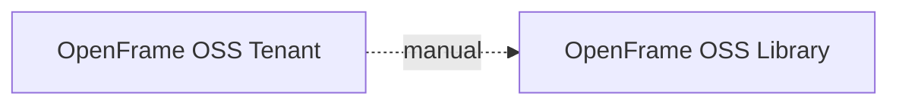

# Contributing to OpenFrame OSS Tenant

Thank you for your interest in contributing to **OpenFrame OSS Tenant** — the multi-service, multi-tenant open-source foundation of the OpenFrame platform, built by [Flamingo](https://flamingo.run). This repository bundles the Spring Boot backend services (`openframe-api`, `openframe-gateway`, `openframe-authorization-server`, `openframe-external-api`, `openframe-client`, `openframe-stream`, `openframe-management`, `openframe-config`, `openframe-test`), the Kubernetes/Argo CD manifests that deploy them, and the Rust `openframe-client` agent under `clients/openframe-client`.

This guide covers setting up a development environment, the branching and pull request workflow, code style, running and writing tests, and where to go for more documentation.

---

## 💬 Community and communication

**This project does not use GitHub Issues or GitHub Discussions** for feature requests, bug reports, or general discussion. All of that happens in the OpenMSP Slack community:

- [https://www.openmsp.ai/](https://www.openmsp.ai/)
- [Join Slack](https://join.slack.com/t/openmsp/shared_invite/zt-36bl7mx0h-3~U2nFH6nqHqoTPXMaHEHA)

GitHub pull requests remain the mechanism for proposing and reviewing code changes. Before opening a larger pull request, consider discussing the change in Slack first.

---

## How this repository fits the ecosystem

OpenFrame OSS Tenant is registered in the organization's code graph as a **service** publishing nine Maven artifacts under `com.openframe` (all `1.0.0-SNAPSHOT`) plus the `openframe_client` Cargo crate (`0.1.0`). It has one recorded upstream dependency — the [OpenFrame OSS Library](https://github.com/flamingo-stack/openframe-oss-lib), pinned manually — and no recorded downstream consumer. Coverage for this graph is `full`, meaning that absence is conclusive: nothing else in the organization currently depends on `com.openframe:*` or `openframe_client`.



A practical consequence: a public API change here is lower-risk to the rest of the organization's graph than a change to `openframe-oss-lib` itself — but the Rust agent build still depends directly on that library (`clients/openframe-client/Cargo.toml` pins `openframe-agent-lib` to tag `v0.0.5` of `https://github.com/flamingo-stack/openframe-oss-lib.git`), and `clients/openframe-client/src/main.rs` is a thin wrapper that calls into it. If you are touching the CLI surface exposed by the separately maintained [openframe-cli](https://github.com/flamingo-stack/openframe-cli) tool, consult that repository's own [installation](https://github.com/flamingo-stack/openframe-cli#installation) and [documentation](https://github.com/flamingo-stack/openframe-cli/tree/main/docs) — it is not part of this codebase.

---

## 🛠️ Setting up a development environment

Do not try to piece a setup together from scratch here — follow the dedicated guides:

1. [Prerequisites](./docs/getting-started/prerequisites.md) — tools you need before you start.
2. [Quick Start](./docs/getting-started/quick-start.md) and [First Steps](./docs/getting-started/first-steps.md) — get something running quickly.
3. [Environment Setup](./docs/development/setup/environment.md) — JDK/Rust toolchain, IDE configuration, environment variables.
4. [Local Development](./docs/development/setup/local-development.md) — cloning, building, running services and the Rust agent locally, hot reload, and debugging.
5. [Architecture Overview](./docs/development/architecture/README.md) — how the services, data stores, and the Rust agent fit together before you start changing code.

In short: the backend is a Maven multi-module project rooted at `pom.xml` (Spring Boot `4.1.1`, Java `25`, Spring Cloud `2025.1.3`), and the Rust agent lives at `clients/openframe-client/` with its build requiring the `OPENFRAME_VERSION` environment variable. See [Environment Setup](./docs/development/setup/environment.md) for the full toolchain list and [Local Development](./docs/development/setup/local-development.md) for exact build and run commands — do not duplicate them here, as they are kept current with the repository's actual structure.

---

## 🔀 Development workflow

### Branches

Branch naming is not rigidly enforced by a single documented scheme in this repository's CI, but a few constraints are worth keeping in mind:

- **Default branch is `main`.** The release workflow (`.github/workflows/release.yml`) triggers on pushes to `main` that touch `manifests/**`, `openframe/**`, `integrated-tools/**`, `pom.xml`, or `clients/**`, building and publishing images and the Helm chart. Avoid pushing directly to `main`; land changes through a pull request.
- **Stale branches are pruned automatically.** `.github/workflows/cleanup.yml` runs a daily job that deletes any unprotected branch with no commit in the last 60 days. Keep your branch active (rebase or push) if you intend to keep it beyond that window.
- **Scope your branch to one logical change.** CI's path-filtered `changes` job decides what to rebuild and release per component (`openframe-api`, `openframe-authorization-server`, `openframe-external-api`, `openframe-client`, `openframe-config`, `openframe-gateway`, `openframe-management`, `openframe-stream`, the Rust `client` crate, `openframe-test`, `helm`). A branch mixing unrelated service changes makes the diff harder to review and can trigger a wider rebuild/release surface than intended.

### Commits

No single commit-message template is enforced by tooling in this repository's workflows; write commits that are clear and scoped to one logical change. When a change is a deliberate override or exception (as the version pins and CVE overrides in `pom.xml` are), explain *why*, not just *what* — following the style of the inline comments already in `pom.xml` and the workflow files. A good commit message:

- States the component touched (service name, `manifests/<chart>`, `clients/openframe-client`, etc.) and the effect of the change.
- Calls out version bumps explicitly, e.g. referencing the property changed (`${openframe.libs.version}`, `${spring-boot.version}`), so a reviewer can cross-check the changelog of that dependency.
- For security-motivated dependency overrides, states the CVE class being avoided (as the `jackson-bom.version` / `bcprov-lts8on.version` overrides do in comments), so a future contributor does not silently "clean up" a deliberate pin.

### Opening a pull request

1. Branch from `main`, make your change, and ensure it builds locally — see [Local Development](./docs/development/setup/local-development.md) for the exact Maven/Cargo commands.
2. Open the pull request against `main` at [github.com/flamingo-stack/openframe-oss-tenant/pulls](https://github.com/flamingo-stack/openframe-oss-tenant/pulls).
3. `.github/CODEOWNERS` routes the review request automatically based on the paths you changed (see the table below).
4. **Automated code review.** This repository runs the "🦩 Flamingo Code Review" workflow (`.github/workflows/flamingo-code-review.yml`). A review does **not** run automatically the moment a PR is opened — opening, reopening, or marking ready-for-review posts an invitation comment with a checkbox; checking it (or commenting `@flamingo-review`, or adding the `flamingo-review` label) starts the first pass. Commenting `@flamingo-review full` re-reads the whole cumulative diff instead of only the incremental delta since the last reviewed commit. Repeated pushes to an open PR do **not** re-trigger a review by themselves unless the PR carries the `flamingo-review-always` label (continuous review), or you explicitly ask again.
5. Address findings, keep pushing to the same branch, and ask for re-review via the same comment/checkbox/label mechanism once ready.
6. Once approvals from the relevant CODEOWNERS are in and checks are green, the PR can be merged. Merging into `main` for a path covered by the release workflow triggers an image/chart build and publish.

The "🦩 Flamingo Code Documentation" workflow (`.github/workflows/code-documentation.yml`) also runs a `code-graph` job on every push to the default branch, rebuilding the deterministic code graph the review tooling and documentation pipeline rely on. It explicitly ignores `docs/**` and `**.md` changes, so documentation-only PRs do not trigger a graph rebuild.

### Reviews — ownership (CODEOWNERS)

`.github/CODEOWNERS` assigns review ownership by path (last match wins, broader patterns listed above more specific ones):

| Path | Owning team |
|---|---|
| `/openframe/` | `@flamingo-stack/backend-engineers` |
| `/clients/openframe-client/` | `@flamingo-stack/client-engineers` |
| `/configs/` | `@flamingo-stack/backend-engineers` |
| `/configs/base/` | `@flamingo-stack/tech-leads` and `@flamingo-stack/tech-heads-of` (Spring Cloud Config base profile — requires both) |
| `/manifests/` | `@flamingo-stack/devops-engineers` |
| `/.github/CODEOWNERS` | `@flamingo-stack/devops-engineers` |

A pull request touching `configs/base/` requires sign-off from both a tech lead and a head-of, reflecting that this file drives shared Spring configuration (MongoDB, Redis Cluster, Cassandra, Pinot connection endpoints) consumed by every backend service.

### Review checklist

Before requesting (or performing) review, confirm:

- **Scope.** The branch touches one logical area and does not mix unrelated changes across service boundaries without reason.
- **Build passes.** The Java and Rust builds succeed for touched modules (see [Local Development](./docs/development/setup/local-development.md) for exact commands).
- **No new compiler warnings in Rust.** CI enforces `RUSTFLAGS=-D warnings` and `clippy --deny clippy::all`; a warning introduced locally will fail CI.
- **Fallible Rust calls have context.** Any new `?`-propagated error in `clients/openframe-client` has a `.context("Failed to ...")` attached, per the rules enforced on Rust files in this repository.
- **Shared JSON state writes are atomic.** Any new Rust code writing a state file another process may read uses a tmp-then-rename pattern, not a bare `fs::write`.
- **Regex values are compiled once**, via a `static` initializer (`once_cell::sync::Lazy` or `lazy_static!`), never constructed inline inside a function body.
- **Dependency pins respected.** A version bump to a `com.openframe.oss:*` library goes through `${openframe.libs.version}` in the root `pom.xml`, not a per-module override; a security-motivated override in `pom.xml` is not removed without checking the comment explaining why it exists.
- **CODEOWNERS respected**, per the table above.
- **Docker build steps use retry.** Any new `docker buildx build` step in a workflow is wrapped in `nick-fields/retry@v4` (`max_attempts: 3`, `retry_wait_seconds: 5`, `timeout_minutes: 30`), matching the pattern in `.github/workflows/release.yml`.
- **No invented GitHub Issues/Discussions references.** Feature requests and support questions are redirected to the OpenMSP Slack community.
- **External CLI changes stay external.** Anything concerning the `openframe-cli` tool is referenced against its own repository ([flamingo-stack/openframe-cli](https://github.com/flamingo-stack/openframe-cli)), never assumed to live in a local subdirectory of this repository.
- **Documentation kept consistent.** If the change affects architecture, update references consistently with [Architecture](./docs/development/architecture/README.md) rather than leaving them to drift.

---

## 📐 Code style and conventions

### Java / Spring Boot services

All Java services share the parent `pom.xml` (`com.openframe:openframe-parent`), built on `spring-boot-starter-parent` 4.1.1 and targeting Java 25. Each service module (`openframe/services/openframe-api`, `openframe-authorization-server`, `openframe-client`, `openframe-config`, `openframe-external-api`, `openframe-gateway`, `openframe-management`, `openframe-stream`, `openframe-test`) has its own `pom.xml` that inherits from the root and declares only the dependencies it adds on top of the shared BOM.

Conventions to follow:

- **Lombok** is used throughout. Since JDK 23+ no longer auto-discovers annotation processors, any new module's `maven-compiler-plugin` configuration must keep Lombok and `spring-boot-configuration-processor` listed explicitly in `annotationProcessorPaths`, mirroring the root `pom.xml`'s `pluginManagement` block — do not drop this when adding a module.
- **Shared, org-wide libraries** (`openframe-core`, `openframe-data-mongo-common`, `openframe-data-redis`, `openframe-security-core`, `openframe-api-lib`, `fleetmdm`, and similar `com.openframe.oss:*` artifacts) are centrally versioned by the single `${openframe.libs.version}` property in the root `pom.xml`. Bump that one property rather than pinning an individual module to a different library version.
- **Entry points.** Each Spring Boot application's entry point is a single `*Application.java` class under `src/main/java/com/openframe/<service>/` (e.g. `ApiApplication`, `GatewayApplication`). Keep this pattern for any new service: one `@SpringBootApplication` class per module, named `<Service>Application`.
- **Security-sensitive dependency versions** in the root `pom.xml` (`jackson-bom.version`, `jackson-2-bom.version`, `tomcat.version`, `bcprov-lts8on.version`, `libthrift.version`, etc.) are pinned deliberately above what the Spring Boot BOM would otherwise resolve, to close HIGH/CRITICAL CVEs reported by Trivy. Do not "simplify" these overrides back to the BOM default without checking the comment that explains why each one exists.
- **Test dependencies** (`spring-boot-starter-test`, `spring-security-test`, `mockito-core`, `mockito-junit-jupiter`) are declared once in the root POM and inherited by every module; do not redeclare them per-module.
- Prefer constructor injection over field injection, and follow the Spring naming conventions already used across the codebase (`*Service`, `*Repository`, `*Controller`).

### Rust client (`clients/openframe-client`)

`clients/openframe-client` is a thin binary crate (`openframe-client`, `0.1.0`) whose logic lives in the `openframe-agent-lib` crate pulled from `openframe-oss-lib`. `src/main.rs` should stay a thin entry point that delegates to that library; substantial agent logic belongs upstream in `openframe-oss-lib`, not inline in this repository.

Rules enforced on Rust files in this repository (apply to any file under `clients/`):

- Every fallible call that returns `anyhow::Result` must attach a `.context("Failed to <verb> <component>")` description before propagating with `?` — a bare `?` is not acceptable on initialization paths.
- `Regex` values must be compiled exactly once via a `static` initializer (`once_cell::sync::Lazy` or `lazy_static!`), never constructed inline inside a function body.
- Writes to JSON state files that may be concurrently read by another process must use an atomic tmp-then-rename pattern — a bare `fs::write` to the final path risks a reader observing a torn/partial file.
- CI enforces `RUSTFLAGS=-D warnings` and `clippy --deny clippy::all` across `--benches --tests --examples --all-features`; a new warning fails the build. Don't suppress a warning with `#[allow(...)]` without a comment explaining why.

```bash
# Format
cargo fmt

# Lint (warnings are errors)
OPENFRAME_VERSION=0.0.0-dev cargo clippy -- -D warnings
```

### Kubernetes manifests and CI workflows

- Docker image build steps in GitHub Actions workflows must wrap `docker buildx build` in `nick-fields/retry@v4` with `max_attempts: 3`, `retry_wait_seconds: 5`, `timeout_minutes: 30`, passing the build invocation via `command:` rather than `run:` — see the `build_images` job in `.github/workflows/release.yml` for the reference pattern.
- Chart and manifest changes under `manifests/` follow the existing Argo CD app-of-apps structure (`manifests/apps`, `manifests/platform/*`, `manifests/datasources/*`, `manifests/tenant`); keep new datasources or platform components consistent with the `argocd_app` / `chart_dependency` / `chart_image` entries already present in the corresponding `Chart.yaml` and `values.yaml`.

### Editor and formatting defaults

`.vscode/settings.json` fixes the baseline every contributor's editor should match: `files.eol` is `\n`, `editor.tabSize` is 2 with `editor.insertSpaces` true, and Rust files additionally use `editor.formatOnSave` with `rust-lang.rust-analyzer` as the default formatter and a 4-space tab size override for `[rust]`. Match these settings (or configure your editor equivalently) before formatting a diff, to avoid unrelated whitespace noise in a PR.

---

## ✅ Running and writing tests

Detailed test organization, how to run each suite, and conventions for writing new tests (Java fixtures, Helm chart assertions, the `openframe-test` end-to-end module, and Rust) are covered in full in [Testing](./docs/development/testing/README.md) — read it before adding or changing tests. In short:

- **Backend (Java/Maven):** test dependencies (`spring-boot-starter-test`, `spring-security-test`, `mockito-core`, `mockito-junit-jupiter`) are declared once at the parent POM level. Build and test from the repository root, or scope to one module with Maven's `-pl` reactor selector — see [Testing](./docs/development/testing/README.md) for the exact invocations.
- **Backend test conventions:** follow the pattern established in `openframe-api`'s test tree — a `final` utility class of constants (`TestConstants`), a shared `TestUtils` helper class, a `@TestConfiguration` that mocks every infrastructure bean (`MongoTemplate`, `RedisTemplate`, `KafkaTemplate`, `CassandraTemplate`, the Pinot `Connection`, repositories) with `Mockito.mock(...)` — except `PasswordEncoder`, which should be a real `BCryptPasswordEncoder` since hashing correctness is worth testing directly — and small, explicit test doubles for failure paths (e.g. `TestAuthenticationManager`, which always throws `BadCredentialsException`).
- **Mock beans need `@Primary`.** This is an enforced, active code-review rule: a mock bean missing `@Primary` causes ambiguous bean resolution in the Spring test context and will be flagged in review.
- **`openframe-test`** is not a shared JUnit helper library — it is a standalone test-runner application (`TestApplication.java`) run as its own process, driving `registration` → `oss` → `reset` tagged test phases and reporting results to Slack.
- **Rust agent:** since nearly all of the crate's behavior is re-exported from the external `openframe-agent-lib` crate, meaningful unit test coverage for agent behavior belongs in the [OpenFrame OSS Library](https://github.com/flamingo-stack/openframe-oss-lib) repository, not here. This repository's own Rust surface (`clients/openframe-client/src/main.rs`) is a thin wrapper not expected to carry its own test suite beyond Cargo's doctest/compile checks.
- **Helm chart tests:** `manifests/app-of-apps/tests/` holds `helm-unittest`-style YAML suites validating the Argo CD app-of-apps chart's rendered manifests. New assertions follow the existing `suite:`/`templates:`/`tests:` structure, one concern per file.
- **Tenant/organization scoping:** an active rule (`OPENFRAM-005-11`, `error`) requires any filter object passed into a method that *mutates* records (archive, delete, status update) to have `organizationIds` set before the call — follow the established `inOrganization` helper idiom when writing such tests.
- **Class size:** the active rule `OFJAVA-006` (`warn`) measures class size by responsibility, not line count — if a class is painful to unit test with mocks, that's a signal to split it.

No repository-wide coverage threshold or coverage-reporting plugin (e.g. JaCoCo, Clover) is configured for this repository; treat the practices above as the practical minimum bar for new code.

---

## 🔒 Reporting security issues

Security vulnerabilities must **not** be reported through a public GitHub issue, pull request, or the OpenMSP Slack community. See [SECURITY.md](./SECURITY.md) for the full disclosure process, scope, and supported versions. In short: email **security@flamingo.run**.

Two code-review rules tagged `severity: error` are actively enforced against this repository's security-sensitive code:

- **`OPENFRAM-002-12`** — custom `AuthenticationProvider` beans must not be registered via `@Bean` (this silently bypasses the platform's default authentication provider).
- **`OPENFRAM-002-6`** — tenant-scoped MongoDB `@Document` classes must implement the `TenantScoped` marker interface.

Before opening a pull request that touches a `*Config.java`, `*SecurityConfig.java`, `*AuthenticationProvider.java`, or any file under a `document/` package, check your change against these two rules first. For the full authentication/authorization model, encryption configuration, and environment-variable secrets handling, see [Security](./docs/development/security/README.md).

---

## 📚 Where to find more documentation

- [Documentation home](./docs/README.md)
- [Development hub](./docs/development/README.md)
- [Architecture Overview](./docs/development/architecture/README.md)
- [Environment Setup](./docs/development/setup/environment.md)
- [Local Development](./docs/development/setup/local-development.md)
- [Testing](./docs/development/testing/README.md)
- [Security](./docs/development/security/README.md)
- [Getting Started: Introduction](./docs/getting-started/introduction.md)
- [Getting Started: Prerequisites](./docs/getting-started/prerequisites.md)
- [Getting Started: Quick Start](./docs/getting-started/quick-start.md)
- [Getting Started: First Steps](./docs/getting-started/first-steps.md)

---

<div align="center">
  Questions? Join the <a href="https://www.openmsp.ai/"><b>OpenMSP Slack community</b></a> — we're happy to help.
</div>
