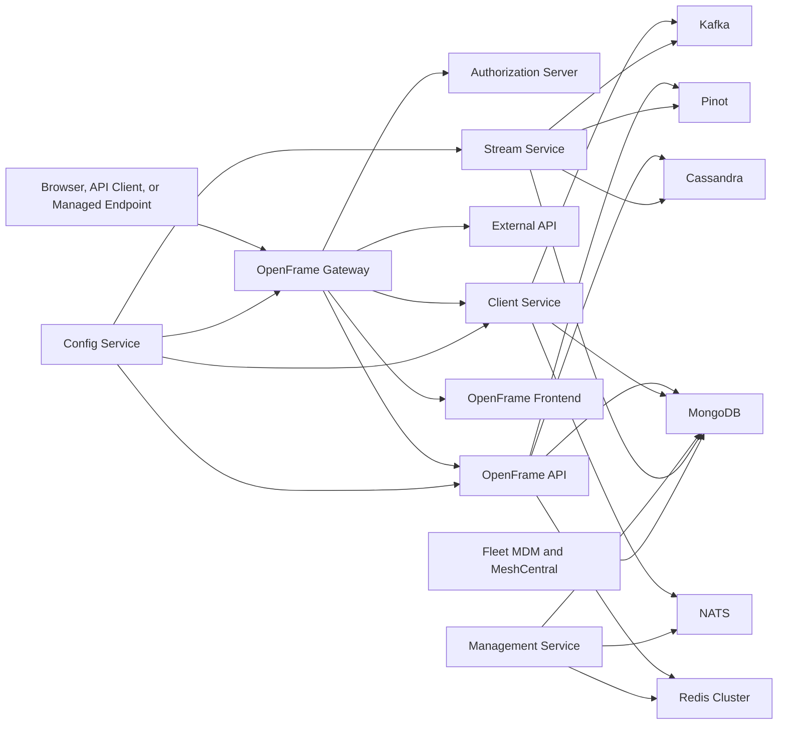

<div align="center">
  <picture>
    <source media="(prefers-color-scheme: dark)" srcset="https://shdrojejslhgnojzkzak.supabase.co/storage/v1/object/public/public/doc-orchestrator/logos/1771371901777-lc3cse-logo-openframe-full-dark-bg.png">
    <source media="(prefers-color-scheme: light)" srcset="https://shdrojejslhgnojzkzak.supabase.co/storage/v1/object/public/public/doc-orchestrator/logos/1771372526604-k3y1w-logo-openframe-full-light-bg.png">
    
  </picture>
</div>

<p align="center">
  <a href="LICENSE.md"></a>
</p>

# OpenFrame OSS Tenant

**OpenFrame OSS Tenant** is the deployable, self-hosted tenant distribution for [OpenFrame](https://openframe.ai) ([openframe.ai](https://www.flamingo.run/openframe)), the unified, AI-driven MSP platform built by [Flamingo](https://flamingo.run). It assembles nine Spring Boot services (Java), a Rust endpoint agent, shared configuration, and Kubernetes/Helm manifests into one running platform that integrates multiple IT management tools behind a single gateway and a single operational surface.

This repository owns the **tenant-specific composition**: thin service entry points, runtime configuration, Helm charts, Argo CD application definitions, and the release pipeline that publishes container images and Maven artifacts. Most of the domain logic — authentication, GraphQL and REST APIs, RMM orchestration, stream processing, and more — is consumed from the [OpenFrame OSS Library](https://github.com/flamingo-stack/openframe-oss-lib), pinned at version `7.0.11` for Java modules and `v0.0.5` / `0.1.0` for the Rust client agent. According to the organization's dependency graph (coverage: full), no other repository currently consumes the artifacts published here — this is a leaf service, not a library.

[](https://www.youtube.com/watch?v=-_56_qYvMWk)

## Features

- **Unified gateway entry point.** `openframe-gateway` is the single edge router for browser, API, and managed-endpoint traffic, enforcing JWT and API-key boundaries before forwarding to backend services.
- **OAuth 2.0 / OpenID Connect authorization server.** `openframe-authorization-server` provides tenant-aware login, SSO (Google, Microsoft, Apple), invitation acceptance, password reset, and signed JWT issuance.
- **Managed-endpoint platform.** `openframe-client` (server-side) coordinates registration, telemetry, delivery, and RMM commands with the Rust `openframe-client` agent running on each managed device.
- **GraphQL and REST APIs.** `openframe-api` exposes the main operational API (devices, tickets, RMM, software, knowledge base); `openframe-external-api` exposes an API-key-protected integration surface for third parties.
- **Event-driven data pipeline.** `openframe-stream` consumes Kafka events for enrichment, log routing, execution history, and software projections, backed by Cassandra, Pinot, and MongoDB.
- **Centralized configuration.** `openframe-config` is a Spring Cloud Config Server distributing shared settings to every service.
- **Platform reconciliation.** `openframe-management` handles startup reconciliation, NATS stream provisioning, Fleet MDM setup, and package catalog synchronization.
- **Kubernetes-native delivery.** An Argo CD app-of-apps structure under `manifests/` deploys platform services, datasources (MongoDB, Redis Cluster, Cassandra, Kafka, NATS, Pinot, ZooKeeper, MySQL), and tenant workloads (Fleet MDM, MeshCentral, OpenFrame services, frontend) in ordered sync waves.
- **Open-source foundation.** Built on Spring Boot, Spring Cloud, and a Rust agent, with integrated upstream MSP tools such as Fleet (osquery-based device management) and MeshCentral (remote access).

## Architecture



The gateway (`configs/base/openframe-gateway.yml`) is the single entry point: `/sas/**` routes to the authorization server, `/api/**` to the main API, `/api-docs/**` to the External API's documentation surface, `/clients/**` to the client service, and all remaining browser traffic to the OpenFrame frontend.

This repository pins nine Maven artifacts (all `1.0.0-SNAPSHOT`) — `com.openframe:openframe-api`, `openframe-authorization-server`, `openframe-client`, `openframe-config`, `openframe-external-api`, `openframe-gateway`, `openframe-management`, `openframe-stream`, and `openframe-test` — plus the `openframe_client` cargo crate (`0.1.0`), and publishes corresponding container images under `ghcr.io/flamingo-stack/openframe-oss-tenant`. Every one of these is a thin composition layer over the [OpenFrame OSS Library](https://github.com/flamingo-stack/openframe-oss-lib), pinned at `7.0.11` (Java) / `v0.0.5` (Rust agent library).

## Technology Stack

| Layer | Technology |
|---|---|
| Backend services | Java 25, Spring Boot 4.1.1, Spring Cloud 2025.1.3 |
| Endpoint agent | Rust (Cargo edition 2021), `openframe-agent-lib` from OpenFrame OSS Library |
| Messaging | NATS, Apache Kafka |
| Data stores | MongoDB, Redis Cluster, Cassandra, Apache Pinot, MySQL (Fleet MDM) |
| Coordination | ZooKeeper, Debezium Connect |
| Deployment | Kubernetes, Helm, Argo CD (app-of-apps) |
| Integrated tools | Fleet MDM (osquery-based device management), MeshCentral (remote access) |

## Quick Start

> OpenFrame OSS Tenant is a Kubernetes-deployed platform — nine Spring Boot services plus a Rust endpoint agent, assembled from the pinned OpenFrame OSS Library and deployed through Helm charts and Argo CD. There is no `docker-compose up` or local npm/yarn entry point in this repository; the fastest path to a running system is the external [OpenFrame CLI](https://github.com/flamingo-stack/openframe-cli).

1. **Install the OpenFrame CLI.** Follow the installation instructions in its own repository: [flamingo-stack/openframe-cli#installation](https://github.com/flamingo-stack/openframe-cli#installation).
2. **Bootstrap a tenant environment with the CLI.** The CLI provisions a Kubernetes cluster and deploys the platform's Argo CD application-of-apps (the same `manifests/app-of-apps` chart this repository's release workflow publishes to `oci://ghcr.io/flamingo-stack/openframe-oss-tenant/app-of-apps`). Follow the CLI's documented bootstrap steps: [flamingo-stack/openframe-cli/tree/main/docs](https://github.com/flamingo-stack/openframe-cli/tree/main/docs).
3. **Wait for the Argo CD sync waves to settle.** Argo CD applies `manifests/apps/values.yaml` in order: the `platform` wave (namespace, ingress-nginx, `openframe-config`, dev-tools), then the `datasources` wave (Cassandra, Kafka, MongoDB, MongoDB for MeshCentral, MySQL for Fleet MDM, NATS, Pinot, Redis Cluster, ZooKeeper), and finally the tenant application (`manifests/tenant`), which deploys the OpenFrame services, Fleet MDM, MeshCentral, and the frontend.
4. **Confirm the gateway is reachable.** Once the gateway responds on its routed paths (see the table above), your tenant is up.
5. **Explore with the CLI or `kubectl`.** Use the OpenFrame CLI's cluster-inspection commands, or `kubectl get pods -A`, to confirm the platform and tenant namespaces are healthy.

A minimal unauthenticated health check, once you know your gateway host, uses the shared actuator path defined in `configs/base/application.yml`:

```bash
# Replace <gateway-host> with the address your CLI bootstrap reported
curl -s https://<gateway-host>/api/management/v1/health
```

A healthy instance returns:

```json
{
  "status": "UP"
}
```

For the full five-minute walkthrough, including a richer "register a device" example against the Client Service, see [Quick Start](./docs/getting-started/quick-start.md). Before bootstrapping, review [Prerequisites](./docs/getting-started/prerequisites.md) for required tooling (JDK 25, Rust toolchain, Docker with BuildKit, Kubernetes, Helm, Argo CD access) and [First Steps](./docs/getting-started/first-steps.md) for what to check right after your first deployment comes up.

## Documentation

📚 See the [Documentation](./docs/README.md) for comprehensive guides, or jump directly to:

- [Introduction](./docs/getting-started/introduction.md) — what this repository is and how it fits into Flamingo/OpenFrame.
- [Prerequisites](./docs/getting-started/prerequisites.md) — required tooling, versions, and access.
- [Quick Start](./docs/getting-started/quick-start.md) — bootstrap a tenant with the OpenFrame CLI.
- [First Steps](./docs/getting-started/first-steps.md) — post-install checks and initial configuration.
- [Architecture Reference](./docs/reference/architecture/README.md) — full repository structure and module-by-module breakdown.
- [Ecosystem Reference](./docs/reference/architecture/ecosystem.md) — published artifacts, upstream dependencies, and the full delivery chain.
- [Development Overview](./docs/development/README.md), [Environment Setup](./docs/development/setup/environment.md), [Local Development](./docs/development/setup/local-development.md)
- [Development Architecture Notes](./docs/development/architecture/README.md)
- [Testing](./docs/development/testing/README.md) and [Security](./docs/development/security/README.md)
- [Contributing Guidelines](./docs/development/contributing/guidelines.md)

For the OpenFrame command-line tooling, see the separate [OpenFrame CLI repository](https://github.com/flamingo-stack/openframe-cli) and its [installation guide](https://github.com/flamingo-stack/openframe-cli#installation) — it is maintained outside this repository.

This project does not use GitHub Issues or Discussions. Questions and discussion happen on the [OpenMSP Slack community](https://www.openmsp.ai/) ([direct invite](https://join.slack.com/t/openmsp/shared_invite/zt-36bl7mx0h-3~U2nFH6nqHqoTPXMaHEHA)). Code changes go through pull requests at the [repository's pull request page](https://github.com/flamingo-stack/openframe-oss-tenant/pulls).

---
<div align="center">
  Built with 💛 by the <a href="https://www.flamingo.run/about"><b>Flamingo</b></a> team
</div>
