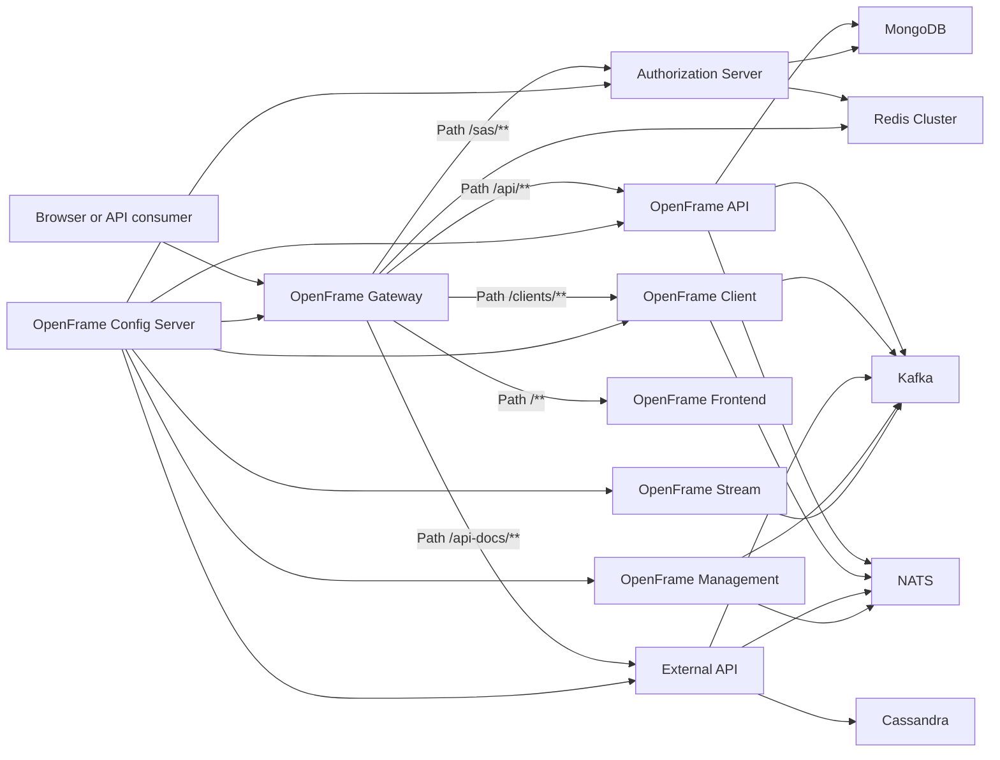

<div align="center">
  <picture>
    <source media="(prefers-color-scheme: dark)" srcset="https://shdrojejslhgnojzkzak.supabase.co/storage/v1/object/public/public/doc-orchestrator/logos/1771371901777-lc3cse-logo-openframe-full-dark-bg.png">
    <source media="(prefers-color-scheme: light)" srcset="https://shdrojejslhgnojzkzak.supabase.co/storage/v1/object/public/public/doc-orchestrator/logos/1771372526604-k3y1w-logo-openframe-full-light-bg.png">
    
  </picture>
</div>

<p align="center">
  <a href="LICENSE.md"></a>
</p>

# OpenFrame OSS Tenant

**OpenFrame OSS Tenant** is the tenant-facing service and deployment repository for [OpenFrame](https://openframe.ai), the unified, AI-driven platform from [Flamingo](https://flamingo.run) that brings together multiple MSP (Managed Service Provider) tools under a single interface. Flamingo replaces expensive proprietary MSP software with open-source alternatives enhanced by intelligent automation — Mingo AI for technicians and Fae for clients — and OpenFrame is the platform that ties those integrations together.

This repository assembles independently deployable Spring Boot services, centralized configuration, Kafka/NATS-based event processing, and Kubernetes/Helm manifests into one operable tenant environment. The API, authorization, data access, security, gateway, and messaging logic is supplied by the pinned [OpenFrame OSS Library](https://github.com/flamingo-stack/openframe-oss-lib) (`com.openframe.oss:*`, version `7.0.11`, plus `openframe_agent_lib` at `v0.0.5`); this repository's own Java modules are deliberately thin Spring Boot entry points that compose those library capabilities into running services. No other managed repository currently depends on artifacts published from this repository.

[](https://www.youtube.com/watch?v=-_56_qYvMWk)

## Features

- **Unified MSP tenant runtime** — one repository defines the full backend for a tenant: API, authorization, client ingestion, external/API-key access, configuration, management, streaming, and gateway routing.
- **Service-oriented architecture** — eight Spring Boot services (`openframe-api`, `openframe-authorization-server`, `openframe-client`, `openframe-config`, `openframe-external-api`, `openframe-gateway`, `openframe-management`, `openframe-stream`), each a narrow bootstrap class over a focused component-scan boundary, plus a test-support module (`openframe-test`).
- **Centralized configuration** — shared and per-service settings live under `configs/base` (for example `configs/base/application.yml` and `configs/base/openframe-gateway.yml`), served by the `openframe-config` service so every tenant service boots from one configuration source.
- **Single-entry gateway routing** — `openframe-gateway` is the reactive edge service, routing `/sas/**` to the authorization server, `/api/**` to the API service, `/clients/**` to the client service, `/api-docs/**` to the external API, and the catch-all `/**` to the frontend.
- **Event-driven integration** — Kafka and NATS back asynchronous workloads across the API, client, external API, management, and stream services, with Kafka also feeding the stream service's log-event consumption pipeline.
- **GitOps-ready deployment** — Helm charts and an Argo CD app-of-apps structure under `manifests/` deploy platform components, datasources (MongoDB, Redis Cluster, Cassandra, Kafka, NATS, Pinot, MySQL, Zookeeper, Debezium Connect), and the tenant application itself.
- **A native Rust client** — the `openframe_client` cargo crate (in `clients/openframe-client`) is a thin binary wrapping the shared `openframe-agent-lib` library from the OpenFrame OSS Library.
- **Automated image and chart publishing** — the release workflow (`.github/workflows/release.yml`) builds and publishes container images for each service and an app-of-apps Helm chart to `ghcr.io/flamingo-stack/openframe-oss-tenant`.

## Technology Stack

- **Languages:** Java 25 (Spring Boot `4.1.1`, Spring Cloud `2025.1.3`), Rust (edition 2021), Bash
- **Backend framework:** Spring Boot / Spring Cloud Gateway (reactive and servlet services)
- **Messaging:** Kafka, NATS (including JetStream)
- **Data stores:** MongoDB, Redis Cluster, Cassandra, Apache Pinot, MySQL (Fleet MDM)
- **Deployment:** Docker (two-stage Eclipse Temurin Java 25 builds), Kubernetes, Helm, Argo CD (app-of-apps pattern)
- **Upstream dependency:** [OpenFrame OSS Library](https://github.com/flamingo-stack/openframe-oss-lib) (`com.openframe.oss:*` at `7.0.11`, `openframe_agent_lib` at `v0.0.5`)

## Architecture

The gateway is the single entry point for tenant traffic. It routes requests to the authorization server, API, client, and external API services, while every service pulls shared and service-specific configuration from the config server and uses Kafka/NATS plus its backing datastores.



This repository publishes nine Maven artifacts (`com.openframe:openframe-api`, `openframe-authorization-server`, `openframe-client`, `openframe-config`, `openframe-external-api`, `openframe-gateway`, `openframe-management`, `openframe-stream`, `openframe-test`) and one Rust crate (`openframe_client`), and pins every shared capability from the [OpenFrame OSS Library](https://github.com/flamingo-stack/openframe-oss-lib) at version `7.0.11` / `v0.0.5`. No other repository in the organization currently consumes artifacts published from this one.

## Quick Start

> Full tool versions (Java, Maven, Docker, kubectl/Helm) are in [Prerequisites](./docs/getting-started/prerequisites.md).

### 1. Clone the repository

```bash
git clone https://github.com/flamingo-stack/openframe-oss-tenant.git
cd openframe-oss-tenant
```

### 2. Build the Maven modules

The root `pom.xml` is a multi-module Maven project (`com.openframe:openframe-parent`) targeting Java 25 and Spring Boot `4.1.1`, with nine service modules under `openframe/services`:

```bash
mvn clean package -DskipTests
```

This resolves the pinned OpenFrame OSS Library artifacts (version `7.0.11`) and builds every service module. Building against the private OpenFrame OSS Library artifacts requires authenticated Maven access — service Dockerfiles (for example `openframe/services/openframe-api/Dockerfile`) inject a `GITHUB_TOKEN` via `.mvn/settings.xml` during the image build.

### 3. Run one service locally

```bash
mvn -pl openframe/services/openframe-api -am spring-boot:run
```

Each service's `application.yml` points at a configuration server address by default. Outside Kubernetes, override `SPRING_CONFIG_URL` or run `openframe-config` first:

```bash
mvn -pl openframe/services/openframe-config -am spring-boot:run
```

### 4. Or build a container image

```bash
docker build -f openframe/services/openframe-api/Dockerfile -t openframe-api:local .
```

Every service uses the same two-stage pattern (Eclipse Temurin Java 25 JDK builder, Eclipse Temurin Java 25 JRE runtime, non-root `appuser`).

### 5. Deploy the full tenant stack (Kubernetes)

Services are deployed together through the Argo CD app-of-apps structure under `manifests/`:

- `manifests/apps` — app-of-apps root, deploying `platform` then `datasources` then the `tenant` application.
- `manifests/platform/openframe-config` — the config server platform chart.
- `manifests/datasources/*` — MongoDB, Redis Cluster, Cassandra, Kafka, NATS, Pinot, MySQL (Fleet MDM), Zookeeper, Debezium Connect.
- `manifests/tenant` — the tenant chart wiring together all backend services, FleetMDM, MeshCentral, and the OpenFrame frontend image.

The release workflow (`.github/workflows/release.yml`) publishes container images to `ghcr.io/flamingo-stack/openframe-oss-tenant/<service>` and packages the app-of-apps chart as `oci://ghcr.io/flamingo-stack/openframe-oss-tenant/app-of-apps`.

### 6. Build the Rust client agent (optional)

```bash
cd clients/openframe-client
OPENFRAME_VERSION=0.0.0-dev make build
```

`OPENFRAME_VERSION` is required — the underlying `openframe-agent-lib` build script panics without it. The actual agent implementation is delivered as a separate dependency; for the CLI used to manage OpenFrame deployments, see the external [openframe-cli](https://github.com/flamingo-stack/openframe-cli) repository ([installation](https://github.com/flamingo-stack/openframe-cli#installation), [documentation](https://github.com/flamingo-stack/openframe-cli/tree/main/docs)) — it is not part of this repository.

Full walkthroughs, including the "Hello World" API-service startup, live in [Quick Start](./docs/getting-started/quick-start.md).

## Community and Support

This project does not use GitHub Issues or GitHub Discussions. Questions, feedback, and coordination happen in the [OpenMSP Slack community](https://www.openmsp.ai/) — [join here](https://join.slack.com/t/openmsp/shared_invite/zt-36bl7mx0h-3~U2nFH6nqHqoTPXMaHEHA).

## Documentation

📚 See the [Documentation](./docs/README.md) for comprehensive guides.

---
<div align="center">
  Built with 💛 by the <a href="https://www.flamingo.run/about"><b>Flamingo</b></a> team
</div>
