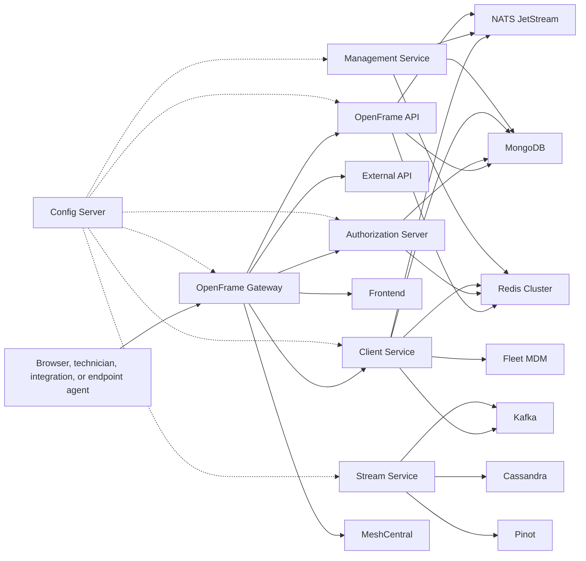

<div align="center">
  <picture>
    <source media="(prefers-color-scheme: dark)" srcset="https://shdrojejslhgnojzkzak.supabase.co/storage/v1/object/public/public/doc-orchestrator/logos/1771371901777-lc3cse-logo-openframe-full-dark-bg.png">
    <source media="(prefers-color-scheme: light)" srcset="https://shdrojejslhgnojzkzak.supabase.co/storage/v1/object/public/public/doc-orchestrator/logos/1771372526604-k3y1w-logo-openframe-full-light-bg.png">
    
  </picture>
</div>

<p align="center">
  <a href="LICENSE.md"></a>
</p>

# OpenFrame OSS Tenant

**OpenFrame OSS Tenant** is the deployable, tenant-oriented distribution of [OpenFrame](https://openframe.ai) ([www.flamingo.run/openframe](https://www.flamingo.run/openframe)) — the unified, AI-driven MSP operations platform built by [Flamingo](https://flamingo.run). It assembles Spring Boot services, a Rust endpoint agent, shared configuration, Helm charts, and Argo CD application definitions into a single runnable platform.

This repository is the **composition and delivery layer**: it pins and assembles the [OpenFrame OSS Library](https://github.com/flamingo-stack/openframe-oss-lib) (`com.openframe.oss:*` at version `7.0.11`, plus the `openframe_agent_lib` Rust crate at `v0.0.5`) into runnable Spring Boot applications and a Rust endpoint agent, packages them as container images, and deploys them with Helm and Argo CD. No other repository in the organization currently depends on the artifacts this repository publishes — they are terminal, deployable build outputs.

Flamingo replaces expensive proprietary MSP tooling with open-source alternatives enhanced by AI automation — **Mingo AI** for technicians and **Fae** for clients. OpenFrame is the platform that brings multiple MSP tools together behind a single AI-driven interface.

[](https://www.youtube.com/watch?v=-_56_qYvMWk)

## Features

- **Unified gateway surface** — a single [OpenFrame Gateway](./docs/reference/architecture/gateway-core/gateway-core.md) routes browser, technician, integration, and endpoint-agent traffic to the right backend service, enforcing JWT/API-key security, CORS, and client-version policy at the edge.
- **Tenant-aware identity** — an OAuth 2.1 / OpenID Connect [Authorization Server](./docs/reference/architecture/authorization-service-core/authorization-service-core.md) handles login, invitations, SSO, and password recovery per tenant.
- **GraphQL and REST product API** — [OpenFrame API](./docs/reference/architecture/api-service-backend/api-service-backend.md) exposes devices, organizations, tickets, knowledge base, and RMM workflows; the [External API](./docs/reference/architecture/external-api-service-core/external-api-service-core.md) exposes an integration-oriented REST surface with API-key auth.
- **Endpoint agent and device management** — a Rust-based agent (published as the `openframe_client` Cargo artifact) registers devices, ships logs, executes commands and scripts, manages installed tools, and keeps itself and managed tools up to date over NATS JetStream. See [OpenFrame Client Core](./docs/reference/architecture/openframe-client-core/openframe-client-core.md).
- **Event processing pipeline** — the [Stream Service](./docs/reference/architecture/stream-service-core/stream-service-core.md) consumes Kafka and CDC events into Cassandra-backed logs and Pinot analytics projections.
- **Background operations** — the [Management Service](./docs/reference/architecture/management-core/management-core.md) initializes NATS streams, synchronizes package catalogs, and runs scheduled maintenance.
- **Integrated MSP tooling** — the tenant Helm chart deploys Fleet MDM and MeshCentral alongside the OpenFrame services for endpoint management and remote access.
- **GitOps-native deployment** — Argo CD application definitions deploy platform prerequisites (ingress, config) and datasources (MongoDB, Redis Cluster, Kafka, NATS, Cassandra, Pinot, Zookeeper, Debezium Connect) before tenant workloads.

## Architecture overview



The gateway routes the platform's public prefixes: `/sas/**` to the authorization server, `/api/**` to the OpenFrame API, `/api-docs/**` to the external API, `/clients/**` to the client service, and everything else (`/**`) to the frontend workload. These routes are defined in [`configs/base/openframe-gateway.yml`](https://github.com/flamingo-stack/openframe-oss-tenant/blob/main/configs/base/openframe-gateway.yml).

Almost all domain logic — authentication, device management, ticketing, remote management, and data access — is implemented in the pinned [OpenFrame OSS Library](https://github.com/flamingo-stack/openframe-oss-lib) at version `7.0.11` (and the `openframe_agent_lib` Rust crate at `v0.0.5`). This repository owns the runnable applications, Dockerfiles, shared configuration, and Kubernetes/Helm deployment topology.

## Technology stack

| Layer | Technology |
|---|---|
| Backend services | Java 25, Spring Boot 4.1.1, Spring Cloud 2025.1.3 (nine Maven modules under `openframe/services`) |
| Endpoint agent | Rust, published as the `openframe_client` Cargo crate (`clients/openframe-client`) |
| Identity | OAuth 2.1 / OpenID Connect via the Authorization Server |
| Data stores | MongoDB, Redis Cluster, Cassandra, Apache Pinot |
| Messaging | NATS JetStream, Apache Kafka, Debezium Connect (CDC) |
| Integrated tooling | Fleet MDM, MeshCentral |
| Delivery | Docker, Helm, Argo CD (app-of-apps pattern) |

### What this repository publishes

| Ecosystem | Artifact | Version |
|---|---|---|
| maven | `com.openframe:openframe-api` | 1.0.0-SNAPSHOT |
| maven | `com.openframe:openframe-authorization-server` | 1.0.0-SNAPSHOT |
| maven | `com.openframe:openframe-client` | 1.0.0-SNAPSHOT |
| maven | `com.openframe:openframe-config` | 1.0.0-SNAPSHOT |
| maven | `com.openframe:openframe-external-api` | 1.0.0-SNAPSHOT |
| maven | `com.openframe:openframe-gateway` | 1.0.0-SNAPSHOT |
| maven | `com.openframe:openframe-management` | 1.0.0-SNAPSHOT |
| maven | `com.openframe:openframe-stream` | 1.0.0-SNAPSHOT |
| maven | `com.openframe:openframe-test` | 1.0.0-SNAPSHOT |
| cargo | `openframe_client` | 0.1.0 |

Per the repository graph, no other managed repository consumes these artifacts: they are terminal, deployable build outputs rather than shared libraries. The upstream library dependency is pinned in [`pom.xml`](https://github.com/flamingo-stack/openframe-oss-tenant/blob/main/pom.xml) (`openframe.libs.version` = `7.0.11`) and [`clients/openframe-client/Cargo.toml`](https://github.com/flamingo-stack/openframe-oss-tenant/blob/main/clients/openframe-client/Cargo.toml) (`openframe_agent_lib` at `v0.0.5`).

## Quick Start

> This repository is a **service distribution**, not a single binary you install with one command. "Quick start" here means building the Java services with Maven and the Rust agent with Cargo, and understanding how the pieces fit together. Full environment bring-up (Kubernetes, datastores, Helm) is covered in [Local Development](./docs/development/setup/local-development.md) and [Environment Setup](./docs/development/setup/environment.md).

### Prerequisites

At minimum you need Java 25 and Maven (the root [`pom.xml`](https://github.com/flamingo-stack/openframe-oss-tenant/blob/main/pom.xml) targets Spring Boot 4.1.1), the Rust toolchain with `cargo`, and a GitHub token with read access to `flamingo-stack/openframe-oss-lib`, since the Maven and Cargo dependencies are pulled from that source. See the full [Prerequisites](./docs/getting-started/prerequisites.md) page for the complete tooling, system, and access requirements.

### Clone the repository

```bash
git clone https://github.com/flamingo-stack/openframe-oss-tenant.git
cd openframe-oss-tenant
```

### Build the Java services

The root [`pom.xml`](https://github.com/flamingo-stack/openframe-oss-tenant/blob/main/pom.xml) is a multi-module Maven project covering the nine services under `openframe/services`. Build everything with:

```bash
mvn clean package -U --batch-mode --no-transfer-progress
```

To build a single service (mirroring how the release Dockerfiles do it), use `-pl` with `-am`:

```bash
mvn clean package -U \
  -pl openframe/services/openframe-api \
  -am \
  --batch-mode --no-transfer-progress \
  -Dmaven.javadoc.skip=true \
  -Dmaven.test.skip=true
```

### Build the Rust endpoint agent

The endpoint agent lives in [`clients/openframe-client`](https://github.com/flamingo-stack/openframe-oss-tenant/blob/main/clients/openframe-client/Cargo.toml). Its Makefile requires `OPENFRAME_VERSION`:

```bash
cd clients/openframe-client
OPENFRAME_VERSION=0.0.0-dev make build
```

### Run a single service

Each service resolves configuration from the OpenFrame Config Server at startup via an `optional:configserver:` import, so it still starts even if that server is unreachable locally:

```bash
cd openframe/services/openframe-api
mvn spring-boot:run -Dspring-boot.run.arguments="--SPRING_CONFIG_URL=http://localhost:8888"
```

Shared, cross-service configuration (datastore URIs, gateway routes, security token lifetimes) lives in [`configs/base/application.yml`](https://github.com/flamingo-stack/openframe-oss-tenant/blob/main/configs/base/application.yml) and per-service files such as `configs/base/openframe-api.yml` and `configs/base/openframe-gateway.yml`.

### Running the full platform

A single service by itself is not a usable deployment — the platform expects MongoDB, Redis Cluster, Kafka, Cassandra, Pinot, NATS, and (for Fleet MDM) MySQL, plus a reachable Config Server. This repository ships the Helm charts and Argo CD application definitions for all of this under `manifests` (platform namespace, datasources namespace, and the `manifests/tenant` chart). Bringing up that full environment is covered step by step in [Local Development](./docs/development/setup/local-development.md) and [Environment Setup](./docs/development/setup/environment.md).

### Operating a deployed tenant

Day-to-day operational tasks against a deployed OpenFrame tenant are typically done through the **OpenFrame CLI**, maintained in a separate repository: [flamingo-stack/openframe-cli](https://github.com/flamingo-stack/openframe-cli). See that repository's [installation instructions](https://github.com/flamingo-stack/openframe-cli#installation) and [documentation](https://github.com/flamingo-stack/openframe-cli/tree/main/docs) — it is not bundled inside this repository.

For a guided walkthrough of what to check right after deployment, see [First Steps](./docs/getting-started/first-steps.md).

## Documentation

📚 See the [Documentation](./docs/README.md) for comprehensive guides, including the full [architecture reference](./docs/reference/architecture/README.md), the generated [ecosystem overview](./docs/reference/architecture/ecosystem.md), [development setup](./docs/development/setup/environment.md), [local development](./docs/development/setup/local-development.md), [security](./docs/development/security/README.md), and [contributing guidelines](./docs/development/contributing/guidelines.md).

## Community

This project does not use GitHub Issues or GitHub Discussions. All community support, questions, and discussion happen in the [OpenMSP Slack community](https://www.openmsp.ai/) ([join link](https://join.slack.com/t/openmsp/shared_invite/zt-36bl7mx0h-3~U2nFH6nqHqoTPXMaHEHA)).

## License

This repository is licensed under **The Flamingo AI Unified License v1.1** (see [`LICENSE.md`](https://github.com/flamingo-stack/openframe-oss-tenant/blob/main/LICENSE.md)). The license covers the Flamingo-authored source code in this repository and across the `flamingo-stack` organization, including OpenFrame. It does not govern the hosted OpenFrame service, OpenMSP, or the Flamingo website — those are covered by the [Flamingo AI Terms of Service](https://www.flamingo.run/terms-of-service).

---
<div align="center">
  Built with 💛 by the <a href="https://www.flamingo.run/about"><b>Flamingo</b></a> team
</div>
