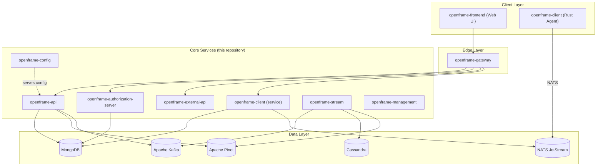

<div align="center">
  <picture>
    <source media="(prefers-color-scheme: dark)" srcset="https://shdrojejslhgnojzkzak.supabase.co/storage/v1/object/public/public/doc-orchestrator/logos/1771371901777-lc3cse-logo-openframe-full-dark-bg.png">
    <source media="(prefers-color-scheme: light)" srcset="https://shdrojejslhgnojzkzak.supabase.co/storage/v1/object/public/public/doc-orchestrator/logos/1771372526604-k3y1w-logo-openframe-full-light-bg.png">
    
  </picture>
</div>

<p align="center">
  <a href="LICENSE.md"></a>
</p>

# OpenFrame OSS Tenant

**OpenFrame OSS Tenant** is the multi-service, multi-tenant open-source backend of [OpenFrame](https://openframe.ai), the unified AI-driven MSP platform built by [Flamingo](https://flamingo.run). Flamingo replaces expensive proprietary MSP software with open-source alternatives enhanced by intelligent automation — Mingo AI for technicians, Fae for clients — and this repository is the polyglot core that makes it possible: a set of Spring Boot (Java) microservices plus a cross-platform Rust endpoint agent, together with the Kubernetes manifests that deploy and wire all of it together as a tenant.

It integrates device management, remote access, ticketing, real-time messaging, event-driven automation, and the data pipelines that feed OpenFrame's analytics and AI features — all behind a single Spring Cloud Gateway entry point.

[](https://www.youtube.com/watch?v=-_56_qYvMWk)

## Features

- **Unified entry point** — `openframe-gateway` (Spring Cloud Gateway) fronts every backend route: API, authorization, external API, client, and the frontend UI, so operators and integrations talk to one address.
- **Multi-tenant OAuth2/OIDC** — `openframe-authorization-server` issues RSA-signed JWTs and supports SSO (Google, Microsoft), giving every tenant isolated, standards-based authentication.
- **REST + GraphQL API surface** — `openframe-api` exposes the core application API (tickets, dialogs, AI settings, tenant management); `openframe-external-api` exposes a separate, rate-limited, API-key-protected surface for programmatic/external access.
- **Agent lifecycle and orchestration** — the `openframe-client` Java service manages agent lifecycle and tool orchestration (MeshCentral, FleetMDM) over NATS JetStream, while the companion `openframe-client` **Rust agent** runs on managed endpoints, talking to the platform exclusively over NATS.
- **Real-time event processing** — `openframe-stream` consumes Kafka topics (including Debezium CDC change events), normalizes and enriches events, and writes them into Cassandra and Apache Pinot for fast analytics.
- **Centralized configuration** — `openframe-config` serves shared configuration to every other service in the mesh.
- **Deployable as a whole tenant** — the `manifests/` tree ships an Argo CD app-of-apps that stands up the platform layer (ingress-nginx, dev-tools, config), the datasource layer (MongoDB, Cassandra, Kafka, NATS, Apache Pinot, Redis Cluster, ZooKeeper, Debezium Connect, MySQL for FleetMDM), and the tenant chart that assembles every OpenFrame service image together with the FleetMDM and MeshCentral charts and the frontend UI.

## Architecture



This repository publishes nine Maven artifacts under the `com.openframe` group (`openframe-api`, `openframe-authorization-server`, `openframe-client`, `openframe-config`, `openframe-external-api`, `openframe-gateway`, `openframe-management`, `openframe-stream`, `openframe-test`, all `1.0.0-SNAPSHOT`) and one Cargo crate, `openframe_client` (`0.1.0`), for the Rust agent. It pins a single upstream dependency, the [OpenFrame OSS Library](https://github.com/flamingo-stack/openframe-oss-lib), which supplies shared Java modules and the Rust `openframe-agent-lib` crate that every service and the agent build on. Per the organization's code graph, no other repository currently depends on this repository's published artifacts.

## Technology Stack

| Layer | Technology |
|---|---|
| Backend services | Java 25, Spring Boot 4.1, Spring Cloud 2025.1.3, Spring Cloud Gateway, Spring Authorization Server |
| Endpoint agent | Rust (edition 2021), thin binary delegating to the shared `openframe` crate |
| Messaging / streaming | Apache Kafka, NATS JetStream, Kafka Streams |
| Data stores | MongoDB, Cassandra, Apache Pinot, Redis Cluster |
| Deployment | Kubernetes, Argo CD (app-of-apps pattern), Helm |
| CI/CD | GitHub Actions (`.github/workflows/release.yml`), container images published to `ghcr.io/flamingo-stack/openframe-oss-tenant/*` |

## Quick Start

This builds the Java backend and the Rust agent locally. It assumes Java 25, Maven, and Rust/Cargo are already installed — see [Prerequisites](./docs/getting-started/prerequisites.md) for the full list.

```bash
# Clone the repository
git clone https://github.com/flamingo-stack/openframe-oss-tenant.git
cd openframe-oss-tenant

# Build all backend services (Java / Spring Boot)
mvn clean install -DskipTests
```

Build the Rust agent (optional for a pure-backend quick start):

```bash
cd clients/openframe-client
OPENFRAME_VERSION=0.0.0-dev cargo build --release
cd ../..
```

Run a service, for example the core API:

```bash
mvn spring-boot:run -pl openframe/services/openframe-api
```

A successful run prints the Spring Boot banner and the `"Starting OpenFrame API"` log line from `ApiApplication`. Without a reachable Config Service or datasources (MongoDB, Redis Cluster, Cassandra, Pinot, Kafka, NATS), the service still boots but with incomplete configuration — this confirms the build and Spring context, not a fully wired platform. For a complete, datasource-backed local environment, see [Local Development](./docs/development/setup/local-development.md) and [Environment Setup](./docs/development/setup/environment.md).

## Documentation

📚 See the [Documentation](./docs/README.md) for comprehensive guides, including:

- [Introduction](./docs/getting-started/introduction.md), [Prerequisites](./docs/getting-started/prerequisites.md), [Quick Start](./docs/getting-started/quick-start.md), and [First Steps](./docs/getting-started/first-steps.md)
- [Architecture Overview](./docs/reference/architecture/overview.md) and [Ecosystem Reference](./docs/reference/architecture/ecosystem.md)
- [Architecture Diagrams](./docs/diagrams/architecture/README.md)
- [Development Overview](./docs/development/README.md), [Development Architecture](./docs/development/architecture/README.md)
- [Environment Setup](./docs/development/setup/environment.md) and [Local Development](./docs/development/setup/local-development.md)
- [Testing](./docs/development/testing/README.md), [Security](./docs/development/security/README.md), and [Contributing Guidelines](./docs/development/contributing/guidelines.md)

## Related Projects

The CLI used to bootstrap or manage OpenFrame agent installs is maintained separately: [flamingo-stack/openframe-cli](https://github.com/flamingo-stack/openframe-cli) ([installation](https://github.com/flamingo-stack/openframe-cli#installation), [docs](https://github.com/flamingo-stack/openframe-cli/tree/main/docs)).

## Community

This project does not use GitHub Issues or GitHub Discussions. All support, feature requests, bug reports, and development discussion happen in the OpenMSP Slack community:

- OpenMSP: [https://www.openmsp.ai/](https://www.openmsp.ai/)
- Join Slack: [invite link](https://join.slack.com/t/openmsp/shared_invite/zt-36bl7mx0h-3~U2nFH6nqHqoTPXMaHEHA)
- OpenFrame: [https://openframe.ai](https://openframe.ai)
- Flamingo: [https://flamingo.run](https://flamingo.run)
- Releases: [github.com/flamingo-stack/openframe-oss-tenant/releases](https://github.com/flamingo-stack/openframe-oss-tenant/releases)

---
<div align="center">
  Built with 💛 by the <a href="https://www.flamingo.run/about"><b>Flamingo</b></a> team
</div>
