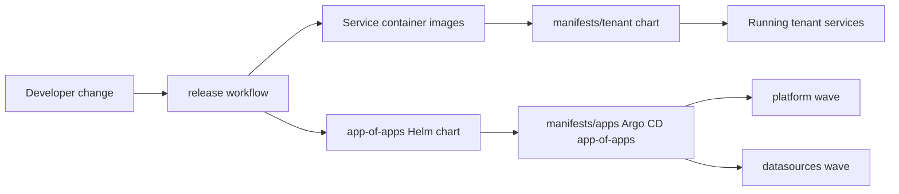

#  Development

This section is the hub for everything you need to build, run, test, secure, and contribute to **OpenFrame OSS Tenant** — the multi-service, multi-tenant open-source foundation of the OpenFrame platform. It links out to the detailed guides; use this page to find the one you need.

> OpenFrame OSS Tenant bundles the Java/Spring Boot backend services (`openframe-api`, `openframe-gateway`, `openframe-authorization-server`, `openframe-external-api`, `openframe-client`, `openframe-stream`, `openframe-management`, `openframe-config`), the Rust `openframe-client` agent under `clients/openframe-client/`, and the Kubernetes manifests under `manifests/` that wire them together.

## Overview

The backend is a Maven multi-module project rooted at `pom.xml`, built on Spring Boot `4.1.1` (Java `25`) with Spring Cloud `2025.1.3`. Each service module (listed under `<modules>` in `pom.xml`) depends on a shared parent POM for dependency management, plus `com.openframe.oss:*` libraries (for example `openframe-api-service-core`, `openframe-authorization-service-core`, `openframe-client-core`, `openframe-config-core`, `openframe-external-api-service-core`) pinned at `${openframe.libs.version}` (currently `7.0.11`) and published by the [OpenFrame OSS Library](https://github.com/flamingo-stack/openframe-oss-lib) — the sole upstream repository this project depends on.

The Rust agent (`clients/openframe-client/Cargo.toml`, crate `openframe-client` `0.1.0`) is a thin binary: its `src/main.rs` delegates all logic to the `openframe-agent-lib` crate, pulled directly from `https://github.com/flamingo-stack/openframe-oss-lib.git` at tag `v0.0.5`.

This repository publishes nine Maven artifacts under the `com.openframe` group (all `1.0.0-SNAPSHOT`) and one Cargo crate, `openframe_client` (`0.1.0`). Per the organization's code graph (coverage: full), no other managed repository currently consumes these artifacts — they are built and shipped as container images (see `.github/workflows/release.yml`) rather than as libraries consumed elsewhere in the org.

Each development topic has its own dedicated guide, linked below.

## Development documentation

| Guide | What it covers |
|---|---|
| [Environment Setup](./setup/environment.md) | Tooling, JDK/Rust toolchain, and environment variables needed before you build |
| [Local Development](./setup/local-development.md) | Running services and the agent locally, module-by-module |
| [Architecture](./architecture/README.md) | How the services, data stores, and the Rust agent fit together |
| [Testing](./testing/README.md) | Test modules, `openframe-test`, and how to run the test suite |
| [Security](./security/README.md) | OAuth2/OIDC, JWT, and security-relevant configuration |
| [Contributing Guidelines](./contributing/guidelines.md) | How to propose and submit changes |

Before diving into any of the above, it is worth reading the [Introduction](../getting-started/introduction.md), [Prerequisites](../getting-started/prerequisites.md), and [Quick Start](../getting-started/quick-start.md) guides, and the [architecture overview](../reference/architecture/overview.md) and [ecosystem reference](../reference/architecture/ecosystem.md), which describe how this repository's services, data layer, and the Rust agent relate to one another in more depth.

## Quick navigation

Use this table to jump straight to what you need:

| I want to... | Go to |
|---|---|
| Set up my machine for the first time | [Prerequisites](../getting-started/prerequisites.md) then [Environment Setup](./setup/environment.md) |
| Get something running quickly | [Quick Start](../getting-started/quick-start.md) |
| Understand the system before touching code | [Architecture overview](../reference/architecture/overview.md) and [diagrams](../diagrams/architecture/README.md) |
| Run a backend service or the Rust agent locally | [Local Development](./setup/local-development.md) |
| Understand how services, data stores, and artifacts relate | [Ecosystem reference](../reference/architecture/ecosystem.md) |
| Write or run tests | [Testing](./testing/README.md) |
| Understand auth/JWT/security configuration | [Security](./security/README.md) |
| Submit a change | [Contributing Guidelines](./contributing/guidelines.md) |
| Take your first guided steps in the platform | [First Steps](../getting-started/first-steps.md) |

## Repository layout at a glance

```text
openframe-oss-tenant/
├── pom.xml                                   # Parent Maven POM (Spring Boot 4.1.1, Java 25)
├── openframe/services/
│   ├── openframe-api/                        # REST + GraphQL API service
│   ├── openframe-authorization-server/       # OAuth2/OIDC authorization server
│   ├── openframe-client/                     # Agent lifecycle / orchestration service (Java)
│   ├── openframe-config/                     # Spring Cloud Config server
│   ├── openframe-external-api/               # Rate-limited public API service
│   ├── openframe-gateway/                    # Spring Cloud Gateway
│   ├── openframe-management/                 # Platform/tenant management service
│   ├── openframe-stream/                     # Kafka Streams event processing
│   └── openframe-test/                       # Shared test support module
├── clients/openframe-client/                 # Rust cross-platform agent (Cargo.toml, src/main.rs)
├── manifests/                                # Argo CD app-of-apps, datasources, platform, tenant charts
├── configs/base/                             # Shared Spring config (application.yml, per-service yml)
└── .github/workflows/release.yml             # CI/CD: builds and publishes images + the app-of-apps chart
```

## Building the project

The commands below are the starting point; [Environment Setup](./setup/environment.md) and [Local Development](./setup/local-development.md) go into the detail of toolchain versions and per-service workflows.

```bash
# Clone the repository
git clone https://github.com/flamingo-stack/openframe-oss-tenant.git
cd openframe-oss-tenant

# Build all backend services (Java / Spring Boot)
mvn clean install -DskipTests

# Build the Rust agent
cd clients/openframe-client
OPENFRAME_VERSION=0.0.0-dev cargo build
cd ../..
```

To run a single service locally (for example the API service):

```bash
mvn spring-boot:run -pl openframe/services/openframe-api
```

## Delivery and deployment context

Understanding how a change you make reaches a running environment helps when developing and reviewing locally. Per the CI workflow `.github/workflows/release.yml`, each service is built into its own container image published to `ghcr.io/flamingo-stack/openframe-oss-tenant/<service>` (`openframe-api`, `openframe-authorization-server`, `openframe-external-api`, `openframe-client`, `openframe-config`, `openframe-gateway`, `openframe-management`, `openframe-stream`), alongside an `app-of-apps` Helm chart published to `oci://ghcr.io/flamingo-stack/openframe-oss-tenant/app-of-apps`.

The `manifests/apps` Argo CD app-of-apps then layers in two waves: a `platform` wave (`manifests/platform/namespace-platform`, `manifests/platform/ingress-nginx`, `manifests/platform/dev-tools`, `manifests/platform/openframe-config`) and a `datasources` wave (Cassandra, Debezium Connect, Kafka, MongoDB, MongoDB for MeshCentral, MySQL for FleetMDM, NATS, Pinot, Redis Cluster, ZooKeeper — each defined under `manifests/datasources/`). The `manifests/tenant` chart assembles the service images together with the FleetMDM and MeshCentral charts and the `openframe-oss-frontend` UI image into one deployable tenant.



For the full list of gateway routes, datasource connection endpoints, and chart dependencies, see the [ecosystem reference](../reference/architecture/ecosystem.md).

## Community and support

This project does not use GitHub Issues or GitHub Discussions. Development discussion, support, and feature requests happen in the OpenMSP Slack community: [openmsp.ai](https://www.openmsp.ai/) ([join via invite link](https://join.slack.com/t/openmsp/shared_invite/zt-36bl7mx0h-3~U2nFH6nqHqoTPXMaHEHA)).

[](https://www.youtube.com/watch?v=-_56_qYvMWk)
