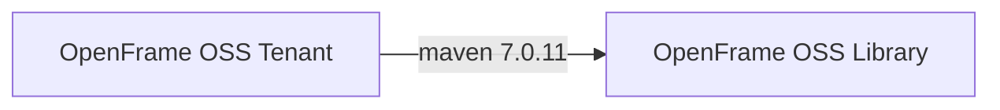

#  Development

This is the entry point for everything you need to build, run, and contribute to the **OpenFrame OSS Tenant** repository — the tenant-facing service and deployment repository for OpenFrame, Flamingo's unified AI-driven MSP platform. It assembles independently deployable Spring Boot services, a Rust agent client, centralized configuration, event processing, and Kubernetes/Helm manifests into an operable tenant environment.

> For a general introduction to the project, see [Introduction](../getting-started/introduction.md), [Prerequisites](../getting-started/prerequisites.md), [Quick Start](../getting-started/quick-start.md), and [First Steps](../getting-started/first-steps.md).

## Overview

This repository is a multi-module Maven project (Java 25, Spring Boot `4.1.1`, Spring Cloud `2025.1.3`) with nine service modules declared under the root [`pom.xml`](https://github.com/flamingo-stack/openframe-oss-tenant/blob/main/pom.xml), plus a standalone Rust agent binary under `clients/openframe-client`. Shared application capabilities — API, authorization, data access, security, gateway, and messaging implementations — are **not** implemented in this repository; they are pulled in as pinned dependencies from [OpenFrame OSS Library](https://github.com/flamingo-stack/openframe-oss-lib) at version `7.0.11` (and `openframe-agent-lib` at `v0.0.5` for the Rust client). This repository focuses on composition: each service module wires those library "core" artifacts together with Spring Boot starters, adds tenant-specific configuration (`configs/base`), and is packaged into a container image and a set of Helm charts for Argo CD-driven deployment.

Because this repository has no recorded downstream consumers, changes here affect the tenant deployment directly rather than other repositories that depend on it — the dependency direction only flows inward, from `openframe-oss-lib`.

This **Development** section is the hub for all engineering-facing documentation: environment setup, local development workflows, architecture deep-dives, security practices, and contribution guidelines. Use the navigation below to find what you need.

## What's in This Section

| Document | What it covers |
| --- | --- |
| [Environment Setup](./setup/environment.md) | Preparing your machine: JDK, Maven, Rust toolchain, and the configuration needed before building any service. |
| [Local Development](./setup/local-development.md) | Running services locally, working with the Maven multi-module build, and iterating on the Rust client. |
| [Architecture](./architecture/README.md) | How the gateway, API, authorization, client, external API, management, and stream services fit together, plus their datastores and messaging backbone. |
| [Security](./security/README.md) | Security-relevant configuration and practices for this repository. |
| [Contributing Guidelines](./contributing/guidelines.md) | How to propose and submit changes to this repository. |

For deeper, auto-generated architectural reference material (module-by-module breakdowns, diagrams, and bootstrap/consumption flows), see [Reference Architecture](../reference/architecture/README.md) and the [Ecosystem overview](../reference/architecture/ecosystem.md).

## Repository Structure at a Glance

| Area | Purpose |
| --- | --- |
| `openframe/services` | The nine Spring Boot service modules (`openframe-api`, `openframe-authorization-server`, `openframe-client`, `openframe-config`, `openframe-external-api`, `openframe-gateway`, `openframe-management`, `openframe-stream`, `openframe-test`). |
| `clients/openframe-client` | The Rust agent binary (`openframe-client` crate), built on top of `openframe-agent-lib`. |
| `configs/base` | Shared and per-service runtime configuration (`application.yml`, `openframe-api.yml`, `openframe-gateway.yml`, and so on). |
| `manifests/apps` | Argo CD app-of-apps configuration that wires platform, datasource, and tenant applications together. |
| `manifests/platform` | Platform Helm charts (ingress-nginx, dev-tools, openframe-config, ngrok-operator). |
| `manifests/datasources` | Helm charts for backing stores and messaging systems (MongoDB, Redis Cluster, Cassandra, Kafka, NATS, Pinot, MySQL, Debezium Connect, ZooKeeper). |
| `manifests/tenant` | The tenant application chart that wires service images and the OpenFrame frontend together. |
| `.github/workflows/release.yml` | The release workflow that builds and publishes service images and the app-of-apps Helm chart. |

## Service Module Map

Each service module is a thin Spring Boot composition layer over a corresponding `*-service-core` library from `openframe-oss-lib`:

| Service module | Library dependency pulled in | Entry point |
| --- | --- | --- |
| `openframe-api` | `openframe-api-service-core` | [`ApiApplication.java`](https://github.com/flamingo-stack/openframe-oss-tenant/blob/main/openframe/services/openframe-api/src/main/java/com/openframe/api/ApiApplication.java) |
| `openframe-authorization-server` | `openframe-authorization-service-core` | [`OpenFrameAuthorizationServerApplication.java`](https://github.com/flamingo-stack/openframe-oss-tenant/blob/main/openframe/services/openframe-authorization-server/src/main/java/com/openframe/authz/OpenFrameAuthorizationServerApplication.java) |
| `openframe-client` | `openframe-client-core` | [`ClientApplication.java`](https://github.com/flamingo-stack/openframe-oss-tenant/blob/main/openframe/services/openframe-client/src/main/java/com/openframe/client/ClientApplication.java) |
| `openframe-config` | `openframe-config-core` | [`ConfigServerApplication.java`](https://github.com/flamingo-stack/openframe-oss-tenant/blob/main/openframe/services/openframe-config/src/main/java/com/openframe/config/ConfigServerApplication.java) |
| `openframe-external-api` | `openframe-external-api-service-core` | [`ExternalApiApplication.java`](https://github.com/flamingo-stack/openframe-oss-tenant/blob/main/openframe/services/openframe-external-api/src/main/java/com/openframe/external/ExternalApiApplication.java) |
| `openframe-gateway` | `openframe-gateway-service-core` | [`GatewayApplication.java`](https://github.com/flamingo-stack/openframe-oss-tenant/blob/main/openframe/services/openframe-gateway/src/main/java/com/openframe/gateway/GatewayApplication.java) |
| `openframe-management` | `openframe-management-service-core` | [`ManagementApplication.java`](https://github.com/flamingo-stack/openframe-oss-tenant/blob/main/openframe/services/openframe-management/src/main/java/com/openframe/management/ManagementApplication.java) |
| `openframe-stream` | `openframe-stream-service-core` | [`StreamApplication.java`](https://github.com/flamingo-stack/openframe-oss-tenant/blob/main/openframe/services/openframe-stream/src/main/java/com/openframe/stream/StreamApplication.java) |
| `openframe-test` | `openframe-test-service-core` | [`TestApplication.java`](https://github.com/flamingo-stack/openframe-oss-tenant/blob/main/openframe/services/openframe-test/src/main/java/com/openframe/test/TestApplication.java) |

The gateway routes incoming traffic to these services by path: `/sas/**` to the authorization server, `/api/**` to the API service, `/clients/**` to the client service, `/api-docs/**` to the external API, and `/**` to the OpenFrame frontend, as configured in `configs/base/openframe-gateway.yml`.

## Quick Navigation Guide

Use this guide to find the right document for your current task:

- **I'm new to the project and want the big picture** → start with [Introduction](../getting-started/introduction.md), then [Architecture](./architecture/README.md) and [Reference Architecture](../reference/architecture/README.md).
- **I need to prepare my machine before building anything** → [Prerequisites](../getting-started/prerequisites.md) and [Environment Setup](./setup/environment.md).
- **I want to get something running quickly** → [Quick Start](../getting-started/quick-start.md), then [First Steps](../getting-started/first-steps.md).
- **I'm actively developing a service or the Rust client** → [Local Development](./setup/local-development.md).
- **I need to understand how services, datastores, and messaging fit together** → [Architecture](./architecture/README.md), [Ecosystem](../reference/architecture/ecosystem.md), and the individual module references below.
- **I'm reviewing security-sensitive configuration** → [Security](./security/README.md).
- **I'm about to open a change** → [Contributing Guidelines](./contributing/guidelines.md).

### Module-Level Reference Architecture

For a module-by-module deep dive generated from the codebase, see:

- [API Service Core](../reference/architecture/api-service-core/api-service-core.md)
- [Authorization Server Core](../reference/architecture/authorization-server-core/authorization-server-core.md)
- [Client Service Core](../reference/architecture/client-service-core/client-service-core.md)
- [Config Server Core](../reference/architecture/config-server-core/config-server-core.md)
- [External API Service](../reference/architecture/external-api-service/external-api-service.md)
- [Gateway Service Core](../reference/architecture/gateway-service-core/gateway-service-core.md)
- [Management Service Core](../reference/architecture/management-service-core/management-service-core.md)
- [Stream Service Core](../reference/architecture/stream-service-core/stream-service-core.md)
  - [Application Bootstrap](../reference/architecture/stream-service-core/stream-service-core/application_bootstrap/application_bootstrap.md)
  - [Log Event Consumption](../reference/architecture/stream-service-core/stream-service-core/log_event_consumption/log_event_consumption.md)

## Build Entry Points

The Maven reactor build is driven entirely from the root [`pom.xml`](https://github.com/flamingo-stack/openframe-oss-tenant/blob/main/pom.xml), which declares all nine service modules. Each module's own `pom.xml` (for example [`openframe/services/openframe-api/pom.xml`](https://github.com/flamingo-stack/openframe-oss-tenant/blob/main/openframe/services/openframe-api/pom.xml) or [`openframe/services/openframe-gateway/pom.xml`](https://github.com/flamingo-stack/openframe-oss-tenant/blob/main/openframe/services/openframe-gateway/pom.xml)) inherits from the parent and adds only the service-specific `*-service-core` dependency plus any extra starters it needs (such as `spring-cloud-starter-config` or `openframe-data-redis`). The Rust agent client is built independently via its own [`Cargo.toml`](https://github.com/flamingo-stack/openframe-oss-tenant/blob/main/clients/openframe-client/Cargo.toml) under `clients/openframe-client`, which depends on `openframe-agent-lib` pinned to tag `v0.0.5` from `openframe-oss-lib`.

Step-by-step build and run instructions live in [Environment Setup](./setup/environment.md) and [Local Development](./setup/local-development.md).

## Related External Tooling

The [OpenFrame CLI](https://github.com/flamingo-stack/openframe-cli) is maintained as a separate repository and is not part of this codebase. Refer to its own [installation guide](https://github.com/flamingo-stack/openframe-cli#installation) and [documentation](https://github.com/flamingo-stack/openframe-cli/tree/main/docs) if your workflow involves it.

> **Note:** This project does not use GitHub Issues or GitHub Discussions for coordination. Questions, feedback, and support happen in the [OpenMSP Slack community](https://www.openmsp.ai/).
