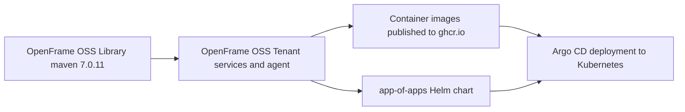
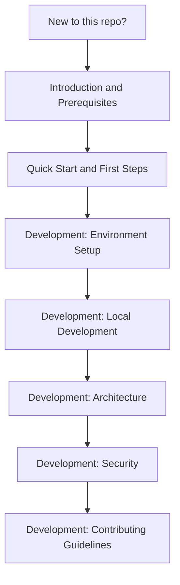

## Overview

This is the **Development** hub for OpenFrame OSS Tenant — the deployable, tenant-oriented distribution of the OpenFrame platform. It assembles nine Spring Boot services, a Rust endpoint agent, shared configuration, Helm charts, and Argo CD application definitions into one MSP operations platform.

The repository builds on top of **OpenFrame OSS Library** (`com.openframe.oss`, version `7.0.11`), which supplies most of the domain logic as pinned Maven artifacts (`openframe-api-service-core`, `openframe-client-core`, `openframe-authorization-service-core`, `openframe-gateway-service-core`, and more — see the ecosystem reference below for the full list). This repository owns the runnable applications, their configuration, container delivery, and Kubernetes/Argo CD deployment topology. No other repository in the organization is recorded as consuming artifacts published from here: this repo sits at the top of the dependency graph as the assembled, deployable product.

Use this page as your map across every development-focused document in this repository: environment setup, local development workflows, architecture, security, and contribution guidelines.

## What's in this repository

| Area | Technology | Notes |
|---|---|---|
| `openframe/services/*` | Java 25, Spring Boot `4.1.1` (via `spring-boot-starter-parent`) | Nine Maven modules, each a runnable service. |
| `clients/openframe-client` | Rust, edition 2021 | Thin binary (`openframe-client`) over the `openframe-agent-lib` crate pinned to tag `v0.0.5`. |
| `configs/base/*` | YAML | Shared Spring configuration, datasource endpoints, and gateway routing rules. |
| `manifests/*` | Helm charts, Argo CD app definitions | Platform, datasource, and tenant workload deployment topology. |

The root [`pom.xml`](https://github.com/flamingo-stack/openframe-oss-tenant/blob/main/pom.xml) declares the Maven reactor with these modules:

- `openframe/services/openframe-config`
- `openframe/services/openframe-api`
- `openframe/services/openframe-client`
- `openframe/services/openframe-stream`
- `openframe/services/openframe-management`
- `openframe/services/openframe-gateway`
- `openframe/services/openframe-external-api`
- `openframe/services/openframe-authorization-server`
- `openframe/services/openframe-test`

Each service module's `pom.xml` pulls in a corresponding `*-service-core` artifact from OpenFrame OSS Library — for example `openframe-api` depends on `com.openframe.oss:openframe-api-service-core`, `openframe-client` depends on `com.openframe.oss:openframe-client-core`, and `openframe-authorization-server` depends on `com.openframe.oss:openframe-authorization-service-core`. This split means most business logic lives upstream, while this repository wires services together, configures them, and ships them.

The Rust agent's manifest, [`clients/openframe-client/Cargo.toml`](https://github.com/flamingo-stack/openframe-oss-tenant/blob/main/clients/openframe-client/Cargo.toml), defines the `openframe-client` binary with its entry point at `clients/openframe-client/src/main.rs`, depending on the `openframe-agent-lib` git dependency and `anyhow`.

## How development fits the wider system

Per the organization's repository graph, this repository pins 23 artifacts from OpenFrame OSS Library (22 Maven artifacts plus the `openframe_agent_lib` Cargo crate at tag `v0.0.5`), and publishes 9 Maven artifacts plus the `openframe_client` Cargo crate of its own. No downstream consumer repository is recorded for these published artifacts — this repository is the terminal, deployable product in the graph, not a library other teams build on. For the full dependency and delivery-chain breakdown (container images, Helm chart OCI references, Argo CD application waves, and gateway routes), see the [Ecosystem reference](../reference/architecture/ecosystem.md).

> **Note:** This organization does not use GitHub Issues or GitHub Discussions for coordination. Development questions and community support go through the [OpenMSP Slack community](https://www.openmsp.ai/).

## Development documentation index

Use the table below to jump directly to the topic you need.

| Document | What it covers |
|---|---|
| [Environment Setup](./setup/environment.md) | Preparing your local toolchain (JDK, Maven, Rust) and required configuration before running any service. |
| [Local Development](./setup/local-development.md) | Running services and the Rust agent locally, iterating on code, and connecting to supporting datastores. |
| [Architecture](./architecture/README.md) | How the gateway, authorization server, API, client, management, and stream services fit together, and how requests flow through the platform. |
| [Security](./security/README.md) | Authentication, authorization, and secure-configuration practices that apply across the services in this repository. |
| [Contributing Guidelines](./contributing/guidelines.md) | Conventions and expectations for proposing and merging changes. |

If you're arriving fresh to OpenFrame rather than to this repository's internals, start instead with the [Introduction](../getting-started/introduction.md), [Prerequisites](../getting-started/prerequisites.md), [Quick Start](../getting-started/quick-start.md), and [First Steps](../getting-started/first-steps.md) guides, then return here once your environment is ready.

## Quick navigation guide

- **Setting up a machine for the first time?** Begin with [Environment Setup](./setup/environment.md), which should be done before attempting to run any service.
- **Ready to run something locally?** Go to [Local Development](./setup/local-development.md) for day-to-day workflows against the Java services and the Rust agent.
- **Trying to understand how a request moves through the platform?** Read [Architecture](./architecture/README.md), and cross-reference the [Ecosystem reference](../reference/architecture/ecosystem.md) and [Architecture reference](../reference/architecture/README.md) for the full module and deployment picture.
- **Reviewing auth, tokens, or secure configuration?** See [Security](./security/README.md).
- **About to open a change?** Read [Contributing Guidelines](./contributing/guidelines.md) first.

## Deep-dive architecture references

The modules that make up each service are documented individually under the reference architecture tree. Notable groupings include:

- Main application entry points: [Main Applications](../reference/architecture/main-applications/main-applications.md), split further into [API and Gateway Applications](../reference/architecture/main-applications/api_and_gateway_applications.md), [Identity, Configuration, and Client Applications](../reference/architecture/main-applications/identity_configuration_and_client_applications.md), and [Management and Stream Applications](../reference/architecture/main-applications/management_and_stream_applications.md).
- Gateway behavior: [Gateway Core](../reference/architecture/gateway-core/gateway-core.md).
- Identity and tenant-aware OAuth: [Authorization Service Core](../reference/architecture/authorization-service-core/authorization-service-core.md), [Security OAuth](../reference/architecture/security-oauth/security-oauth.md), and [Security Core OAuth](../reference/architecture/security-core-oauth/security-core-oauth.md).
- The primary application API: [API Service Backend](../reference/architecture/api-service-backend/api-service-backend.md), with [Dataloaders](../reference/architecture/api-service-dataloaders/api-service-dataloaders.md), [Fetchers](../reference/architecture/api-service-fetchers/api-service-fetchers.md), and related DTO/filter/OAuth modules.
- Endpoint-agent internals (Rust): [Openframe Client Core](../reference/architecture/openframe-client-core/openframe-client-core.md) and [Client Core Registration Agent](../reference/architecture/client-core-registration-agent/client-core-registration-agent.md).
- Event processing: [Stream Service Core](../reference/architecture/stream-service-core/stream-service-core.md).
- Background initialization and reconciliation: [Management Core](../reference/architecture/management-core/management-core.md).
- Persistence: [Data Mongo Sync Repositories](../reference/architecture/data-mongo-sync-repositories/data-mongo-sync-repositories.md), [Data Mongo Common](../reference/architecture/data-mongo-common/data-mongo-common.md), [Data Mongo Reactive](../reference/architecture/data-mongo-reactive/data-mongo-reactive.md), and [Data Redis](../reference/architecture/data-redis/data-redis.md).
- External integrations: [External API Service Core](../reference/architecture/external-api-service-core/external-api-service-core.md).

The full index of reference modules is available from the [Architecture reference overview](../reference/architecture/README.md).

## Related external tooling

The [OpenFrame CLI](https://github.com/flamingo-stack/openframe-cli) is maintained in a separate repository and is not part of this codebase. Refer to its own [installation instructions](https://github.com/flamingo-stack/openframe-cli#installation) and [documentation](https://github.com/flamingo-stack/openframe-cli/tree/main/docs) if your workflow involves it.

## Getting help

This project does not track work in GitHub Issues or Discussions. For development questions, bug reports, or feature discussions, use the [OpenMSP Slack community](https://www.openmsp.ai/) ([join link](https://join.slack.com/t/openmsp/shared_invite/zt-36bl7mx0h-3~U2nFH6nqHqoTPXMaHEHA)). Release history is available under [GitHub Releases](https://github.com/flamingo-stack/openframe-oss-tenant/releases).
