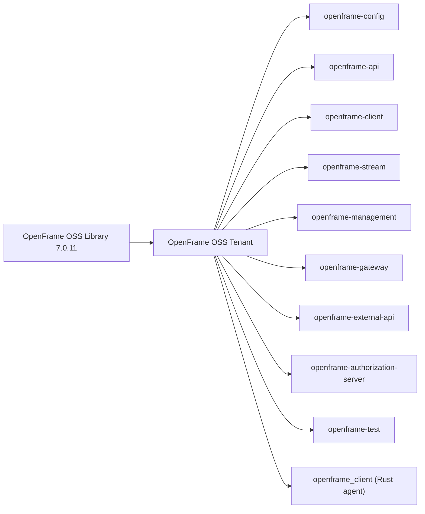
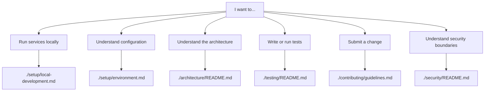

ic# Development

This section is the entry point for developers working on **OpenFrame OSS Tenant** — the deployable, self-hosted tenant distribution for [OpenFrame](https://openframe.ai) ([flamingo.run/openframe](https://www.flamingo.run/openframe)). This repository assembles Spring Boot services (Java), a Rust endpoint agent client, shared configuration, and Kubernetes/Helm manifests into the running MSP platform stack. Most domain logic is consumed from the [OpenFrame OSS Library](https://github.com/flamingo-stack/openframe-oss-lib) at pinned version `7.0.11`; this repository owns the tenant-specific service entry points, runtime configuration, Helm charts, Argo CD application definitions, and the release delivery pipeline.

Use this page to find the right development document instead of digging through the whole repository tree.

> If you have not yet installed the project or run it for the first time, start with [Introduction](../getting-started/introduction.md), [Prerequisites](../getting-started/prerequisites.md), [Quick Start](../getting-started/quick-start.md) and [First Steps](../getting-started/first-steps.md) before coming back here.

## Overview

OpenFrame OSS Tenant is a multi-module Maven project (Java 25, Spring Boot `4.1.1` via `spring-boot-starter-parent`, Spring Cloud `2025.1.3`) plus a standalone Rust client crate. The root `pom.xml` declares the parent POM and wires together nine service modules under `openframe/services`:

| Service module | Maven artifact | Role |
| --- | --- | --- |
| `openframe-config` | `com.openframe:openframe-config` | Spring Cloud Config Server for shared platform configuration |
| `openframe-api` | `com.openframe:openframe-api` | Main OpenFrame API and GraphQL service |
| `openframe-client` | `com.openframe:openframe-client` | Managed endpoint registration, delivery, telemetry, RMM coordination |
| `openframe-stream` | `com.openframe:openframe-stream` | Kafka event processing, enrichment, log storage, software projection |
| `openframe-management` | `com.openframe:openframe-management` | Platform initialization, reconciliation, catalog sync, scheduled jobs |
| `openframe-gateway` | `com.openframe:openframe-gateway` | Reactive edge router, JWT boundary, API-key enforcement, tool proxy |
| `openframe-external-api` | `com.openframe:openframe-external-api` | API-key-protected REST API for third-party integrations |
| `openframe-authorization-server` | `com.openframe:openframe-authorization-server` | OAuth 2.0 / OpenID Connect authorization server |
| `openframe-test` | `com.openframe:openframe-test` | Shared tenant integration and end-to-end test service artifact |

Each service module is a thin composition layer: it pulls in a corresponding `*-service-core` artifact from the OpenFrame OSS Library (for example `openframe-api` depends on `com.openframe.oss:openframe-api-service-core`, `openframe-authorization-server` depends on `com.openframe.oss:openframe-authorization-service-core`), adds `spring-cloud-starter-config` for centralized configuration, and in several cases `openframe-data-redis` for caching. The Rust agent in `clients/openframe-client` (crate `openframe_client`, Cargo package name `openframe-client`) is a thin binary over `openframe-agent-lib`, pulled directly from the [OpenFrame OSS Library](https://github.com/flamingo-stack/openframe-oss-lib) git repository at tag `v0.0.5`.

Per the repository graph, this repository has no recorded downstream consumers inside the organization (coverage is `full`, so this is confirmed, not just unindexed) — its outputs are delivered as container images and a Helm app-of-apps chart rather than consumed as a library by other repositories. Everything upstream flows from the single `openframe-oss-lib` dependency pinned at `7.0.11` (Maven) and `v0.0.5` (the `openframe-agent-lib` crate used by the Rust client).

## What lives in this section

The development documentation is organized into four areas, each covering a distinct concern of contributing to and operating this repository:

- **Setup** — getting a working local environment and understanding configuration surfaces.
- **Architecture** — how the services, modules, and deployment manifests fit together.
- **Testing** — how the shared `openframe-test` module and service-level tests are structured.
- **Contributing** — expectations and workflow guidelines for proposing changes.
- **Security** — the security model, authentication boundaries, and practices to follow.

## Development documentation

| Document | What it covers |
| --- | --- |
| [Local Development](./setup/local-development.md) | Running the Spring Boot service modules and the Rust client locally. |
| [Environment Configuration](./setup/environment.md) | Shared configuration under `configs/base`, datasource wiring, and gateway routes. |
| [Architecture](./architecture/README.md) | How the service modules, shared config, and Kubernetes manifests relate. |
| [Testing](./testing/README.md) | The `openframe-test` module and how service-level tests are organized. |
| [Contributing Guidelines](./contributing/guidelines.md) | How to propose and submit changes to this repository. |
| [Security](./security/README.md) | Authentication, authorization server, and security boundaries. |

## Quick navigation guide

Use this guide to jump to the right document based on what you are trying to do.

### By task

- **I'm new to the project.** Read [Introduction](../getting-started/introduction.md), check [Prerequisites](../getting-started/prerequisites.md), then follow [Quick Start](../getting-started/quick-start.md) and [First Steps](../getting-started/first-steps.md).
- **I want to run a service module (API, gateway, client, stream, management, authorization server, config, external API) on my machine.** Go to [Local Development](./setup/local-development.md).
- **I need to know where Kafka, NATS, MongoDB, Redis, Cassandra, or Pinot connection strings come from.** Go to [Environment Configuration](./setup/environment.md), which documents the `configs/base` shared application configuration.
- **I need to understand how the gateway routes traffic, or how services depend on the OpenFrame OSS Library.** Go to [Architecture](./architecture/README.md).
- **I'm adding or modifying tests.** Go to [Testing](./testing/README.md) for how the `openframe-test` artifact and per-service tests are structured.
- **I'm preparing a change for review.** Go to [Contributing Guidelines](./contributing/guidelines.md).
- **I need to understand authentication, authorization, or tenant security boundaries.** Go to [Security](./security/README.md).

### By module

If you are working inside a specific service module, these reference documents (generated from the OpenFrame OSS Library's own architecture) describe the core logic each tenant service composes:

| Tenant service | Related architecture reference |
| --- | --- |
| `openframe-api` | [Openframe API Service Core](../reference/architecture/openframe-api-service-core/openframe-api-service-core.md) |
| `openframe-authorization-server` | [Openframe Authorization Service Core](../reference/architecture/openframe-authorization-service-core/openframe-authorization-service-core.md) |
| `openframe-client` (Java side) | [Openframe Client Core Java](../reference/architecture/openframe-client-core-java/openframe-client-core-java.md) |
| `openframe-client` (Rust agent) | [Openframe Client Core](../reference/architecture/openframe-client-core/openframe-client-core.md) |
| `openframe-config` | [Openframe Config Core](../reference/architecture/openframe-config-core/openframe-config-core.md) |
| `openframe-external-api` | [Openframe External API Service Core](../reference/architecture/openframe-external-api-service-core/openframe-external-api-service-core.md) |
| `openframe-gateway` | [Openframe Gateway Service Core](../reference/architecture/openframe-gateway-service-core/openframe-gateway-service-core.md) |
| `openframe-management` | [Openframe Management Service Core](../reference/architecture/openframe-management-service-core/openframe-management-service-core.md) |
| `openframe-stream` | [Openframe Stream Service Core](../reference/architecture/openframe-stream-service-core/openframe-stream-service-core.md) |
| `openframe-test` | [Openframe Test Service Core](../reference/architecture/openframe-test-service-core/openframe-test-service-core.md) |

For the complete artifact, dependency, and delivery-chain picture (container images, Helm charts, Argo CD applications), see [Ecosystem](../reference/architecture/ecosystem.md) and the full [Architecture Reference](../reference/architecture/README.md).

> **Note:** The `openframe-client` CLI tooling referenced by the agent ecosystem (`openframe-cli`) is maintained in a separate, external repository: [flamingo-stack/openframe-cli](https://github.com/flamingo-stack/openframe-cli). Its [installation guide](https://github.com/flamingo-stack/openframe-cli#installation) and [documentation](https://github.com/flamingo-stack/openframe-cli/tree/main/docs) live there, not in this repository.

## Getting help

This project does not use GitHub Issues or GitHub Discussions. Questions, bug reports, and feature discussions happen in the [OpenMSP Slack community](https://www.openmsp.ai/) — join via the [Slack invite link](https://join.slack.com/t/openmsp/shared_invite/zt-36bl7mx0h-3~U2nFH6nqHqoTPXMaHEHA). For released versions of the tenant distribution, see [Releases](https://github.com/flamingo-stack/openframe-oss-tenant/releases).

If you'd like a broader product overview before diving into development details, this walkthrough covers current platform functionality end to end:

