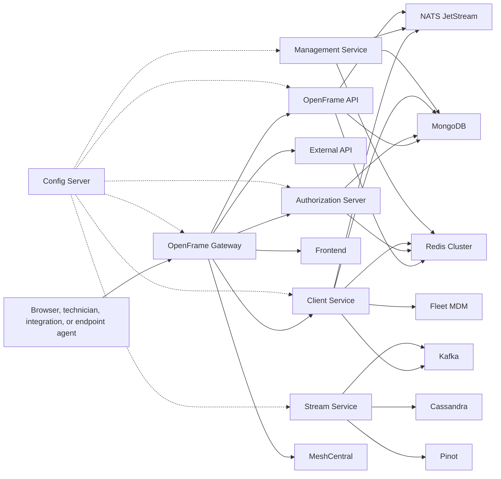
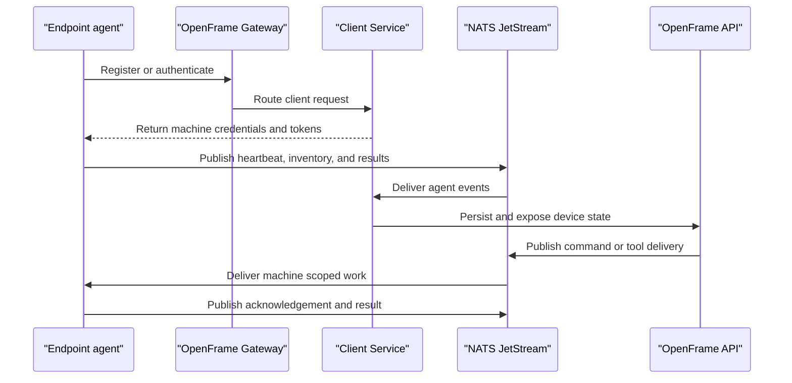
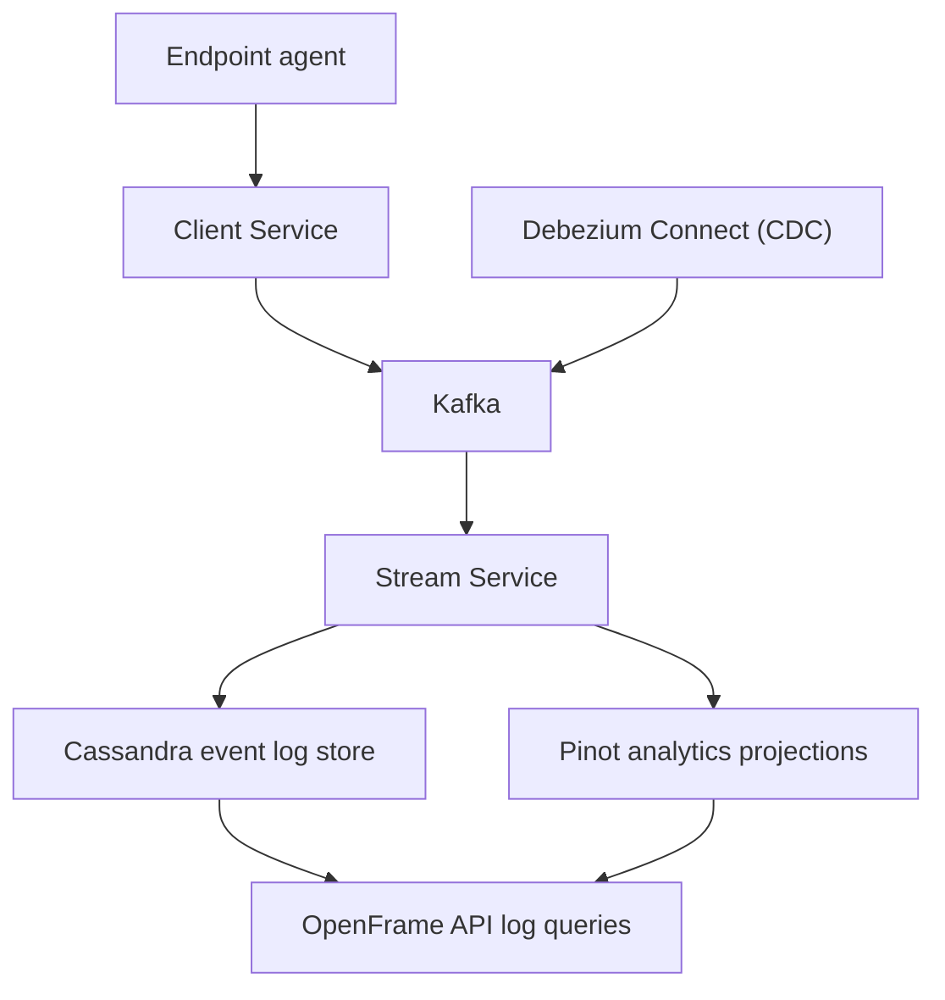
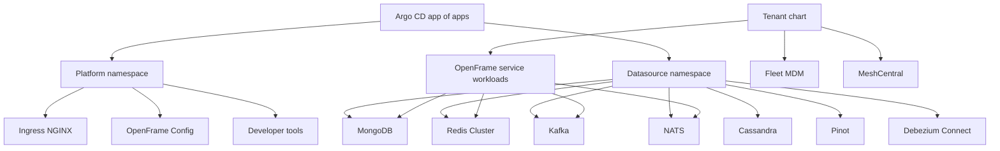

# Architecture Overview

[OpenFrame OSS Tenant](https://github.com/flamingo-stack/openframe-oss-tenant) is the deployable, tenant-oriented distribution of the OpenFrame MSP platform. It is a **service** repository (Java, Rust, Bash) that assembles runnable Spring Boot applications, a Rust endpoint agent, shared configuration, Helm charts, and Argo CD application definitions into one operational unit.

Most domain logic — authorization flows, API resolvers, client-registration behavior, stream processing, data repositories — is implemented upstream in [OpenFrame OSS Library](https://github.com/flamingo-stack/openframe-oss-lib) and pinned at version `7.0.11` (the Rust agent core, `openframe_agent_lib`, is pinned at `v0.0.5`). This repository owns the runnable applications, their container images, the Kubernetes/Argo CD deployment topology, and tenant-facing configuration. Per the organization's repository graph (`get_repo_ecosystem`, coverage: full), no other managed repository consumes artifacts published from this one — it sits at the end of the dependency chain, assembling the library rather than being assembled by others.

For a narrative walkthrough of modules and request flows, see the [Architecture Reference](../../reference/architecture/README.md) and its [ecosystem facts](../../reference/architecture/ecosystem.md).

## High-Level Architecture

The Maven reactor at [`pom.xml`](https://github.com/flamingo-stack/openframe-oss-tenant/blob/main/pom.xml) declares nine modules under [`openframe/services`](https://github.com/flamingo-stack/openframe-oss-tenant/tree/main/openframe/services): `openframe-config`, `openframe-api`, `openframe-client`, `openframe-stream`, `openframe-management`, `openframe-gateway`, `openframe-external-api`, `openframe-authorization-server`, and `openframe-test`. Each is a thin Spring Boot application (Spring Boot `4.1.1`, Java `25`, Spring Cloud `2025.1.3`) that pulls in one or more `com.openframe.oss:*` library artifacts and a small amount of local application wiring (component-scan packages, bootstrap class).

The endpoint agent is separate from the Maven reactor: [`clients/openframe-client/Cargo.toml`](https://github.com/flamingo-stack/openframe-oss-tenant/blob/main/clients/openframe-client/Cargo.toml) defines the `openframe-client` Rust binary, published as the `openframe_client` crate. Its entry point, [`clients/openframe-client/src/main.rs`](https://github.com/flamingo-stack/openframe-oss-tenant/blob/main/clients/openframe-client/src/main.rs), is a thin wrapper that calls `openframe::run()` from the `openframe-agent-lib` crate (`openframe_agent_lib` `v0.0.5`, pulled from the OSS Library repository). Nearly all agent behavior — registration, command execution, logging, tool updates — lives in that upstream crate.

## Core Components

| Component | Module path | Library dependency | Responsibility |
|---|---|---|---|
| **OpenFrame Gateway** | [`openframe/services/openframe-gateway`](https://github.com/flamingo-stack/openframe-oss-tenant/tree/main/openframe/services/openframe-gateway) | `openframe-gateway-service-core` | Reactive edge: JWT validation, API-key boundary, service routing, integrated-tool proxying. Routes are defined in [`configs/base/openframe-gateway.yml`](https://github.com/flamingo-stack/openframe-oss-tenant/blob/main/configs/base/openframe-gateway.yml). |
| **Authorization Server** | [`openframe/services/openframe-authorization-server`](https://github.com/flamingo-stack/openframe-oss-tenant/tree/main/openframe/services/openframe-authorization-server) | `openframe-authorization-service-core` | Tenant-aware OAuth 2.1 / OIDC, password login, invitations, SSO, password reset, token issuance. Entry point: `OpenFrameAuthorizationServerApplication`. |
| **OpenFrame API** | [`openframe/services/openframe-api`](https://github.com/flamingo-stack/openframe-oss-tenant/tree/main/openframe/services/openframe-api) | `openframe-api-lib`, `openframe-api-service-core`, `openframe-data-redis` | Primary GraphQL/REST application API for devices, organizations, tickets, knowledge base, automation, and remote-management workflows. Entry point: `ApiApplication`. |
| **External API** | [`openframe/services/openframe-external-api`](https://github.com/flamingo-stack/openframe-oss-tenant/tree/main/openframe/services/openframe-external-api) | `openframe-external-api-service-core` | API-key-authenticated REST endpoints for customers, devices, tickets, tools, logs, and knowledge-base content. Entry point: `ExternalApiApplication`. |
| **Client Service** | [`openframe/services/openframe-client`](https://github.com/flamingo-stack/openframe-oss-tenant/tree/main/openframe/services/openframe-client) | `openframe-client-core`, `openframe-data-redis` | Endpoint-agent registration, authentication, device events, command delivery, RMM results, schedules, package-update state. Entry point: `ClientApplication`. |
| **Management Service** | [`openframe/services/openframe-management`](https://github.com/flamingo-stack/openframe-oss-tenant/tree/main/openframe/services/openframe-management) | `openframe-management-service-core` | Initializes client/tool-agent configuration, NATS streams, integrated tools, package catalogs, background reconciliation. |
| **Stream Service** | [`openframe/services/openframe-stream`](https://github.com/flamingo-stack/openframe-oss-tenant/tree/main/openframe/services/openframe-stream) | `openframe-stream-service-core` | Processes Kafka and CDC events into operational logs, RMM history, software inventory, and analytics projections. Entry point: `StreamApplication`. |
| **Config Server** | [`openframe/services/openframe-config`](https://github.com/flamingo-stack/openframe-oss-tenant/tree/main/openframe/services/openframe-config) | `openframe-config-core` | Spring Cloud Config Server: centralized runtime configuration and shared Logback XML delivery. Entry point: `ConfigServerApplication`. |
| **OpenFrame Test** | [`openframe/services/openframe-test`](https://github.com/flamingo-stack/openframe-oss-tenant/tree/main/openframe/services/openframe-test) | `openframe-test-service-core` | Shared test-support application artifact for the platform's service suite. |
| **Endpoint Agent** | [`clients/openframe-client`](https://github.com/flamingo-stack/openframe-oss-tenant/tree/main/clients/openframe-client) | `openframe_agent_lib` (cargo) | Rust binary that registers devices, maintains credentials, executes commands, manages integrated tools, ships logs, and recovers state. Published as the `openframe_client` crate. |

Each service's `pom.xml` (for example [`openframe/services/openframe-api/pom.xml`](https://github.com/flamingo-stack/openframe-oss-tenant/blob/main/openframe/services/openframe-api/pom.xml) and [`openframe/services/openframe-gateway`'s equivalent](https://github.com/flamingo-stack/openframe-oss-tenant/tree/main/openframe/services/openframe-gateway)) pulls its corresponding `*-service-core` artifact plus `spring-cloud-starter-config` so the service fetches configuration from the Config Server at startup.

### Gateway routing table

The gateway, defined in [`configs/base/openframe-gateway.yml`](https://github.com/flamingo-stack/openframe-oss-tenant/blob/main/configs/base/openframe-gateway.yml), is the single HTTP entry point into the tenant services:

| Path prefix | Destination service |
|---|---|
| `/sas/**` | `openframe-authorization-server` |
| `/api/**` | `openframe-api` |
| `/api-docs/**` | `openframe-external-api` |
| `/clients/**` | `openframe-client` |
| `/**` | Frontend workload |

## Data Flow: Endpoint Management

The sequence below follows an endpoint agent from registration through ongoing command delivery, as implemented across the Client Service, NATS, and the OpenFrame API.

Key behaviors backing this flow, documented in the referenced library modules:

- **Registration** generates a UUID machine ID and a `SecureRandom`-derived agent secret, resolves the target organization (falling back to the tenant default), and optionally assigns device tags — see [Client Core Registration Agent](../../reference/architecture/client-core-registration-agent/client-core-registration-agent.md).
- **Event ingestion** runs through durable and best-effort NATS listeners (connection, heartbeat, hostname, timezone, installed-agent, tool-connection) inside the Client Service — see [Client Core Server Controllers](../../reference/architecture/client-core-server-controllers/client-core-server-controllers.md).
- **Command and software dispatch** is persisted first (one `RUNNING` execution row per target machine) and then published to NATS, so execution state exists before the agent ever receives the message — see [Api Service Backend](../../reference/architecture/api-service-backend/api-service-backend.md).
- **Delivery recovery** uses a watchdog/retry mechanism (`DeliveryRepublisherRegistry`) that can re-publish retained schedule or software messages after a disruption.

## Data Flow: Event and Analytics Pipeline

The Stream Service consumes Kafka topics (including Debezium change-data-capture events) and normalizes them into Cassandra-backed operational logs and Pinot analytics projections. The OpenFrame API's log-retrieval services (`BothStoresLogDetailsService`) select between Cassandra and Loki depending on a configured migration boundary, documented in [Api Service Backend](../../reference/architecture/api-service-backend/api-service-backend.md).

## Deployment Topology

Argo CD applications are declared in [`manifests/apps/values.yaml`](https://github.com/flamingo-stack/openframe-oss-tenant/blob/main/manifests/apps/values.yaml), which sequences platform namespace setup (wave `-1`), platform workloads (wave `0`: ingress-nginx, dev-tools, openframe-config), the datasource namespace (wave `-1`), and datasource workloads (wave `0`: Cassandra, Debezium Connect, Kafka, MongoDB, MongoDB (MeshCentral), MySQL (Fleet MDM), NATS, Pinot, Redis Cluster, Zookeeper). The [`manifests/tenant`](https://github.com/flamingo-stack/openframe-oss-tenant/tree/main/manifests/tenant) chart then deploys the OpenFrame service workloads alongside Fleet MDM (`oci://ghcr.io/flamingo-stack/fleetmdm/helm-charts/fleet`) and MeshCentral (`oci://ghcr.io/flamingo-stack/meshcentral/helm-charts/meshcentral`).

Shared datasource endpoints used by every service are configured once in [`configs/base/application.yml`](https://github.com/flamingo-stack/openframe-oss-tenant/blob/main/configs/base/application.yml) (MongoDB, Redis Cluster, Cassandra, Pinot controller/broker). Service-specific Kafka and NATS bootstrap addresses are set per service in files such as [`configs/base/openframe-api.yml`](https://github.com/flamingo-stack/openframe-oss-tenant/blob/main/configs/base/openframe-api.yml), [`configs/base/openframe-client.yml`](https://github.com/flamingo-stack/openframe-oss-tenant/blob/main/configs/base/openframe-client.yml), [`configs/base/openframe-external-api.yml`](https://github.com/flamingo-stack/openframe-oss-tenant/blob/main/configs/base/openframe-external-api.yml), [`configs/base/openframe-management.yml`](https://github.com/flamingo-stack/openframe-oss-tenant/blob/main/configs/base/openframe-management.yml), and [`configs/base/openframe-stream.yml`](https://github.com/flamingo-stack/openframe-oss-tenant/blob/main/configs/base/openframe-stream.yml).

[`.github/workflows/release.yml`](https://github.com/flamingo-stack/openframe-oss-tenant/blob/main/.github/workflows/release.yml) builds and publishes one container image per service to `ghcr.io/flamingo-stack/openframe-oss-tenant/<service>` (for example `openframe-api`, `openframe-authorization-server`, `openframe-external-api`, `openframe-client`, `openframe-config`, `openframe-gateway`, `openframe-management`, `openframe-stream`) and publishes the `app-of-apps` OCI Helm chart from [`manifests/app-of-apps`](https://github.com/flamingo-stack/openframe-oss-tenant/tree/main/manifests/app-of-apps).

## Key Design Decisions

### 1. Thin runnable services over a shared library

Every Maven module under `openframe/services` is intentionally small: an `@SpringBootApplication` class, a `@ComponentScan` declaration, and a `pom.xml` pulling in one `com.openframe.oss:*-service-core` artifact. All domain logic — GraphQL resolvers, authorization grants, data repositories, RMM dispatch — lives in [OpenFrame OSS Library](https://github.com/flamingo-stack/openframe-oss-lib), pinned uniformly at `7.0.11` via the `openframe.libs.version` property in the root [`pom.xml`](https://github.com/flamingo-stack/openframe-oss-tenant/blob/main/pom.xml). This keeps a single version boundary: upgrading the platform means bumping one Maven property, and this repository's job is assembly, image delivery, and deployment topology — not feature implementation.

### 2. Gateway as the single trust and routing boundary

All inbound traffic reaches backend services through `openframe-gateway`; services other than the gateway are not expected to be reached directly in production. The gateway resolves the tenant domain from the request `Host` and stamps `X-Tenant-Domain` on forwarded requests — see [Api Service Tenant](../../reference/architecture/api-service-tenant/api-service-tenant.md) — removing any client-supplied value first so tenant identity cannot be spoofed by a caller. Downstream services (API, Authorization Server, Client, External API) trust that header rather than re-deriving tenant context themselves.

### 3. NATS JetStream for agent-facing messaging, Kafka for the analytics pipeline

Two different message buses serve different purposes. NATS JetStream carries low-latency, per-machine traffic: registration, heartbeats, command dispatch, and execution results between the Client Service and endpoint agents. Kafka (with Debezium Connect for CDC) carries the higher-volume event stream destined for the Stream Service, Cassandra, and Pinot. This separation keeps agent command-and-control latency independent of analytics ingestion volume.

### 4. Durable persistence before dispatch

Command and software-action dispatch services persist a `RUNNING` execution row (or a delivery/schedule record) **before** publishing the corresponding NATS message. This ordering, documented in [Api Service Backend](../../reference/architecture/api-service-backend/api-service-backend.md) and [Client Core Registration Agent](../../reference/architecture/client-core-registration-agent/client-core-registration-agent.md), ensures that a crash between persistence and publish is recoverable (the row exists and can be retried or marked failed), rather than leaving no record of attempted work.

### 5. Distributed-lock-coordinated scheduling

Because the Client Service runs multiple replicas, recurring work (device-local schedules, reconnect dispatch, package auto-update triggers, watchdogs) uses Redis-backed ShedLock so a given scheduled job executes on at most one replica per lock window, avoiding duplicate dispatch. See [Client Core Server Controllers](../../reference/architecture/client-core-server-controllers/client-core-server-controllers.md).

### 6. Config Server as the single source of runtime and logging configuration

`openframe-config` is a Spring Cloud Config Server backed by a Git repository. Its `ConfigGitCacheRepair` component runs before the embedded web server accepts traffic, removing stale Git locks and resetting a dirty local checkout (or deleting the cache entirely on unrecoverable failure) so configuration retrieval stays available even after an interrupted Git operation. It additionally serves shared Logback XML through a `/logging/{filename}` endpoint restricted to a strict `[a-z0-9-]+\.xml` filename pattern. See [Config Core](../../reference/architecture/config-core/config-core.md).

### 7. Conditional/extensible processors instead of hard-coded integrations

Several lifecycle touch-points — agent registration-secret processing, invitation processing, SSO config processing, user processing, domain-existence validation — are implemented as `@ConditionalOnMissingBean` default no-op (or permissive) components. A deployment can supply its own bean to add custom behavior (for example, connecting invitation events to an external workflow) without forking the library. See [Api Service Processors](../../reference/architecture/api-service-processors/api-service-processors.md).

### 8. Fail-open external dependencies for registration paths

The disposable-email-domain check (`KickboxDisposableDomainChecker`) treats any lookup failure, timeout, or malformed response as "not disposable" rather than blocking registration. Local domain policy (blocklist/allowlist) is evaluated first and does not depend on the external service at all. This design, in [Core Email Validation](../../reference/architecture/core-email-validation/core-email-validation.md), ensures a third-party outage cannot take down tenant registration.

## Where to Go Next

- [Architecture Reference](../../reference/architecture/README.md) — full repository structure, module documentation index, and further end-to-end diagrams.
- [Ecosystem Facts](../../reference/architecture/ecosystem.md) — generated dependency and delivery-chain data for this repository.
- [Development overview](../README.md), [environment setup](../setup/environment.md), and [local development](../setup/local-development.md) for running the stack.
- [Security](../security/README.md), [testing](../testing/README.md), and [contributing guidelines](../contributing/guidelines.md) for day-to-day development practices.

The [OpenFrame CLI](https://github.com/flamingo-stack/openframe-cli) is maintained as a separate, external repository and is not part of this codebase; see its [installation guide](https://github.com/flamingo-stack/openframe-cli#installation) and [documentation](https://github.com/flamingo-stack/openframe-cli/tree/main/docs).

