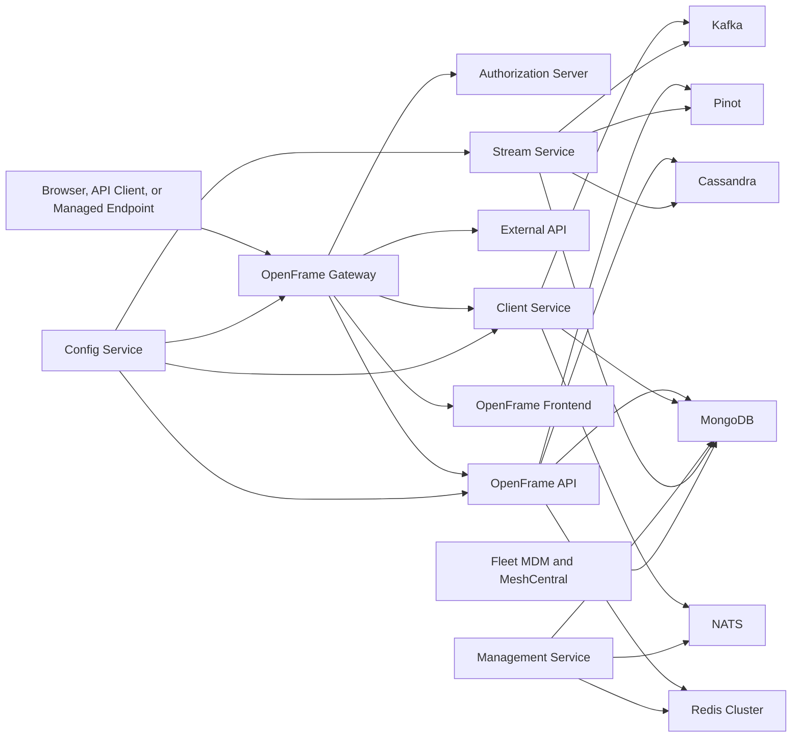
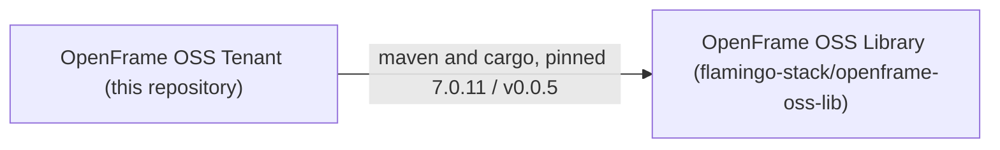
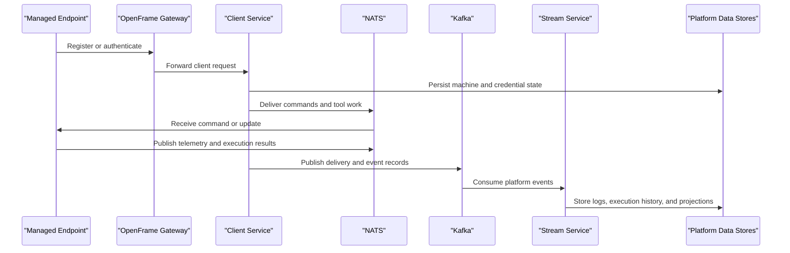
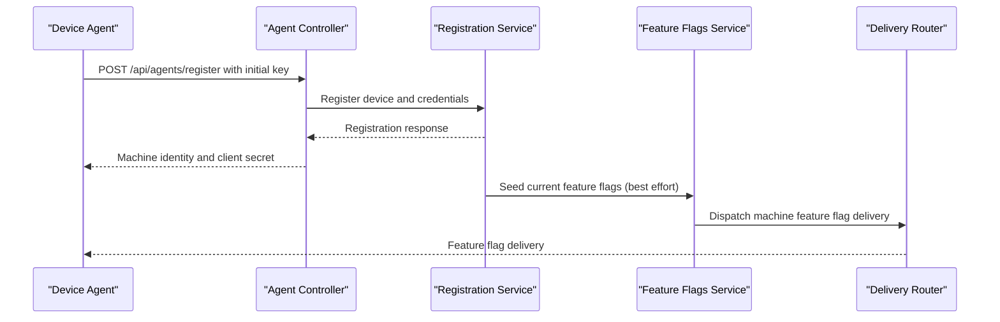
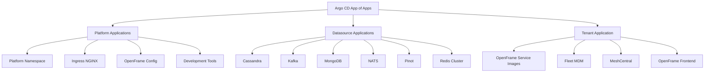

# Architecture Overview

OpenFrame OSS Tenant is the deployable, self-hosted tenant distribution for [OpenFrame](https://openframe.ai). It assembles Spring Boot services, Kubernetes manifests, shared runtime configuration, and endpoint-agent integrations into a single AI-driven MSP platform stack. Most domain logic is consumed from the **OpenFrame OSS Library** (`com.openframe.oss:*`, pinned at version `7.0.11`); this repository owns the tenant-specific service entry points, runtime configuration, Helm charts, Argo CD application definitions, and the release delivery pipeline.

> This repository publishes nine Maven artifacts and one Cargo crate. No other repository in the organization is recorded as a consumer of these artifacts — this is a leaf service in the dependency graph, not a shared library.

## High-Level Architecture

Every service in this diagram is a thin Spring Boot composition layer: the entry-point classes (for example `ApiApplication`, `GatewayApplication`, `ClientApplication`) are only a few lines of Spring Boot bootstrap. The actual behavior — REST and GraphQL handling, OAuth flows, NATS/Kafka listeners, package catalogs, RMM dispatch — is implemented in the OpenFrame OSS Library and pulled in as a `*-service-core` Maven dependency per service. This repository's job is composition, configuration, and deployment, not domain logic.

### Ecosystem position

The repository graph (`get_repo_ecosystem`) confirms this is a one-directional dependency: OpenFrame OSS Tenant pulls `com.openframe.oss:*` Maven artifacts and the `openframe_agent_lib` Cargo crate from OpenFrame OSS Library at pinned versions, and no other repository is recorded as consuming anything this repository publishes. Coverage is `full`, meaning this absence of downstream consumers is confirmed organization-wide, not merely unobserved.

## Core Components

| Component | Maven artifact | Upstream library dependency | Runtime role |
| --- | --- | --- | --- |
| OpenFrame Gateway | `com.openframe:openframe-gateway` | `openframe-gateway-service-core` | Reactive edge router: JWT boundary, API-key enforcement, CORS, WebSocket and tool proxying. Routes `/sas/**`, `/api/**`, `/api-docs/**`, `/clients/**`, and remaining traffic to the frontend. |
| OpenFrame Authorization Server | `com.openframe:openframe-authorization-server` | `openframe-authorization-service-core` | Multi-tenant OAuth 2.0 / OpenID Connect server: password login, tenant discovery, invitation acceptance, SSO (Google, Microsoft, Apple), signed JWT issuance. |
| OpenFrame API | `com.openframe:openframe-api` | `openframe-api-service-core`, `openframe-api-lib` | Main REST and GraphQL service: devices, organizations, tickets, RMM commands, software catalog, knowledge base, notifications. |
| OpenFrame External API | `com.openframe:openframe-external-api` | `openframe-external-api-service-core` | API-key-protected REST surface for third-party integrations: customers, devices, tickets, logs, integrated tools. |
| OpenFrame Client | `com.openframe:openframe-client` | `openframe-client-core` | Managed-endpoint registration, authentication, telemetry ingestion (NATS), delivery dispatch, RMM scheduling and execution tracking. |
| OpenFrame Management | `com.openframe:openframe-management` | `openframe-management-service-core` | Startup reconciliation, NATS stream provisioning, Fleet setup, package catalog synchronization, scheduled maintenance jobs. |
| OpenFrame Stream | `com.openframe:openframe-stream` | `openframe-stream-service-core` | Kafka event consumption: normalization, enrichment, log routing/storage, execution-history updates, Fleet software projection. |
| OpenFrame Config | `com.openframe:openframe-config` | `openframe-config-core` | Spring Cloud Config Server; serves shared `configs/base` and profile configuration plus reusable Logback XML over HTTP. |
| OpenFrame Test | `com.openframe:openframe-test` | `openframe-test-service-core` | Shared integration, UI, API, and end-to-end test infrastructure artifact for the tenant. |
| OpenFrame Client (agent) | `openframe_client` (Cargo) | `openframe_agent_lib` (git-pinned `v0.0.5`) | Rust endpoint-agent binary: enrollment, NATS messaging, script execution, tool lifecycle, logging, durable result delivery. |

Supporting data and messaging infrastructure, deployed from `manifests/datasources`, backs these services: **MongoDB** (primary document store), **Redis Cluster** (caching and ShedLock distributed locks), **Cassandra** and **Pinot** (log storage and analytical projections), **Kafka** and **Zookeeper** (event streaming and Debezium CDC), and **NATS** (device/agent messaging). **Fleet MDM** and **MeshCentral**, deployed from `manifests/tenant`, are the integrated RMM and remote-access tools this platform orchestrates.

## Data Flow: Control Plane and Endpoint Interaction

A more detailed view of agent registration, as implemented by `openframe-client-core` (the library module running inside the OpenFrame Client service):

Registration is deliberately decoupled from feature-flag delivery: a flag-dispatch failure is logged but never turns a successful registration into a failed one. The resulting access and refresh tokens are issued from `/oauth/token`, signed as JWTs carrying `machine_id`, `grant_type`, and role claims.

## Deployment Architecture

The tenant is delivered as Argo CD applications structured in three layers — platform, datasources, and tenant — synchronized through an app-of-apps chart.

Namespace-creation applications run at a lower Argo CD sync wave (`-1`) than the services that depend on them (wave `0`), as defined in `manifests/apps/values.yaml`. Service container images are published by `.github/workflows/release.yml` to `ghcr.io/flamingo-stack/openframe-oss-tenant/<service>`, and the tenant Helm chart (`manifests/tenant`) references those images plus the externally published `ghcr.io/flamingo-stack/fleetmdm/fleet` and `ghcr.io/flamingo-stack/meshcentral/meshcentral` images, along with the separately-maintained `ghcr.io/flamingo-stack/openframe-oss-frontend/openframe-oss-frontend` image.

Gateway routing, defined in `configs/base/openframe-gateway.yml`, maps:

| Path | Destination |
| --- | --- |
| `/sas/**` | `openframe-authorization-server` |
| `/api-docs/**` | `openframe-external-api` (Swagger docs) |
| `/api/**` | `openframe-api` |
| `/clients/**` | `openframe-client` |
| `/**` (remaining) | `openframe-frontend` |

## Key Design Decisions

### 1. Tenant repository as thin composition layer over a shared library

Every service module under `openframe/services/` (for example `openframe/services/openframe-api/pom.xml`) declares exactly one `*-service-core` or `*-core` dependency from `com.openframe.oss`, plus Spring Boot/Spring Cloud starters. The actual application class (such as `ApiApplication`, `GatewayApplication`, or `OpenFrameAuthorizationServerApplication`) contains only Spring Boot bootstrap code. This keeps business logic, security rules, and persistence behavior centralized in **OpenFrame OSS Library**, version-pinned at `7.0.11` across every service so the whole tenant upgrades the shared domain layer atomically.

### 2. Centralized version pinning through the parent POM

The root `pom.xml` defines `<openframe.libs.version>7.0.11</openframe.libs.version>` once and every service module inherits it. This, combined with a long list of CVE-driven version overrides (Jackson, Tomcat, BouncyCastle, Thrift, lz4-java, Freemarker, Plexus Utils) in `dependencyManagement`, shows the project treats supply-chain security patching as a first-class, centrally-managed concern rather than something each service manages independently.

### 3. Tenant-scoped signing keys and JWT claims

The Authorization Server resolves JWT signing keys per active tenant rather than using a single shared key. A JWKS request with no resolved tenant context is treated as a hard error, not a fallback to a default key. Access tokens are stamped with `tenant_id`, `userId`, and effective roles, making tenant isolation part of the token contract rather than an API-layer afterthought. See `docs/reference/architecture/openframe-authorization-service-core/security_and_tenant_context.md`.

### 4. Gateway-stamped tenant domain propagation

The gateway injects a trusted tenant-domain header that downstream services (such as the API service's `TenantDomainProvider`) read rather than re-deriving tenant context from request input. This keeps tenant resolution authoritative and prevents a client from spoofing tenant identity by manipulating a request body or query parameter.

### 5. Separate reactive and synchronous MongoDB access layers

The platform depends on both `openframe-data-mongo-sync` and `openframe-data-mongo-reactive` as distinct upstream artifacts, built on the shared `openframe-data-mongo-common` document/enum layer. Synchronous services (API, Client) and reactive flows (Gateway, Authorization Server) each get the access pattern appropriate to their Spring stack, while sharing one canonical `Device` document model and workflow enum vocabulary — avoiding duplicated or diverging domain types across sync and reactive code paths.

### 6. Durable execution state before message dispatch

The RMM and package-update subsystems (`openframe-client-core`, consumed by the Client service) persist execution-tracking rows — a running `PackageUpdateDeviceState`, a queued `ScriptExecution`, a `ProcessedCommand` dedup record — **before** publishing a NATS or Kafka message to the device. This "persist then publish" ordering means a crash between persistence and delivery leaves recoverable state rather than an orphaned in-flight command, and duplicate or redelivered messages can be detected and skipped.

### 7. Distributed, ShedLock-coordinated scheduling

Scheduled jobs in the Client service (device-online dispatch, script-schedule runner, execution watchdog) use Redis-backed `ShedLock` with tenant- and environment-scoped lock keys, so multiple replicas of the same service never duplicate a sweep. Lock durations are bounded (minimum and maximum) so a crashed replica cannot indefinitely block the next scheduled run — correctness also depends on the underlying services' idempotent state transitions, not locking alone.

### 8. Fail-open policy for non-critical external checks

The disposable-email-domain checker (`openframe-core`) is explicitly designed to fail open: a timeout or malformed response from the external lookup service returns "not disposable" rather than blocking registration. This reflects a deliberate choice to prioritize platform availability over a secondary anti-abuse signal.

### 9. Best-effort post-registration enrichment

Feature-flag seeding after agent registration, ticket-history writes after a status transition, and Apple-token revocation sweeps all follow the same pattern: the primary operation (registration, ticket transition, token issuance) must succeed independently, and secondary enrichment is logged-and-swallowed on failure rather than rolling back or failing the primary action.

### 10. Database-per-datastore specialization

Rather than a single general-purpose database, the platform routes different data shapes to purpose-built stores: MongoDB for tenant documents and workflow state, Cassandra and Pinot for high-volume log and analytical data (with a configurable cutover timestamp between them via `openframe.tool-events.store` and `openframe.tool-events.loki-since`), Redis for caching and distributed locks, and Kafka/NATS for event and command transport respectively.

## Related Documentation

For a full breakdown of each OpenFrame OSS Library module consumed by this tenant — including the Authorization Server's SSO flows, the Client Core's registration and telemetry pipeline, the API Service Core's GraphQL data fetchers, and the Stream Service Core's enrichment pipeline — see the reference architecture documentation, which documents each upstream module in detail.

