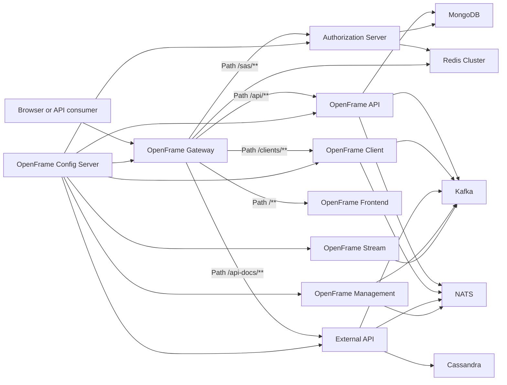
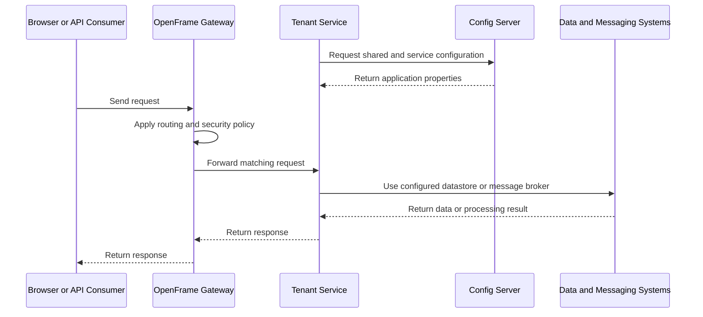

# Architecture Overview

OpenFrame OSS Tenant is the tenant-facing service and deployment repository for OpenFrame, Flamingo's unified AI-driven MSP platform. It is a **service** repository (bash, java, rust) that assembles independently deployable Spring Boot services, a Rust client agent, centralized configuration, event processing, and Kubernetes/Helm manifests into an operable tenant environment.

The repository publishes nine Maven service artifacts (`com.openframe:openframe-api`, `openframe-authorization-server`, `openframe-client`, `openframe-config`, `openframe-external-api`, `openframe-gateway`, `openframe-management`, `openframe-stream`, `openframe-test`) and one Cargo crate (`openframe_client`). Shared application capabilities — API, authorization, data, security, gateway, and messaging implementations — are supplied by the pinned [OpenFrame OSS Library](https://github.com/flamingo-stack/openframe-oss-lib) dependencies at version `7.0.11` (and `openframe_agent_lib` at `v0.0.5` for the Rust agent). Per the organization's repository graph (coverage: full), no other managed repository currently consumes this repository's published artifacts — it sits at the end of the dependency chain, consuming the OSS Library rather than being consumed itself.

## High-Level Architecture

Every backend service is an independent Spring Boot application built from the shared parent POM at [`pom.xml`](https://github.com/flamingo-stack/openframe-oss-tenant/blob/main/pom.xml), which pins Spring Boot `4.1.1`, Spring Cloud `2025.1.3`, Java `25`, and the `openframe.libs.version` property (`7.0.11`) used across every OpenFrame OSS Library dependency. Each service module's own `pom.xml` adds only the one or two OpenFrame library artifacts specific to its role (for example, `openframe-api-service-core` for the API service, `openframe-gateway-service-core` and `openframe-security-oauth` for the gateway).

The platform's agent side is a thin Rust binary: [`clients/openframe-client/src/main.rs`](https://github.com/flamingo-stack/openframe-oss-tenant/blob/main/clients/openframe-client/src/main.rs) calls straight into `openframe::run()`, with all logic living in the `openframe-agent-lib` crate pulled from the [OpenFrame OSS Library](https://github.com/flamingo-stack/openframe-oss-lib) repository at git tag `v0.0.5` (declared in [`clients/openframe-client/Cargo.toml`](https://github.com/flamingo-stack/openframe-oss-tenant/blob/main/clients/openframe-client/Cargo.toml)). This is a separate `openframe-client` artifact from the Java `openframe-client` Spring Boot service — the Rust binary is the endpoint agent, while the Java service is the backend client API.

## Core Components

| Component | Module path | Role | Gateway route | Key dependency |
|---|---|---|---|---|
| OpenFrame Gateway | [`openframe/services/openframe-gateway`](https://github.com/flamingo-stack/openframe-oss-tenant/tree/main/openframe/services/openframe-gateway) | Reactive edge service; routing, CORS, OAuth/JWT validation, rate limiting | — (entry point, port `8100`) | `openframe-gateway-service-core`, `openframe-security-oauth` |
| Authorization Server | [`openframe/services/openframe-authorization-server`](https://github.com/flamingo-stack/openframe-oss-tenant/tree/main/openframe/services/openframe-authorization-server) | OAuth2/OIDC authorization server, `/sas` context path, port `9005` | `/sas/**` | `openframe-authorization-service-core`, `openframe-data-redis` |
| OpenFrame API | [`openframe/services/openframe-api`](https://github.com/flamingo-stack/openframe-oss-tenant/tree/main/openframe/services/openframe-api) | Core API, data, notification, Kafka composition root, port `8090` | `/api/**` | `openframe-api-service-core`, `openframe-data-redis` |
| OpenFrame Client (Java) | [`openframe/services/openframe-client`](https://github.com/flamingo-stack/openframe-oss-tenant/tree/main/openframe/services/openframe-client) | Client-facing backend, Kafka producer, excludes Cassandra health indicator, port `8097` | `/clients/**` | `openframe-client-core`, `openframe-data-redis` |
| External API | [`openframe/services/openframe-external-api`](https://github.com/flamingo-stack/openframe-oss-tenant/tree/main/openframe/services/openframe-external-api) | Programmatic/API-key access, OpenAPI docs, ports `8092`/`8093` | `/api-docs/**`, `/swagger-ui/**`, `/webjars/**`, `/external-api/**` | `openframe-external-api-service-core` |
| Config Server | [`openframe/services/openframe-config`](https://github.com/flamingo-stack/openframe-oss-tenant/tree/main/openframe/services/openframe-config) | Centralized configuration source for all services, ports `8888`/`8889` | — (internal platform dependency) | `openframe-config-core` |
| Management Service | [`openframe/services/openframe-management`](https://github.com/flamingo-stack/openframe-oss-tenant/tree/main/openframe/services/openframe-management) | Management, data, core composition root; supplies no extra NATS JetStream streams | — (internal) | `openframe-management-service-core` (via OSS Library) |
| Stream Service | [`openframe/services/openframe-stream`](https://github.com/flamingo-stack/openframe-oss-tenant/tree/main/openframe/services/openframe-stream) | Consumes inbound Kafka log events and dispatches by message type | — (Kafka consumer only) | `openframe-stream-service-core` (via OSS Library) |
| OpenFrame Client (Rust agent) | [`clients/openframe-client`](https://github.com/flamingo-stack/openframe-oss-tenant/blob/main/clients/openframe-client/src/main.rs) | Endpoint agent binary, thin wrapper over `openframe-agent-lib` | — (external, communicates via NATS/Kafka) | `openframe-agent-lib` (cargo, `v0.0.5`) |
| OpenFrame Test | `openframe/services/openframe-test` | Shared test-support module | — | `openframe-test-service-core` |

Shared configuration for all services lives under `configs/base`, for example [`configs/base/application.yml`](https://github.com/flamingo-stack/openframe-oss-tenant/blob/main/configs/base/application.yml) (MongoDB, Redis, Cassandra, Pinot, management, logging, encryption, tenant-isolation defaults) and per-service files such as [`configs/base/openframe-gateway.yml`](https://github.com/flamingo-stack/openframe-oss-tenant/blob/main/configs/base/openframe-gateway.yml).

## Data Flow

At startup, every tenant service pulls its configuration from the Config Server before serving traffic. At request time, the gateway applies CORS, OAuth/JWT validation, and rate-limit policy before forwarding to the matched backend service, which reads from or writes to its configured datastore (MongoDB, Redis Cluster, Cassandra, Pinot) or message broker (Kafka, NATS) and returns a response back through the gateway.

For asynchronous workloads, the Stream service listens on a configured Kafka topic independently of the gateway's synchronous request path: `LogsEventListener` (in [`openframe/services/openframe-stream/src/main/java/com/openframe/stream/listener/LogsEventListener.java`](https://github.com/flamingo-stack/openframe-oss-tenant/blob/main/openframe/services/openframe-stream/src/main/java/com/openframe/stream/listener/LogsEventListener.java)) is conditional on `openframe.oss-tenant.kafka.topics.inbound.logs-events.name`, joins the consumer group `openframe-oss-logs-events-group`, reads the `message-type` Kafka header to classify each `CommonDebeziumMessage`, and delegates to a generic JSON message processor, logging (without rethrowing) any processing failure.

## Deployment Topology

```mermaid
flowchart TD
    Release["Release workflow"] --> Images["Service container images"]
    Release --> AppChart["App-of-apps Helm chart"]

    AppChart --> Platform["Platform applications"]
    AppChart --> Datasources["Datasource applications"]
    AppChart --> Tenant["Tenant application"]

    Platform --> ConfigServer["OpenFrame Config"]
    Platform --> Ingress["Ingress NGINX"]
    Platform --> DevTools["Development tools"]

    Datasources --> Mongo["MongoDB"]
    Datasources --> Redis["Redis Cluster"]
    Datasources --> Kafka["Kafka"]
    Datasources --> Nats["NATS"]
    Datasources --> Cassandra["Cassandra"]
    Datasources --> Pinot["Pinot"]
    Datasources --> Mysql["MySQL for Fleet"]
    Datasources --> Debezium["Debezium Connect"]

    Tenant --> Gateway["OpenFrame Gateway"]
    Tenant --> Api["OpenFrame API"]
    Tenant --> Authz["Authorization Server"]
    Tenant --> Client["OpenFrame Client"]
    Tenant --> ExternalApi["External API"]
    Tenant --> Management["OpenFrame Management"]
    Tenant --> Stream["OpenFrame Stream"]
    Tenant --> Frontend["OpenFrame Frontend"]
```

The [`.github/workflows/release.yml`](https://github.com/flamingo-stack/openframe-oss-tenant/blob/main/.github/workflows/release.yml) workflow publishes a container image per service under `ghcr.io/flamingo-stack/openframe-oss-tenant/` and packages the app-of-apps Helm chart from `./manifests/app-of-apps` as `oci://ghcr.io/flamingo-stack/openframe-oss-tenant/app-of-apps`. Argo CD then rolls the app-of-apps out via [`manifests/apps/values.yaml`](https://github.com/flamingo-stack/openframe-oss-tenant/blob/main/manifests/apps/values.yaml) in waves: platform applications (`manifests/platform/namespace-platform`, `manifests/platform/ingress-nginx`, `manifests/platform/dev-tools`, `manifests/platform/openframe-config`) at wave -1/0, datasource applications (`manifests/datasources/cassandra`, `kafka`, `mongodb`, `mongodb-meshcentral`, `mysql-fleetmdm`, `nats`, `pinot`, `redis-cluster`, `zookeeper`, `debezium-connect`) at wave 0, and the tenant application chart under [`manifests/tenant`](https://github.com/flamingo-stack/openframe-oss-tenant/tree/main/manifests/tenant) last, which brings in the `fleet` and `meshcentral` OCI charts plus every tenant service image.

## Key Design Decisions

**Thin bootstrap, heavy library.** Every Java service's application class (`ApiApplication`, `OpenFrameAuthorizationServerApplication`, `ClientApplication`, `ConfigServerApplication`, `ExternalApiApplication`, `GatewayApplication`, `ManagementApplication`, `StreamApplication`) is intentionally minimal: `@SpringBootApplication` plus an explicit `@ComponentScan` across a short, fixed list of package roots (for example, `ApiApplication` scans `com.openframe.api`, `com.openframe.data`, `com.openframe.core`, `com.openframe.notification`, `com.openframe.kafka`). All actual request handling, persistence, and protocol logic is contributed by the pinned OpenFrame OSS Library artifacts at `7.0.11`, keeping this repository focused on composition, configuration, and deployment rather than business logic. The same pattern holds for the Rust client: [`clients/openframe-client/src/main.rs`](https://github.com/flamingo-stack/openframe-oss-tenant/blob/main/clients/openframe-client/src/main.rs) is a single-line call into the shared `openframe-agent-lib` crate.

**Centralized configuration over embedded config.** All services depend on `spring-cloud-starter-config` and fetch configuration from the Config Server (deployed first, in the platform wave) rather than embedding full settings in each service. Shared settings (datastore connection strings, management/observability paths, tenant isolation) live once in `configs/base/application.yml`; only service-specific overrides live in each service's own YAML file.

**Gateway as the single routing and security boundary.** `GatewayApplication` centralizes CORS, OAuth/JWT validation, rate limiting, and path-based routing. Authorization traffic (`/sas/**`) is forwarded without a strip-prefix filter so the authorization server's own `/sas` context path lines up; `/api/**`, `/clients/**`, and `/external-api/**` each have their leading segment stripped before reaching their backend; and `/**` falls through to the frontend as the catch-all last route. This keeps routing logic in one declarative configuration file rather than duplicated across services.

**Deliberate exclusions over implicit defaults.** The Client service explicitly filters out `CassandraHealthIndicator` from its component scan (`ClientApplication`), and the Management service supplies an empty `NoAdditionalStreamConfigurationProvider` to opt out of extra NATS JetStream stream definitions ([`NoAdditionalStreamConfigurationProvider.java`](https://github.com/flamingo-stack/openframe-oss-tenant/blob/main/openframe/services/openframe-management/src/main/java/com/openframe/management/initializer/NoAdditionalStreamConfigurationProvider.java)). Both are narrow, intentional opt-outs from library defaults rather than broad feature removal, and both must be revisited consciously if the service's data or messaging footprint changes.

**One topic, header-based event typing for streaming.** Rather than one Kafka topic per event type, the Stream service's `LogsEventListener` subscribes to a single configured inbound topic and uses the `message-type` Kafka header to route each `CommonDebeziumMessage` to the right processing logic, keeping topic management simple while still supporting multiple logical event kinds.

**Polyglot persistence, matched to workload.** The platform deploys MongoDB (document data), Redis Cluster (cache and distributed state), Cassandra (tool/event storage, used by the External API service), Kafka (event streams and service messaging), NATS (messaging and stream integration), Pinot (analytics), and MySQL (for the Fleet MDM dependency) as separate datasource Argo CD applications, letting each service pick only the stores it needs via shared configuration rather than a single general-purpose database.

**GitOps delivery via app-of-apps.** The release workflow's only deployment artifact beyond container images is the app-of-apps Helm chart; Argo CD sync waves (platform, then datasources, then tenant) encode the dependency order explicitly in `manifests/apps/values.yaml` instead of relying on runtime retry logic to paper over startup ordering.

For a deeper look at any individual service's internals, see the architecture reference docs for the [ecosystem](../../reference/architecture/ecosystem.md), [API service core](../../reference/architecture/api-service-core/api-service-core.md), [authorization server core](../../reference/architecture/authorization-server-core/authorization-server-core.md), [client service core](../../reference/architecture/client-service-core/client-service-core.md), [config server core](../../reference/architecture/config-server-core/config-server-core.md), [external API service](../../reference/architecture/external-api-service/external-api-service.md), [gateway service core](../../reference/architecture/gateway-service-core/gateway-service-core.md), [management service core](../../reference/architecture/management-service-core/management-service-core.md), and [stream service core](../../reference/architecture/stream-service-core/stream-service-core.md).

The OpenFrame CLI tooling referenced elsewhere in the documentation set is maintained separately at [flamingo-stack/openframe-cli](https://github.com/flamingo-stack/openframe-cli) and is not part of this repository.

For a product-level walkthrough of OpenFrame before diving into this architecture, see the OpenFrame product walkthrough below.

Questions and coordination about this architecture are handled through the [OpenMSP Slack community](https://www.openmsp.ai/) rather than GitHub Issues or Discussions.
