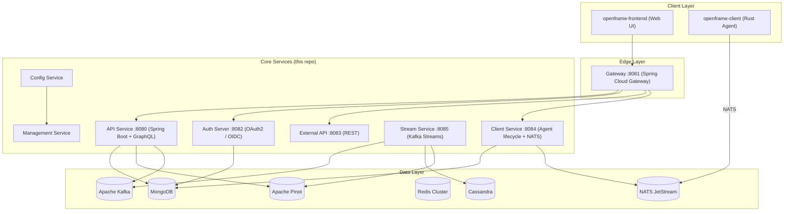
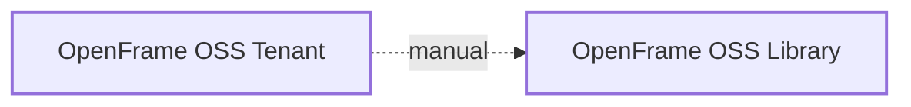
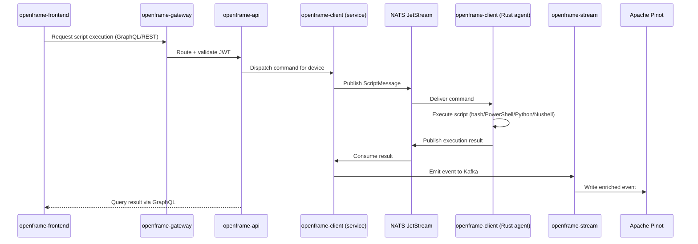
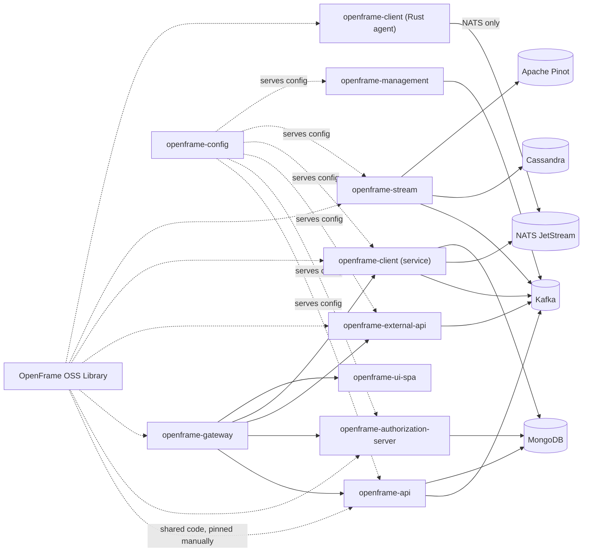

#  Architecture Overview

OpenFrame OSS Tenant is the multi-service, multi-tenant open-source foundation of the OpenFrame platform — the unified, AI-driven MSP tooling layer built by [Flamingo](https://flamingo.run). This repository hosts the Spring Boot backend services (API, Gateway, Authorization Server, External API, Client, Stream, Management, Config), the cross-platform `openframe-client` Rust agent, and the Kubernetes manifests that deploy and wire everything together.

This document gives a system-level view of the repository: how its services fit together, what each one is responsible for, how a request flows end to end, and the design decisions behind the layout. For the CLI used to manage agents and clusters, see the external [OpenFrame CLI repository](https://github.com/flamingo-stack/openframe-cli); it is maintained separately from this repository.

## High-Level Architecture

The platform is organized into four layers: a client layer (web UI and the Rust device agent), an edge layer (the API gateway), a set of core backend services owned by this repository, and a data layer of managed datastores and message buses provisioned via the Kubernetes manifests in `manifests/`.

All inbound client traffic — from the web UI and from the External API's own callers — enters through `openframe-gateway`, which validates JWTs and routes to the appropriate backend service. Services talk to each other synchronously over HTTP/GraphQL and asynchronously over Apache Kafka and NATS JetStream. The Rust agent, `openframe-client`, never calls HTTP endpoints directly: it communicates with the platform exclusively through NATS.

### Repository ecosystem

The code graph records this repository as a **service** (bash, java, rust) with one upstream dependency and no recorded downstream consumer:

The upstream dependency, [OpenFrame OSS Library](https://github.com/flamingo-stack/openframe-oss-lib), is pinned manually rather than through a version-manager edge. Concretely:

- `clients/openframe-client/Cargo.toml` pins `openframe-agent-lib` as a git dependency at tag `v0.0.5` from that repository; the Rust binary in `clients/openframe-client/src/main.rs` is a thin wrapper that immediately calls `openframe::run()`.
- Every Java `pom.xml` in `openframe/services/*` depends on a `*-service-core` or `*-core` artifact under group `com.openframe.oss` (for example `openframe-api-service-core`, `openframe-authorization-service-core`, `openframe-client-core`, `openframe-config-core`, `openframe-external-api-service-core`), all resolved at `${openframe.libs.version}` (`7.0.11`, declared in the root `pom.xml`). These artifacts are published from `openframe-oss-lib`.

The index coverage for this ecosystem is **full**: no other managed repository consumes `com.openframe:*` or the `openframe_client` crate published here, so the published Maven artifacts and the Cargo crate are currently private to this repository's own build graph rather than shared libraries for other services.

## Core Components

| Component | Language / Framework | Port | Responsibility |
|---|---|---|---|
| `openframe-api` | Java / Spring Boot 4.1 + GraphQL | 8080 | REST + GraphQL APIs: tickets, dialogs, AI settings, tenant management |
| `openframe-authorization-server` | Java / Spring Authorization Server | 8082 | Multi-tenant OAuth2/OIDC; JWT issuance; SSO |
| `openframe-gateway` | Java / Spring Cloud Gateway | 8081 | Security enforcement, JWT validation, routing, WebSocket proxy |
| `openframe-external-api` | Java / Spring Boot | 8083 | Rate-limited public API endpoints with API key management |
| `openframe-client` (service) | Java / Spring Boot + NATS | 8084 | Agent lifecycle management and tool orchestration (MeshCentral, FleetMDM) |
| `openframe-stream` | Java / Kafka Streams | 8085 | Real-time event normalization, enrichment, Cassandra/Pinot writes |
| `openframe-management` | Java / Spring Boot | — | Platform/tenant management operations |
| `openframe-config` | Java / Spring Cloud Config | — | Centralized configuration serving to every other service |
| `openframe-client` (agent) | Rust | — | Cross-platform system agent: device registration, script execution |
| `openframe-test` | Java | — | Shared test support module (not a deployed service) |

Every Java service is a module of the root Maven POM (`pom.xml`), built with the Spring Boot `4.1.1` parent and Java `25`. Each service's own `pom.xml` adds exactly one `*-service-core` or `*-core` dependency from `openframe-oss-lib` plus thin Spring Boot starters — the actual business logic for each service lives in that upstream library, and this repository's module is primarily a deployable shell with its own component-scan configuration, Kubernetes manifest, and container image.

For example, `openframe-api/pom.xml` depends on `openframe-api-service-core` and `openframe-data-redis`, plus `spring-cloud-starter-config` (to pull configuration from `openframe-config` at startup) and plain `spring-boot-starter`. The entry-point class, `ApiApplication` (`openframe/services/openframe-api/src/main/java/com/openframe/api/ApiApplication.java`), scans `com.openframe.api`, `com.openframe.data`, `com.openframe.core`, `com.openframe.notification`, and `com.openframe.kafka` — pulling in shared beans from the library rather than redefining them locally. The other services follow the same pattern with their own package lists; see `ClientApplication.java`, `GatewayApplication.java`, `ManagementApplication.java`, `ExternalApiApplication.java`, `OpenFrameAuthorizationServerApplication.java`, and `ConfigServerApplication.java` under their respective `openframe/services/<name>/src/main/java/...` directories.

The Rust agent is comparatively minimal at the repository level: `clients/openframe-client/src/main.rs` contains only a `main()` that calls `openframe::run()`, with all configuration loading, command handling, and self-update logic implemented in the `openframe-agent-lib` crate pinned in `clients/openframe-client/Cargo.toml`.

## Data Flow

The sequence below traces a device script execution — a representative end-to-end flow spanning every layer of the architecture: a technician triggers a script through the web UI, the gateway routes and authenticates the request, the Client service hands the command to the agent over NATS, and the execution result flows back through Kafka Streams into Pinot for analytics.

Routing for this flow is defined declaratively in `configs/base/openframe-gateway.yml`, which maps `Path=/sas/**` to the authorization server, `Path=/api-docs/**` to the external API's Swagger docs, `Path=/api/**` to `openframe-api`, `Path=/clients/**` to `openframe-client`, and the catch-all `Path=/**` to the frontend SPA. Shared datasource endpoints (MongoDB, Redis Cluster, Cassandra, Pinot controller/broker) are centralized in `configs/base/application.yml`, while Kafka and NATS bootstrap servers are declared per-service in `configs/base/openframe-api.yml`, `configs/base/openframe-client.yml`, `configs/base/openframe-external-api.yml`, `configs/base/openframe-management.yml`, and `configs/base/openframe-stream.yml`.

### Component relationships

`openframe-config` serves centralized Spring Cloud configuration to every other Java service at startup (each service's `pom.xml` depends on `spring-cloud-starter-config` to pull it). In deployment, `manifests/platform/openframe-config` ships the Config Service's own chart, pointed at the `ghcr.io/flamingo-stack/openframe-oss-tenant/openframe-config` image, and is deployed ahead of the tenant workloads as part of the `platform` Argo CD wave.

## Deployment topology

The Kubernetes manifests under `manifests/` assemble the full platform through Argo CD, driven by `manifests/apps/values.yaml`. Two waves run before the tenant services: the `platform` wave (`manifests/platform/namespace-platform`, `manifests/platform/ingress-nginx`, `manifests/platform/dev-tools`, `manifests/platform/openframe-config`) and the `datasources` wave (`manifests/datasources/cassandra`, `manifests/datasources/kafka`, `manifests/datasources/mongodb`, `manifests/datasources/mongodb-meshcentral`, `manifests/datasources/mysql-fleetmdm`, `manifests/datasources/nats`, `manifests/datasources/pinot`, `manifests/datasources/redis-cluster`, `manifests/datasources/zookeeper`, plus `manifests/datasources/debezium-connect`).

The `manifests/tenant` chart then assembles the backend service images built by this repository — `openframe-api`, `openframe-authorization-server`, `openframe-client`, `openframe-external-api`, `openframe-gateway`, `openframe-management`, `openframe-stream` (all under `ghcr.io/flamingo-stack/openframe-oss-tenant/<service>`) — together with the separately published `openframe-oss-frontend` UI image and two third-party OCI charts: FleetMDM (`oci://ghcr.io/flamingo-stack/fleetmdm/helm-charts/fleet`) and MeshCentral (`oci://ghcr.io/flamingo-stack/meshcentral/helm-charts/meshcentral`).

`.github/workflows/release.yml` is the single CI/CD pipeline that builds and publishes every service's container image plus the `app-of-apps` Helm chart (`oci://ghcr.io/flamingo-stack/openframe-oss-tenant/app-of-apps`, from `./manifests/app-of-apps`) on release.

## Key Design Decisions

> **Thin deployable shells over a shared library.** Every Java service's `pom.xml` pulls in exactly one `*-service-core` artifact from `openframe-oss-lib` (pinned to `${openframe.libs.version}`, currently `7.0.11`) rather than reimplementing business logic locally. This keeps the tenant repository focused on deployment concerns — entry-point classes, component-scan configuration, Kubernetes manifests, and release wiring — while the actual domain logic is versioned and evolved centrally in the library. The same pattern holds for the Rust agent: `clients/openframe-client/src/main.rs` is a five-line wrapper around `openframe::run()`, with the library pinned by git tag (`v0.0.5`) in `clients/openframe-client/Cargo.toml`.

> **Gateway-centric security enforcement.** All synchronous client traffic — from the web UI and external API callers alike — is required to pass through `openframe-gateway`, which validates JWTs before routing. The route table in `configs/base/openframe-gateway.yml` is the single declarative source of truth for which backend owns which path prefix, keeping routing logic out of individual services.

> **Agent isolation via NATS.** The Rust agent never calls backend HTTP endpoints directly; `configs/base/openframe-client.yml` wires `openframe-client` (the Java lifecycle service) to both Kafka and NATS, and the agent communicates exclusively over NATS JetStream. This decouples the agent's network footprint from the rest of the HTTP-routed platform and lets the Client service mediate everything the agent does — device registration, script dispatch, result collection — before it reaches Kafka.

> **Dual-path event storage.** Real-time events from `openframe-stream` (Kafka Streams) are written to both Cassandra (operational/time-series storage) and Apache Pinot (low-latency OLAP for dashboards and queries), as shown in the component relationships diagram. Shared connection endpoints for both stores are centralized in `configs/base/application.yml` rather than duplicated per service.

> **Centralized configuration serving.** `openframe-config` is a dedicated Spring Cloud Config service (module `openframe/services/openframe-config`, entry point `ConfigServerApplication`) that every other Java service depends on via `spring-cloud-starter-config`. This means environment-specific values live in one place (`configs/base/*.yml`) instead of being baked into each service's own packaged configuration.

> **Security-driven dependency overrides.** The root `pom.xml` pins several transitive dependencies (`plexus-utils`, `bcprov-lts8on`, `libthrift`, `async-http-client`, `lz4-java`, and the Kafka-specific `at.yawk.lz4` fork) above what the Spring Boot `4.1.1` BOM manages, explicitly to close HIGH/CRITICAL CVEs flagged by Trivy. Jackson is likewise pinned to the BOM's `3.1.x` minor line rather than `3.2`, because `3.2` rejects a type-id/type-property overlap used by the chat message model — a deliberate trade-off of a newer patch version for compatibility.

## Where to go next

For environment setup and local development instructions, see the [Development guide](../README.md), the [environment setup reference](../setup/environment.md), and [local development](../setup/local-development.md). Security practices and test strategy are covered in [Security](../security/README.md) and [Testing](../testing/README.md). Contribution conventions live in [Contributing guidelines](../contributing/guidelines.md). A deeper reference on this repository's module layout and dependency graph is available at [Architecture reference](../../reference/architecture/overview.md) and [Ecosystem reference](../../reference/architecture/ecosystem.md), and the raw `.mmd` diagram sources behind this document are collected in [Architecture diagrams](../../diagrams/architecture/README.md).

If you are new to the project, start with the [Introduction](../../getting-started/introduction.md), check [Prerequisites](../../getting-started/prerequisites.md), then follow the [Quick Start](../../getting-started/quick-start.md) and [First Steps](../../getting-started/first-steps.md) guides.

This project does not use GitHub Issues or GitHub Discussions for support or feature requests; all community discussion happens in the [OpenMSP Slack community](https://join.slack.com/t/openmsp/shared_invite/zt-36bl7mx0h-3~U2nFH6nqHqoTPXMaHEHA).
