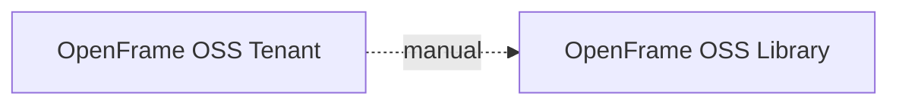

ic# Contributing Guidelines

OpenFrame OSS Tenant is the multi-service, multi-tenant open-source foundation of the OpenFrame platform — the AI-powered MSP platform built by [Flamingo](https://flamingo.run). The repository bundles the Spring Boot backend services (`openframe-api`, `openframe-gateway`, `openframe-authorization-server`, `openframe-external-api`, `openframe-client`, `openframe-stream`, `openframe-management`, `openframe-config`, `openframe-test`), the Kubernetes/Argo CD manifests that deploy them, and the Rust `openframe-client` agent under `clients/openframe-client`.

This guide covers code style, branching, commit messages, and the review checklist that applies before a change lands on `main`. For environment setup, see `../setup/environment.md` and `../setup/local-development.md`. For how the services fit together, see `../architecture/README.md` and `../../reference/architecture/ecosystem.md`.

> **Community, not Issues/PRs for discussion:** This project does not use GitHub Issues or GitHub Discussions for feature requests or support. All of that happens in the OpenMSP Slack community: [https://www.openmsp.ai/](https://www.openmsp.ai/) · [Join Slack](https://join.slack.com/t/openmsp/shared_invite/zt-36bl7mx0h-3~U2nFH6nqHqoTPXMaHEHA). GitHub pull requests remain the mechanism for proposing and reviewing code changes.

## How this repository fits the ecosystem

OpenFrame OSS Tenant is registered as a **service** publishing nine Maven artifacts under `com.openframe` (all `1.0.0-SNAPSHOT`) plus the `openframe_client` Cargo crate (`0.1.0`). It has one recorded upstream dependency — the [OpenFrame OSS Library](https://github.com/flamingo-stack/openframe-oss-lib), pinned manually (not via a version manager) — and no recorded downstream consumer. Coverage for this graph is `full`, meaning that absence is conclusive: nothing else in the organization currently depends on `com.openframe:*` or `openframe_client`.

Because this repository has no recorded internal consumers, a public API change here is lower-risk to the rest of the organization graph than a change to `openframe-oss-lib` itself — but the Rust agent build still depends directly on that library: `clients/openframe-client/Cargo.toml` pins `openframe-agent-lib` to a tag (`v0.0.5`) of `https://github.com/flamingo-stack/openframe-oss-lib.git`, and `clients/openframe-client/src/main.rs` is a thin wrapper that calls into it. If you are touching the CLI surface exposed by the separately maintained [openframe-cli](https://github.com/flamingo-stack/openframe-cli) tool, consult that repository's own [installation](https://github.com/flamingo-stack/openframe-cli#installation) and [documentation](https://github.com/flamingo-stack/openframe-cli/tree/main/docs) — it is not part of this codebase.

## Code style and conventions

### Java / Spring Boot services

All Java services share the parent `pom.xml` (`com.openframe:openframe-parent`), which is built on `spring-boot-starter-parent` 4.1.1 and targets Java 25. Each service module (`openframe/services/openframe-api`, `openframe-authorization-server`, `openframe-client`, `openframe-config`, `openframe-external-api`, `openframe-gateway`, `openframe-management`, `openframe-stream`, `openframe-test`) has its own `pom.xml` that inherits from the root and declares only the dependencies it adds on top of the shared BOM.

Conventions observed across the service modules:

- Lombok is used throughout (`org.projectlombok:lombok`, version pinned via `${lombok.version}`). Since JDK 23+ no longer auto-discovers annotation processors, any new module's `maven-compiler-plugin` configuration must keep Lombok and `spring-boot-configuration-processor` listed explicitly in `annotationProcessorPaths`, mirroring the root `pom.xml`'s `pluginManagement` block — do not drop this when adding a module.
- Shared, org-wide libraries (`openframe-core`, `openframe-data-mongo-common`, `openframe-data-redis`, `openframe-security-core`, `openframe-api-lib`, `fleetmdm`, and similar `com.openframe.oss:*` artifacts) are centrally versioned by the single `${openframe.libs.version}` property in the root `pom.xml`. Bump that one property rather than pinning an individual module to a different library version.
- Each Spring Boot application's entry point is a single `*Application.java` class under `src/main/java/com/openframe/<service>/`, e.g. `openframe/services/openframe-api/src/main/java/com/openframe/api/ApiApplication.java`, `openframe/services/openframe-gateway/src/main/java/com/openframe/gateway/GatewayApplication.java`. Keep this pattern for any new service: one `@SpringBootApplication` class per module, named `<Service>Application`.
- Security-sensitive dependency versions in the root `pom.xml` (`jackson-bom.version`, `jackson-2-bom.version`, `tomcat.version`, `bcprov-lts8on.version`, `libthrift.version`, etc.) are pinned deliberately above what the Spring Boot BOM would otherwise resolve, to close HIGH/CRITICAL CVEs reported by Trivy. Do not "simplify" these overrides back to the BOM default without checking whether the override exists for a CVE fix — the inline comments in `pom.xml` explain each one.
- Test dependencies (`spring-boot-starter-test`, `spring-security-test`, `mockito-core`, `mockito-junit-jupiter`) are declared once in the root POM's `dependencies` section and inherited by every module; do not redeclare them per-module.

### Rust client (`clients/openframe-client`)

`clients/openframe-client` is a thin binary crate (`openframe-client`, `0.1.0`) whose logic lives in the `openframe-agent-lib` crate pulled from `openframe-oss-lib`. `src/main.rs` should stay a thin entry point that delegates to that library; substantial agent logic belongs upstream in `openframe-oss-lib`, not inline in this repository.

Rules enforced on Rust files in this repository (apply them to any file under `clients/`):

- Every fallible call that returns `anyhow::Result` must attach a `.context("Failed to <verb> <component>")` description before propagating with `?` — a bare `?` is not acceptable on initialization paths, because it leaves no indication of which component failed.
- `Regex` values must be compiled exactly once via a `static` initializer (`once_cell::sync::Lazy` or `lazy_static!`), never constructed inline inside a function body.
- Writes to JSON state files that may be concurrently read by another process must use an atomic tmp-then-rename pattern (write to a `.tmp` file, then `fs::rename`) — a bare `fs::write` to the final path risks a reader observing a torn/partial file.
- CI enforces `RUSTFLAGS=-D warnings` and `clippy --deny clippy::all` across `--benches --tests --examples --all-features`; a new warning fails the build. Don't suppress a warning with `#[allow(...)]` without a comment explaining why.

Use the VS Code tasks in `.vscode/tasks.json` for local Rust workflows: `rust-build` (`cargo build`), `rust-build-release` (`cargo build --release`), `rust-test` (`cargo test`), `rust-check` (`cargo check`), and `rust-clippy` (`cargo clippy`), all run with working directory `${workspaceFolder}/client`.

### Kubernetes manifests and CI workflows

- Docker image build steps in GitHub Actions workflows must wrap `docker buildx build` in `nick-fields/retry@v4` with `max_attempts: 3`, `retry_wait_seconds: 5`, `timeout_minutes: 30`, passing the build invocation via `command:` rather than `run:` — see the `build_images` job in `.github/workflows/release.yml` for the reference pattern.
- Chart and manifest changes under `manifests/` follow the existing Argo CD app-of-apps structure (`manifests/apps`, `manifests/platform/*`, `manifests/datasources/*`, `manifests/tenant`); keep new datasources or platform components consistent with the `argocd_app` / `chart_dependency` / `chart_image` entries already present in the corresponding `Chart.yaml` and `values.yaml`.

### Editor and formatting defaults

`.vscode/settings.json` fixes the baseline every contributor's editor should match: `files.eol` is `\n`, `editor.tabSize` is 2 with `editor.insertSpaces` true, and Rust files additionally use `editor.formatOnSave` with `rust-lang.rust-analyzer` as the default formatter and a 4-space tab size override for `[rust]`. Match these settings (or configure your editor equivalently) before formatting a diff, to avoid unrelated whitespace noise in a PR.

## Ownership (CODEOWNERS)

`.github/CODEOWNERS` assigns review ownership by path (last match wins, broader patterns listed above more specific ones):

| Path | Owning team |
|---|---|
| `/openframe/` | `@flamingo-stack/backend-engineers` |
| `/clients/openframe-client/` | `@flamingo-stack/client-engineers` |
| `/configs/` | `@flamingo-stack/backend-engineers` |
| `/configs/base/` | `@flamingo-stack/tech-leads` and `@flamingo-stack/tech-heads-of` (Spring Cloud Config base profile — requires both) |
| `/manifests/` | `@flamingo-stack/devops-engineers` |
| `/.github/CODEOWNERS` | `@flamingo-stack/devops-engineers` |

A pull request touching `configs/base/` requires sign-off from both a tech lead and a head-of, reflecting that this file drives shared Spring configuration (MongoDB, Redis Cluster, Cassandra, Pinot connection endpoints) consumed by every backend service.

## Branch naming and PR process

Branch naming is not rigidly enforced by a single documented scheme in this repository, but the automation that runs on every push and pull request gives useful constraints to work within:

- **Default branch is `main`.** The release workflow (`.github/workflows/release.yml`) triggers on pushes to `main` that touch `manifests/**`, `openframe/**`, `integrated-tools/**`, `pom.xml`, or `clients/**`, building and publishing images and the Helm chart. Avoid pushing directly to `main`; land changes through a pull request.
- **Stale branches are pruned automatically.** `.github/workflows/cleanup.yml` runs a daily job (`stale-branches`) that deletes any unprotected branch with no commit in the last 60 days (`MAX_AGE_DAYS: "60"`). Keep your branch active (rebase or push) if you intend to keep it beyond that window, or expect it to be deleted.
- **Scope your branch to one logical change** — the CI `changes` job (`.github/workflows/changes.yaml`) uses path filters per component (`openframe-api`, `openframe-authorization-server`, `openframe-external-api`, `openframe-client`, `openframe-config`, `openframe-gateway`, `openframe-management`, `openframe-stream`, the Rust `client` crate, `openframe-test`, `helm`) to decide what to rebuild and release. A branch that mixes unrelated service changes makes the diff harder to review and can trigger a wider rebuild/release surface than intended.

### Opening a pull request

1. Fork or branch from `main`, make your change, and ensure it builds locally (`mvn clean install -DskipTests` for Java services; `cargo build` from `clients/openframe-client` with `OPENFRAME_VERSION` set for the Rust agent, as described in `../../reference/architecture/overview.md`).
2. Open the pull request against `main` at [https://github.com/flamingo-stack/openframe-oss-tenant/pulls](https://github.com/flamingo-stack/openframe-oss-tenant/pulls).
3. CODEOWNERS routes the review request automatically based on the paths you changed.
4. **Automated code review**: this repository runs the "🦩 Flamingo Code Review" workflow (`.github/workflows/flamingo-code-review.yml`). A review does **not** run automatically the moment a PR is opened — opening, reopening, or marking ready-for-review posts an **invitation comment** with a checkbox; checking it (or commenting `@flamingo-review`, or adding the `flamingo-review` label from the sidebar) starts the first pass. Commenting `@flamingo-review full` re-reads the whole cumulative diff instead of only the incremental delta since the last reviewed commit. Repeated pushes to an open PR do **not** re-trigger a review by themselves unless the PR carries the `flamingo-review-always` label (continuous review) or you explicitly ask again.
5. Address findings, keep pushing to the same branch, and ask for re-review via the same comment/checkbox/label mechanism once ready.
6. Once approvals from the relevant CODEOWNERS are in and checks are green, the PR can be merged. Merging into `main` for a path covered by the release workflow will trigger an image/chart build and publish.

### What CI validates on a PR

The "🦩 Flamingo Code Documentation" workflow (`.github/workflows/code-documentation.yml`) also runs a `code-graph` job on every push to the default branch (and is dispatchable for pull-request overlays); this rebuilds the deterministic code graph the review tooling and documentation pipeline rely on. It explicitly ignores `docs/**` and `**.md` changes, so documentation-only PRs do not trigger a graph rebuild.

## Commit message format

No single commit-message template is enforced by tooling in this repository's workflows; write commits that are clear, scoped to one logical change, and — when a change is a deliberate override or exception (as the version pins and CVE overrides in `pom.xml` are) — explain *why*, not just *what*, following the style of the inline comments already in `pom.xml` and the workflow files (e.g., the detailed rationale comments in `.github/workflows/flamingo-code-review.yml` explaining each trigger's purpose and security boundary). A good commit message in this codebase:

- States the component touched (service name, `manifests/<chart>`, `clients/openframe-client`, etc.) and the effect of the change.
- Calls out version bumps explicitly, e.g. referencing the property changed (`${openframe.libs.version}`, `${spring-boot.version}`) so a reviewer can cross-check the changelog of that dependency.
- For security-motivated dependency overrides, states the CVE class being avoided (as the existing `jackson-bom.version` / `bcprov-lts8on.version` overrides do in comments), so a future contributor does not silently "clean up" a deliberate pin.

## Review checklist

Before requesting (or performing) review, confirm:

- [ ] **Scope.** The branch touches one logical area (one service, one chart, the Rust client, or CI) and does not mix unrelated changes across the `openframe-api` / `openframe-gateway` / `openframe-authorization-server` / `openframe-client` / `openframe-stream` / `openframe-management` / `openframe-config` / `openframe-external-api` boundaries without reason.
- [ ] **Build passes.** `mvn clean install -DskipTests` succeeds for touched Java modules; `cargo build` (with `OPENFRAME_VERSION` set) succeeds for `clients/openframe-client` if Rust code changed.
- [ ] **No new compiler warnings in Rust.** CI enforces `RUSTFLAGS=-D warnings` and `clippy --deny clippy::all`; a warning introduced locally will fail CI.
- [ ] **Fallible Rust calls have context.** Any new `?`-propagated error in `clients/openframe-client` has a `.context("Failed to ...")` attached.
- [ ] **Shared JSON state writes are atomic.** Any new Rust code writing a state file another process may read uses the tmp-then-rename pattern, not a bare `fs::write`.
- [ ] **Dependency pins respected.** A version bump to a `com.openframe.oss:*` library goes through `${openframe.libs.version}` in the root `pom.xml`, not a per-module override; a security-motivated override in `pom.xml` is not removed without checking the comment explaining why it exists.
- [ ] **CODEOWNERS respected.** Changes to `configs/base/` have both a tech lead and a head-of reviewer; changes to `manifests/` have devops-engineers review; changes to `clients/openframe-client/` have client-engineers review.
- [ ] **Docker build steps use retry.** Any new `docker buildx build` step in a workflow is wrapped in `nick-fields/retry@v4` (`max_attempts: 3`, `retry_wait_seconds: 5`, `timeout_minutes: 30`), matching `.github/workflows/release.yml`.
- [ ] **No invented GitHub Issues/Discussions references.** Feature requests and support questions are redirected to the OpenMSP Slack community, not opened as GitHub Issues.
- [ ] **External CLI changes stay external.** Anything concerning the `openframe-cli` tool is referenced against its own repository ([flamingo-stack/openframe-cli](https://github.com/flamingo-stack/openframe-cli)), never assumed to live in a local subdirectory of this repository.
- [ ] **Documentation kept consistent.** If the change affects architecture, update references consistently with `../architecture/README.md` and `../../reference/architecture/ecosystem.md` rather than leaving them to drift.

### Getting unstuck

If you are new to the repository, start with `../../getting-started/introduction.md`, confirm your toolchain against `../../getting-started/prerequisites.md`, and follow `../../getting-started/quick-start.md` and `../../getting-started/first-steps.md` before opening your first pull request. For day-to-day local iteration once your environment is set up, see `../setup/local-development.md`. For how security controls are organized across the services, see `../security/README.md`, and for the test setup see `../testing/README.md`.

