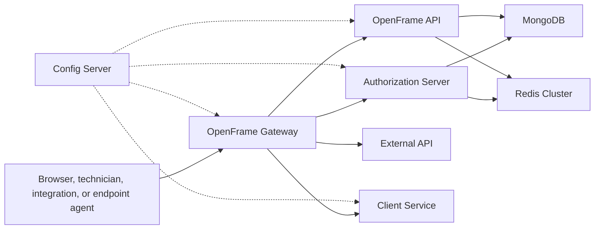

## Security

OpenFrame OSS Tenant assembles the runnable Spring Boot services (`openframe-api`, `openframe-authorization-server`, `openframe-client`, `openframe-config`, `openframe-external-api`, `openframe-gateway`, `openframe-management`, `openframe-stream`) and the Rust endpoint agent (`openframe_client`) that together form the OpenFrame platform. Most security-relevant logic — OAuth2/OIDC, JWT signing, tenant isolation, password policy, domain validation — is implemented in the pinned [OpenFrame OSS Library](https://github.com/flamingo-stack/openframe-oss-lib) (`com.openframe.oss:*`, version `7.0.11`), which this repository consumes as a Maven dependency and runs. This document describes how those security mechanisms are wired together in this repository: configuration, deployment, environment variables, and secure development practices for anyone contributing to this repository.

> This is a development reference. For the organization's vulnerability-disclosure process, supported versions, and how to report a security issue, see [`SECURITY.md`](https://github.com/flamingo-stack/openframe-oss-tenant/blob/main/SECURITY.md) at the repository root, or email security@flamingo.run. Do not open a public GitHub issue for a security problem.

### How the pieces fit together



The gateway is the single public entry point. It routes `/sas/**` to the authorization server, `/api/**` to the API, `/api-docs/**` to the external API, and `/clients/**` to the client service, as declared in `configs/base/openframe-gateway.yml`. Every authentication, token, and tenant-isolation decision upstream of a backend service happens at or before this boundary.

---

### 1. Authentication and authorization patterns

#### Tenant-aware OAuth 2.1 / OpenID Connect

The `openframe-authorization-server` service (entry point `openframe/services/openframe-authorization-server/src/main/java/com/openframe/authz/OpenFrameAuthorizationServerApplication.java`) runs the `com.openframe.oss:openframe-authorization-service-core` library. It is a multi-tenant OAuth 2.1/OIDC authorization server:

- Tenant context is resolved before user lookup, client registration, signing-key selection, and issuer construction — `TenantForwardedPrefixFilter` injects `X-Forwarded-Prefix: /{tenant}` so Spring Authorization Server computes a tenant-specific issuer.
- Each tenant has its own RSA signing key, managed by `TenantKeyService`; the JWK set served to a request only exposes the key for the resolved tenant.
- Issued access tokens carry `tenant_id`, `userId`, and `roles` claims (see [Authorization Service Core](../../reference/architecture/authorization-service-core/authorization-service-core.md)).
- Password login uses BCrypt via `DaoAuthenticationProvider`; an SSO-provisioned account with no password hash cannot authenticate by password.
- External sign-in supports Google, Microsoft, and Apple OIDC, plus native Apple token exchange and a signup-ticket grant for mobile clients (`urn:openframe:params:oauth:grant-type:apple-native`, `urn:openframe:params:oauth:grant-type:signup-ticket`).
- Sessions are backed by Redis-backed Spring Session, not in-memory sessions, so login state survives restarts and is shared across replicas.

The gateway side of this flow — authorization redirects, callback handling, auth cookies, refresh, logout, and mobile/native handoff — is implemented by `com.openframe.oss:openframe-security-oauth` and runs inside `openframe-gateway`. See [Security Oauth](../../reference/architecture/security-oauth/security-oauth.md) for the full endpoint list (`/oauth/login`, `/oauth/callback`, `/oauth/refresh`, `/oauth/logout`, Apple-native and mobile endpoints). It is only active when `openframe.gateway.oauth.enable=true`.

> **Security-relevant behavior to preserve:** an invalid or unknown refresh token returns `401` **without** clearing cookies, so a late response from a losing concurrent refresh request cannot delete cookies written by a winning one. A *missing* refresh token, by contrast, clears cookies and returns `401`. Do not conflate these two paths when touching refresh logic.

#### JWT signing and verification

`com.openframe.oss:openframe-security-core` (`JwtSecurityConfig`, `KeyConfig`) builds the shared `JwtEncoder`/`JwtDecoder` beans from configured RSA key material (see [Security Core Oauth](../../reference/architecture/security-core-oauth/security-core-oauth.md)):

- The encoder needs both the public and private key and is the only component that should be able to sign tokens.
- The decoder needs only the public key and verifies signatures without ever holding private-key material.
- `KeyConfig.toRSAPublicKey()` parses a PEM-formatted public key (markers and whitespace stripped, Base64-decoded, loaded via the JCA RSA `KeyFactory`). Malformed PEM content fails bean construction at startup rather than silently producing an unusable decoder.

Common, non-tenant-aware token expiration defaults live in `configs/base/application.yml` under `security.oauth2.token`:

```yaml
security:
  oauth2:
    token:
      access:
        expiration-seconds: 3600   # 10 minute in the source comment, 3600s = 1 hour actual value
      refresh:
        expiration-seconds: 604800     # 1 week
        max-refresh-count: 10080       # maximum refreshes allowed in that week
```

When rotating signing keys, replace both the signing (private) and verification (public) material together — a decoder that has not picked up the new public key cannot verify tokens signed by a rotated encoder (see Operational Considerations in [Security Core Oauth](../../reference/architecture/security-core-oauth/security-core-oauth.md)).

#### Gateway-level authorization boundary

`openframe-gateway` is the reactive edge: JWT validation, API-key handling, service routing, and WebSocket/tool proxying happen here before a request reaches a backend service (see [`docs/reference/architecture/README.md`](../../reference/architecture/README.md)). Treat the gateway's routing table in `configs/base/openframe-gateway.yml` as a security boundary definition, not just a convenience map — a new backend route must be added there deliberately, scoped to the correct path prefix.

#### Tenant isolation as an authorization control

`configs/base/application.yml` enables `openframe.tenant-isolation.enabled: true`. This is load-bearing: library version `7.0.11`'s tenant-aware repositories (and `TenantAwareMongoTemplate`) only register when this flag is on. Services started without it, or against an incompatible library version, crash-loop at startup because tenant-aware beans are unsatisfiable. Do not disable this flag in a tenant deployment of this repository.

---

### 2. Data encryption and secure storage

#### At-rest value encryption

`configs/base/application.yml` defines a shared encryption configuration used for encrypting sensitive configuration values at rest:

```yaml
security:
  encryption:
    password: ${ENCRYPTION_PASSWORD:kdCJxik7VWRlG5L8jKHBeJQK5unssi7u1uHOd01b75ilr8n}
    salt: ${ENCRYPTION_SALT:74f62c51327175b05abe1ad78030565c}
```

> **The checked-in values are development defaults, not production secrets.** Every deployment beyond local development must override `ENCRYPTION_PASSWORD` and `ENCRYPTION_SALT` with values injected from a secret store rather than left at these repository defaults. The same applies to the MongoDB credential embedded in the default connection string (`spring.mongodb.uri` in `configs/base/application.yml`) — it must be replaced with a managed credential in any shared or production environment.

#### Transport encryption

- The authorization server's RSA key pairs (via `AuthenticationKeyPair`, `PemUtil`) sign and verify JWTs; see Authentication above.
- The gateway terminates and routes HTTP traffic for all public prefixes; TLS termination and certificate management for externally reachable endpoints are deployment concerns of the `manifests/platform/ingress-nginx` chart dependency and are outside this repository's application code.
- Session cookies from the authorization server keep the `JSESSIONID` name and respect the servlet-context path so a tenant-forwarded path does not create a cookie that is never sent back to the authorization-server context.

#### Secure storage of credentials in persistence

- OAuth token records (`OAuthToken` documents, `oauth_tokens` MongoDB collection) are indexed by tenant but carry access and refresh token values directly; see [Oauth Repositories](../../reference/architecture/data-mongo-sync-repositories/oauth-repositories/oauth-repositories.md). Treat both the lookup input and the returned token value as secrets — never log raw access or refresh tokens in application or audit logs.
- `Auth User Repositories` performs field-level updates for `lastLogin` and `imageUrl` rather than full-document read-modify-save, intentionally avoiding optimistic-lock races around login timestamps (see [Auth User Repositories](../../reference/architecture/data-mongo-sync-repositories/auth-user-repositories/auth-user-repositories.md)). This pattern — narrow, field-scoped writes instead of full document replace — is worth following for any other sensitive, frequently-updated field.
- One-time OAuth "dev tickets" used for mobile/developer handoff are held in-memory only (`InMemoryOAuthDevTicketStore`) by default, with no persistence, expiry, or cross-instance sharing. A horizontally scaled gateway deployment should supply a distributed `OAuthDevTicketStore` implementation instead of relying on the default.

---

### 3. Input validation and sanitization

Validation primitives are centralized in library modules so services share one policy rather than reimplementing ad hoc checks:

- **Email validation** (`com.openframe.oss:openframe-core`): `ValidEmailValidator` is a Jakarta Bean Validation constraint validator. It rejects `null` and requires a **full match** against the configured regex — it does not trim, lowercase, or otherwise normalize input, so the annotation's regex is the single source of truth for accepted syntax (see [Core Validation](../../reference/architecture/core-validation/core-validation.md)).
- **Disposable / blocked email domains** (`com.openframe.oss:openframe-core`): `EmailDomainPolicy` combines a local blocklist/allowlist with an optional external disposable-domain lookup (Kickbox-compatible endpoint). The external check is deliberately **fail-open**: any timeout, DNS error, or malformed response is logged and treated as "not disposable," so a third-party outage can never block legitimate registration — only an explicit positive classification adds a block. Configure under `openframe.email-domain-policy` (see [Core Email Validation](../../reference/architecture/core-email-validation/core-email-validation.md)).
- **Tool-argument validation** (`com.openframe.oss:openframe-core`): `ToolArgumentValueKind` predicates (`HAS_TEXT`, `NOT_TRIM_EMPTY`, `NOT_TRIM_BLANK`, `PATTERN`) and `ToolArgumentNormalizationPatterns` build fully anchored regexes with Unicode-aware case handling for enum-like and character-class argument values (see [Core Validation](../../reference/architecture/core-validation/core-validation.md)). When adding a new tool-argument rule, keep generated patterns anchored (`^...$`) — removing anchoring changes both the accepted input and the security guarantee at tool-execution boundaries.
- **API-layer contracts**: software-bundle mutation inputs (`CreateSoftwareBundleInput`, `UpdateSoftwareBundleInput` in `com.openframe.oss:openframe-api-lib`) apply Jakarta Bean Validation at the API boundary — notably restricting target machine identifiers to letters, digits, underscores, and hyphens, which keeps identifiers safe for message-subject use downstream (see [Api Contracts And Mapping](../../reference/architecture/api-contracts-and-mapping/api-contracts-and-mapping.md)).
- **Password policy**: password-reset and user-registration DTOs in the authorization service require a password of at least eight characters containing uppercase, lowercase, digit, and special-character categories (see [Authorization Service Core](../../reference/architecture/authorization-service-core/authorization-service-core.md)).
- **Device log query arguments**: `DeviceLogArgumentContract` (in `openframe-api-lib`) enforces ID, text-term, time-window, epoch-nanosecond, and cursor rules before a log query is admitted to the backend store (see [Api Service Backend](../../reference/architecture/api-service-backend/api-service-backend.md)).
- **Script execution validators**: elevated-user execution is constrained to Windows-only scripts, and invalid or excessive timeouts are rejected before a script execution record is created (see [Api Service Backend](../../reference/architecture/api-service-backend/api-service-backend.md)).

When adding a new input surface in this repository or in a service that consumes these libraries, prefer reusing `ValidEmailValidator`, `EmailDomainPolicy`, and `ToolArgumentValueKind` rather than writing a parallel regex, so that validation remains centralized and auditable.

---

### 4. Common security vulnerabilities and mitigations

#### Dependency and CVE hygiene

`pom.xml` pins several transitive dependencies explicitly above the versions the Spring Boot BOM or upstream libraries would otherwise select, specifically to close known HIGH/CRITICAL CVEs:

| Dependency | Version | Reason (from `pom.xml` comments) |
|---|---|---|
| `org.codehaus.plexus:plexus-utils` | `3.6.2` | Not managed by Spring Boot; pinned past known CVEs. |
| `org.bouncycastle:bcprov-lts8on` | `2.73.13` | Pinned past known CVEs. |
| `org.apache.thrift:libthrift` | `0.25.0` | Pinned past known CVEs. |
| `org.asynchttpclient:async-http-client` | `3.0.14` | Pinned past known CVEs. |
| `org.lz4:lz4-java` | `1.8.1` | Pinned past known CVEs. |
| `at.yawk.lz4:lz4-java` (Kafka fork) | `1.12.0` | The `kafka-clients` 4 fork at `1.10.1` has a HIGH CVE. |
| Jackson (`jackson-bom`, `jackson-2-bom`) | `3.1.7` / `2.21.7` | Security overrides on top of the Spring Boot BOM; kept on the 3.x minor line because Jackson 3.2 rejects a chat `MessageData` type-id/type-property overlap used elsewhere in the platform. |

Renovate (`renovate.json`) is scoped to automatically track only `com.openframe.oss:*` Maven artifacts (grouped as `openframe-libs`), the `@flamingo-stack/openframe-frontend-core` npm package, the pinned FleetMDM and MeshCentral Helm charts, and all dependencies under `clients/openframe-client/**` (grouped as `openframe-client deps`). All other Maven and npm dependency updates are explicitly disabled in `renovate.json`, so a CVE fix in an unlisted dependency requires a manual `pom.xml` override of the kind shown above rather than an automatic PR. When you add a new dependency that later needs a security pin, follow this same explicit-override pattern in `pom.xml` and document the CVE reason in a comment, as the existing entries do.

#### Tenant data isolation failures

Because every backend service runs with `openframe.tenant-isolation.enabled: true`, the main tenant-isolation risk in this repository is **accidentally bypassing tenant scoping** — for example, calling a repository method that queries by a non-tenant-scoped key, or caching a value under a key that omits the tenant ID. `openframe.redis.tenant-id: default` and the Redis cluster key-locality design (see [Data Redis](../../reference/architecture/data-redis/data-redis.md)) exist specifically so that cache keys remain tenant-partitioned; any new Redis usage should go through the shared Redis key builder rather than constructing raw keys.

#### Token and session replay / confusion

- Refresh-token and Apple-native-token revocation paths are designed with the concurrent-refresh race explicitly in mind (see Authentication above) — a fix to "simplify" refresh-failure cookie handling can reintroduce a session-eviction race.
- The OIDC ID-token decoder cache in the authorization server is keyed by provider, client ID, JWK-set URI, **and issuer**, not just provider ID — this prevents a decoder created for one tenant from enforcing another tenant's audience or metadata. Any change to decoder caching must preserve all four key components.
- `SsoFlowSuccessHandler` and `LoginSsoHandler` require a **trusted** provider email signal before using email claims to link an SSO identity to an existing account, and `MicrosoftLoginEmailGate` adds an extra verified-email defense for tenant-scoped generic Microsoft logins. Weakening either of these checks would allow account-linking based on an unverified email claim.
- `SsoJoinController`, the invitation/consent gate, validates that the invitation cookie matches the invitation ID stamped into the **same** authenticated OIDC session before completing registration — this prevents a cookie from one invitation flow being replayed against a different session's identity.

#### Open redirect

The gateway's mobile and native-Apple flows (`/oauth/signup-continue`, `/oauth/join-return`) apply an explicit redirect allow-list before appending a signup ticket or redirecting, falling back to a configured safe page (`openframe.gateway.oauth.signup-continue-page`, `openframe.gateway.oauth.join-cancel-page`) when the requested target is not allow-listed. The default `DefaultRedirectTargetResolver` used for ordinary browser flows is a **selection** fallback (requested target → `Referer` → `/`), not an allow-list — native/mobile destinations must go through the explicit allow-list check, never through the default resolver alone.

#### Client disconnect noise vs. real failures

`ClientDisconnectClassifier` (in `com.openframe.oss:openframe-core`) exists so that expected peer disconnects (closed channels, broken pipes, premature close) in reactive/Netty paths are not misreported as application failures. When adding new exception handling around reactive HTTP, use this classifier rather than a broad `catch (Exception e)` that could silently swallow a genuine security- or integrity-relevant error alongside benign disconnects.

---

### 5. Security testing and code review guidelines

#### Test configuration patterns

`openframe-api`'s test resources (`openframe/services/openframe-api/src/test/resources/application-test.yml`) show the repository's pattern for isolating security-adjacent infrastructure in tests:

```yaml
jwt:
  secret: test-secret-key
  expiration: 3600000

spring:
  data:
    redis:
      enabled: false
    cassandra:
      enabled: false
  kafka:
    enabled: false
```

Follow this pattern for new test suites: use an explicit, obviously-fake test secret (never a value that resembles a production key), and disable infrastructure the test does not exercise rather than pointing it at a real datastore.

`openframe/services/openframe-api/src/test/java/com/openframe/api/util/TestAuthenticationManager.java` provides a minimal `AuthenticationManager` that always throws `BadCredentialsException`, useful as a negative-path authentication double. `openframe/services/openframe-api/src/test/java/com/openframe/api/config/TestConfig.java` and `TestConstants.java`/`TestUtils.java` (same package) hold the shared test wiring for the API service — check these before adding new authentication or authorization test fixtures to avoid duplicating a manager or constant set.

#### What to verify before merging a security-relevant change

- **Tenant scoping**: any new repository method, cache key, or query must include a tenant predicate consistent with `openframe.tenant-isolation.enabled: true`. A method that silently drops tenant scoping is a cross-tenant data leak, not just a bug.
- **Secrets in configuration**: a new `configs/base/*.yml` entry must use an environment-variable placeholder (`${VAR_NAME:default}`) for any credential, and the default — if present at all — must be clearly a development-only value, following the existing pattern for `ENCRYPTION_PASSWORD`, `ENCRYPTION_SALT`, and `REDIS_CLUSTER_NODES`.
- **Token handling**: no raw JWT, access token, or refresh token value should appear in a log statement, error message, or test assertion output.
- **Dependency changes**: a `pom.xml` version bump for a dependency already carrying a CVE-driven override (see the table above) must preserve or improve on the pinned version, not silently revert to a BOM-managed version that reintroduces the CVE.
- **Redirect targets**: any new redirect-producing endpoint in the gateway OAuth flow must go through an explicit allow-list, matching the pattern used by `/oauth/signup-continue` and `/oauth/join-return`.

#### Reporting findings discovered during review

If a code review surfaces an actual exploitable vulnerability (not a style or best-practice nit), do not file it as a GitHub issue or discuss it in a public pull request comment or OpenMSP Slack channel. Report it per [`SECURITY.md`](https://github.com/flamingo-stack/openframe-oss-tenant/blob/main/SECURITY.md): email security@flamingo.run with the affected file/commit and reproduction steps.

---

### 6. Environment variables and secrets management

#### Variables referenced in shared configuration

`configs/base/application.yml` is the common configuration layer loaded by every service through the Config Server (`SPRING_CONFIG_URL`, default `http://openframe-config.platform.svc.cluster.local:8888`). The variables it reads, with their checked-in defaults, are:

| Variable | Used for | Checked-in default |
|---|---|---|
| `ENCRYPTION_PASSWORD` | At-rest value encryption password | Development placeholder — **override in any non-local environment** |
| `ENCRYPTION_SALT` | At-rest value encryption salt | Development placeholder — **override in any non-local environment** |
| `REDIS_CLUSTER_NODES` | Redis cluster node list for `spring.data.redis.cluster.nodes` | `redis-cluster-0/1/2.redis-cluster-headless.datasources.svc.cluster.local:6379` |
| `OPENFRAME_CLUSTER_ID` | `openframe.cluster-id` tag used across services | `cluster-id` |
| `RELEASE_VERSION` | Actuator management endpoint base path versioning | `v1` |
| `SPRING_CONFIG_URL` | Location of the Config Server each service imports configuration from | `http://openframe-config.platform.svc.cluster.local:8888` (per-service `application.yml` files use `http://openframe-config.microservices.svc.cluster.local:8888` as their local default — confirm which applies in your deployment) |

Each per-service `application.yml` (for example `openframe/services/openframe-api/src/main/resources/application.yml`, and the equivalent files for `openframe-authorization-server` and `openframe-client`) only sets `spring.application.name` and imports configuration from the Config Server — it does not define service-specific secrets directly, so service-level secret overrides belong in the Config Server's backing configuration or in the Kubernetes manifests, not hardcoded into these files.

#### Rust agent build-time variable

The endpoint agent (`clients/openframe-client/src/main.rs`) requires `OPENFRAME_VERSION` at build time, consumed by the shared `openframe-agent-lib` (`openframe_agent_lib`, pinned at `v0.0.5` from [OpenFrame OSS Library](https://github.com/flamingo-stack/openframe-oss-lib)) build script:

```bash
OPENFRAME_VERSION=0.0.0-dev cargo build --release
```

This is a build-identity value, not a secret, but it must be set consistently with the release pipeline's versioning scheme for reproducible, auditable builds.

#### Secrets management principles for this repository

- **Never commit a production credential.** The values embedded in `configs/base/application.yml` (the MongoDB connection string's inline credential, the default `ENCRYPTION_PASSWORD`/`ENCRYPTION_SALT`) are committed defaults intended for local/dev use only; production and shared environments must supply their own values through the deployment's secret mechanism (Kubernetes Secrets referenced by the Argo CD-managed manifests under `manifests/`, or an equivalent secret store), not by editing this file in place.
- **Prefer environment-variable indirection.** Every security-sensitive setting in `configs/base/application.yml` already follows the `${VAR_NAME:default}` Spring placeholder pattern. Extend new configuration the same way rather than hardcoding a literal.
- **Scope automated dependency updates deliberately.** `renovate.json` intentionally disables automatic updates for everything except `com.openframe.oss:*` artifacts, the frontend-core npm package, the two pinned Helm charts, and `clients/openframe-client/**` dependencies — this is a deliberate control to keep the update surface reviewable, not an oversight. Do not broaden it without considering the CVE-tracking burden that creates.
- **Do not log secrets.** This applies to JWTs, OAuth access/refresh tokens, the encryption password/salt, and any database credential — consistent with the token-handling guidance in the Common Vulnerabilities section above.

---

[](https://www.youtube.com/watch?v=jEkFcS4AcQ4)

### Related documentation

For the services and libraries referenced in this document, see [OpenFrame OSS Tenant architecture overview](../../reference/architecture/README.md), [Authorization Service Core](../../reference/architecture/authorization-service-core/authorization-service-core.md), [Security Core Oauth](../../reference/architecture/security-core-oauth/security-core-oauth.md), [Security Oauth](../../reference/architecture/security-core-oauth/security-core-oauth.md), [Core Validation](../../reference/architecture/core-validation/core-validation.md), [Core Email Validation](../../reference/architecture/core-email-validation/core-email-validation.md), and [Data Redis](../../reference/architecture/data-redis/data-redis.md). For general environment setup, see [Environment Setup](../setup/environment.md) and [Local Development](../setup/local-development.md). For the overall contribution process, see [Contributing Guidelines](../contributing/guidelines.md).
