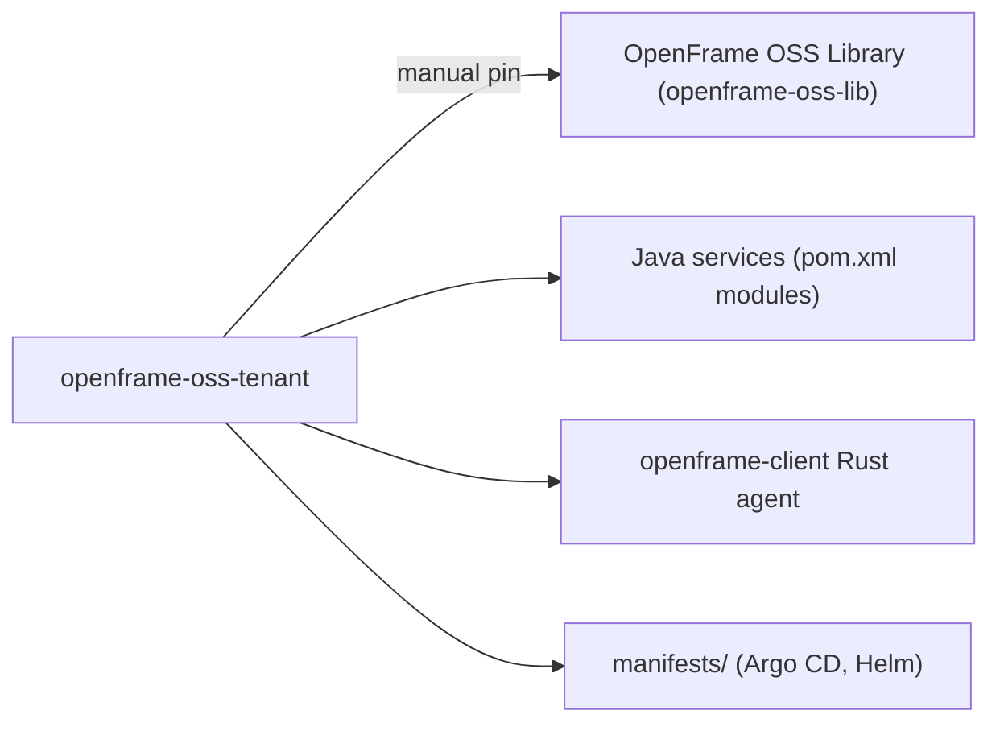

# Development Environment Setup

This guide covers the tools, IDE configuration, and environment variables you need to work on **OpenFrame OSS Tenant** — the polyglot repository that hosts the platform's Spring Boot (Java) backend services, the `openframe-client` Rust agent, and the Kubernetes manifests that deploy them. It assumes you have already read the [prerequisites](../../getting-started/prerequisites.md) and completed the [quick start](../../getting-started/quick-start.md).

> This repository publishes nine Maven artifacts (`com.openframe:openframe-api`, `openframe-authorization-server`, `openframe-client`, `openframe-config`, `openframe-external-api`, `openframe-gateway`, `openframe-management`, `openframe-stream`, `openframe-test`, all `1.0.0-SNAPSHOT`) and one Cargo crate (`openframe_client` `0.1.0`). No other repository in the organization currently consumes them — the ecosystem graph coverage is `full`, so this is confirmed, not a gap.

## Repository shape at a glance



The repository has one recorded upstream dependency: the [OpenFrame OSS Library](https://github.com/flamingo-stack/openframe-oss-lib), pinned manually rather than through a package manager. The Rust agent in `clients/openframe-client/src/main.rs` pulls it directly via its `Cargo.toml` git dependency (`openframe-agent-lib`, tag `v0.0.5`), and the Java services depend on the `com.openframe.oss` artifacts from the same library (version pinned by `<openframe.libs.version>` in the root `pom.xml`).

## Required development tools

| Tool | Why you need it | Notes |
|---|---|---|
| **JDK 25** | Compiles and runs every Java service | Root `pom.xml` sets `<java.version>25</java.version>` and inherits from `spring-boot-starter-parent` `4.1.1` |
| **Apache Maven** | Builds the multi-module Java project | The parent POM (`pom.xml`) declares all nine service modules under `openframe/services/` |
| **Rust toolchain (cargo, rustc)** | Builds the `openframe-client` agent | `clients/openframe-client/Cargo.toml` targets edition `2021` |
| **Git** | Source control, including a git-based Cargo dependency | `openframe-agent-lib` is fetched straight from GitHub by tag, not from crates.io |
| **kubectl** | Inspect and interact with the Kubernetes cluster the services run in | Used against the namespaces referenced throughout `manifests/` and `configs/base/*.yml` |
| **Helm** | Deploy/inspect the charts under `manifests/` | Charts such as `manifests/datasources/cassandra`, `manifests/datasources/kafka`, and `manifests/tenant` declare Helm/OCI chart dependencies |
| **Docker or an OCI-compatible builder** | Build/inspect the container images the release workflow publishes | Each service gets an image at `ghcr.io/flamingo-stack/openframe-oss-tenant/<service>` |

### Java toolchain details

The parent `pom.xml` pins these key versions, which your local JDK and IDE project settings should match:

- `java.version`: `25`
- `spring-boot.version` / Spring Boot parent: `4.1.1`
- `spring-cloud.version`: `2025.1.3`
- `lombok.version`: `1.18.48`

> Lombok is required for every service (the parent POM adds it as a direct dependency and also wires it into `maven-compiler-plugin`'s `annotationProcessorPaths`). JDK 23+ no longer auto-discovers annotation processors on the classpath, so Lombok must be installed and enabled in your IDE, or builds involving generated code will fail.

Build the backend with the standard Maven lifecycle from the repository root:

```bash
# Clone the repository
git clone https://github.com/flamingo-stack/openframe-oss-tenant.git
cd openframe-oss-tenant

# Build all backend services (Java / Spring Boot)
mvn clean install -DskipTests
```

Run an individual service with the Maven Spring Boot plugin, pointing `-pl` at its module path:

```bash
mvn spring-boot:run -pl openframe/services/openframe-api
```

### Rust toolchain details

The agent crate is defined in `clients/openframe-client/Cargo.toml`; its one binary target (`openframe-client`) has `src/main.rs` as its thin entry point, delegating all logic to the `openframe` crate shared from the `openframe-oss-lib` repository. The library's build script expects `OPENFRAME_VERSION` as a build-time environment variable, so always export it before building:

```bash
cd clients/openframe-client
OPENFRAME_VERSION=0.0.0-dev cargo build
```

Once built, you can exercise the agent binary directly:

```bash
# Verify the agent binary
./clients/openframe-client/target/debug/openframe-client --help

# Run environment diagnostics
./clients/openframe-client/target/debug/openframe-client doctor
```

### Kubernetes and datasource tooling

Many services expect to reach datasources over in-cluster DNS names (for example `mongodb-0.mongodb.datasources.svc.cluster.local`, `cassandra.datasources.svc.cluster.local`, `kafka.datasources.svc.cluster.local`, `nats.datasources.svc.cluster.local`), as configured in `configs/base/application.yml` and the per-service config files (`configs/base/openframe-api.yml`, `configs/base/openframe-client.yml`, `configs/base/openframe-external-api.yml`). For local development against a real cluster you need `kubectl` configured against that cluster, and ideally a tool to tunnel or proxy those service names to your workstation — the `manifests/platform/dev-tools` chart bundles `telepresence-oss` (`oci://ghcr.io/flamingo-stack/registry/helm-charts/telepresence-oss`) for exactly this purpose, alongside `kafka-ui` for inspecting Kafka topics.

For the deeper walkthrough of running services together locally, see [Local Development](./local-development.md).

## IDE recommendations and setup

The repository ships a `.vscode/` folder with working launch, task, and settings configuration, which strongly suggests **Visual Studio Code** as the primary supported editor for this repo. If you prefer IntelliJ IDEA or another Java IDE, import the root `pom.xml` as a multi-module Maven project and make sure the project SDK is set to JDK 25 to match the parent POM.

### VS Code: workspace settings

`.vscode/settings.json` configures:

- Consistent line endings and indentation (`files.eol: "\n"`, `editor.tabSize: 2`, `editor.insertSpaces: true`).
- YAML schema validation, mapping Argo Workflows and `yamllint` schemas onto `**/*.yml` files, useful when editing the Helm values and Argo CD manifests under `manifests/`.
- Java tooling: `java.debug.settings.hotCodeReplace: "auto"`, `java.configuration.updateBuildConfiguration: "automatic"`, `java.autobuild.enabled: true`, and `java.compile.nullAnalysis.mode: "automatic"` — these keep the Java language server in sync as you edit the Maven modules.
- Rust tooling via `rust-analyzer`: `rust-analyzer.checkOnSave.command: "clippy"`, `cargo.features: "all"`, `cargo.allFeatures: true`, plus inlay hints and code lenses enabled. A `[rust]` language override sets `editor.defaultFormatter` to `rust-lang.rust-analyzer` with `editor.formatOnSave: true` and 4-space indentation.

### VS Code: recommended extensions

Based on the languages and tooling the workspace settings and tasks target, install:

- **Extension Pack for Java** (or equivalent) — needed for the `java.*` settings in `.vscode/settings.json` and for the `java` launch configurations in `.vscode/launch.json` (`Management Application`, `API Application`, `Client Application`, `Config Server Application`, `Stream Application`, `Gateway Application`).
- **rust-analyzer** — required for the `[rust]` editor settings and the `lldb`-based Rust debug configurations in `.vscode/launch.json`.
- **CodeLLDB** — provides the `lldb` debugger type used by every Rust launch configuration (`OpenFrame Client Debug`, `OpenFrame Client Debug (Service Mode)`, `OpenFrame Client Release`, `OpenFrame Client Tests`).
- **YAML** — backs the `yaml.schemas` mapping in `.vscode/settings.json` for validating `manifests/` and `configs/` YAML files.

### VS Code: launch configurations

`.vscode/launch.json` defines ready-to-use debug targets. The table below summarizes what each one runs and from where:

| Configuration | Type | Entry point | Working directory |
|---|---|---|---|
| OpenFrame Client Debug | `lldb` | `client/target/debug/openframe` (`run-as-service`) | `${workspaceFolder}/client` |
| OpenFrame Client Debug (Service Mode) | `lldb` | same binary, `run-as-service` | `${workspaceFolder}/client` |
| OpenFrame Client Release | `lldb` | `client/target/release/openframe` (`run`) | `${workspaceFolder}/client` |
| OpenFrame Client Tests | `lldb` | `client/target/debug/openframe-test` | `${workspaceFolder}/client` |
| Management Application | `java` | `com.openframe.management.ManagementApplication` | `openframe/services/openframe-management` |
| API Application | `java` | `com.openframe.api.ApiApplication` | `openframe/services/openframe-api` |
| Client Application | `java` | `com.openframe.client.ClientApplication` | `openframe/services/openframe-client` |
| Config Server Application | `java` | `com.openframe.config.ConfigServerApplication` | `openframe/services/openframe-config` |
| Stream Application | `java` | `com.openframe.stream.StreamApplication` | `openframe/services/openframe-stream` |
| Gateway Application | `java` | `com.openframe.gateway.GatewayApplication` | `openframe/services/openframe-gateway` |
| OpenFrame Frontend (Local K8s / Dev / Stage / Prod) | `node` | `npm run dev` | `openframe/services/openframe-frontend` |

> The four Rust `lldb` configurations reference `client/target/...` and `cwd: "${workspaceFolder}/client"`, while the Cargo workspace under this repository lives at `clients/openframe-client`. If these paths do not match your checkout layout, adjust `program` and `cwd` locally, or build and point the debugger at your actual `clients/openframe-client/target/...` output.

Every Java launch configuration sets `SPRING_PROFILES_ACTIVE: "k8s"` so the service boots with the same profile convention used across the platform.

### VS Code: build and test tasks

`.vscode/tasks.json` wires the editor's build/test commands to Cargo and npm:

- `rust-build` (default build task) runs `cargo build` in `${workspaceFolder}/client`.
- `rust-build-release` runs `cargo build --release`.
- `rust-test` (default test task) runs `cargo test`.
- `rust-watch` runs `cargo watch -x run` as a background task.
- `rust-check` runs `cargo check`.
- `rust-clippy` runs `cargo clippy` — pairs with the `rust-analyzer.checkOnSave.command: "clippy"` setting above.
- `deploy-client` runs `./deploy.sh` from `client/scripts`.
- `start-vue` runs `npm run dev` for `openframe/services/openframe-ui` with `VITE_*` environment variables pointing at local service hosts (`openframe-api.microservices:8090`, `openframe-gateway.microservices:8100`).
- `kill-port-4000` and `frontend-with-port-cleanup` free port `4000` (used by the Next.js frontend dev server) before each frontend launch, with OS-specific commands for Windows and Linux.

As with the launch configurations, these tasks assume a `client/` directory for the Rust agent; align the `cwd` with `clients/openframe-client` if your checkout differs.

## Environment variables for development

Environment variables in this repository fall into three groups: Rust build-time variables, Spring configuration overrides, and frontend dev-server variables used by the VS Code launch configurations.

### Rust agent build and runtime variables

| Variable | Used by | Purpose |
|---|---|---|
| `OPENFRAME_VERSION` | `cargo build` (consumed by the `openframe-agent-lib` build script) | Required at build time; the Quick Start command is `OPENFRAME_VERSION=0.0.0-dev cargo build` |
| `RUST_LOG` | the `lldb` debug configurations | Log verbosity (`debug` for debug builds, `info` for release) |
| `RUST_BACKTRACE` | the `lldb` debug configurations | Set to `"1"` to get full panic backtraces while debugging |
| `OPENFRAME_DEV_MODE` | the `lldb` debug configurations | Set to `"true"` to run the agent in development mode |
| `OPENFRAME_LOG_DIR` | the `lldb` debug configurations | Points at `${workspaceFolder}/client/logs` for local log output |

### Spring service configuration variables

The shared config file `configs/base/application.yml` and per-service files (`configs/base/openframe-api.yml`, `openframe-client.yml`, `openframe-external-api.yml`, `openframe-management.yml`, `openframe-stream.yml`, `openframe-gateway.yml`) resolve most infrastructure endpoints from Kubernetes service DNS, with a handful of overridable variables:

| Variable | Default (from `configs/base/application.yml`) | Purpose |
|---|---|---|
| `REDIS_CLUSTER_NODES` | `redis-cluster-0.redis-cluster-headless.datasources.svc.cluster.local:6379,redis-cluster-1...,redis-cluster-2...` | Overrides the Redis Cluster node list |
| `SPRING_CONFIG_URL` | `http://openframe-config.microservices.svc.cluster.local:8888` (per-service) / `http://openframe-config.platform.svc.cluster.local:8888` (shared logging config) | Points each service at the Config Server for `optional:configserver:` imports and the shared Logback config |
| `RELEASE_VERSION` | `v1` | Used to build the Actuator management endpoint base path |
| `ENCRYPTION_PASSWORD` | fallback value in `application.yml` | Overrides the password used by the shared encryption settings — set a real value outside the fallback for any non-local environment |
| `ENCRYPTION_SALT` | fallback value in `application.yml` | Overrides the salt used alongside `ENCRYPTION_PASSWORD` |
| `OPENFRAME_CLUSTER_ID` | `cluster-id` | Identifies the cluster for the `openframe.cluster-id` property |

Every service imports its configuration from the Config Server, as declared in the individual `application.yml` resources, for example `openframe/services/openframe-api/src/main/resources/application.yml`:

```yaml
spring:
  application:
    name: openframe-api
  config:
    import: "optional:configserver:${SPRING_CONFIG_URL:http://openframe-config.microservices.svc.cluster.local:8888}"
```

The same `spring.config.import` pattern, with the service's own `spring.application.name`, appears in the `openframe-authorization-server` and `openframe-client` service resources.

> `ENCRYPTION_PASSWORD` and `ENCRYPTION_SALT` ship with fallback defaults in `configs/base/application.yml` purely so services boot locally. Refer to your environment configuration for the real values used outside a local sandbox — never rely on the checked-in fallbacks beyond local development.

### Frontend dev-server variables (from `.vscode/launch.json` and `tasks.json`)

The Next.js frontend (`openframe/services/openframe-frontend`) and the legacy Vue UI (`openframe/services/openframe-ui`) read environment variables for local development:

```json
{
  "NODE_ENV": "development",
  "PORT": "4000",
  "NEXT_PUBLIC_API_URL": "https://localhost/api",
  "NEXT_PUBLIC_GRAPHQL_ENDPOINT": "https://localhost/api/graphql",
  "NEXT_PUBLIC_WS_ENDPOINT": "wss://localhost/api/ws",
  "NEXT_PUBLIC_APP_TYPE": "openframe",
  "NEXT_PUBLIC_CLIENT_ID": "openframe_web_dashboard",
  "NEXT_PUBLIC_CLIENT_SECRET": "prod_secret"
}
```

Additional named profiles set a different combination of `NEXT_PUBLIC_*` variables for local, dev, stage, and prod-style tenant hosts, for example `NEXT_PUBLIC_TENANT_HOST_URL` and `NEXT_PUBLIC_SHARED_HOST_URL` pointing at `michael.openframe.build` / `openframe.build` (dev), `test.openframe.miami` / `openframe.miami` (stage), and `test.openframe.ai` / `openframe.ai` (prod-style), plus `NEXT_PUBLIC_ENABLE_DEV_TICKET_OBSERVER`, `NEXT_PUBLIC_AUTH_CHECK_INTERVAL`, `NEXT_PUBLIC_APP_MODE`, and `NEXT_PUBLIC_FEATURE_ORG_IMAGES`.

The `start-vue` task in `.vscode/tasks.json` sets its own set for the Vue-based UI:

```json
{
  "PORT": "5177",
  "VITE_API_URL": "http://openframe-api.microservices:8090",
  "VITE_GATEWAY_URL": "http://openframe-gateway.microservices:8100",
  "VITE_CLIENT_ID": "openframe_web_dashboard",
  "VITE_CLIENT_SECRET": "prod_secret",
  "VITE_GRAFANA_URL": "https://localhost:3000"
}
```

> `NEXT_PUBLIC_CLIENT_SECRET` and `VITE_CLIENT_SECRET` are checked-in placeholder values (`prod_secret`) used purely to wire up local dev servers against routed backend services. Refer to your environment configuration for the actual client secret in any shared or deployed environment.

### Test-time overrides

Test resources disable most external infrastructure so service tests run without a live cluster. `openframe/services/openframe-api/src/test/resources/application-test.yml` excludes MongoDB auto-configuration, disables Redis, Cassandra, Kafka, and Pinot, and sets a fixed `jwt.secret: test-secret-key` with `jwt.expiration: 3600000` — useful as a reference when writing or debugging unit tests for the API module.

## Editor extensions/plugins

Summarizing the extensions implied by the checked-in VS Code configuration:

- **Java** language support (for the `java.*` keys in `.vscode/settings.json` and the six `java`-type launch configurations).
- **rust-analyzer** (for the `rust-analyzer.*` keys and the `[rust]` formatter override).
- **CodeLLDB** (the `lldb` debugger type backing every Rust launch configuration).
- **YAML** language support (for the `yaml.schemas` mapping, which validates Argo Workflows-style and `yamllint` schemas against `**/*.yml`).

If your IDE is not VS Code, replicate the equivalent capabilities: a Java language server with Lombok annotation-processing support and JDK 25 configured, a Rust language server with Clippy-on-save enabled, a debugger capable of attaching to native Rust binaries, and YAML schema validation for the Helm/Argo CD manifests under `manifests/`.

## Next steps

Once your tools and IDE are configured, proceed to [Local Development](./local-development.md) to bring up the services together, consult the [Architecture overview](../architecture/README.md) to understand how the services and datasources fit together, and review the [Contributing guidelines](../contributing/guidelines.md) before opening a pull request. Remember that this project does not use GitHub Issues or Discussions — development questions and discussion happen in the [OpenMSP Slack community](https://www.openmsp.ai/).
