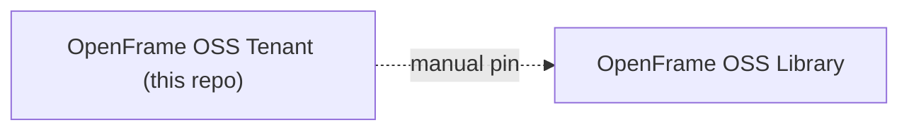

# Local Development

This guide covers cloning the repository, building its Java and Rust components, running services locally, enabling hot-reload-style workflows, and attaching a debugger — for the **OpenFrame OSS Tenant** monorepo (`flamingo-stack/openframe-oss-tenant`). It complements [Environment Setup](./environment.md) (prerequisites, tool versions) and the [Development overview](../README.md).

> For architectural context (service responsibilities, data flow, and how requests move through the Gateway, Kafka, and NATS), see [Architecture Overview](../../reference/architecture/overview.md) and [Ecosystem](../../reference/architecture/ecosystem.md).

## What's in this repository

OpenFrame OSS Tenant is a polyglot **service** repository: Java/Spring Boot backend services built from a single root Maven POM, plus a thin Rust CLI agent. It publishes nine Maven artifacts (`com.openframe:openframe-api`, `openframe-authorization-server`, `openframe-client`, `openframe-config`, `openframe-external-api`, `openframe-gateway`, `openframe-management`, `openframe-stream`, `openframe-test`, all `1.0.0-SNAPSHOT`) and one Cargo crate (`openframe_client`, `0.1.0`). Per the organization's dependency graph (`get_repo_ecosystem`, coverage: full), it has exactly one upstream dependency — [OpenFrame OSS Library](https://github.com/flamingo-stack/openframe-oss-lib), pinned manually — and no other repository in the organization currently consumes its published artifacts.



The Java services live under `openframe/services/`:

| Module | Artifact |
|---|---|
| `openframe/services/openframe-api` | `openframe-api` |
| `openframe/services/openframe-authorization-server` | `openframe-authorization-server` |
| `openframe/services/openframe-client` | `openframe-client` |
| `openframe/services/openframe-config` | `openframe-config` |
| `openframe/services/openframe-external-api` | `openframe-external-api` |
| `openframe/services/openframe-gateway` | `openframe-gateway` |
| `openframe/services/openframe-management` | `openframe-management` |
| `openframe/services/openframe-stream` | `openframe-stream` |
| `openframe/services/openframe-test` | shared test support module |

The Rust agent lives under `clients/openframe-client/`, with its entry point at `clients/openframe-client/src/main.rs`.

> The **OpenFrame CLI** (`openframe-cli`) is a separate, externally maintained tool. It is not part of this repository — see its own repository at [flamingo-stack/openframe-cli](https://github.com/flamingo-stack/openframe-cli) for installation and usage, including its [documentation](https://github.com/flamingo-stack/openframe-cli/tree/main/docs).

## Clone and setup

```bash
# Clone the repository
git clone https://github.com/flamingo-stack/openframe-oss-tenant.git
cd openframe-oss-tenant
```

### Backend (Java / Spring Boot)

The root `pom.xml` is a Maven parent POM (`com.openframe:openframe-parent`) targeting **Java 25**, built on `spring-boot-starter-parent` 4.1.1 with the Spring Cloud 2025.1.3 BOM. It declares every service as a `<module>`, so a single Maven invocation at the repository root can build them all:

```bash
# Build all backend services (skip tests for a faster first build)
mvn clean install -DskipTests
```

To build (and transitively build) just one service, use `-pl` with `-am` (also-make dependencies):

```bash
mvn clean package -pl openframe/services/openframe-api -am -DskipTests
```

This is the same flag pattern each service's `Dockerfile` uses at build time (for example `openframe/services/openframe-api/Dockerfile` runs `mvn clean package -U -pl openframe/services/openframe-api -am --batch-mode`).

Each service module's own `pom.xml` (e.g. `openframe/services/openframe-api/pom.xml`, `openframe/services/openframe-gateway/pom.xml`) declares a `<relativePath>../../../pom.xml</relativePath>` back to the root, and pulls in a `*-service-core` artifact from the upstream `openframe-oss-lib` (for example `openframe-api-service-core`, `openframe-gateway-service-core`) at the centrally managed `${openframe.libs.version}` property. You should not need to touch these versions for ordinary local development.

> **Working against a local OSS library checkout.** If you are also modifying `openframe-oss-lib`, the project's handshake is to build and `install` it locally under the `999-SNAPSHOT` coordinate, then point this repo's `<openframe.libs.version>` property at `999-SNAPSHOT` — nothing else changes. In the library repo: `mvn -pl <modules> -am clean install -DskipTests`; here: `mvn -pl openframe/services/<svc> -am compile -DskipTests`. Do not release a new snapshot version or hand-edit the dependency coordinate as a substitute for this handshake.

### Rust agent (`openframe-client`)

The agent crate at `clients/openframe-client/` is a thin binary (`clients/openframe-client/src/main.rs`) over the shared `openframe-agent-lib` crate (published as `openframe`), sourced from `openframe-oss-lib` via a Git dependency pinned to a tag in `clients/openframe-client/Cargo.toml`. All of the agent's actual logic — configuration loading, service lifecycle, CLI subcommands — lives in that shared crate; this repository's `main()` only calls `openframe::run()`.

Building requires the `OPENFRAME_VERSION` environment variable, consumed by the shared crate's build script:

```bash
cd clients/openframe-client
OPENFRAME_VERSION=0.0.0-dev cargo build
```

A `Makefile` at `clients/openframe-client/Makefile` wraps the common Cargo invocations and defaults `OPENFRAME_VERSION` to `0.0.0-dev` if unset:

```bash
cd clients/openframe-client

make build   # cargo build --release --locked, with OPENFRAME_VERSION exported
make test    # builds first, then cargo test --release --locked
make lint    # cargo fmt --check, then cargo clippy -- -D warnings
make clean   # cargo clean
```

Run the compiled binary directly once built:

```bash
./clients/openframe-client/target/debug/openframe-client --help
./clients/openframe-client/target/debug/openframe-client doctor
```

## Running locally

### Backend services

Each Spring Boot service module can be started with the Spring Boot Maven plugin from the repository root:

```bash
mvn spring-boot:run -pl openframe/services/openframe-api
```

Substitute the `-pl` path for any other service module (`openframe-gateway`, `openframe-authorization-server`, `openframe-external-api`, `openframe-client`, `openframe-stream`, `openframe-management`, `openframe-config`) to run it the same way.

Every service's `src/main/resources/application.yml` (see `openframe/services/openframe-api/src/main/resources/application.yml`, and the equivalent files for `openframe-authorization-server` and `openframe-client`) imports configuration from a Spring Cloud Config server at startup:

```yaml
spring:
  config:
    import: "optional:configserver:${SPRING_CONFIG_URL:http://openframe-config.microservices.svc.cluster.local:8888}"
```

Because the import is `optional:`, a service will still start without a reachable config server, falling back to its own local properties plus the shared values in `configs/base/application.yml` (MongoDB, Redis Cluster, Cassandra, and Pinot connection settings common to every service). For a fully wired local environment, datasources such as MongoDB, Redis, Cassandra, Kafka, NATS, and Pinot are expected to be reachable at the hostnames declared in `configs/base/application.yml` and the per-service config files (e.g. `configs/base/openframe-api.yml`, `configs/base/openframe-gateway.yml`) — in a cluster deployment these resolve to the `datasources` namespace's internal DNS names; for local work, point `SPRING_CONFIG_URL` and the datasource host properties at your own instances or a tunnelled cluster.

The Gateway (`openframe-gateway`) is the single HTTP entry point once routes are configured per `configs/base/openframe-gateway.yml`, fronting `/sas/**` (authorization server), `/api-docs/**` (external API docs), `/api/**` (API service), `/clients/**` (client service), and `/**` (frontend).

### Rust agent

```bash
cd clients/openframe-client
OPENFRAME_VERSION=0.0.0-dev cargo run
```

Install as a system service (as documented in the shared library's CLI, invoked through this repo's binary):

```bash
sudo ./target/release/openframe-client install \
  --serverUrl https://your-openframe-instance.example.com \
  --initialKey YOUR_INITIAL_KEY \
  --orgId YOUR_ORG_ID
```

## Hot reload / watch mode

### Java services

Spring Boot's `spring-boot:run` goal picks up the `spring-boot-starter` ecosystem already on the classpath; combined with your IDE's incremental compilation, recompiling a class while `spring-boot:run` is active triggers Spring Boot DevTools-style restarts if the module has devtools on its classpath, or a manual re-run of `mvn spring-boot:run -pl <module>` otherwise. Because every service module inherits from the same parent POM, a change to a shared dependency requires rebuilding from the root (`mvn clean install -DskipTests`) before the affected service picks it up.

### Rust agent

The repository's `.vscode/tasks.json` defines a `rust-watch` task that uses `cargo watch` to rebuild and re-run the agent on file changes:

```json
{
    "label": "rust-watch",
    "type": "shell",
    "command": "cargo watch -x run",
    "options": { "cwd": "${workspaceFolder}/client" }
}
```

> Note: this task's `cwd` is declared as `${workspaceFolder}/client` in `.vscode/tasks.json`, while the Rust crate in this repository actually lives at `clients/openframe-client`. If you run this task as-is from VS Code, point the working directory at `clients/openframe-client` (or run `cargo watch -x run` manually from that path) so it resolves to the correct `Cargo.toml`. `cargo watch` is not a dependency declared in `clients/openframe-client/Cargo.toml` itself — install it separately (`cargo install cargo-watch`) if you want to use this workflow.

Equivalent manual commands from `clients/openframe-client/`:

```bash
cd clients/openframe-client
cargo watch -x check   # fast feedback loop: recompile-check on save
cargo watch -x run     # rebuild and re-run the binary on save
```

The `rust-build`, `rust-build-release`, `rust-test`, `rust-check`, and `rust-clippy` tasks in `.vscode/tasks.json` provide the non-watching equivalents (`cargo build`, `cargo build --release`, `cargo test`, `cargo check`, `cargo clippy`), each scoped to the same `client` working directory caveat above.

## Debug configuration

The repository ships a `.vscode/launch.json` with ready-made debug configurations for both the Rust agent and the Java services, plus `.vscode/settings.json` tuning the Java and Rust tooling (`java.debug.settings.hotCodeReplace: auto`, `rust-analyzer.checkOnSave.command: clippy`).

### Java services (VS Code / `java` debug type)

Each backend service has a corresponding launch configuration in `.vscode/launch.json` that sets `mainClass`, `projectName`, and `cwd`, and activates the `k8s` Spring profile:

| Launch configuration | Main class | Module |
|---|---|---|
| `Management Application` | `com.openframe.management.ManagementApplication` | `openframe/services/openframe-management` |
| `API Application` | `com.openframe.api.ApiApplication` | `openframe/services/openframe-api` |
| `Client Application` | `com.openframe.client.ClientApplication` | `openframe/services/openframe-client` |
| `Config Server Application` | `com.openframe.config.ConfigServerApplication` | `openframe/services/openframe-config` |
| `Stream Application` | `com.openframe.stream.StreamApplication` | `openframe/services/openframe-stream` |
| `Gateway Application` | `com.openframe.gateway.GatewayApplication` | `openframe/services/openframe-gateway` |

Each of these sets `SPRING_PROFILES_ACTIVE=k8s` and passes `-Dspring.profiles.active=k8s` as a VM argument. Launching any of these from VS Code's Run and Debug panel starts that service's `main()` (for example `ApiApplication.main()` in `openframe/services/openframe-api/src/main/java/com/openframe/api/ApiApplication.java`) under the debugger, with breakpoints, step-through, and hot code replace (`java.debug.settings.hotCodeReplace: auto`, from `.vscode/settings.json`) available immediately.

### Rust agent (`lldb` debug type)

Four `lldb`-type configurations debug the agent binary, each with a `preLaunchTask` that builds it first:

| Launch configuration | Pre-launch task | Binary | Args |
|---|---|---|---|
| `OpenFrame Client Debug` | `rust-build` | `target/debug/openframe` | `run-as-service` |
| `OpenFrame Client Debug (Service Mode)` | `rust-build` | `target/debug/openframe` | `run-as-service` |
| `OpenFrame Client Release` | `rust-build-release` | `target/release/openframe` | `run` |
| `OpenFrame Client Tests` | `rust-test` | `target/debug/openframe-test` | — |

All four set `RUST_LOG` (`debug` for the debug/test configs, `info` for release), `OPENFRAME_DEV_MODE=true`, and `OPENFRAME_LOG_DIR` pointed at a `logs` directory under the working folder, with `cwd` set to `${workspaceFolder}/client`. As with the watch task above, adjust `cwd` to `clients/openframe-client` if your checkout layout differs, so the `preLaunchTask` builds and the debugger attaches to the binary actually produced by this repository's `Cargo.toml`.

### Frontend-adjacent launch configurations

`.vscode/launch.json` also defines four `node`-type configurations (`OpenFrame Frontend with Local K8s Cluster`, `...with Dev Configuration`, `...with Stage Configuration`, `...with Prod Configuration`) that each run `npm run dev` with environment variables for a Next.js-style frontend (`NEXT_PUBLIC_API_URL`, `NEXT_PUBLIC_APP_MODE`, etc.) from a `cwd` of `${workspaceFolder}/openframe/services/openframe-frontend`, and a `start-vue` task in `.vscode/tasks.json` that runs `npm run dev` against `${workspaceFolder}/openframe/services/openframe-ui`. Neither `openframe/services/openframe-frontend` nor `openframe/services/openframe-ui` is present in this repository's verified file index — these configurations target a frontend service that is developed and documented separately. Use them only if your workspace includes that service at the referenced path.

The `kill-port-4000` and `frontend-with-port-cleanup` tasks in `.vscode/tasks.json` exist to free port 4000 (used by the frontend dev server above) before each frontend launch, using `lsof`/`fuser` on macOS/Linux or `netstat`/`taskkill` on Windows.

## Troubleshooting tips

- If `mvn spring-boot:run -pl <service>` fails to resolve a `com.openframe.oss:*` artifact, confirm `openframe.libs.version` in the root `pom.xml` matches what you have installed locally (see the `999-SNAPSHOT` handshake above) — module POMs never hardcode this version per the project's build rules.
- If the Rust build fails with a message about a missing `OPENFRAME_VERSION`, the shared library's build script requires it to be set even for a local debug build; export `OPENFRAME_VERSION=0.0.0-dev` before invoking `cargo build`, `cargo run`, `cargo watch`, or any `make` target in `clients/openframe-client/`.
- Spring profile `k8s`, set by every Java `.vscode/launch.json` entry, assumes some datasource hostnames resolve as they would inside the cluster (see `configs/base/application.yml`); for a fully offline debug session you may need to override individual datasource properties via additional VM arguments or environment variables.

For environment-level prerequisites (JDK, Rust toolchain, and other required tooling) see [Environment Setup](./environment.md). For the full service inventory and how requests flow between them, see [Architecture Overview](../../reference/architecture/overview.md).
