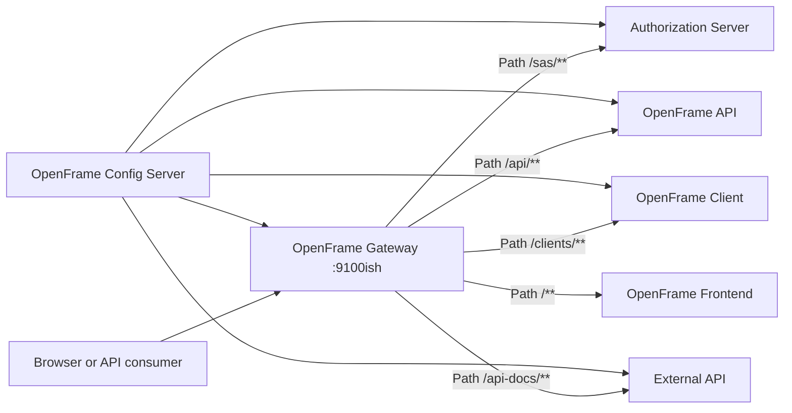

# Local Development

This guide walks through cloning OpenFrame OSS Tenant, building its Spring Boot services and Rust client, running services locally, enabling hot reload, and configuring a debugger — using only the tooling and files that exist in this repository.

> This repository has no root `docker-compose.yml` and no bundled CLI bootstrap script. Local setup is driven by Maven (Java services), Cargo (the Rust client), and the Visual Studio Code task/launch configuration committed at `.vscode/`.

## Repository Shape

OpenFrame OSS Tenant is a **service** repository (bash, java, rust) that publishes nine Maven artifacts (`openframe-api`, `openframe-authorization-server`, `openframe-client`, `openframe-config`, `openframe-external-api`, `openframe-gateway`, `openframe-management`, `openframe-stream`, `openframe-test`) plus a Cargo crate, `openframe_client`. All of its service-level capability (API, data, security, gateway, authorization, notification) is supplied by the pinned `com.openframe.oss:*` artifacts at version `7.0.11`, published from the separate [OpenFrame OSS Library](https://github.com/flamingo-stack/openframe-oss-lib) repository. No other repository in the graph is recorded as consuming this one — it sits at the tenant/deployment end of the dependency chain.

For the full module map and request flow, see `../../reference/architecture/README.md` and `../../reference/architecture/ecosystem.md`.

## 1. Clone and Setup

### Clone the repository

```bash
git clone https://github.com/flamingo-stack/openframe-oss-tenant.git
cd openframe-oss-tenant
```

### Prerequisites

The build files pin exact toolchain versions, so match them locally:

| Tool | Version in this repo | Where it's pinned |
|---|---|---|
| Java (JDK) | 25 | `<java.version>` in `pom.xml` |
| Maven | wrapped by `spring-boot-starter-parent` 4.1.1 | `pom.xml` parent |
| Rust / Cargo | edition 2021 | `clients/openframe-client/Cargo.toml` |
| Node.js + npm | used only for `openframe-frontend` dev server | `.vscode/tasks.json` (`start-vue` task) |

See `../../getting-started/prerequisites.md` for the general environment checklist and `../../getting-started/quick-start.md` / `../../getting-started/first-steps.md` for the broader onboarding path. The separate CLI tool for bootstrapping OpenFrame environments is maintained in [openframe-cli](https://github.com/flamingo-stack/openframe-cli); see its [installation guide](https://github.com/flamingo-stack/openframe-cli#installation) and [docs](https://github.com/flamingo-stack/openframe-cli/tree/main/docs) — it is not part of this repository.

### Build the Java services

The root `pom.xml` is a multi-module Maven project. Its `<modules>` list enumerates every Spring Boot service under `openframe/services/`:

```text
openframe/services/openframe-config
openframe/services/openframe-api
openframe/services/openframe-client
openframe/services/openframe-stream
openframe/services/openframe-management
openframe/services/openframe-gateway
openframe/services/openframe-external-api
openframe/services/openframe-authorization-server
openframe/services/openframe-test
```

Build everything from the repository root:

```bash
mvn clean install
```

Build a single service plus its dependencies (the same pattern the container images use, see the `Dockerfile` of each service, for example `openframe/services/openframe-api/Dockerfile`):

```bash
mvn clean package -U \
  -pl openframe/services/openframe-api \
  -am \
  -Dmaven.test.skip=true
```

Swap `-pl openframe/services/openframe-api` for any other module path listed above to build just that service.

> **JDK 25 annotation processing note:** the parent POM explicitly lists Lombok and `spring-boot-configuration-processor` under `maven-compiler-plugin` → `annotationProcessorPaths`, because JDK 23+ no longer auto-discovers annotation processors on the classpath. If you add a new module, keep this plugin configuration inherited from the parent rather than reinventing it.

Each service module's `pom.xml` (`openframe/services/openframe-api/pom.xml`, `openframe/services/openframe-authorization-server/pom.xml`, `openframe/services/openframe-client/pom.xml`, `openframe/services/openframe-config/pom.xml`, `openframe/services/openframe-external-api/pom.xml`) declares a `<relativePath>../../../pom.xml</relativePath>` back to the root, and each pulls in one `com.openframe.oss:*-service-core` artifact at `7.0.11` plus `spring-cloud-starter-config`.

### Build the Rust client

The Rust agent lives at `clients/openframe-client` and is a thin binary over the external `openframe-agent-lib` crate (pulled by git tag from `flamingo-stack/openframe-oss-lib`, per `clients/openframe-client/Cargo.toml`). It ships its own `Makefile`:

```bash
cd clients/openframe-client
make build
```

`make build` sets `OPENFRAME_VERSION` (required by the library's build script, which panics if it is unset) and runs:

```bash
OPENFRAME_VERSION=0.0.0-dev cargo build --release --locked
```

Other Makefile targets:

```bash
make fmt         # cargo fmt --all
make fmt-check   # cargo fmt --all -- --check
make clippy      # cargo clippy --all-targets -- -D warnings
make lint        # fmt-check + clippy
make test        # build, then cargo test --release --locked
make clean       # cargo clean
```

Cross-compiling: pass `TARGET=<triple>` to `make build`, e.g. `make build TARGET=x86_64-unknown-linux-musl`.

## 2. Running Locally

### Running a Java service directly

Each service is a standard Spring Boot application with one `main` class per module:

| Service | Main class | Module path |
|---|---|---|
| openframe-api | `com.openframe.api.ApiApplication` | `openframe/services/openframe-api` |
| openframe-authorization-server | `com.openframe.authz.OpenFrameAuthorizationServerApplication` | `openframe/services/openframe-authorization-server` |
| openframe-client | `com.openframe.client.ClientApplication` | `openframe/services/openframe-client` |
| openframe-config | `com.openframe.config.ConfigServerApplication` | `openframe/services/openframe-config` |
| openframe-external-api | `com.openframe.external.ExternalApiApplication` | `openframe/services/openframe-external-api` |
| openframe-gateway | `com.openframe.gateway.GatewayApplication` | `openframe/services/openframe-gateway` |
| openframe-management | `com.openframe.management.ManagementApplication` | `openframe/services/openframe-management` |
| openframe-stream | `com.openframe.stream.StreamApplication` | `openframe/services/openframe-stream` |

Run one with the Spring Boot Maven plugin, from the module directory:

```bash
cd openframe/services/openframe-api
mvn spring-boot:run
```

Every service imports configuration at startup through Spring Cloud Config. Its `src/main/resources/application.yml` (see `openframe/services/openframe-api/src/main/resources/application.yml`, `openframe/services/openframe-authorization-server/src/main/resources/application.yml`, `openframe/services/openframe-client/src/main/resources/application.yml`) points at:

```yaml
spring:
  config:
    import: "optional:configserver:${SPRING_CONFIG_URL:http://openframe-config.microservices.svc.cluster.local:8888}"
```

Because that default host is a Kubernetes in-cluster DNS name, running a service **outside** a cluster requires overriding `SPRING_CONFIG_URL` (or running against a local tunnel/port-forward to an `openframe-config` instance) so the service can resolve its configuration. The `import` is `optional:`, so a service will still start without the config server reachable, but it will be missing the shared and service-specific settings normally supplied from `configs/base/application.yml` and the per-service file (for example `configs/base/openframe-api.yml`).

### Service composition at startup

Each application class defines its own `@ComponentScan` boundary, so the packages it scans determine which beans (and therefore which upstream library behavior) are active:

- `ApiApplication` scans `com.openframe.api`, `com.openframe.data`, `com.openframe.core`, `com.openframe.notification`, `com.openframe.kafka`.
- `OpenFrameAuthorizationServerApplication` scans `com.openframe.authz`, `com.openframe.core`, `com.openframe.data`, `com.openframe.notification`, and also carries `@EnableDiscoveryClient`.
- `ClientApplication` scans `com.openframe.data`, `com.openframe.client`, `com.openframe.core`, `com.openframe.security`, `com.openframe.kafka.producer`, and explicitly excludes `CassandraHealthIndicator`.
- `ExternalApiApplication` scans `com.openframe.external`, `com.openframe.data`, `com.openframe.core`, `com.openframe.api`, `com.openframe.kafka`.
- `GatewayApplication` scans `com.openframe.gateway`, `com.openframe.core`, `com.openframe.data`, `com.openframe.security`.
- `ManagementApplication` scans `com.openframe.management`, `com.openframe.data`, `com.openframe.core`, and also excludes `CassandraHealthIndicator`.
- `StreamApplication` scans `com.openframe.stream`, `com.openframe.data`, `com.openframe.kafka.producer`, and carries `@EnableKafka`.
- `ConfigServerApplication` has no explicit scan beyond `@SpringBootApplication`; its behavior comes entirely from the `openframe-config-core` dependency.

Architecture detail for each bootstrap class, including sequence diagrams of their startup flow, is documented per module: `../../reference/architecture/api-service-core/api-service-core.md`, `../../reference/architecture/authorization-server-core/authorization-server-core.md`, `../../reference/architecture/client-service-core/client-service-core.md`, `../../reference/architecture/config-server-core/config-server-core.md`, `../../reference/architecture/external-api-service/external-api-service.md`, `../../reference/architecture/gateway-service-core/gateway-service-core.md`, `../../reference/architecture/management-service-core/management-service-core.md`, `../../reference/architecture/stream-service-core/stream-service-core.md`.



### Running the Rust client

```bash
cd clients/openframe-client
cargo run
```

`src/main.rs` is intentionally thin — it only calls `openframe::run()` from the external `openframe-agent-lib` crate; all client-agent logic lives upstream in `flamingo-stack/openframe-oss-lib`.

### Running the frontend dev server

The `.vscode/tasks.json` file defines a `start-vue` task that runs the frontend under `openframe/services/openframe-ui`:

```bash
cd openframe/services/openframe-ui
npm run dev
```

with environment variables `PORT=5177`, `VITE_API_URL=http://openframe-api.microservices:8090`, `VITE_GATEWAY_URL=http://openframe-gateway.microservices:8100`, `VITE_CLIENT_ID=openframe_web_dashboard`, `VITE_CLIENT_SECRET=prod_secret`, and `VITE_GRAFANA_URL=https://localhost:3000` (as declared in the task). Treat the secret value as a placeholder for local, non-production use only — replace it with your own environment configuration for anything beyond a local smoke test.

Separately, `.vscode/launch.json` defines Node launch configurations against `openframe/services/openframe-frontend` (`npm run dev` on port 4000) with `NEXT_PUBLIC_*` variables for API, GraphQL, and WebSocket endpoints — see the Debug Configuration section below.

### Datastore and messaging dependencies

Shared configuration in `configs/base/application.yml` points every service at in-cluster hostnames for MongoDB (`mongodb-0.mongodb.datasources.svc.cluster.local`), Redis Cluster (`redis-cluster-{0,1,2}.redis-cluster-headless.datasources.svc.cluster.local`), Cassandra (`cassandra.datasources.svc.cluster.local`), and Pinot controller/broker. Per-service files such as `configs/base/openframe-api.yml` additionally point at Kafka (`kafka.datasources.svc.cluster.local`) and NATS (`nats.datasources.svc.cluster.local`). These are Kubernetes Helm-deployed datasources defined under `manifests/datasources/` (Cassandra, Kafka, MongoDB, MongoDB for MeshCentral, MySQL for FleetMDM, NATS, Pinot, Redis Cluster, Zookeeper) — there is no root Docker Compose file in this repository to start them standalone. Running services fully locally therefore means either pointing the relevant connection properties at your own local instances of these systems, or working against a cluster (the manifests under `manifests/apps`, `manifests/platform`, `manifests/datasources`, and `manifests/tenant` describe the full deployment topology; see `../../reference/architecture/README.md` for the deployment diagram).

The two MongoDB datastores each ship their own initialization/readiness shell scripts, useful as a reference for what a local MongoDB instance needs to satisfy: `manifests/datasources/mongodb/scripts/mongo-init.sh`, `manifests/datasources/mongodb/scripts/readiness-command.sh`, `manifests/datasources/mongodb-meshcentral/scripts/meshcentral-mongodb-init.sh`, `manifests/datasources/mongodb-meshcentral/scripts/meshcentral-readiness-command.sh`, and `manifests/datasources/mongodb-meshcentral/scripts/mongodb-entrypoint.sh`.

For deeper environment-variable and configuration-source detail, see `./environment.md`.

## 3. Hot Reload / Watch Mode

This repository does not bundle a Spring Boot DevTools dependency declaration in the provided `pom.xml` files, and it has no root Docker Compose stack with bind-mount based reload. The watch-mode tooling that **is** committed is for the Rust client, via the `.vscode/tasks.json` `rust-watch` task:

```bash
cd client
cargo watch -x run
```

> Note: the `rust-watch` task's working directory in `.vscode/tasks.json` is `${workspaceFolder}/client`, while the Cargo project in this repository lives at `clients/openframe-client`. Confirm the path in your checkout before running the task, or run `cargo watch -x run` directly from `clients/openframe-client` if you have `cargo-watch` installed (`cargo install cargo-watch`).

Other Rust-related VS Code tasks in `.vscode/tasks.json` worth using during iterative development:

```bash
cargo check    # fast type-check, "rust-check" task
cargo clippy   # lint, "rust-clippy" task
cargo build    # debug build, "rust-build" task (default build task)
cargo test     # "rust-test" task (default test task)
```

For the frontend, `npm run dev` (used by both the `start-vue` task for `openframe-ui` and the Node launch configurations for `openframe-frontend`) runs the framework's own development server with its native hot-reload/watch behavior; no additional watch wrapper is defined in this repository for it.

For Java services, use your IDE's incremental compilation together with `mvn spring-boot:run`, or rely on the hot-swap behavior enabled by VS Code's Java debug settings described below — this repository does not commit a `spring-boot-devtools` dependency, so automatic classpath-change restarts are not configured out of the box.

## 4. Debug Configuration

The repository commits a ready-to-use VS Code debug setup in `.vscode/launch.json`, `.vscode/tasks.json`, and `.vscode/settings.json`.

### Java debugging

`.vscode/settings.json` enables Java hot-code-replace and automatic build:

```json
"java.debug.settings.hotCodeReplace": "auto",
"java.configuration.updateBuildConfiguration": "automatic",
"java.autobuild.enabled": true,
"java.debug.settings.showLogicalStructure": true,
"java.debug.settings.showStaticVariables": true,
"java.compile.nullAnalysis.mode": "automatic"
```

`.vscode/launch.json` defines one `java` launch configuration per service, each setting `SPRING_PROFILES_ACTIVE=k8s` via both `env` and `vmArgs`:

| Launch configuration name | Main class | `cwd` |
|---|---|---|
| Management Application | `com.openframe.management.ManagementApplication` | `${workspaceFolder}/openframe/services/openframe-management` |
| API Application | `com.openframe.api.ApiApplication` | `${workspaceFolder}/openframe/services/openframe-api` |
| Client Application | `com.openframe.client.ClientApplication` | `${workspaceFolder}/openframe/services/openframe-client` |
| Config Server Application | `com.openframe.config.ConfigServerApplication` | `${workspaceFolder}/openframe/services/openframe-config` |
| Stream Application | `com.openframe.stream.StreamApplication` | `${workspaceFolder}/openframe/services/openframe-stream` |
| Gateway Application | `com.openframe.gateway.GatewayApplication` | `${workspaceFolder}/openframe/services/openframe-gateway` |

Open the Run and Debug panel in VS Code, pick one of these configurations, and start debugging — breakpoints, hot-code-replace, and the Java variable/structure views apply automatically given the settings above.

### Rust debugging

Four `lldb`-type launch configurations target the Rust client binary at `${workspaceFolder}/client/target/debug/openframe` (debug) or `.../target/release/openframe` (release):

| Launch configuration name | Pre-launch task | Args | Notable env |
|---|---|---|---|
| OpenFrame Client Debug | `rust-build` | `run-as-service` | `RUST_LOG=debug`, `RUST_BACKTRACE=1`, `OPENFRAME_DEV_MODE=true` |
| OpenFrame Client Debug (Service Mode) | `rust-build` | `run-as-service` | same as above |
| OpenFrame Client Release | `rust-build-release` | `run` | `RUST_LOG=info`, `OPENFRAME_DEV_MODE=true` |
| OpenFrame Client Tests | `rust-test` | none | `RUST_LOG=debug`, `RUST_BACKTRACE=1`, `OPENFRAME_DEV_MODE=true` |

Each sets `OPENFRAME_LOG_DIR` to `${workspaceFolder}/client/logs`. As with the watch task, this path is `client/`, while the Cargo manifest in this repository is at `clients/openframe-client` — verify or adjust the path for your checkout before relying on the pre-launch build tasks.

The pre-launch tasks (`rust-build`, `rust-build-release`, `rust-test`) are plain `cargo build`, `cargo build --release`, and `cargo test` invocations declared in `.vscode/tasks.json`, each with `"cwd": "${workspaceFolder}/client"` and the `$rustc` problem matcher for inline error reporting in the editor.

`.vscode/settings.json` also configures `rust-analyzer` for a smoother debug/edit loop:

```json
"rust-analyzer.checkOnSave.command": "clippy",
"rust-analyzer.cargo.features": "all",
"rust-analyzer.cargo.allFeatures": true,
"rust-analyzer.diagnostics.enable": true,
"rust-analyzer.inlayHints.enable": true,
"rust-analyzer.lens.enable": true,
"[rust]": {
    "editor.defaultFormatter": "rust-lang.rust-analyzer",
    "editor.formatOnSave": true,
    "editor.tabSize": 4
}
```

### Frontend debugging

Four `node`-type launch configurations target `openframe/services/openframe-frontend`, all using the `frontend-with-port-cleanup` pre-launch task (which first runs `kill-port-4000` to free port 4000, then starts `npm run dev`):

| Launch configuration name | Distinguishing environment |
|---|---|
| OpenFrame Frontend with Local K8s Cluster | `NEXT_PUBLIC_API_URL=https://localhost/api`, `NEXT_PUBLIC_APP_TYPE=openframe`, `PORT=4000` |
| OpenFrame Frontend with Dev Configuration | `NEXT_PUBLIC_APP_MODE=saas-tenant`, `NEXT_PUBLIC_TENANT_HOST_URL=https://michael.openframe.build` |
| OpenFrame Frontend with Stage Configuration | `NEXT_PUBLIC_TENANT_HOST_URL=https://test.openframe.miami` |
| OpenFrame Frontend with Prod Configuration | `NEXT_PUBLIC_TENANT_HOST_URL=https://test.openframe.ai` |

All four set `console: integratedTerminal`, `sourceMaps: true`, and `smartStep: true`, and skip stepping into `<node_internals>/**` and `node_modules/**`. Pick the configuration matching the backend/tenant environment you want the frontend to talk to.

> The hostnames and secrets embedded in these launch configurations (for example `VITE_CLIENT_SECRET=prod_secret`, the `openframe.build`/`openframe.miami`/`openframe.ai` tenant hosts) are committed defaults for local convenience. Refer to your environment configuration for any value you need to change for your own setup.

### Port cleanup helper

`.vscode/tasks.json` defines `kill-port-4000`, a cross-platform (`windows`/`linux` variants plus a default) command to free port 4000 before a frontend debug session starts, and `frontend-with-port-cleanup`, which chains it before the frontend launch itself.

## Where to Go Next

- `../../reference/architecture/README.md` — full architecture overview, repository structure, and deployment topology.
- `./environment.md` — configuration sources and environment variables in more detail.
- `../architecture/README.md` — development-focused architecture notes.
- `../testing/README.md` — running the test suites for these services.
- `../contributing/guidelines.md` — contribution workflow.
- `../security/README.md` — security practices for local and deployed environments.

For questions or help, the project is coordinated through the OpenMSP Slack community rather than GitHub Issues or Discussions.
