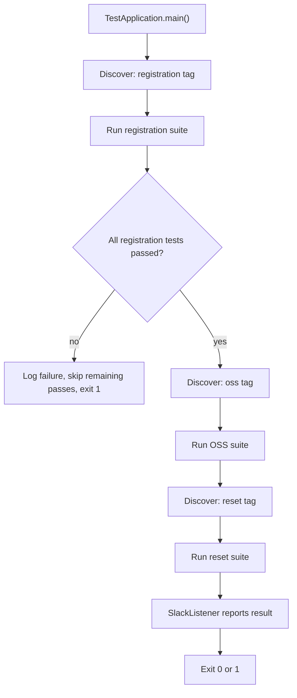

## Testing

OpenFrame OSS Tenant is a multi-module Maven project (Java 25, Spring Boot `4.1.1`, parent artifact `com.openframe:openframe-parent`) that assembles tenant-owned service entry points from OpenFrame OSS Library modules, plus a thin Rust client (`clients/openframe-client`). Testing spans three layers: Java unit/slice tests inside each service module, a dedicated end-to-end test service (`openframe-test`) that runs library-supplied integration and UI suites against a deployed tenant, and chart-level Helm unit tests for the Argo CD app-of-apps manifests. This document explains how those layers are organized, how to run them locally and in CI, how to add new tests, and what coverage expectations apply.

> This repository has no recorded downstream consumers (see `get_repo_ecosystem`, coverage `full`): changes here are the final word on the deployed tenant stack, so tests that validate a published artifact's contract matter more than they would in a library with many callers.

### Test structure and organization

#### Java services (`openframe/services/*`)

The root [`pom.xml`](https://github.com/flamingo-stack/openframe-oss-tenant/blob/main/pom.xml) declares nine modules under `openframe/services`:

```text
openframe/services/
├── openframe-config/                 # Spring Cloud Config Server
├── openframe-api/                    # Main API + GraphQL service
├── openframe-client/                 # Managed-endpoint registration/delivery service
├── openframe-stream/                 # Kafka event processing service
├── openframe-management/             # Reconciliation / catalog sync service
├── openframe-gateway/                # Reactive edge router
├── openframe-external-api/           # API-key-protected REST API
├── openframe-authorization-server/   # OAuth2 / OIDC authorization server
└── openframe-test/                   # End-to-end test runner service
```

Each service's own module `pom.xml` (for example [`openframe/services/openframe-api/pom.xml`](https://github.com/flamingo-stack/openframe-oss-tenant/blob/main/openframe/services/openframe-api/pom.xml)) inherits test dependencies declared once, centrally, in the parent POM:

- `spring-boot-starter-test`
- `spring-security-test` (scope `test`)
- `mockito-core` and `mockito-junit-jupiter` (scope `test`)

Because the parent POM owns these dependencies, an individual service module does not need to redeclare them — it only adds the library it composes (for example `openframe-api` adds `com.openframe.oss:openframe-api-service-core`) plus `spring-boot-starter` and, where needed, `openframe-data-redis` and `spring-cloud-starter-config`.

Tests observed directly in this repository sit under `src/test/java` of `openframe-api`:

```text
openframe/services/openframe-api/src/test/java/com/openframe/api/
├── TestConstants.java              # Shared constant fixtures (client id/secret, tokens)
├── TestUtils.java                  # JSON helpers, reflection field setter, DTO/document factories
├── config/TestConfig.java          # @TestConfiguration: mocks every infra bean
└── util/TestAuthenticationManager.java  # Deterministic failing AuthenticationManager
```

`TestConfig` is the pattern every service-level Spring test context in this repository follows: it replaces `MongoTemplate`, `UserRepository`, `RedisTemplate`, `KafkaTemplate`, `CassandraTemplate`, and the Pinot `Connection` with Mockito mocks marked `@Primary`, so a slice or unit test never needs live infrastructure. The only bean given a real implementation is `PasswordEncoder` (`BCryptPasswordEncoder`), because hashing logic itself is worth exercising for real. `TestUtils` centralizes JSON serialization (via Jackson's `JsonMapper`), reflection-based private-field injection for constructing test fixtures, and builders for OAuth client/token/response test objects so individual test classes don't duplicate that boilerplate.

Most of the actual domain logic under test (API controllers, GraphQL data fetchers, authorization flows, stream enrichment, gateway routing, etc.) lives in the upstream `OpenFrame OSS Library` (pinned at `7.0.11` across every module — see `openframe-api-service-core`, `openframe-authorization-service-core`, `openframe-gateway-service-core`, `openframe-stream-service-core`, and the rest listed in [`docs/reference/architecture/ecosystem.md`](../../reference/architecture/ecosystem.md)). This repository's own `src/test` trees therefore focus on how the tenant wires those library beans together — Spring context loading, bean overrides, and tenant-specific configuration — rather than re-testing library internals. When you need to understand a specific library behavior's test coverage (for example Fleet MDM device projection or AI assistant tool scoping), the corresponding component doc under `docs/reference/architecture/` documents it, such as [`openframe-data-device-aspect`](../../reference/architecture/openframe-data-device-aspect/openframe-data-device-aspect.md) or [`openframe-test-service-core`](../../reference/architecture/openframe-test-service-core/openframe-test-service-core.md).

#### The end-to-end test service (`openframe-test`)

`openframe/services/openframe-test` is a distinct module: not a Spring Boot web service, but a JUnit Platform launcher packaged as its own artifact (`com.openframe:openframe-test`, published alongside the other services). Its own source is minimal:

```text
openframe/services/openframe-test/src/main/java/com/openframe/test/
├── TestApplication.java   # main() — discovers and runs tagged JUnit suites
└── SummaryLogger.java     # Logs JUnit discovery/execution summaries
```

`TestApplication.main()` builds a `TestRunnerConfig` pointed at the package `com.openframe.test.tests`, attaches an Allure JUnit Platform listener, a `SummaryGeneratingListener`, and a `SlackListener` (backed by `SlackClient`, reading `SLACK_OAUTH_TOKEN` from the environment and posting to a fixed Slack channel ID), then runs tests in two ordered passes:

1. **Registration tests** (JUnit tag `registration`) — run first, unconditionally, by package discovery. Interrupts the whole run if any fail.
2. **OSS tests** (JUnit tag `oss`), followed by **reset tests** (JUnit tag `reset`) — run only if registration passed.

Both passes log a discovered test list and a pass/fail summary through `SummaryLogger`, and the Slack listener reports the outcome at the end. The process exits `0` only if every tagged pass succeeded.

The actual test classes, page objects, API DTOs, authentication flows, and database helpers that `com.openframe.test.tests` discovers are supplied by the upstream library artifact `com.openframe.oss:openframe-test-service-core` (version `7.0.11`), published in this repository as `com.openframe:openframe-test`. Its structure, as documented in [`openframe-test-service-core`](../../reference/architecture/openframe-test-service-core/openframe-test-service-core.md), separates concerns into:

| Package area | Responsibility |
|---|---|
| `api.auth` | `IAuthFlow`, `AuthFlowOSS`, `AuthFlowSAAS` — deployment-specific login redirect flows ([Auth Flow](../../reference/architecture/openframe-test-service-core/auth-flow/auth-flow.md)) |
| `data.db.collections` | `OrganizationsCollection`, `TenantsCollection` — typed MongoDB fixture lookups ([Db Collections](../../reference/architecture/openframe-test-service-core/db-collections/db-collections.md)) |
| `data.dto` | Tolerant Jackson DTOs for device, ticket, script, schedule, software, AI-dialog, and assignment API responses (for example [Device Dto](../../reference/architecture/openframe-test-service-core/device-dto/device-dto.md), [Ai Dto](../../reference/architecture/openframe-test-service-core/ai-dto/ai-dto.md), [Assignment Dto](../../reference/architecture/openframe-test-service-core/assignment-dto/assignment-dto.md)) |
| `helpers` | `RateLimitRetryFilter`, `TransientGatewayRetryFilter` — bounded retry for `429`/`502`/`504` responses |
| `listener` | `SlackListener`, `SlackClient` — JUnit outcome aggregation and reporting |
| `pages` | Playwright page objects for devices, remote access, monitoring, scripts, and SSO login |
| `runner` | `TestRunner`, `TestRunnerConfig`, `Test` — JUnit Platform discovery/execution/listing |
| `tests` | The functional suites themselves: [Core Tests](../../reference/architecture/openframe-test-service-core/core-tests/core-tests.md) (tenant administration, devices, policies, scripts, tickets, knowledge base, onboarding), [Ai Tests](../../reference/architecture/openframe-test-service-core/ai-tests/ai-tests.md) (Fae client assistant, Mingo administrator assistant), External API tests, and [Admin Tests](../../reference/architecture/openframe-test-service-core/admin-tests/admin-tests.md) (the shared ADMIN fixture lifecycle) |



A representative suite is **Admin Tests**: `AdminFixtureTest` runs a tagged `admin-setup` case that invites and accepts one administrator before the functional phase, stores the identity in a shared `PipelineContext`, and a paired `admin-teardown` case that deletes it afterward — guarding against double deletion by checking `PipelineContext.hasFixtureAdmin()` first. This keeps a single, known ADMIN identity available to every functional test that needs one, distinct from the tenant's initial OWNER.

#### Chart tests (Helm unit tests)

The `manifests/app-of-apps` chart ships `helm unittest` specs under `manifests/app-of-apps/tests/`:

```text
manifests/app-of-apps/tests/
├── argocd_apps_test.yaml        # Application metadata, sources, destination, sync policy
├── edge_cases_test.yaml         # Missing/overridden configuration handling
├── projects_test.yaml           # The platform / datasources / tenant AppProject trio
├── secrets_test.yaml            # Confirms no docker-secret/repo-secret templates for OSS
├── validation_test.yaml         # End-to-end valid-deployment assertions
└── values_propagation_test.yaml # Repository URL/branch/path value propagation
```

These specs assert against `templates/argocd-apps.yaml` and `templates/projects.yaml` rendered output — for example that `spec.sources[0].repoURL` resolves to `https://github.com/flamingo-stack/openframe-oss-tenant.git`, that `spec.syncPolicy.retry.limit` is `5`, and that exactly three `AppProject` documents (`platform`, `datasources`, `tenant`) are produced by `projects.yaml`.

### Running tests

#### Java modules

Run the full reactor build with tests from the repository root:

```bash
mvn test
```

Run tests for a single service module only (useful when iterating on one service):

```bash
mvn test -pl openframe/services/openframe-api
```

Package a module while skipping tests (CI build steps that only need the image build, not a second test pass, do this upstream — see the Docker build step in the release workflow):

```bash
mvn package -DskipTests -pl openframe/services/openframe-api
```

Because `openframe-test` depends on `com.openframe.oss:openframe-test-service-core`, building it (`mvn package -pl openframe/services/openframe-test`) packages the end-to-end suite classes together with `TestApplication`, producing the artifact the deployed test runner executes against a live tenant.

#### Running the end-to-end suite

The `openframe-test` module's `main()` entry point (`com.openframe.test.TestApplication`) is not meant to run against `localhost` defaults casually — it drives real registration, OSS, and reset passes against a deployed tenant and reports to Slack. The class reads `SLACK_OAUTH_TOKEN` from the environment to authenticate its summary post; without it, `SlackClient` still constructs but posting will fail or be skipped depending on the configured transport (the library describes a Slack bot, webhook, or log fallback — see [Slack Listener](../../reference/architecture/openframe-test-service-core/openframe-test-service-core.md)). Running it requires a target tenant to already be deployed and reachable, because every suite calls real product APIs, GraphQL endpoints, SSH-reachable managed devices (for Fae/Mingo AI tests and device tests), or Playwright-driven UI flows — there is no bundled mock tenant.

To scope which suites run, use JUnit tags directly against the packaged test classes, mirroring what `TestApplication` already does internally (`registration`, `oss`, `reset`, plus finer-grained tags documented per suite such as `ai`, `fae`, `mingo`, `fleet`, `negative`, `compaction`, `stop`, `admin-setup`, `admin-teardown`).

#### CI execution

CI change detection lives in [`.github/workflows/changes.yaml`](https://github.com/flamingo-stack/openframe-oss-tenant/blob/main/.github/workflows/changes.yaml), which defines an `openframe-test` path filter keyed to `./pom.xml` and `./openframe/services/openframe-test/**`: a change to either triggers downstream jobs scoped to that component. The release pipeline ([`.github/workflows/release.yml`](https://github.com/flamingo-stack/openframe-oss-tenant/blob/main/.github/workflows/release.yml)) builds and pushes container images for every service (including `openframe-test` is not in the release image matrix directly, but the `build_images` job's matrix — `openframe-api`, `openframe-authorization-server`, `openframe-external-api`, `openframe-client`, `openframe-config`, `openframe-gateway`, `openframe-management`, `openframe-stream` — depends on the same multi-module Maven build that compiles and runs `mvn test` across all modules, `openframe-test` included, during module resolution). The Rust client build (`build_clients` job) runs `make build` per target under `clients/openframe-client`.

Separately, the Flamingo Code Review workflow ([`.github/workflows/flamingo-code-review.yml`](https://github.com/flamingo-stack/openframe-oss-tenant/blob/main/.github/workflows/flamingo-code-review.yml)) reviews pull requests on demand (via the `flamingo-review` label, a `@flamingo-review` comment command, or the `flamingo-review-always` label) rather than on every push; it is a review gate, not a test runner, and a `tests` check only reports in the merge queue (`merge_group`) where it is otherwise skipped.

> Rule `OPENFRAM-010-13` requires every `docker buildx build` invocation in this repository's workflows to target `--platform linux/amd64,linux/arm64` and, for release builds, to pass `--push --provenance=false --sbom=true`. If you add a new CI step that builds a test or service image, match this pattern.

#### Helm chart tests

Chart tests under `manifests/app-of-apps/tests/` are written for `helm unittest` (the `helm-unittest` plugin), following the `suite:` / `templates:` / `tests:` structure shown in each spec file. Run them with the `helm unittest` plugin against the `manifests/app-of-apps` chart, pointing at the templates each suite declares (`templates/argocd-apps.yaml`, `templates/projects.yaml`).

### Writing new tests

#### Java unit and slice tests

Follow the pattern already established in `openframe-api`:

1. **Mock every infrastructure bean.** If your test needs a Spring context (for example a `@SpringBootTest` or `@WebMvcTest` slice), add a `@TestConfiguration` class modeled on [`TestConfig.java`](https://github.com/flamingo-stack/openframe-oss-tenant/blob/main/openframe/services/openframe-api/src/test/java/com/openframe/api/config/TestConfig.java): every infrastructure dependency (`MongoTemplate`, `RedisTemplate`, `KafkaTemplate`, `CassandraTemplate`, the Pinot `Connection`, repositories like `UserRepository`) must be a `Mockito.mock()` bean annotated `@Bean @Primary`, so it overrides the real auto-configured bean rather than competing with it ambiguously. `PasswordEncoder` is the one exception and should stay a real `BCryptPasswordEncoder`.
2. **Centralize fixtures.** Put shared constants in a `TestConstants`-style holder (private constructor, `public static final` fields) and shared object-building/serialization helpers in a `TestUtils`-style holder, following the existing `openframe-api` test package layout (`com.openframe.api.TestConstants`, `com.openframe.api.TestUtils`).
3. **Use `spring-security-test`, Mockito, and `spring-boot-starter-test`** directly — they are already on the test classpath for every module through the parent POM; no need to add them per module.
4. **Keep classes small and single-responsibility.** The organization-wide rule `OFJAVA-006` applies here explicitly: design each class so it is easy to unit-test with mocks. If mocking a class under test becomes painful, that is a signal the class under test has too many responsibilities and should be split — the same applies to test helper classes themselves.
5. **Scope any filter used in a mutating call to a tenant/organization.** Rule `OPENFRAM-005-11` (scoped to `openframe-test-service-core`, `openframe-api-service-core`, and `openframe-management-service-core` sources) requires that any filter object passed to a mutating service method (archive, delete, status update) have its `organizationIds` (or equivalent tenant-scoping field) set before the call — a tenant-wide filter is acceptable for read-only queries but not for mutations in a shared environment. If you write or extend a test that exercises such a mutating call, use the established `inOrganization`-style helper pattern rather than passing an unscoped filter.

#### Extending the end-to-end suite

New functional end-to-end coverage belongs in the upstream `openframe-test-service-core` library (consumed here at `7.0.11`), not in this repository's own `openframe-test` module — `openframe-test` only contains the runner (`TestApplication`, `SummaryLogger`) that discovers and executes whatever test classes exist under `com.openframe.test.tests` on the classpath. When adding a new library-side suite (in the upstream `openframe-oss-lib` repository):

- Follow the established tag convention: broad tags (`registration`, `oss`, `reset`) select which of `TestApplication`'s three ordered passes a test runs in; finer tags (`ai`, `fae`, `mingo`, `fleet`, `negative`, domain-specific tags) allow scoped execution.
- Verify outcomes through an **independent channel** from the one that caused them — the existing AI test suites are explicit about this: Fae/Mingo device tests confirm file writes, deletions, and host facts over SSH rather than trusting the assistant's own generated reply; entity mutation tests read back through the relevant product API. Avoid writing a test that only inspects the acting system's own response.
- Clean up fixtures defensively. Existing suites remove created tickets, scripts, policies, and tags, use run-specific identifiers to avoid collisions in shared tenant environments, and restore tenant-wide configuration (for example AI model selection) that a test temporarily changed.
- Use `PipelineContext` (as `AdminFixtureTest` does) when a suite needs to publish state for other tests to consume later in the same pipeline run, rather than recreating the same fixture per test class.

#### Helm chart tests

When adding a new Argo CD application or project to `manifests/app-of-apps`, add or extend a spec under `manifests/app-of-apps/tests/` in the same `suite:`/`templates:`/`tests:` shape as the existing files — for example add assertions for a new application's `metadata.name`, `spec.sources[0].repoURL`, `spec.destination`, and `spec.syncPolicy` the way `argocd_apps_test.yaml` does, and extend `projects_test.yaml`'s document-count assertion if you add a new `AppProject`.

### Coverage requirements

This repository does not define a numeric line/branch coverage threshold in its build configuration — no JaCoCo or coverage-gate plugin is declared in the parent `pom.xml`. Coverage expectations here are enforced through code-review rules and through the layered test design itself rather than a percentage gate:

- **`OFJAVA-006`** acts as a structural coverage proxy: a class that is hard to unit-test with mocks is treated as a design smell to fix, which keeps unit-testable surface area high by construction rather than by a coverage number.
- **`OPENFRAM-008-4`** and **`OPENFRAM-009-11`** require every `@TestConfiguration` class under `openframe/services/*/src/test/java/**` to mock all infrastructure beans with `@Primary`, which is what makes module-level tests runnable without live Mongo/Redis/Kafka/Cassandra/Pinot — missing this breaks the whole test context, not just one assertion.
- **`OPENFRAM-005-11`** is a correctness/safety rule rather than a coverage rule, but it directly affects what a mutating-path test must assert: a test exercising a mutating service method should verify the filter was organization-scoped, since an unscoped filter is destructive in a shared environment.
- End-to-end functional breadth is tracked qualitatively by the suite catalog in `openframe-test-service-core` — Core Tests, Ai Tests, External Api Tests, and Admin Tests collectively enumerate the tenant surfaces considered "covered" (tenant administration, devices, policies, scripts, tickets, knowledge base, onboarding, AI assistants, External API). When adding a new tenant-facing capability, the expectation demonstrated by the existing suite is to add a corresponding functional test class tagged consistently with its domain, plus independent-channel verification, rather than relying on unit tests alone.

Because no downstream repository consumes this repository's published artifacts, a regression here cannot be caught by another project's test suite — the Java unit tests, the `openframe-test` end-to-end suites, and the Helm chart tests described above are the full safety net for this stack.

For local environment setup needed to run these suites against a real tenant, see [Local Development](../setup/local-development.md) and [Environment Setup](../setup/environment.md). For the broader service and module architecture referenced throughout this document, see [Architecture](../architecture/README.md) and [the ecosystem reference](../../reference/architecture/ecosystem.md).
