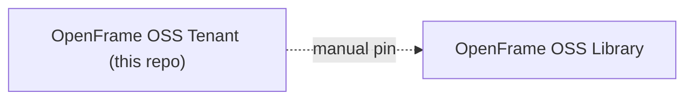
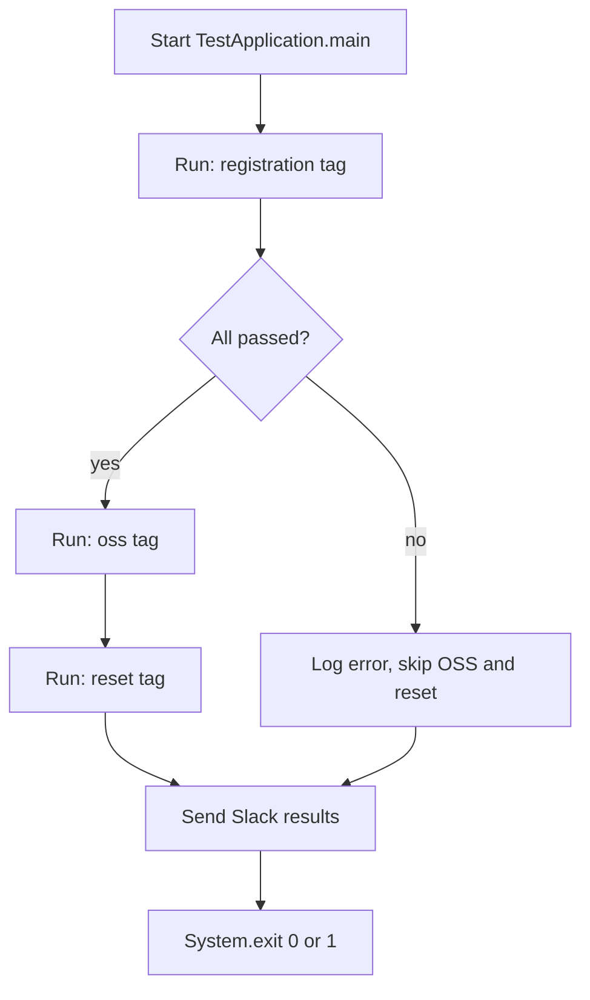

## OpenFrame OSS Tenant — Testing

This document describes how automated testing is organized and run across the OpenFrame OSS Tenant monorepo: the Java/Spring Boot backend services, the Rust `openframe-client` agent, the Helm chart unit tests under `manifests/`, and the standalone end-to-end suite (`openframe-test`).

> This document covers the **OpenFrame OSS Tenant** repository (`flamingo-stack/openframe-oss-tenant`). The [OpenFrame CLI](https://github.com/flamingo-stack/openframe-cli) is maintained in its own repository and is out of scope here; see its [installation guide](https://github.com/flamingo-stack/openframe-cli#installation) and [documentation](https://github.com/flamingo-stack/openframe-cli/tree/main/docs) if you need it.

### Where this fits

OpenFrame OSS Tenant is registered in the organization's code graph as a **service** publishing nine Maven artifacts (`com.openframe:openframe-api`, `openframe-authorization-server`, `openframe-client`, `openframe-config`, `openframe-external-api`, `openframe-gateway`, `openframe-management`, `openframe-stream`, `openframe-test`, all `1.0.0-SNAPSHOT`) and one Cargo crate (`openframe_client` `0.1.0`). It pins one upstream dependency manually: [OpenFrame OSS Library](https://github.com/flamingo-stack/openframe-oss-lib), whose shared Spring Boot "service-core" and client libraries each backend module depends on. No other repository is recorded as consuming artifacts published from this repository — the graph's coverage is `full`, so this absence is conclusive, not a gap in what the pipeline has indexed.



Because nothing downstream depends on this repository's artifacts, test changes here carry no cross-repository compatibility risk beyond the shared library contract — but a renamed or removed public Java symbol can still break another service module in this same monorepo, so run the full `mvn` build (not just one module) before merging.

## Test structure and organization

The repository mixes four kinds of tests, each with its own toolchain:

| Area | Language/Framework | Location | Build tool |
|---|---|---|---|
| Backend services | Java 25, JUnit 5, Spring Boot Test, Mockito | `openframe/services/<service>/src/test/java/...` | Maven (`pom.xml`) |
| Rust agent | Cargo test harness | `clients/openframe-client/` (binary) + the `openframe-agent-lib` crate in the OpenFrame OSS Library | Cargo |
| Helm charts | helm-unittest | `manifests/app-of-apps/tests/*.yaml` | Helm |
| End-to-end / smoke suite | JUnit 5 + Allure + Slack reporting | `openframe/services/openframe-test/` | Maven, run as a standalone application |

### Backend service test layout

Each Spring Boot module under `openframe/services/` follows the standard Maven layout, `src/test/java` mirroring `src/main/java`'s package structure. The `openframe-api` module is the most fully fleshed out example in the material available here:

- `openframe/services/openframe-api/src/test/java/com/openframe/api/TestConstants.java` — a `final` utility class of static test fixtures (`TEST_CLIENT_ID`, `TEST_CLIENT_SECRET`, `TEST_ACCESS_TOKEN`, `TEST_REFRESH_TOKEN`, `TEST_AUTH_CODE`) used across OAuth-related tests so every test file shares the same mock credentials instead of inlining its own.
- `openframe/services/openframe-api/src/test/java/com/openframe/api/TestUtils.java` — shared helpers: `asJsonString(Object)` for Jackson serialization in assertions, `setPrivateField(Object, String, Object)` for reflection-based field injection when a setter isn't exposed, and factory methods (`createTestClient()`, `createTestToken()`, `createTestTokenResponse()`, `createTestAuthResponse()`) that build ready-to-use OAuth fixtures (`OAuthClient`, `OAuthToken`, `TokenResponse`, `AuthorizationResponse`).
- `openframe/services/openframe-api/src/test/java/com/openframe/api/config/TestConfig.java` — a `@TestConfiguration` class providing `@Primary`-annotated mock beans (`MongoTemplate`, `RedisTemplate`, `KafkaTemplate`, `CassandraTemplate`, the Pinot `Connection`, `UserRepository`) built with `Mockito.mock(...)`, plus one **real** bean, `BCryptPasswordEncoder`, since password hashing logic itself should be exercised rather than mocked.
- `openframe/services/openframe-api/src/test/java/com/openframe/api/util/TestAuthenticationManager.java` — a test double implementing Spring Security's `AuthenticationManager` whose `authenticate(...)` always throws `BadCredentialsException`, used to drive authentication-failure test paths without needing a real credential store.

This pattern — one `TestConstants` class, one `TestUtils` class, one `@TestConfiguration` mocking every infrastructure bean, and small single-purpose test doubles like `TestAuthenticationManager` — is the expected shape for a new service module's test support code.

### The `openframe-test` module

`openframe-test` (`com.openframe:openframe-test`, Maven artifact `1.0.0-SNAPSHOT`) is **not** a library of shared JUnit helpers; it is a standalone test-runner application with its own `main` method, built on `openframe-test-service-core` from the OpenFrame OSS Library:

- `openframe/services/openframe-test/src/main/java/com/openframe/test/TestApplication.java` — the entry point. It builds a `TestRunnerConfig` pointed at the `com.openframe.test.tests` package, attaches `AllureJunitPlatform` (Allure reporting), a `SummaryGeneratingListener`, and a `SlackListener` (via `SlackClient`, using the `SLACK_OAUTH_TOKEN` environment variable and channel `C0AHS6C6G3H`), then drives three sequential JUnit-tag-filtered phases:
  1. `registration` tag (run only when no CLI arguments are passed)
  2. `oss` tag — the main OSS regression suite
  3. `reset` tag — environment cleanup/reset after the OSS suite
  
  If the registration phase fails, the OSS and reset phases are skipped and the process exits with code `1`; Slack is notified either way via `slackListener.sendResults(...)`, and the process exit code (`0` or `1`) reflects overall pass/fail — making this suite usable as a CI gate.
- `openframe/services/openframe-test/src/main/java/com/openframe/test/SummaryLogger.java` — `logSummary(TestExecutionSummary)` logs found/succeeded/failed counts and any per-test failure messages; `logTestList(List<Test>)` logs the display name of every planned test before a run starts.



### Rust agent tests

The `openframe-client` Rust crate in this repository (`clients/openframe-client/Cargo.toml`, crate `openframe-client` `0.1.0`) is intentionally a thin binary: `clients/openframe-client/src/main.rs` contains only a `main()` that delegates to `openframe::run()`, where `openframe` is the `openframe-agent-lib` crate pulled from the external [OpenFrame OSS Library](https://github.com/flamingo-stack/openframe-oss-lib) repository (pinned by tag in `Cargo.toml`, currently `v0.0.5`). Nearly all agent behavior — and therefore nearly all Rust unit/integration test coverage — lives in that upstream crate, not in this repository. When working on agent behavior, expect to test against the `openframe-agent-lib` sources in the dependency checkout rather than in `clients/openframe-client/` itself; this repository's own Rust surface is limited to the entry point and build wiring.

### Helm chart tests

`manifests/app-of-apps/tests/` contains a `helm-unittest`-style test suite validating the Argo CD app-of-apps chart's rendered manifests:

- `argocd_apps_test.yaml` — asserts the rendered `Application` object's `apiVersion`, `kind`, `metadata.name`, finalizers, `spec.project`, source repo URL/branch/path, destination namespace, and sync policy (automated prune/self-heal, retry limit 5), and that custom `repository.*` values override the defaults correctly.
- `projects_test.yaml` — asserts that exactly three `AppProject` documents are generated (`platform`, `datasources`, `tenant`), each with the shared `resources-finalizer.argocd.argoproj.io` finalizer, a wildcard `sourceRepos`/`destinations` policy, and a project-specific `spec.description`.
- `edge_cases_test.yaml` — exercises missing-configuration defaults and custom-repository overrides together across both `argocd-apps.yaml` and `projects.yaml` templates.
- `secrets_test.yaml` — confirms the OSS-tenant chart intentionally omits secret-bearing templates (no `docker-secret.yaml` / `repo-secret.yaml`), documenting that secrets are managed separately for OSS deployments.
- `validation_test.yaml` — a broader pass over valid-deployment assertions: source, destination, sync policy, and retry/backoff values (`duration: 15s`, `factor: 2`, `maxDuration: 30m`).
- `values_propagation_test.yaml` — confirms `repository.URL`, `repository.branch`, `repository.baseDir`, and `repository.appsDir` values propagate into the rendered `spec.sources[0]` fields, and that the sync policy stays hardcoded regardless of input values.

These are declarative YAML test specs consumed by the `helm-unittest` plugin; each `it:` block is one assertion group against a rendered template, keeping chart logic (image tags, sync waves, project wiring) verifiable without deploying to a real cluster.

## Running tests

### Backend (Java / Maven)

The parent POM (`pom.xml`) aggregates every service module (`openframe-config`, `openframe-api`, `openframe-client`, `openframe-stream`, `openframe-management`, `openframe-gateway`, `openframe-external-api`, `openframe-authorization-server`, `openframe-test`) and inherits from `spring-boot-starter-parent` (Spring Boot `4.1.1`, Java `25`). Test dependencies are declared once at the parent level and inherited by every module: `spring-boot-starter-test`, `spring-security-test` (scope `test`), `mockito-core` (scope `test`), and `mockito-junit-jupiter` (scope `test`).

Build and test the full backend from the repository root:

```bash
# Clone the repository
git clone https://github.com/flamingo-stack/openframe-oss-tenant.git
cd openframe-oss-tenant

# Build every service and run its tests
mvn clean install
```

To build without running tests (e.g. for a quick compile check):

```bash
mvn clean install -DskipTests
```

To run tests for one module only, use Maven's reactor module selector:

```bash
mvn test -pl openframe/services/openframe-api
```

Because `-pl` builds only the named module's reactor project, add `-am` ("also make") if that module depends on another in-repo module that hasn't been installed locally yet:

```bash
mvn test -pl openframe/services/openframe-api -am
```

> The parent POM's `maven-compiler-plugin` configuration explicitly lists Lombok and `spring-boot-configuration-processor` as annotation processor paths — required because JDK 23+ no longer auto-discovers annotation processors from the classpath. If Lombok-annotated test fixtures (such as `TestConstants` or value objects used in tests) fail to compile with missing-method errors, confirm this annotation processor configuration is intact rather than assuming a code regression.

### The `openframe-test` end-to-end suite

`openframe-test` is packaged and run as its own application rather than invoked through `mvn test`. Its `main` method (`TestApplication.java`) expects the `SLACK_OAUTH_TOKEN` environment variable to be set, since results are always posted to Slack regardless of pass/fail:

```bash
# Run the full suite (registration -> oss -> reset)
SLACK_OAUTH_TOKEN=xoxb-... java -cp app.jar com.openframe.test.TestApplication

# Skip the registration phase by passing any argument
SLACK_OAUTH_TOKEN=xoxb-... java -cp app.jar com.openframe.test.TestApplication skip
```

The process exit code (`0` on success, `1` on any phase failure) makes it suitable as a CI gate check; if the `registration`-tagged tests fail, the `oss` and `reset` phases are never attempted, and the failure is logged before results are sent to Slack.

### Rust agent

Per the project's quick-start build instructions, the agent binary requires `OPENFRAME_VERSION` at build time (consumed by `openframe-agent-lib`'s build script):

```bash
cd clients/openframe-client
OPENFRAME_VERSION=0.0.0-dev cargo build
```

Cargo's standard test harness (`cargo test`) applies to this crate, but since almost all logic is re-exported from the external `openframe-agent-lib` crate, meaningful unit test coverage for agent behavior should be added and run in the [OpenFrame OSS Library](https://github.com/flamingo-stack/openframe-oss-lib) repository, not here.

### Helm chart tests

The chart test suite under `manifests/app-of-apps/tests/` runs with the `helm-unittest` plugin against the templates in `manifests/app-of-apps/templates/`. Install the plugin and point it at the chart directory:

```bash
helm plugin install https://github.com/helm-unittest/helm-unittest
helm unittest manifests/app-of-apps
```

### CI execution

Release and image builds are defined in `.github/workflows/release.yml`, which triggers on pushes to `main` touching `manifests/**`, `openframe/**`, `integrated-tools/**`, `pom.xml`, or `clients/**`, as well as on manual dispatch. It resolves a version (`.github/workflows/version.yml`), detects which components changed (`.github/workflows/changes.yaml`), and then builds Docker images for each Spring Boot service and Rust client binaries per OS/architecture before cutting a GitHub Release. `.github/workflows/changes.yaml` also defines an `openframe-test` change filter (`./pom.xml`, `./openframe/services/openframe-test/**`) and a `helm` filter (`./manifests/app-of-apps/**`), which is how path-based change detection scopes work for the test module and the Helm chart test suite in CI.

A separate workflow, `.github/workflows/flamingo-code-review.yml`, runs an automated code review pass on pull requests (via `pull_request`, `issue_comment` commands, or the `flamingo-review` label) — it is a review gate, not a test runner, but it does evaluate code-review rules (see below) against changed files, including test files.

## Writing new tests

### Backend services

Follow the conventions already established in `openframe-api`'s test tree:

1. **Fixtures first.** Put constants in a `final` utility class with a private constructor (see `TestConstants.java`) rather than scattering literal strings across test files.
2. **Shared builders.** Factory methods for commonly-constructed domain objects belong in a `TestUtils`-style class (`asJsonString`, `setPrivateField`, and `createTestX()` factory methods), so individual test classes stay focused on behavior, not object wiring.
3. **Mock every infrastructure bean.** `@TestConfiguration` classes must provide `@Bean @Primary` mocks for `MongoTemplate`, `RedisTemplate`, `KafkaTemplate`, `CassandraTemplate`, the Pinot `Connection`, and any repository interfaces (`UserRepository`, etc.) using `Mockito.mock(...)`. `PasswordEncoder` is the sanctioned exception — use a real `BCryptPasswordEncoder` there, since hashing correctness is worth testing directly. This is an enforced, active code-review rule (`OPENFRAM-008-4` / `OPENFRAM-009-11`, both `warn`-severity, scoped to `openframe/services/*/src/test/java/**/*Config.java` and `**/test/**/*Config*.java` respectively): a mock bean missing `@Primary` causes ambiguous bean resolution in the Spring test context and will be flagged in review.
4. **Test doubles for failure paths.** For negative-path tests (e.g., authentication failure), write a small, explicit implementation of the interface in question — see `TestAuthenticationManager`, which always throws `BadCredentialsException` — rather than trying to coerce a mocking framework into the same behavior.
5. **Keep classes small and single-responsibility**, including test support classes. The active code-review rule `OFJAVA-006` (`warn`, applies to all `**/*.java`) measures class size by responsibility, not line count: if a class is painful to unit test with mocks, or its methods use disjoint subsets of its fields, that's a signal to split it. A class approaching "a screen and a half" is flagged as a smell.
6. **Tenant/organization scoping in service-core tests.** If you are adding tests against code in the OpenFrame OSS Library's `openframe-test-service-core`, `openframe-api-service-core`, or `openframe-management-service-core` modules (consumed here as dependencies), note the active rule `OPENFRAM-005-11` (`error`): any filter object passed into a method that *mutates* records (archive, delete, status update) must have `organizationIds` set before the call — a status-only or OS-only filter spanning the whole tenant is acceptable for read-only queries, but destructive in shared environments if used with a mutation. Follow the established `inOrganization` helper idiom when writing such tests.

### New service modules

When adding a new Spring Boot module under `openframe/services/`, mirror the four-file test-support pattern seen in `openframe-api`: a `TestConstants` class, a `TestUtils` class, a `@TestConfiguration` under a `config` (or similarly named) sub-package, and purpose-built test doubles under a `util` sub-package as needed. Add the module to the parent `pom.xml`'s `<modules>` list so it's picked up by `mvn clean install` from the repository root, and add its service name to the `IMAGES` array in `.github/workflows/changes.yaml` if it should be built and published by the release workflow.

### Helm chart tests

New chart assertions go in `manifests/app-of-apps/tests/` as additional `helm-unittest` YAML suites, following the existing `suite:`/`templates:`/`tests:` structure. Keep one concern per file (metadata, sync policy, projects, edge cases, secrets, values propagation) as the existing suite does, rather than growing one large file.

### Rust agent

Since the agent's logic lives in `openframe-agent-lib` (external repository), prefer adding tests there. Within this repository, `clients/openframe-client/src/main.rs` is a one-line wrapper (`openframe::run()`); it is not expected to carry its own test suite beyond what Cargo's doctest/compile checks provide implicitly.

## Coverage requirements

No repository-wide coverage threshold, coverage-reporting plugin, or coverage-gate configuration (e.g. JaCoCo, Clover) was found in the inlined `pom.xml` files for the parent project or any service module in the material available for this document. Coverage enforcement, if any, is not evidenced here, so treat the following as the practical minimum bar until a formal gate is introduced:

- Every new public method in a Spring Boot service's business logic should have at least one corresponding test exercising its happy path and, where failure is meaningful (auth, validation, external-call errors), at least one failure-path test — following the `TestAuthenticationManager` pattern for the latter.
- Every `@TestConfiguration` added for a new module must mock all infrastructure beans the module under test touches (rule `OPENFRAM-008-4` / `OPENFRAM-009-11`), so unit tests never depend on live MongoDB, Redis, Kafka, Cassandra, or Pinot instances — this keeps the suite fast enough to run on every `mvn clean install` and in CI's per-module builds.
- Mutating operations in tenant-scoped service-core modules must have a test confirming `organizationIds` scoping is enforced before the mutation runs (rule `OPENFRAM-005-11`), since this repository's data layer backs a multi-tenant platform and an unscoped mutation is a cross-tenant data-corruption risk, not just a style issue.
- Helm chart changes under `manifests/app-of-apps/` must have a corresponding assertion (new or updated) in `manifests/app-of-apps/tests/`, since that is the only automated verification of the Argo CD app-of-apps rendering in this repository.

For broader architectural context on how these services fit together (ports, data stores, the Gateway's route table), see the [architecture overview](../architecture/README.md) and the generated [ecosystem reference](../../reference/architecture/ecosystem.md). For environment setup before running any of the commands above, see [environment setup](../setup/environment.md) and [local development](../setup/local-development.md). Contribution conventions, including how test changes should be described in a pull request, are covered in [contributing guidelines](../contributing/guidelines.md).
