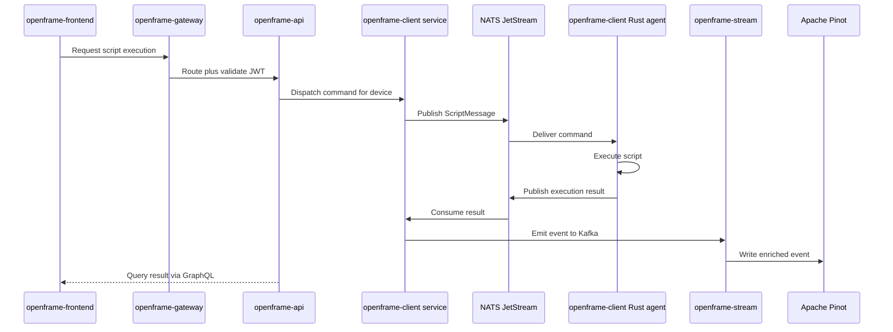

# First Steps

You've installed OpenFrame OSS Tenant — now what? This guide walks through the first things to do right after setup, the configuration you should check before relying on the platform day to day, the key features worth exploring first, and where to get help if something doesn't line up.

> If you haven't completed installation yet, go back to the [Quick Start](./quick-start.md) guide, or check [Prerequisites](./prerequisites.md) if a build or deploy step failed.

## 1. First 5 things to do after installation

### 1. Confirm every core service is actually running

OpenFrame OSS Tenant ships nine Maven modules under `com.openframe` (`openframe-api`, `openframe-authorization-server`, `openframe-client`, `openframe-config`, `openframe-external-api`, `openframe-gateway`, `openframe-management`, `openframe-stream`, `openframe-test`) plus the Rust `openframe_client` agent crate. In a Kubernetes deployment these land as separate workloads; in local development you'll typically run a subset directly via Maven. Before anything else, verify the services you expect to be up are up:

```bash
# Start a single service locally, e.g. the API
mvn spring-boot:run -pl openframe/services/openframe-api
```

Each Spring Boot service exposes actuator endpoints under `/management/v1` (the version segment comes from `RELEASE_VERSION`, default `v1`), with `health`, `info`, `metrics`, and `prometheus` included per `configs/base/application.yml`. A quick health check against the gateway's routed path, or directly against a service's management port, is the fastest way to confirm the stack is alive.

### 2. Check the Config Service is serving configuration

Every Java service (`openframe-api`, `openframe-authorization-server`, `openframe-client`) imports configuration optionally at startup from the Config Service, as seen in each service's `application.yml` (for example `openframe/services/openframe-api/src/main/resources/application.yml`):

```yaml
spring:
  config:
    import: "optional:configserver:${SPRING_CONFIG_URL:http://openframe-config.microservices.svc.cluster.local:8888}"
```

Because the import is `optional`, services will still start without it, but they'll be running on local defaults only — not the shared configuration from `configs/base/`. Confirm `SPRING_CONFIG_URL` points at a reachable `openframe-config` instance before trusting any other configuration step.

### 3. Verify datasource connectivity

OpenFrame OSS Tenant depends on several backing datastores wired through `configs/base/application.yml`: MongoDB, a Redis Cluster (3 nodes), Cassandra, and Apache Pinot (controller + broker). Service-specific configs (`configs/base/openframe-api.yml`, `configs/base/openframe-client.yml`, `configs/base/openframe-external-api.yml`, `configs/base/openframe-management.yml`, `configs/base/openframe-stream.yml`) add Kafka and NATS JetStream endpoints. If you deployed via the Argo CD manifests, these come from the `manifests/datasources/*` charts (Cassandra, Kafka, MongoDB, MongoDB for MeshCentral, MySQL for FleetMDM, NATS, Pinot, Redis Cluster, ZooKeeper, Debezium Connect) under the `datasources` wave. Confirm those pods are healthy before testing application features — most service startup failures trace back to an unreachable datasource rather than application code.

### 4. Build and sanity-check the Rust agent

If your deployment includes the `openframe-client` agent, build it with the required version variable (consumed by the shared library's build script):

```bash
cd clients/openframe-client
OPENFRAME_VERSION=0.0.0-dev cargo build
```

Then confirm the binary runs and can see its environment:

```bash
./clients/openframe-client/target/debug/openframe-client --help
./clients/openframe-client/target/debug/openframe-client doctor
```

The `doctor` subcommand runs environment diagnostics — a good first signal that the agent can reach what it needs before you attempt a real device install.

### 5. Watch the gateway routes resolve correctly

The gateway (`openframe-gateway`) is the single entry point for all client traffic. Its route table, defined in `configs/base/openframe-gateway.yml`, maps:

| Path prefix | Routed to |
|---|---|
| `/sas/**` | `openframe-authorization-server` |
| `/api-docs/**` | `openframe-external-api` (Swagger docs) |
| `/api/**` | `openframe-api` |
| `/clients/**` | `openframe-client` (service) |
| `/**` | `openframe-frontend` (UI) |

Hit each prefix once (even just an unauthenticated request that should 401/403 rather than time out) to confirm the gateway can reach every backend service. A route that times out instead of returning an auth error usually means that backend pod isn't up yet.

## Common initial configuration

### Spring profiles and shared config

`configs/base/application.yml` is the shared configuration layer every service reads from, covering MongoDB, Redis Cluster, Cassandra, and Pinot connection strings, plus common `management`, `security`, and `logging` blocks. Two settings worth understanding early:

- **`openframe.tenant-isolation.enabled: true`** — OSS single-tenant deployments run the shared libraries in tenant-isolation mode. This is required: library versions 6.16+ register services (notifications, tickets, knowledge base) that constructor-require tenant-aware repositories, which are only enabled when this flag is on. Leaving it off causes every Java service to crash-loop at startup.
- **`security.encryption.password` / `security.encryption.salt`** — defaulted in `configs/base/application.yml` but overridable via `ENCRYPTION_PASSWORD` / `ENCRYPTION_SALT` environment variables. Set your own values for anything beyond a throwaway local environment rather than relying on the checked-in defaults.

### Logging

All services point `logging.config` at a shared logback configuration served by the Config Service:

```yaml
logging:
  config: ${SPRING_CONFIG_URL:http://openframe-config.platform.svc.cluster.local:8888}/logging/shared-logback-spring-logfmt.xml
```

If logs look unformatted or default-level, check that this URL is reachable — it's a common symptom of the Config Service not being up yet (see step 2 above).

### OAuth2 token lifetimes

Default token lifetimes are set under `security.oauth2` in `configs/base/application.yml`: access tokens expire after 3600 seconds (1 hour), refresh tokens after 604800 seconds (1 week), with a cap of 10080 refreshes per week. Adjust these in your environment's configuration overlay if your organization needs shorter-lived access tokens.

### Delivery / machine messaging defaults

The shared `openframe.delivery` block configures the machine delivery engine (dispatch topic, sweep job, retry/backoff policy, offline behavior). The sweep job (`openframe.delivery.sweep.enabled`) is **off by default** in the shared config — if you expect queued deliveries to be swept and retried automatically, confirm whether your deployment overlay turns this on.

### Rust agent install parameters

When installing the agent onto a managed device, the key parameters are the server URL, an initial key, and an organization ID:

```bash
sudo ./target/release/openframe-client install \
  --serverUrl https://your-openframe-instance.example.com \
  --initialKey YOUR_INITIAL_KEY \
  --orgId YOUR_ORG_ID
```

The agent's CLI also exposes `auth` (a second-step authentication flow for a parameterless install), `uninstall`, `doctor`, and a hidden `restart-service` subcommand. Each of these accepts an optional `--remote-access-mode` flag (`approval-required`, `notify-only`, `silent-access`, `deny-access`) that controls how remote-access requests are handled for that device going forward — decide on your organization's default before rolling the agent out broadly. Refer to your environment configuration for the actual server URL, initial key, and org ID values; none are published as defaults.

## Exploring key features

### REST + GraphQL API (`openframe-api`)

`openframe-api` is the core service for tickets, dialogs, AI settings, and tenant management, exposed through both REST and GraphQL. Its `ApiApplication` entry point (`openframe/services/openframe-api/src/main/java/com/openframe/api/ApiApplication.java`) scans `com.openframe.api`, `com.openframe.data`, `com.openframe.core`, `com.openframe.notification`, and `com.openframe.kafka` — giving a sense of how broad this service's responsibilities are. Once the gateway is routing correctly, this is the service most day-to-day platform interaction goes through (behind `/api/**`).

### Authorization and SSO (`openframe-authorization-server`)

Built on Spring Authorization Server, `openframe-authorization-server` issues RSA-signed, multi-tenant OAuth2/OIDC tokens and supports SSO via Google and Microsoft. It's reachable through the gateway at `/sas/**`. This is the right place to start if you're setting up organization-wide login rather than per-user credentials.

### Script execution via the Rust agent

A representative end-to-end flow worth exploring early: a technician triggers a script execution from the frontend, which goes through the gateway to `openframe-api`, which dispatches a command to the `openframe-client` service, which publishes it over NATS JetStream to the Rust agent running on the managed device. The agent executes the script (bash, PowerShell, Python, or Nushell) and publishes the result back over NATS; `openframe-client` consumes it and emits an event to Kafka, which `openframe-stream` picks up, enriches, and writes into Cassandra and Pinot for querying.



This is a good first workflow to trace end-to-end once your environment is up: if you can run a script on a test device and see the result come back, you've confirmed the gateway, API, client service, NATS, the agent, Kafka, Stream, and Pinot are all correctly wired.

### Event normalization and analytics (`openframe-stream`)

`openframe-stream` consumes Kafka events, normalizes and enriches them, and writes into Cassandra (event storage) and Pinot (fast analytical queries). Its `LogsEventListener` (`openframe/services/openframe-stream/src/main/java/com/openframe/stream/listener/LogsEventListener.java`) is one entry point worth knowing about if you're debugging why an event didn't show up downstream.

### Public API access (`openframe-external-api`)

`openframe-external-api` is the rate-limited, API-key-authenticated surface for programmatic access, routed through the gateway at `/api-docs/**` for Swagger documentation. If you're integrating a third-party tool against OpenFrame rather than using the UI, this is the service to start with.

### Platform management and config distribution

`openframe-management` handles platform/tenant management operations, and `openframe-config` is the Spring Cloud Config server every other Java service depends on at startup. Both are worth knowing exist even if you don't interact with them directly day to day — most "service won't start" issues trace back to `openframe-config` not being reachable.

## Where to get help

OpenFrame OSS Tenant does not use GitHub Issues or GitHub Discussions for support, feature requests, or bug reports. All of that activity happens in the OpenMSP Slack community:

- OpenMSP community: [https://www.openmsp.ai/](https://www.openmsp.ai/)
- Join the Slack workspace: [invite link](https://join.slack.com/t/openmsp/shared_invite/zt-36bl7mx0h-3~U2nFH6nqHqoTPXMaHEHA)
- OpenFrame product site: [https://openframe.ai](https://openframe.ai)
- Flamingo platform: [https://flamingo.run](https://flamingo.run)
- Releases: [github.com/flamingo-stack/openframe-oss-tenant/releases](https://github.com/flamingo-stack/openframe-oss-tenant/releases)

For a deeper look at how the services fit together before you ask a question, the architecture overview (`../reference/architecture/overview.md`) and the ecosystem reference (`../reference/architecture/ecosystem.md`) are good first reads — they cover the full component map, the delivery chain to container images, and how the Argo CD app-of-apps wires datasources and platform charts together.

The following short walkthrough covers initial dashboard setup and creating your first organization in the UI, which pairs well with the backend steps above:

[](https://www.youtube.com/watch?v=-_56_qYvMWk)

## Continue from here

Once the five checks above pass and your initial configuration is in place, these guides continue specific tasks mentioned on this page:

- For a deeper local development loop (running multiple services together, iterating on code), see [Local Development Setup](../development/setup/local-development.md).
- For environment variable and profile details beyond what's summarized here, see [Environment Setup](../development/setup/environment.md).
- For the full service and data-flow architecture referenced in the script-execution walkthrough above, see [Architecture Overview](../development/architecture/README.md) and the [architecture diagrams](../diagrams/architecture/README.md).
- For hardening the OAuth2, encryption, and tenant-isolation settings touched on above before going to production, see [Security](../development/security/README.md).
- Before running or extending the test suite (`openframe-test` module, `TestConfig`, `TestUtils`), see [Testing](../development/testing/README.md).
- If you plan to contribute changes back, see [Contributing Guidelines](../development/contributing/guidelines.md).

The `openframe-client` command-line tool used for agent install/uninstall/auth/doctor flows is maintained in a separate repository, [flamingo-stack/openframe-cli](https://github.com/flamingo-stack/openframe-cli); its installation and usage docs live at [flamingo-stack/openframe-cli#installation](https://github.com/flamingo-stack/openframe-cli#installation) and [flamingo-stack/openframe-cli/tree/main/docs](https://github.com/flamingo-stack/openframe-cli/tree/main/docs).
