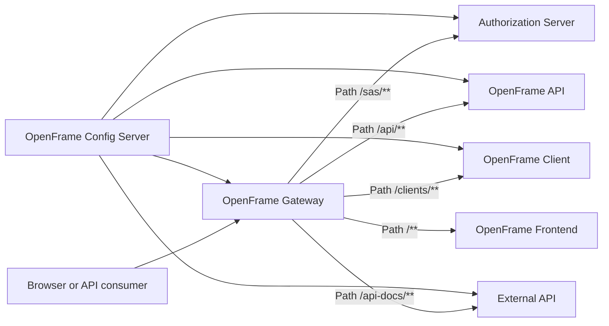

# First Steps

You have an OpenFrame OSS Tenant environment deployed — the gateway, authorization server, API, client, management, stream, external API, and config services are running, backed by MongoDB, Redis Cluster, Cassandra, Kafka, NATS, and Pinot. This guide walks through what to do in the first session after installation: verifying the deployment, configuring the basics, exploring the platform's core capabilities, and knowing where to ask for help.

> If you have not yet installed OpenFrame OSS Tenant, start with [Introduction](./introduction.md), [Prerequisites](./prerequisites.md), and [Quick Start](./quick-start.md) first. This page assumes the platform is already deployed and the Argo CD app-of-apps sync has completed.

## The first 5 things to do after installation

### 1. Confirm every tenant service is healthy

The platform is made up of eight Spring Boot services, each published as its own Maven module and container image:

| Service | Module | Role |
|---|---|---|
| `openframe-config` | `openframe/services/openframe-config` | Centralized configuration server (port 8888 / management 8889) |
| `openframe-gateway` | `openframe/services/openframe-gateway` | Reactive edge router for all tenant traffic |
| `openframe-authorization-server` | `openframe/services/openframe-authorization-server` | OAuth2 / OIDC authorization server (`/sas`, port 9005) |
| `openframe-api` | `openframe/services/openframe-api` | Core API service (`/api/**`) |
| `openframe-client` | `openframe/services/openframe-client` | Client/agent-facing service (`/clients/**`) |
| `openframe-external-api` | `openframe/services/openframe-external-api` | API-key-authenticated programmatic access and API docs (`/api-docs/**`, port 8092 / management 8093) |
| `openframe-management` | `openframe/services/openframe-management` | Management-plane service, including NATS JetStream stream setup |
| `openframe-stream` | `openframe/services/openframe-stream` | Kafka log-event consumer |

Each service exposes a read-only management endpoint at `/management/<release-version>` with `health`, `info`, `metrics`, and `prometheus` exposed (see `configs/base/application.yml`). Check these endpoints first — a service that cannot reach `openframe-config` on startup (default `http://openframe-config.platform.svc.cluster.local:8888`, overridable via `SPRING_CONFIG_URL`) will not come up cleanly.

Because `openframe-config` is deployed in sync wave 0 ahead of tenant workloads (see the Argo CD app-of-apps wiring in `manifests/apps/values.yaml`), verify it is `Synced`/`Healthy` before troubleshooting any other service.

### 2. Verify the gateway routes

All external traffic enters through `openframe-gateway`. The routes, defined in `configs/base/openframe-gateway.yml`, are:

| Path | Destination |
|---|---|
| `/sas/**` | `openframe-authorization-server` |
| `/api-docs/**` | `openframe-external-api` |
| `/api/**` | `openframe-api` |
| `/clients/**` | `openframe-client` |
| `/**` | frontend (`openframe-frontend`) |

Open your tenant host URL in a browser — it should resolve to the frontend through the gateway's catch-all route. If you get a routing error, confirm `ingress-nginx` (deployed as a platform application) is healthy and that your `TENANT_HOST_URL` is set to the externally reachable HTTPS host, since the authorization server derives password-reset and SSO callback URLs from it.

### 3. Check the datasources came up

The tenant depends on several backing stores deployed as separate Argo CD applications (wave 0, `datasources` project): MongoDB, Redis Cluster, Cassandra, Kafka, NATS, Pinot, MySQL (for Fleet MDM), Zookeeper, and Debezium Connect. Shared connection settings live in `configs/base/application.yml` — for example, the MongoDB URI points at `mongodb-0.mongodb.datasources.svc.cluster.local:27017`, and the Redis Cluster nodes resolve under `redis-cluster-*.redis-cluster-headless.datasources.svc.cluster.local:6379`.

Kafka and NATS endpoints are configured per service, for example in `configs/base/openframe-api.yml`, `configs/base/openframe-client.yml`, `configs/base/openframe-external-api.yml`, and `configs/base/openframe-management.yml`, all pointing at `kafka.datasources.svc.cluster.local` and `nats.datasources.svc.cluster.local`. If a service fails to start with binder or connection errors, check that the corresponding datasource application is `Healthy` before looking at the service itself.

### 4. Review (and replace) the security defaults

`configs/base/application.yml` ships baseline values for `ENCRYPTION_PASSWORD` and `ENCRYPTION_SALT` used by the shared encryption settings, and the authorization server's mail host defaults to `localhost:25`. These are repository defaults for local/dev use, not production secrets. Before going further:

- Override `ENCRYPTION_PASSWORD` and `ENCRYPTION_SALT` with deployment-specific secrets.
- Set `TENANT_HOST_URL` to your real tenant hostname.
- Point mail settings at a real provider if you plan to rely on authorization-server notifications (password reset, invites).

Refer to your environment configuration for the actual values used in your deployment — do not reuse the repository defaults in anything beyond local evaluation.

### 5. Install the OpenFrame CLI (optional, for day-2 operations)

If you'll be scripting or automating interactions with your tenant, install the OpenFrame CLI from its own repository. It is maintained separately from this one:

- Repository: [flamingo-stack/openframe-cli](https://github.com/flamingo-stack/openframe-cli)
- Installation instructions: [openframe-cli#installation](https://github.com/flamingo-stack/openframe-cli#installation)
- Documentation: [openframe-cli/docs](https://github.com/flamingo-stack/openframe-cli/tree/main/docs)

Do not look for CLI code in this repository — it is not vendored here.

## Common initial configuration

### Tenant isolation flag

The shared configuration in `configs/base/application.yml` enables `openframe.tenant-isolation.enabled: true` by default. This is required by the pinned OpenFrame OSS Library (`7.0.11`): tenant-aware repositories and the `TenantAwareMongoTemplate` only register when this flag is on, and the library's notification/ticket/knowledge-base beans constructor-require those repositories. Leave this enabled for OSS single-tenant deployments — disabling it causes services to crash-loop at startup on library versions `6.16` and above. A companion setting, `openframe.redis.tenant-id`, defaults to `default` and should match across services.

### Release version and management paths

Services read `RELEASE_VERSION` to build their effective management base path, `/management/${RELEASE_VERSION:v1}`. Keep this consistent with whatever your deployment pipeline sets as the image tag, since it also drives the Prometheus scrape path used by metrics collection.

### Delivery engine defaults

`configs/base/application.yml` configures the shared machine-delivery engine (`openframe.delivery`) with a dispatch topic (`delivery-dispatch`), a sweep job (disabled by default), and default policy values — a 30-second ack threshold, 3 max attempts, exponential backoff, and a 7-day TTL. Review these defaults if you plan to use delivery-dependent features; the sweep job is off out of the box and must be explicitly enabled if your workload needs it.

### Feature toggles

Two feature flags are on by default in the shared configuration:

- `openframe.client.update.feature.enabled: true`
- `openframe.tool-agent.update.feature.enabled: true`

Confirm these match your intended rollout behavior for client and tool-agent updates.

### Logging

All services load shared logging configuration from the config server at `${SPRING_CONFIG_URL}/logging/shared-logback-spring-logfmt.xml`, with `com.openframe` packages logged at `INFO` by default. Adjust the `logging.level` section in `configs/base/application.yml` if you need more detail while diagnosing a new deployment.

## Exploring key features

### The request path

Use this map as your starting point for exploration:

- **Authentication and SSO** — the authorization server (`/sas/**`) issues OAuth2/OIDC tokens and supports Google and Microsoft identity providers, configured per the authorization-server settings. Access tokens default to a 3600-second expiration and refresh tokens to 604800 seconds (one week) at the shared level, with service-specific overrides in `configs/base/openframe-authorization-server.yml` (900s / 604800s). Try signing in through the frontend to exercise this path end-to-end.
- **Core API** — `/api/**` is the primary application API, backed by the `openframe-api-service-core` library and the API service's own scan of `com.openframe.api`, `com.openframe.data`, `com.openframe.core`, `com.openframe.notification`, and `com.openframe.kafka`. See [API Service Core](../reference/architecture/api-service-core/api-service-core.md) for its bootstrap architecture.
- **Programmatic/API-key access and API docs** — `/api-docs/**` is routed to the external API service, which serves generated OpenAPI documentation at `/api-docs` and a Swagger UI at `/swagger-ui.html` (service port `8092`). This is the quickest way to browse the available API surface interactively. See [External API Service](../reference/architecture/external-api-service/external-api-service.md).
- **Client/agent connectivity** — `/clients/**` routes to the client service, which bootstraps Kafka producer, data, core, and security components (deliberately excluding the Cassandra health indicator). See [Client Service Core](../reference/architecture/client-service-core/client-service-core.md).
- **Event streaming** — the stream service consumes Kafka log events and hands typed Debezium messages to a generic JSON processor; see [Stream Service Core](../reference/architecture/stream-service-core/stream-service-core.md) and its sub-pages on [application bootstrap](../reference/architecture/stream-service-core/stream-service-core/application_bootstrap/application_bootstrap.md) and [log event consumption](../reference/architecture/stream-service-core/stream-service-core/log_event_consumption/log_event_consumption.md).
- **Management plane** — the management service assembles management, data, and core components, and supplies the OSS distribution's NATS JetStream policy (no additional streams beyond the defaults, per `NoAdditionalStreamConfigurationProvider`). See [Management Service Core](../reference/architecture/management-service-core/management-service-core.md).
- **Central configuration** — every other service depends on `openframe-config` at startup; see [Config Server Core](../reference/architecture/config-server-core/config-server-core.md) for how configuration is served and cached.
- **Gateway routing and security** — see [Gateway Service Core](../reference/architecture/gateway-service-core/gateway-service-core.md) for the full routing, OAuth integration, and JWT validation picture.

For the full system view — how services, datasources, and the Helm/Argo CD delivery chain fit together — read the [Architecture Overview](../reference/architecture/README.md) and the generated [Ecosystem reference](../reference/architecture/ecosystem.md).

### If you're installing the native agent/client

The Rust-based agent (`clients/openframe-client`, Cargo package `openframe_client`) is a thin binary over the shared `openframe-agent-lib` crate pulled from the OpenFrame OSS Library repository at tag `v0.0.5`. Its entire local logic is a call into `openframe::run()` (see `clients/openframe-client/src/main.rs`) — the actual agent behavior lives upstream, so agent-specific configuration and troubleshooting should be looked up in that library's repository rather than here.

## Where to get help

This project does not use GitHub Issues or GitHub Discussions. All questions, feedback, and coordination happen in the OpenMSP Slack community:

- Community site: [openmsp.ai](https://www.openmsp.ai/)
- Slack invite: [join.slack.com/t/openmsp](https://join.slack.com/t/openmsp/shared_invite/zt-36bl7mx0h-3~U2nFH6nqHqoTPXMaHEHA)

For a broader look at the platform before diving into development work, see the [development overview](../development/README.md), which links out to environment setup, local development, architecture, security, and testing material. If you plan to contribute changes, review [contribution guidelines](../development/contributing/guidelines.md) first.

## Continuing from here

Once the checks above pass, continue with:

- [Quick Start](./quick-start.md) if you still need to complete an initial deployment step.
- [Prerequisites](./prerequisites.md) to confirm your cluster and tooling meet the platform's requirements.
- [Development environment setup](../development/setup/environment.md) and [local development](../development/setup/local-development.md) if you intend to build or modify services rather than just operate them.
- [Security overview](../development/security/README.md) before exposing any environment beyond local evaluation.
- [Testing overview](../development/testing/README.md) if you are validating a change to a service module.

