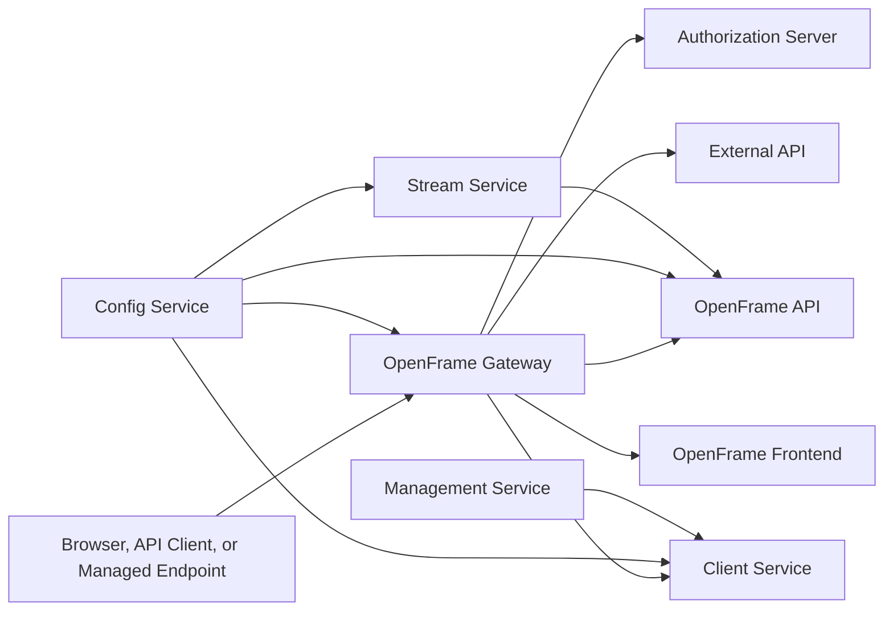

## First Steps

This page covers the first things to do right after you have an OpenFrame OSS Tenant deployment running, the configuration you typically need to touch next, the key platform surfaces worth exploring, and where to ask for help. If you have not deployed anything yet, start with [Introduction](./introduction.md), [Prerequisites](./prerequisites.md), and [Quick Start](./quick-start.md) first — this page assumes the services from `manifests/apps` are already applied to a cluster, or that you are running services locally against the configuration in `configs/base`.

> **Scope reminder:** OpenFrame OSS Tenant is the deployable distribution — Spring Boot service entry points, shared configuration, and Kubernetes/Argo CD manifests. Most of the actual domain behavior (authentication, RMM, GraphQL, ticketing, device data) is implemented in the upstream **OpenFrame OSS Library** (`com.openframe.oss:*`, pinned at `7.0.11`) and consumed here as Maven dependencies. When you need implementation detail for a feature, this page points you to the matching reference document rather than repeating library internals.

### System at a glance



The gateway (`configs/base/openframe-gateway.yml`) is the single entry point. It routes `/sas/**` to the authorization server, `/api/**` to the main API, `/api-docs/**` to the External API, `/clients/**` to the Client service, and all remaining browser traffic to the frontend.

---

## The first 5 things to do after installation

### 1. Confirm every service came up against the Config Server

Every tenant service (`openframe-api`, `openframe-client`, `openframe-authorization-server`, and the rest) boots by importing configuration from `openframe-config` before it does anything else. For example, `openframe/services/openframe-api/src/main/resources/application.yml` sets:

```yaml
spring:
  application:
    name: openframe-api
  config:
    import: "optional:configserver:${SPRING_CONFIG_URL:http://openframe-config.microservices.svc.cluster.local:8888}"
```

If `openframe-config` (the `com.openframe:openframe-config` artifact, built from `openframe-config-core`) isn't reachable, dependent services will either fail to start or run with incomplete configuration. Check the Config Server's health first — it serves from `configs/base` plus a profile-specific directory (`configs/base,configs/{profile}`), cloned from this repository's Git source. The Argo CD wave ordering in `manifests/apps/values.yaml` already places `manifests/platform/openframe-config` before the tenant services for this reason.

### 2. Verify the shared datastores are healthy

The platform depends on several datasources defined under `manifests/datasources`: MongoDB, Redis Cluster, Cassandra, Kafka, NATS, Pinot, and (for Fleet MDM/MeshCentral) MySQL and a second MongoDB instance. `configs/base/application.yml` wires the shared addresses, for example:

```yaml
spring:
  data:
    redis:
      cluster:
        nodes: ${REDIS_CLUSTER_NODES:redis-cluster-0.redis-cluster-headless.datasources.svc.cluster.local:6379,redis-cluster-1.redis-cluster-headless.datasources.svc.cluster.local:6379,redis-cluster-2.redis-cluster-headless.datasources.svc.cluster.local:6379}
    cassandra:
      contact-points: cassandra.datasources.svc.cluster.local
      keyspace-name: openframe_events
```

Confirm each datasource Argo CD application (`cassandra`, `kafka`, `mongodb`, `mongodb-meshcentral`, `mysql-fleetmdm`, `nats`, `pinot`, `redis-cluster`, `zookeeper`) is synced and healthy before expecting API, Client, or Stream services to behave normally.

### 3. Check the gateway routes are resolving

`configs/base/openframe-gateway.yml` defines the routing table the whole UI and API surface depends on:

| Route id | Path | Target service |
|---|---|---|
| `sas` | `/sas/**` | `openframe-authorization-server` |
| `swagger-api-docs` | `/api-docs/**` | `openframe-external-api` |
| `openframe-api` | `/api/**` | `openframe-api` |
| `openframe-client` | `/clients/**` | `openframe-client` |
| `openframe-ui-spa` | `/**` | `openframe-frontend` |

Hit the gateway's root path and confirm the frontend loads, then confirm `/api/**` and `/sas/**` are reachable before moving further — a broken route here manifests as failures across almost every later step.

### 4. Confirm the gateway's OAuth client was bootstrapped

The Management service runs `IdpConfigurationScheduler` (from `openframe-idp-configuration`) once at startup, gated by `openframe.management.idp.init.enabled`. It creates (or reconciles) the confidential OAuth client the gateway uses to talk to the authorization server, using `openframe.gateway.oauth.client-id`, `openframe.gateway.oauth.client-secret`, and `openframe.gateway.oauth.redirect-uri`. If this scheduler hasn't run successfully, gateway-to-authorization-server authentication will fail with an invalid-client error. Check Management service logs for its initialization message before troubleshooting login issues elsewhere. See [Openframe Idp Configuration](../reference/architecture/openframe-idp-configuration/openframe-idp-configuration.md) for the full reconciliation behavior, including secret-rotation semantics.

### 5. Log in and create your organization

Once the gateway, authorization server, and API are reachable, open the frontend route (`/**` on the gateway) and complete the tenant/organization setup flow — tenant discovery, registration, or SSO depending on how your deployment is configured (see [Authentication And Sso Flows](../reference/architecture/openframe-authorization-service-core/authentication_and_sso_flows.md)). Refer to your environment configuration for the actual tenant domain and any bootstrap credentials your deployment was provisioned with; this repository does not define default credentials.

For a guided walkthrough of this first-login experience, see the video below.

[](https://www.youtube.com/watch?v=-_56_qYvMWk)

---

## Common initial configuration

### Logging

All services point at the Config Server's `/logging` endpoint for their Logback configuration:

```yaml
logging:
  config: ${SPRING_CONFIG_URL:http://openframe-config.platform.svc.cluster.local:8888}/logging/shared-logback-spring-logfmt.xml
```

This is served by `LoggingConfigController` (part of `openframe-config-core`), which only serves files matching `[a-z0-9-]+\.xml` and rewrites nested `logging/` includes into fully qualified Config Server URLs. If you need a custom logging profile, add a new XML resource following that naming convention rather than trying to serve an arbitrary classpath file. See [Openframe Config Core](../reference/architecture/openframe-config-core/openframe-config-core.md).

### Tenant isolation flag

`configs/base/application.yml` sets:

```yaml
openframe:
  tenant-isolation:
    enabled: true
  redis:
    tenant-id: default
```

OSS single-tenant deployments must run the shared libraries in tenant-isolation mode: library versions `>= 6.16` register services (notifications, tickets, knowledge base, and others) that require `@TenantAwareRepository` beans, and those beans only exist when this flag is enabled. Leaving it disabled causes every Java service to crash-loop at startup with unsatisfiable bean dependencies. Do not turn this flag off.

### Feature toggles

Also in `configs/base/application.yml`:

```yaml
openframe:
  client:
    update:
      feature:
        enabled: true
  tool-agent:
    update:
      feature:
        enabled: true
```

These control whether forced client updates and tool-agent updates (exposed through the Force Agent REST endpoints — see [Api Controllers](../reference/architecture/openframe-api-service-core/api-controllers/api-controllers.md)) are active. Disable them only if you intentionally want to prevent remote update dispatch during initial rollout.

### Delivery and sweep settings

The machine-delivery engine (how commands and tool work reach managed endpoints) has its defaults under `openframe.delivery` in `configs/base/application.yml` — dispatch topic, sweep interval, retry/backoff policy, and TTLs. The sweep job itself is disabled by default (`sweep.enabled: false`); enable it only once you understand the retry and offline-behavior semantics, since it controls re-delivery of commands to endpoints that were offline.

### Encryption secrets

```yaml
security:
  encryption:
    password: ${ENCRYPTION_PASSWORD:kdCJxik7VWRlG5L8jKHBeJQK5unssi7u1uHOd01b75ilr8n}
    salt: ${ENCRYPTION_SALT:74f62c51327175b05abe1ad78030565c}
```

Override `ENCRYPTION_PASSWORD` and `ENCRYPTION_SALT` for any real deployment rather than relying on the committed defaults in `configs/base/application.yml`. Treat these as sensitive values the same way you would treat the gateway OAuth client secret.

### OAuth token lifetimes

```yaml
security:
  oauth2:
    token:
      access:
        expiration-seconds: 3600
      refresh:
        expiration-seconds: 604800
        max-refresh-count: 10080
```

These feed both the authorization server's registered-client defaults (created by `IdpConfigurationScheduler` on first boot) and general OAuth2 behavior. Changing them after a client is already registered affects only newly created registrations — see [Openframe Idp Configuration](../reference/architecture/openframe-idp-configuration/openframe-idp-configuration.md) for exactly which fields the scheduler reconciles versus leaves untouched on an existing client.

### Per-service datasource bindings

Each service's own config file under `configs/base` (`openframe-api.yml`, `openframe-client.yml`, `openframe-external-api.yml`, `openframe-management.yml`, `openframe-stream.yml`) binds that service's Kafka bootstrap servers and NATS server address, e.g. `spring.oss-tenant.kafka.bootstrap-servers` and `nats.spring.server`. If a given service isn't picking up events, check its specific file rather than assuming the shared `application.yml` covers everything.

---

## Exploring key features

Once the platform is up, these are the areas worth exploring first, organized by the capability they expose.

### Managed endpoints and the agent

The Rust-based OpenFrame agent (published from this repository as the `openframe_client` cargo crate, `clients/openframe-client`) is a thin binary over `openframe-agent-lib`, consumed from the **OpenFrame OSS Library** at tag `v0.0.5`:

```toml
[dependencies]
openframe-agent-lib = { git = "https://github.com/flamingo-stack/openframe-oss-lib.git", tag = "v0.0.5" }
```

The CLI used to install and manage this agent locally is maintained in the separate **openframe-cli** repository (https://github.com/flamingo-stack/openframe-cli); see its installation docs at https://github.com/flamingo-stack/openframe-cli#installation. The server-side counterpart — registration, telemetry processing, delivery, and RMM orchestration — is documented in [Openframe Client Core Java](../reference/architecture/openframe-client-core-java/openframe-client-core-java.md), with the registration and authentication flow broken out in [Registration And Authentication](../reference/architecture/openframe-client-core-java/registration_and_authentication.md).

### Authentication and SSO

Explore tenant discovery, password registration, invitation acceptance, and provider-based SSO through `/sas/**` on the gateway. This is covered end to end in [Authentication And Sso Flows](../reference/architecture/openframe-authorization-service-core/authentication_and_sso_flows.md) and the token/client-registration layer in [Oauth Tokens And Client Registration](../reference/architecture/openframe-authorization-service-core/oauth_tokens_and_client_registration.md). Tenant and request-scoped security context is described in [Security And Tenant Context](../reference/architecture/openframe-authorization-service-core/security_and_tenant_context.md).

### The main API — REST and GraphQL

`/api/**` on the gateway reaches `openframe-api`, which combines REST controllers (agent bootstrap, API keys, invitations, organizations, devices, knowledge-base images, health — see [Api Controllers](../reference/architecture/openframe-api-service-core/api-controllers/api-controllers.md)) with GraphQL data fetchers for operational data ([Graphql Datafetchers](../reference/architecture/openframe-api-service-core/graphql-datafetchers/graphql-datafetchers.md)) and RMM-specific operations ([Graphql Rmm Datafetchers](../reference/architecture/openframe-api-service-core/graphql-rmm-datafetchers/graphql-rmm-datafetchers.md)). Start here if you are building anything against the primary OpenFrame data model.

### External/integration API

For API-key-based programmatic access (as opposed to interactive browser sessions), `/api-docs/**` on the gateway reaches `openframe-external-api`, documented in [Openframe External Api Service Core](../reference/architecture/openframe-external-api-service-core/openframe-external-api-service-core.md). It exposes customers, devices, tickets, knowledge base content, logs, and integrated-tool proxying under `/api/v1`.

### RMM, software, and vulnerability management

Remote command execution, software bundle dispatch, and CVE tracking are implemented across [Openframe Api Contracts](../reference/architecture/openframe-api-contracts/openframe-api-contracts.md) (dispatch, read models, catalog matching) and the stream-side processing in [Rmm Execution Processing](../reference/architecture/openframe-stream-service-core/rmm_execution_processing.md) and [Fleet Software Projection](../reference/architecture/openframe-stream-service-core/fleet_software_projection.md).

### Event and log pipeline

Kafka-based event enrichment (Fleet activity + host data joins, message-type header classification) is documented in [Kafka Configuration And Activity Streams](../reference/architecture/openframe-stream-service-core/kafka_configuration_and_activity_streams.md). Related topics: [Event Deserialization](../reference/architecture/openframe-stream-service-core/event_deserialization.md), [Enrichment Services](../reference/architecture/openframe-stream-service-core/enrichment_services.md), and [Routing And Log Storage](../reference/architecture/openframe-stream-service-core/routing_and_log_storage.md) (which covers the Cassandra/Loki dual-store audit-log lookup also described in [Api Dto Audit](../reference/architecture/openframe-api-service-core/api-dto-audit/api-dto-audit.md)).

### Integrated tools — Fleet MDM and MeshCentral

The tenant Helm chart (`manifests/tenant`) deploys Fleet MDM (`ghcr.io/flamingo-stack/fleetmdm/fleet`) and MeshCentral (`ghcr.io/flamingo-stack/meshcentral/meshcentral`) alongside the OpenFrame services. The SDK-level Fleet integration is documented in [Openframe Sdk Fleetmdm](../reference/architecture/openframe-sdk-fleetmdm/openframe-sdk-fleetmdm.md).

### Development tools in the cluster

`manifests/platform/dev-tools` deploys Kafka UI (`kafbat/kafka-ui`) and Telepresence OSS, useful for inspecting Kafka topics and tunneling into the cluster while developing against a live deployment.

### Product walkthroughs

If you'd rather see the platform than read about it first, these two videos cover a general product walkthrough and the latest GA release:

[](https://www.youtube.com/watch?v=awc-yAnkhIo)

[](https://www.youtube.com/watch?v=u1vTrTNo0-4)

---

## Architecture reference while you explore

If you want the full map of services, modules, and their responsibilities before diving into a specific feature, start at [Reference Architecture](../reference/architecture/README.md) and [Ecosystem](../reference/architecture/ecosystem.md). The published Maven artifacts from this repository — `openframe-api`, `openframe-authorization-server`, `openframe-client`, `openframe-config`, `openframe-external-api`, `openframe-gateway`, `openframe-management`, `openframe-stream`, and `openframe-test`, all at `1.0.0-SNAPSHOT` — are thin composition layers over the pinned `7.0.11` OpenFrame OSS Library modules; the ecosystem graph for this repository confirms no other repository currently consumes these artifacts, so you're working with the full source tree of what runs in this stack.

---

## Where to get help

This project does not use GitHub Issues or GitHub Discussions. All community support, questions, and discussion happen on the **OpenMSP Slack community**:

- Join at https://www.openmsp.ai/ or directly via https://join.slack.com/t/openmsp/shared_invite/zt-36bl7mx0h-3~U2nFH6nqHqoTPXMaHEHA

For deeper technical and architectural detail beyond this page:

- [Reference Architecture](../reference/architecture/README.md) — full repository structure, module list, and deployment architecture
- [Development overview](../development/README.md), [environment setup](../development/setup/environment.md), and [local development](../development/setup/local-development.md) — if you're moving from "running it" to "changing it"
- [Development architecture notes](../development/architecture/README.md)
- [Security](../development/security/README.md) and [testing](../development/testing/README.md) documentation
- [Contributing guidelines](../development/contributing/guidelines.md)

For the CLI used to install and manage the agent outside this repository, see the external **openframe-cli** project documentation at https://github.com/flamingo-stack/openframe-cli/tree/main/docs.

If you want to see what's shipped recently, check https://github.com/flamingo-stack/openframe-oss-tenant/releases.
