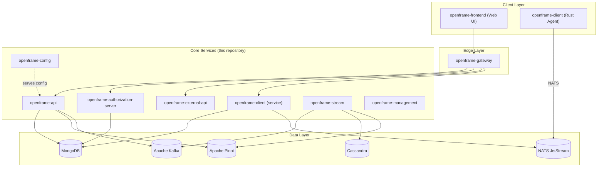
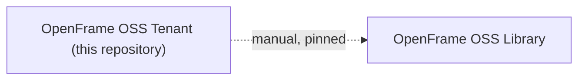

# Introduction

## What is OpenFrame OSS Tenant?

**OpenFrame OSS Tenant** is the multi-service, multi-tenant open-source backend of [OpenFrame](https://openframe.ai), an AI-powered MSP (Managed Service Provider) platform built by [Flamingo](https://flamingo.run). Flamingo's mission is to replace expensive proprietary MSP software with open-source alternatives enhanced by intelligent automation — Mingo AI for technicians, Fae for clients — and OpenFrame is the unified platform that brings device management, remote access, ticketing, and real-time telemetry together behind a single, AI-driven interface.

This repository holds the polyglot core of that platform: a set of Spring Boot (Java) microservices plus a cross-platform Rust agent, together with the Kubernetes manifests that deploy and wire all of it together as a tenant. It integrates device management, real-time messaging, event-driven automation, and the data pipelines that feed OpenFrame's analytics and AI features.

## Key features and benefits

- **Unified entry point.** A Spring Cloud Gateway service (`openframe-gateway`) fronts every backend route — API, authorization, external API, client, and the UI — so operators and integrations talk to one address.
- **Multi-tenant OAuth2/OIDC.** `openframe-authorization-server` issues RSA-signed JWTs and supports SSO, giving every tenant isolated, standards-based authentication.
- **GraphQL + REST API surface.** `openframe-api` exposes the core application API (tickets, dialogs, AI settings, tenant management); `openframe-external-api` exposes a separate, rate-limited, API-key-protected surface for programmatic/external access.
- **Agent lifecycle and orchestration.** The `openframe-client` Java service manages agent lifecycle and tool orchestration (MeshCentral, FleetMDM) over NATS JetStream, while the companion `openframe-client` **Rust agent** (a thin binary delegating to the shared `openframe-agent-lib` crate) runs on managed endpoints and talks to the platform exclusively over NATS.
- **Real-time event processing.** `openframe-stream` consumes Kafka topics (including Debezium CDC change events, see `LogsEventListener`), normalizes and enriches events, and writes them into Cassandra and Apache Pinot for fast analytics.
- **Centralized configuration.** `openframe-config` serves shared configuration to every other service in the mesh, backed by the manifests under `configs/base/`.
- **Deployable as a whole tenant.** The `manifests/` tree ships an Argo CD app-of-apps that stands up the platform layer (ingress-nginx, dev-tools, config), the datasource layer (MongoDB, Cassandra, Kafka, NATS, Apache Pinot, Redis Cluster, ZooKeeper, Debezium Connect, MySQL for FleetMDM), and the tenant chart that assembles every OpenFrame service image together with the FleetMDM and MeshCentral charts and the frontend UI.

## Target audience

This repository is for:

- **Platform engineers and SREs** who deploy and operate an OpenFrame tenant on Kubernetes, using the Argo CD manifests under `manifests/`.
- **Backend developers** extending or maintaining the Java microservices (`openframe-api`, `openframe-gateway`, `openframe-authorization-server`, `openframe-external-api`, `openframe-client`, `openframe-stream`, `openframe-management`, `openframe-config`) built on Spring Boot.
- **Agent/systems developers** working on the cross-platform Rust endpoint agent in `clients/openframe-client/`.
- **MSPs and IT teams** evaluating or self-hosting OpenFrame as an open-source alternative to proprietary MSP tooling.

## Quick overview

This repository also pins one upstream dependency, the [OpenFrame OSS Library](https://github.com/flamingo-stack/openframe-oss-lib), which supplies the shared Java modules (e.g. `openframe-api-service-core`, `openframe-client-core`) and the Rust `openframe-agent-lib` crate that every service and the agent build on:

No other repository in the organization currently consumes this repository's published Maven artifacts or its Cargo crate — the published `com.openframe:*` artifacts and `openframe_client` crate feed this tenant's own build and its container images, not a downstream consumer elsewhere in the org.

If you need the CLI used to bootstrap or manage OpenFrame environments, it lives in the separate [openframe-cli](https://github.com/flamingo-stack/openframe-cli) repository, not in this one.

## Where to go next

- [Prerequisites](./prerequisites.md) — what you need installed before building or running this repository.
- [Quick Start](./quick-start.md) — the fastest path to a running build.
- [First Steps](./first-steps.md) — what to do once things are running.
- [Development environment setup](../development/setup/environment.md) and [local development](../development/setup/local-development.md) — for deeper day-to-day development workflows.
- [Architecture overview](../reference/architecture/overview.md), [ecosystem reference](../reference/architecture/ecosystem.md), and [architecture diagrams](../diagrams/architecture/README.md) — for a detailed look at how the services, data stores, and the Rust agent fit together.
- [Testing](../development/testing/README.md), [security](../development/security/README.md), and [contributing guidelines](../development/contributing/guidelines.md) — for working on the codebase itself.
- The [development overview](../development/README.md) ties all of the above together.

## Community

This project does not use GitHub Issues or GitHub Discussions. All support, feature requests, bug reports, and development discussion happen in the OpenMSP Slack community: [openmsp.ai](https://www.openmsp.ai/) ([join via invite link](https://join.slack.com/t/openmsp/shared_invite/zt-36bl7mx0h-3~U2nFH6nqHqoTPXMaHEHA)).

## License

This repository is licensed under **The Flamingo AI Unified License v1.1** (see `LICENSE.md`), copyright Flamingo AI, Inc. The license covers the source code Flamingo AI publishes, including OpenFrame and every repository of the flamingo-stack organization; it does not govern the hosted OpenFrame service, OpenMSP, or the Flamingo website, which are covered separately by the Flamingo AI Terms of Service.

Note that OpenFrame also integrates upstream components — Fleet, Osquery, and the MeshCentral Agent — which remain under their own original licenses (MIT, Apache-2.0/GPL-2.0-only dual license, and Apache-2.0 respectively) as listed in the Appendix of `LICENSE.md`.
