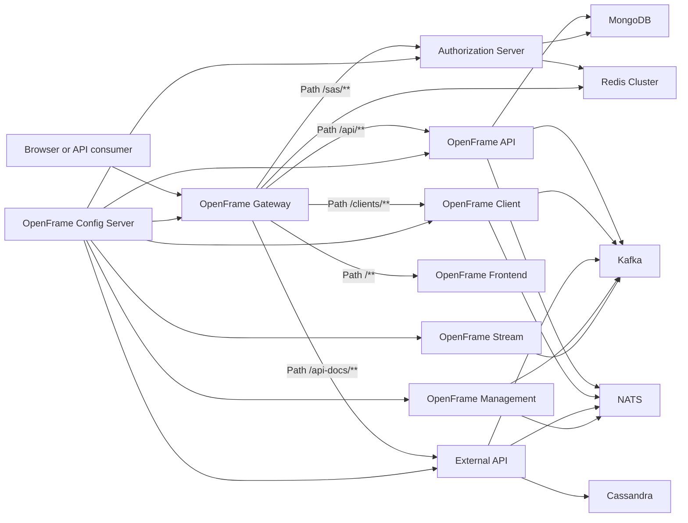

#  Introduction

> **Role in the Flamingo ecosystem:** OpenFrame OSS Tenant is a **service** repository (bash, java, rust) published by [flamingo-stack](https://github.com/flamingo-stack). No other managed repository currently consumes it as a dependency.

## What this project is

**OpenFrame OSS Tenant** is the tenant-facing service and deployment repository for [OpenFrame](https://openframe.ai), the unified, AI-driven platform from [Flamingo](https://flamingo.run) that brings together multiple MSP (Managed Service Provider) tools under a single interface. Flamingo replaces expensive proprietary MSP software with open-source alternatives enhanced by intelligent automation — Mingo AI for technicians and Fae for clients — and OpenFrame is the platform that ties those integrations together.

This repository is where that platform becomes a runnable tenant environment. It assembles a set of independently deployable Spring Boot services, centralized configuration, Kafka/NATS-based event processing, and Kubernetes/Helm manifests into one operable deployment. The heavy lifting of API, authorization, data access, security, gateway, and messaging logic is supplied by the pinned [OpenFrame OSS Library](https://github.com/flamingo-stack/openframe-oss-lib) (`com.openframe.oss:*`, version `7.0.11`, plus `openframe_agent_lib` at `v0.0.5`); this repository's own Java classes are deliberately thin Spring Boot entry points that compose those library capabilities into running services.

## Key features and benefits

- **Unified MSP tenant runtime** — one repository defines the full backend for a tenant: API, authorization, client ingestion, external/API-key access, configuration, management, streaming, and gateway routing.
- **Service-oriented architecture** — eight Spring Boot services (`openframe-api`, `openframe-authorization-server`, `openframe-client`, `openframe-config`, `openframe-external-api`, `openframe-gateway`, `openframe-management`, `openframe-stream`), each with a narrow bootstrap class and a focused component-scan boundary, plus a test-support module (`openframe-test`).
- **Centralized configuration** — shared and per-service settings live under `configs/base` (for example `configs/base/application.yml` and `configs/base/openframe-gateway.yml`), served by the `openframe-config` service so every tenant service boots from one configuration source.
- **Single-entry gateway routing** — `openframe-gateway` is the reactive edge service, routing `/sas/**` to the authorization server, `/api/**` to the API service, `/clients/**` to the client service, `/api-docs/**` to the external API, and the catch-all `/**` to the frontend.
- **Event-driven integration** — Kafka and NATS back asynchronous workloads across the API, client, external API, management, and stream services, with Kafka also feeding the stream service's log-event consumption pipeline.
- **GitOps-ready deployment** — Helm charts and an Argo CD app-of-apps structure under `manifests/` deploy platform components, datasources (MongoDB, Redis Cluster, Cassandra, Kafka, NATS, Pinot, MySQL, Zookeeper, Debezium Connect), and the tenant application itself.
- **A native Rust client** — the `openframe_client` cargo crate (in `clients/openframe-client`) is a thin binary wrapping the shared `openframe-agent-lib` library from OpenFrame OSS Library.
- **Automated image and chart publishing** — the release workflow (`.github/workflows/release.yml`) builds and publishes container images for each service and an app-of-apps Helm chart to `ghcr.io/flamingo-stack/openframe-oss-tenant`.

## Target audience

This repository is intended for:

- **Platform engineers and SREs** deploying or operating an OpenFrame tenant environment on Kubernetes.
- **Backend developers** working on OpenFrame's Spring Boot services (API, authorization, gateway, client, external API, management, stream, config).
- **MSPs and technical evaluators** who want to self-host the open-source OpenFrame platform instead of (or alongside) using the hosted service.
- **Contributors** extending OpenFrame's tenant-side behavior, routing, or data integrations, while relying on the separately maintained [OpenFrame OSS Library](https://github.com/flamingo-stack/openframe-oss-lib) for shared business logic.

If you need the OpenFrame command-line tooling, note that it lives in a separate, externally maintained repository: [openframe-cli](https://github.com/flamingo-stack/openframe-cli) ([installation](https://github.com/flamingo-stack/openframe-cli#installation), [documentation](https://github.com/flamingo-stack/openframe-cli/tree/main/docs)).

## Quick overview

The diagram below summarizes how a request flows through the tenant: the gateway is the single entry point, it routes to the backend services, each service pulls shared configuration from the config server, and services use Kafka/NATS plus their backing datastores.

This repository's own published artifacts are the nine Maven modules (`com.openframe:openframe-api`, `openframe-authorization-server`, `openframe-client`, `openframe-config`, `openframe-external-api`, `openframe-gateway`, `openframe-management`, `openframe-stream`, `openframe-test`) plus the `openframe_client` cargo crate — all built here, while the shared `com.openframe.oss:*` and `openframe_agent_lib` dependencies come from the upstream [OpenFrame OSS Library](https://github.com/flamingo-stack/openframe-oss-lib) at version `7.0.11` / `v0.0.5`. No other managed repository currently depends on artifacts published from this one.

## Finding your way around

Once you understand what this repository does, the other getting-started guides walk you through using it:

- [Prerequisites](./prerequisites.md) — what you need before working with this repository.
- [Quick Start](./quick-start.md) — the fastest path to a running environment.
- [First Steps](./first-steps.md) — what to do right after setup.

For a deeper dive into how the services, configuration, and deployment manifests fit together, see the [architecture reference](../reference/architecture/README.md) and the [ecosystem reference](../reference/architecture/ecosystem.md), which documents published artifacts, upstream dependencies, and the delivery chain in detail. Development-focused guides, including [environment setup](../development/setup/environment.md), [local development](../development/setup/local-development.md), [security practices](../development/security/README.md), and [contribution guidelines](../development/contributing/guidelines.md), are indexed from the [development overview](../development/README.md).

## Community and support

This project does not use GitHub Issues or GitHub Discussions. Questions, feedback, and coordination happen in the [OpenMSP Slack community](https://www.openmsp.ai/) — you can [join here](https://join.slack.com/t/openmsp/shared_invite/zt-36bl7mx0h-3~U2nFH6nqHqoTPXMaHEHA).

## License

This repository is licensed under **The Flamingo AI Unified License v1.1** (Copyright © 2025 Flamingo AI, Inc.), as defined in `LICENSE.md`. The license covers the Flamingo-authored source code in this repository, including OpenFrame. It does not govern the hosted OpenFrame service, OpenMSP, or the Flamingo Website, which are covered separately by the Flamingo AI Terms of Service.

Some components integrated by this platform originate from upstream projects that remain under their own licenses, as listed in the Appendix of `LICENSE.md` (Fleet under MIT, Osquery dual-licensed Apache-2.0 OR GPL-2.0-only, and the MeshCentral Agent under Apache-2.0). The Rust client crate `openframe_client` in `clients/openframe-client/Cargo.toml` declares an MIT license for that crate specifically; refer to `LICENSE.md` for the terms governing the repository as a whole.
