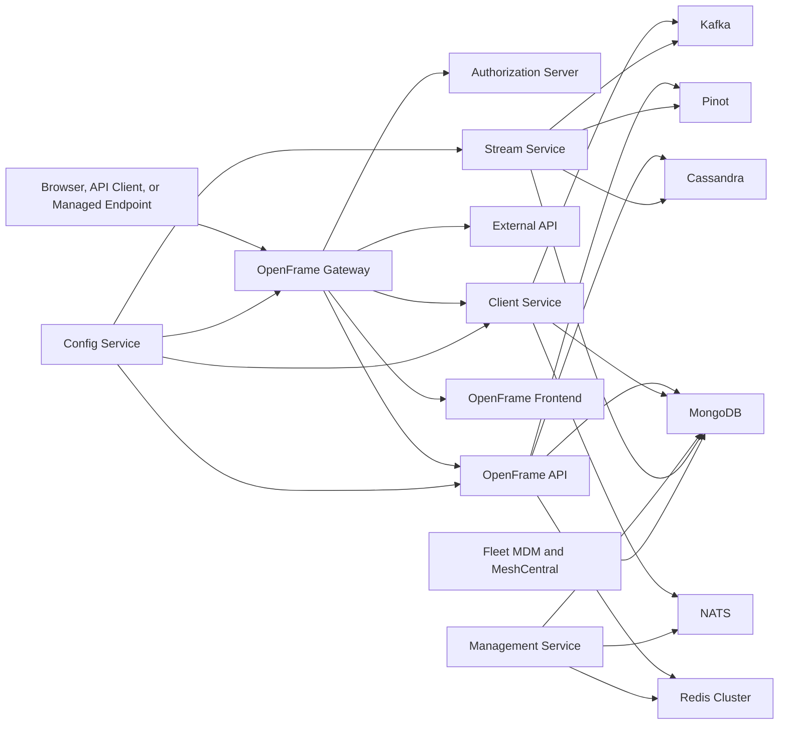

# Introduction

## What is OpenFrame OSS Tenant?

**OpenFrame OSS Tenant** is the deployable, self-hosted tenant distribution for [OpenFrame](https://openframe.ai), the unified, AI-driven MSP (Managed Service Provider) platform built by [Flamingo](https://flamingo.run). It assembles Spring Boot services (Java), a Rust endpoint agent, shared configuration, and Kubernetes/Helm manifests into one running platform that integrates multiple IT management tools behind a single gateway and a single operational surface.

Rather than reimplementing platform behavior, this repository owns the **tenant-specific composition**: thin service entry points, runtime configuration, Helm charts, Argo CD application definitions, and the release pipeline that publishes container images and Maven artifacts. Most of the domain logic it runs — authentication, GraphQL and REST APIs, RMM orchestration, stream processing, and more — is consumed from the **OpenFrame OSS Library** (`flamingo-stack/openframe-oss-lib`), pinned at version `7.0.11` for Java modules and `v0.0.5`/`0.1.0` for the Rust client agent.

Flamingo replaces expensive proprietary MSP tooling with open-source alternatives enhanced by AI automation, and OpenFrame is the integration layer that brings those tools — RMM, remote access, ticketing, and more — into one AI-assisted interface for technicians and clients.

## Key Features and Benefits

- **Unified gateway entry point.** `openframe-gateway` is the single edge router for browser, API, and managed-endpoint traffic, enforcing JWT and API-key boundaries before forwarding to backend services.
- **OAuth 2.0 / OpenID Connect authorization server.** `openframe-authorization-server` provides tenant-aware login, SSO (Google, Microsoft, Apple), invitation acceptance, password reset, and signed JWT issuance.
- **Managed-endpoint platform.** `openframe-client` (server-side) coordinates registration, telemetry, delivery, and RMM commands with the Rust `openframe-client` agent running on each managed device.
- **GraphQL and REST APIs.** `openframe-api` exposes the main operational API (devices, tickets, RMM, software, knowledge base); `openframe-external-api` exposes an API-key-protected integration surface for third parties.
- **Event-driven data pipeline.** `openframe-stream` consumes Kafka events for enrichment, log routing, execution history, and software projections, backed by Cassandra, Pinot, and MongoDB.
- **Centralized configuration.** `openframe-config` is a Spring Cloud Config Server distributing shared settings to every service.
- **Platform reconciliation.** `openframe-management` handles startup reconciliation, NATS stream provisioning, Fleet MDM setup, and package catalog synchronization.
- **Kubernetes-native delivery.** An Argo CD app-of-apps structure under `manifests/` deploys platform services, datasources (MongoDB, Redis Cluster, Cassandra, Kafka, NATS, Pinot, ZooKeeper, MySQL), and tenant workloads (Fleet MDM, MeshCentral, OpenFrame services, frontend) in ordered sync waves.
- **Open-source foundation.** Built on Spring Boot, Spring Cloud, and a Rust agent, with integrated upstream MSP tools such as Fleet (osquery-based device management) and MeshCentral (remote access).

## Target Audience

This repository is for:

- **Platform operators and MSPs** who want to self-host the OpenFrame stack to manage client devices, tickets, and RMM operations.
- **Backend engineers** working on the Java services that compose OpenFrame OSS Library modules into deployable Spring Boot applications.
- **Platform/DevOps engineers** maintaining the Helm charts, Argo CD application definitions, and release pipeline that deliver OpenFrame to Kubernetes.
- **Contributors** extending tenant-specific configuration, service wiring, or deployment topology, as distinct from the shared domain logic maintained upstream in the OpenFrame OSS Library.

## Quick Overview

The gateway routes `/sas/**` to the authorization server, `/api/**` to the main API, `/api-docs/**` to the External API's documentation surface, `/clients/**` to the client service, and all remaining browser traffic to the OpenFrame frontend, as defined in `configs/base/openframe-gateway.yml`.

At the code level, this repository owns nine Maven modules under `openframe/services/` (`openframe-api`, `openframe-authorization-server`, `openframe-client`, `openframe-config`, `openframe-external-api`, `openframe-gateway`, `openframe-management`, `openframe-stream`, `openframe-test`), each a thin Spring Boot application — see for example `openframe/services/openframe-api/src/main/java/com/openframe/api/ApiApplication.java` and `openframe/services/openframe-gateway/src/main/java/com/openframe/gateway/GatewayApplication.java` — plus the Rust agent entry point at `clients/openframe-client/src/main.rs`, which delegates all logic to the `openframe-agent-lib` crate pinned in `clients/openframe-client/Cargo.toml`.

> The OpenFrame ecosystem graph shows this repository has no recorded downstream consumers in the organization: it is a leaf service that pulls in the OpenFrame OSS Library and publishes deployable artifacts and container images, rather than being consumed as a library by other repositories.

## Watch: Getting Started with OpenFrame

## Where to Go Next

- [Prerequisites](./prerequisites.md) — what you need installed before working with this repository.
- [Quick Start](./quick-start.md) — the fastest path to running the platform.
- [First Steps](./first-steps.md) — initial orientation after setup.
- [Local Development Setup](../development/setup/local-development.md) — running services locally.
- [Environment Configuration](../development/setup/environment.md) — configuring runtime settings.
- [Architecture Overview](../development/architecture/README.md) — how the services, data stores, and manifests fit together.
- [Testing](../development/testing/README.md) — how test coverage is organized.
- [Contributing Guidelines](../development/contributing/guidelines.md) — how to propose changes.
- [Security](../development/security/README.md) — security posture and practices.
- [Development Overview](../development/README.md) — the development documentation index.
- [Ecosystem Reference](../reference/architecture/ecosystem.md) — published artifacts, upstream dependencies, and delivery chain in full detail.
- [Architecture Reference](../reference/architecture/README.md) — the detailed repository structure and module-by-module breakdown.

For the OpenFrame command-line tooling, see the separate [OpenFrame CLI repository](https://github.com/flamingo-stack/openframe-cli) and its [installation guide](https://github.com/flamingo-stack/openframe-cli#installation); it is maintained outside this repository.

For questions, support, and community discussion, this project does not use GitHub Issues or Discussions — join the [OpenMSP Slack community](https://www.openmsp.ai/) or use the [direct Slack invite](https://join.slack.com/t/openmsp/shared_invite/zt-36bl7mx0h-3~U2nFH6nqHqoTPXMaHEHA).

## License

This repository is licensed under **The Flamingo AI Unified License v1.1** (Copyright © 2025 Flamingo AI, Inc.), as stated in `LICENSE.md`. The license governs the source code Flamingo AI publishes in this repository; it does not govern the hosted OpenFrame service, OpenMSP, or the Flamingo website, which are covered separately by the Flamingo AI Terms of Service.

The license requires that forks, modifications, and redistributions — including via network use — remain licensed under the same terms, and it restricts offering this software as a competing commercial managed service without a separate commercial license from Flamingo AI. Upstream components incorporated into the platform, such as Fleet (MIT) and MeshCentral Agent (Apache-2.0), remain under their own original licenses as listed in the Appendix of `LICENSE.md`.
