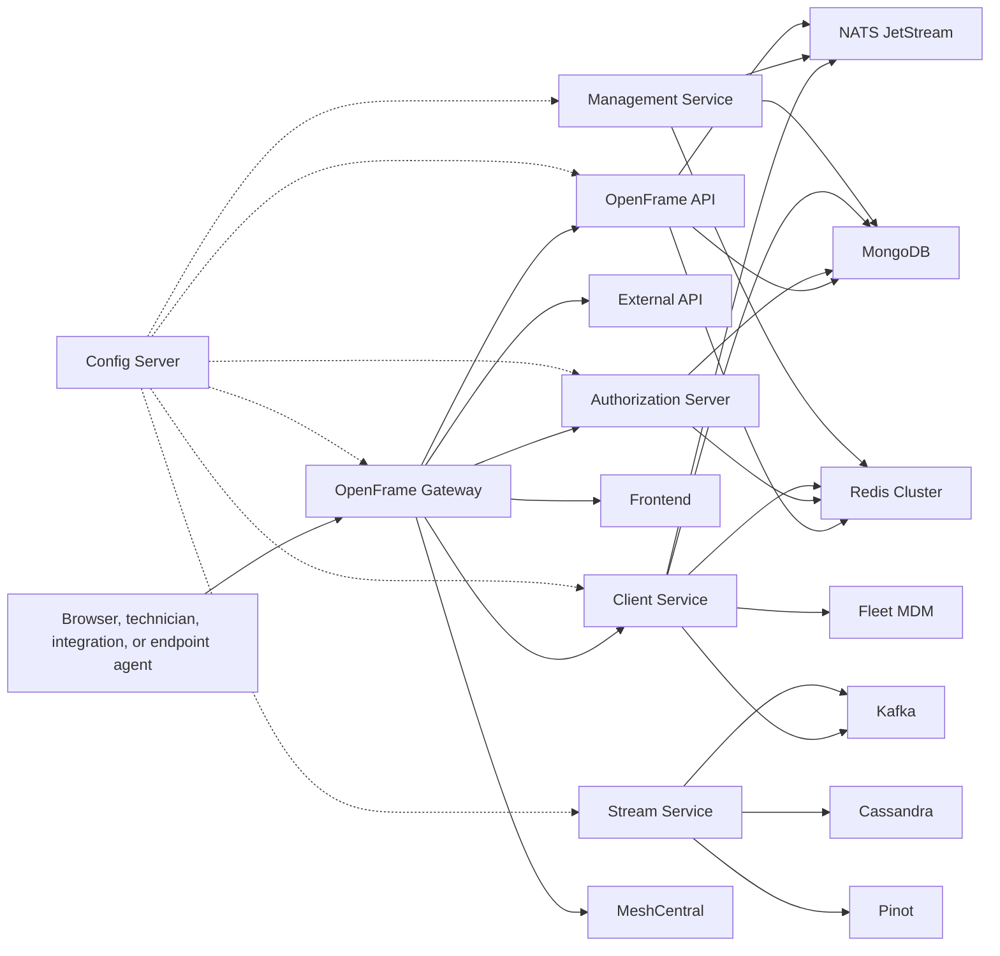

# Introduction

## What is OpenFrame OSS Tenant?

**OpenFrame OSS Tenant** ([flamingo-stack/openframe-oss-tenant](https://github.com/flamingo-stack/openframe-oss-tenant)) is the deployable, tenant-oriented distribution of [OpenFrame](https://openframe.ai) ([www.flamingo.run/openframe](https://www.flamingo.run/openframe)) — the unified, AI-driven MSP operations platform built by [Flamingo](https://flamingo.run). It assembles Spring Boot services, a Rust endpoint agent, shared configuration, Helm charts, and Argo CD application definitions into one runnable platform.

Rather than reimplementing OpenFrame's domain logic, this repository is the **composition and delivery layer**: it pins and assembles the OpenFrame OSS Library (`com.openframe.oss:*` at version `7.0.11`, plus the `openframe_agent_lib` Rust crate at `v0.0.5`) into runnable Spring Boot applications and a Rust endpoint agent, packages them as container images, and deploys them with Helm/Argo CD. If you are looking to stand up an MSP operations platform that unifies identity, device management, remote tooling, automation, and event processing behind one gateway, this is the repository that builds and ships it.

Flamingo replaces expensive proprietary MSP tooling with open-source alternatives enhanced by AI automation — Mingo AI for technicians and Fae for clients. OpenFrame is the platform that brings multiple MSP tools together behind a single AI-driven interface.

## Key features and benefits

- **Unified API and gateway surface** — a single [OpenFrame Gateway](../reference/architecture/gateway-core/gateway-core.md) routes browser, technician, integration, and endpoint-agent traffic to the right backend service, enforcing JWT/API-key security, CORS, and client-version policy at the edge.
- **Tenant-aware identity** — an OAuth 2.1 / OpenID Connect [Authorization Server](../reference/architecture/authorization-service-core/authorization-service-core.md) handles login, invitations, SSO, and password recovery per tenant.
- **GraphQL and REST product API** — the [OpenFrame API](../reference/architecture/api-service-backend/api-service-backend.md) service exposes devices, organizations, tickets, knowledge base, and RMM (remote monitoring and management) workflows; the [External API](../reference/architecture/external-api-service-core/external-api-service-core.md) exposes an integration-oriented REST surface with API-key auth.
- **Endpoint agent and device management** — a Rust-based agent (published as the `openframe_client` Cargo artifact) registers devices, ships logs, executes commands/scripts, manages installed tools, and keeps itself and managed tools up to date, communicating over NATS JetStream.
- **Event processing pipeline** — the [Stream Service](../reference/architecture/stream-service-core/stream-service-core.md) consumes Kafka and CDC events into Cassandra-backed logs and Pinot analytics projections.
- **Background operations** — the [Management Service](../reference/architecture/management-core/management-core.md) initializes NATS streams, synchronizes package catalogs, and runs scheduled maintenance.
- **Integrated MSP tooling** — the tenant Helm chart ([`manifests/tenant`](https://github.com/flamingo-stack/openframe-oss-tenant/tree/main/manifests)) deploys Fleet MDM and MeshCentral alongside the OpenFrame services for endpoint management and remote access.
- **GitOps-native deployment** — Argo CD application definitions ([`manifests/apps/values.yaml`](https://github.com/flamingo-stack/openframe-oss-tenant/blob/main/manifests/apps/values.yaml)) deploy platform prerequisites (ingress, config) and datasources (MongoDB, Redis Cluster, Kafka, NATS, Cassandra, Pinot, Zookeeper, Debezium Connect) before tenant workloads.

## Target audience

This repository is for:

- **Platform operators and DevOps engineers** deploying or operating a self-hosted OpenFrame tenant on Kubernetes using Helm and Argo CD.
- **Backend engineers** working on the Spring Boot services (`openframe-api`, `openframe-gateway`, `openframe-authorization-server`, `openframe-client`, `openframe-external-api`, `openframe-management`, `openframe-stream`, `openframe-config`) that make up the platform.
- **MSP technicians and administrators** who will ultimately use the deployed OpenFrame platform to manage endpoints, tickets, and automation — though day-to-day product usage is best learned from the OpenFrame product itself and the OpenMSP community.
- **Contributors** who want to understand how this tenant repository composes the OpenFrame OSS Library into a deployable stack.

> This repository does not implement most domain logic itself. Business rules for identity, API resolvers, device data, RMM, and stream processing live in the [OpenFrame OSS Library](https://github.com/flamingo-stack/openframe-oss-lib), consumed here as pinned Maven and Cargo dependencies. See [`../reference/architecture/README.md`](../reference/architecture/README.md) for the full architectural breakdown.

## Quick overview

The gateway routes the platform's public prefixes: `/sas/**` to the authorization server, `/api/**` to the OpenFrame API, `/api-docs/**` to the external API, `/clients/**` to the client service, and everything else (`/**`) to the frontend. These routes are defined in [`configs/base/openframe-gateway.yml`](https://github.com/flamingo-stack/openframe-oss-tenant/blob/main/configs/base/openframe-gateway.yml).

### What this repository publishes

| Ecosystem | Artifact | Version |
|---|---|---|
| maven | `com.openframe:openframe-api` | 1.0.0-SNAPSHOT |
| maven | `com.openframe:openframe-authorization-server` | 1.0.0-SNAPSHOT |
| maven | `com.openframe:openframe-client` | 1.0.0-SNAPSHOT |
| maven | `com.openframe:openframe-config` | 1.0.0-SNAPSHOT |
| maven | `com.openframe:openframe-external-api` | 1.0.0-SNAPSHOT |
| maven | `com.openframe:openframe-gateway` | 1.0.0-SNAPSHOT |
| maven | `com.openframe:openframe-management` | 1.0.0-SNAPSHOT |
| maven | `com.openframe:openframe-stream` | 1.0.0-SNAPSHOT |
| maven | `com.openframe:openframe-test` | 1.0.0-SNAPSHOT |
| cargo | `openframe_client` | 0.1.0 |

The repository graph records no other managed repository as consuming these artifacts: they are terminal, deployable build outputs rather than libraries consumed elsewhere in the organization. Everything this repository runs is built on top of the [OpenFrame OSS Library](https://github.com/flamingo-stack/openframe-oss-lib), pinned at version `7.0.11` for the Java libraries and `v0.0.5` for the `openframe_agent_lib` Rust crate (see [`pom.xml`](https://github.com/flamingo-stack/openframe-oss-tenant/blob/main/pom.xml) and [`clients/openframe-client/Cargo.toml`](https://github.com/flamingo-stack/openframe-oss-tenant/blob/main/clients/openframe-client/Cargo.toml)).

### Repository layout

| Area | Purpose |
|---|---|
| [`openframe/services`](https://github.com/flamingo-stack/openframe-oss-tenant/tree/main/openframe/services) | The eight runnable Spring Boot applications (`openframe-api`, `openframe-authorization-server`, `openframe-client`, `openframe-config`, `openframe-external-api`, `openframe-gateway`, `openframe-management`, `openframe-stream`), plus `openframe-test`. |
| [`clients/openframe-client`](https://github.com/flamingo-stack/openframe-oss-tenant/blob/main/clients/openframe-client/Cargo.toml) | The Rust endpoint-agent binary, a thin entry point over the `openframe_agent_lib` library. |
| [`configs/base`](https://github.com/flamingo-stack/openframe-oss-tenant/blob/main/configs/base/application.yml) | Shared service configuration, datasource settings, and gateway routes. |
| [`manifests`](https://github.com/flamingo-stack/openframe-oss-tenant/blob/main/manifests/apps/values.yaml) | Helm charts and Argo CD application definitions for platform, datasource, and tenant workloads. |
| [`.github/workflows/release.yml`](https://github.com/flamingo-stack/openframe-oss-tenant/blob/main/.github/workflows/release.yml) | Builds and publishes service container images and the `app-of-apps` Helm chart. |

## Where to go next

- [Prerequisites](./prerequisites.md) — what you need before working with this repository.
- [Quick Start](./quick-start.md) — the fastest path to a running instance.
- [First Steps](./first-steps.md) — what to do once things are running.
- [Development environment setup](../development/setup/environment.md) and [local development](../development/setup/local-development.md) — for contributors building services locally.
- [Architecture overview](../development/architecture/README.md) and the deeper [reference architecture](../reference/architecture/README.md) — for the full service and module breakdown.
- [Security](../development/security/README.md) and [Contributing guidelines](../development/contributing/guidelines.md) — before submitting changes.

For MSP tooling needed to work with a deployed OpenFrame tenant, see the external [OpenFrame CLI](https://github.com/flamingo-stack/openframe-cli) repository ([installation](https://github.com/flamingo-stack/openframe-cli#installation), [documentation](https://github.com/flamingo-stack/openframe-cli/tree/main/docs)) — it is maintained separately from this repository.

## Community

This project does not use GitHub Issues or GitHub Discussions. All community support, questions, and discussion happen in the [OpenMSP Slack community](https://www.openmsp.ai/) ([join link](https://join.slack.com/t/openmsp/shared_invite/zt-36bl7mx0h-3~U2nFH6nqHqoTPXMaHEHA)).

## License

This repository is licensed under **The Flamingo AI Unified License v1.1** (see [`LICENSE.md`](https://github.com/flamingo-stack/openframe-oss-tenant/blob/main/LICENSE.md)). The license covers the Flamingo-authored source code in this repository and across the `flamingo-stack` organization, including OpenFrame. It does not govern the hosted OpenFrame service, OpenMSP, or the Flamingo website — those are covered by the [Flamingo AI Terms of Service](https://www.flamingo.run/terms-of-service).

The Rust endpoint-agent crate declares `MIT` in its own [`clients/openframe-client/Cargo.toml`](https://github.com/flamingo-stack/openframe-oss-tenant/blob/main/clients/openframe-client/Cargo.toml) package metadata. The license file at the repository root, however, is the Flamingo AI Unified License v1.1, and its Appendix lists upstream components incorporated into Flamingo Software that remain under their own original licenses (for example Fleet under MIT with documentation under CC BY-SA 4.0, Osquery dual-licensed Apache-2.0 OR GPL-2.0-only, and the MeshCentral Agent under Apache-2.0). Review `LICENSE.md` directly for the authoritative terms before redistributing or building a commercial managed service on this code.
