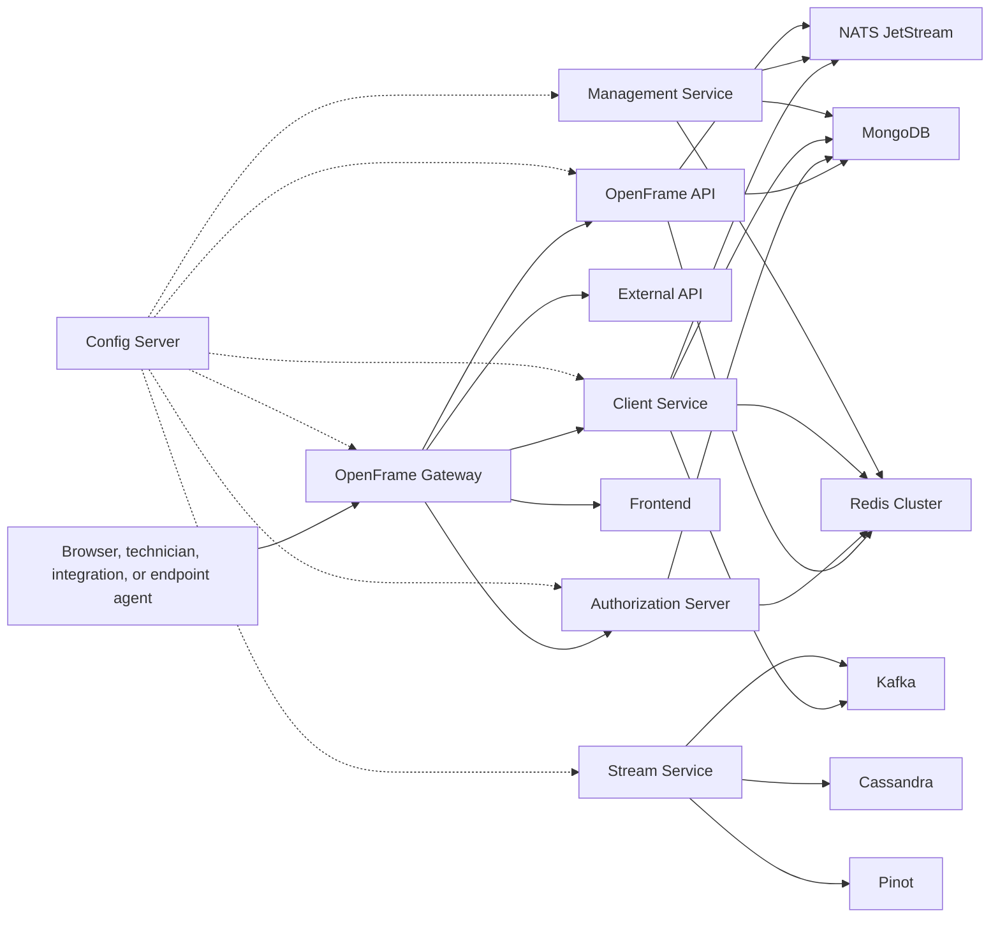

# Quick Start

This guide gets a copy of **OpenFrame OSS Tenant** building locally and explains what you get once it is deployed. OpenFrame OSS Tenant is the deployable, tenant-oriented distribution of [OpenFrame](https://openframe.ai) ([flamingo.run/openframe](https://www.flamingo.run/openframe)) — it assembles Spring Boot services, a Rust endpoint agent, shared configuration, Helm charts, and Argo CD application definitions into a single MSP operations platform. For background on the project and Flamingo, see [Introduction](./introduction.md).

> **Note:** This repository is a **service distribution**, not a single binary you `npm install` or `pip install`. There is no local Docker Compose file or one-line installer script in this repository. "5-minute setup" here means building the Java services with Maven and understanding how the pieces fit together — full environment bring-up (Kubernetes, datastores, Helm) is covered in [Local Development](../development/setup/local-development.md) and [Environment Setup](../development/setup/environment.md).

## What you are installing

OpenFrame OSS Tenant publishes nine Maven modules and one Rust/Cargo binary:

| Ecosystem | Artifact | Version |
|---|---|---|
| maven | `com.openframe:openframe-api` | 1.0.0-SNAPSHOT |
| maven | `com.openframe:openframe-authorization-server` | 1.0.0-SNAPSHOT |
| maven | `com.openframe:openframe-client` | 1.0.0-SNAPSHOT |
| maven | `com.openframe:openframe-config` | 1.0.0-SNAPSHOT |
| maven | `com.openframe:openframe-external-api` | 1.0.0-SNAPSHOT |
| maven | `com.openframe:openframe-gateway` | 1.0.0-SNAPSHOT |
| maven | `com.openframe:openframe-management` | 1.0.0-SNAPSHOT |
| maven | `com.openframe:openframe-stream` | 1.0.0-SNAPSHOT |
| maven | `com.openframe:openframe-test` | 1.0.0-SNAPSHOT |
| cargo | `openframe_client` | 0.1.0 |

Most of the actual domain logic (authentication, device management, ticketing, remote management, data access) is implemented in the pinned [OpenFrame OSS Library](https://github.com/flamingo-stack/openframe-oss-lib) (version `7.0.11` for the Java modules, `v0.0.5` for the Rust `openframe_agent_lib` crate). This repository owns the runnable applications, Dockerfiles, shared configuration, and Kubernetes/Helm deployment topology. No other repository in the organization currently declares a dependency on OpenFrame OSS Tenant's published artifacts.

## TL;DR — 5-minute local build

These steps build the Java services and the Rust client from source. They do **not** start a running platform (databases, Kafka, NATS, the gateway) — for that, see [Local Development](../development/setup/local-development.md).

### 1. Prerequisites

Check [Prerequisites](./prerequisites.md) for a full list. At minimum you need:

- **Java 25** and **Maven** (the root [`pom.xml`](https://github.com/flamingo-stack/openframe-oss-tenant/blob/main/pom.xml) targets `<java.version>25</java.version>` and extends `spring-boot-starter-parent` 4.1.1)
- **Rust** and `cargo` (for the `openframe-client` endpoint agent under `clients/openframe-client`)
- A GitHub personal access token with read access to `flamingo-stack/openframe-oss-lib`, since the Maven and Cargo dependencies are pulled from that private/organization-scoped source

### 2. Clone the repository

```bash
git clone https://github.com/flamingo-stack/openframe-oss-tenant.git
cd openframe-oss-tenant
```

### 3. Build the Java services

The repository root [`pom.xml`](https://github.com/flamingo-stack/openframe-oss-tenant/blob/main/pom.xml) is a multi-module Maven project. Its `<modules>` list is:

```text
openframe/services/openframe-config
openframe/services/openframe-api
openframe/services/openframe-client
openframe/services/openframe-stream
openframe/services/openframe-management
openframe/services/openframe-gateway
openframe/services/openframe-external-api
openframe/services/openframe-authorization-server
openframe/services/openframe-test
```

A full build of every module:

```bash
mvn clean package -U --batch-mode --no-transfer-progress
```

To build just one service (mirroring how the release Dockerfiles do it), use `-pl` with `-am` so Maven also builds the modules it depends on. For example, for `openframe-api`:

```bash
mvn clean package -U \
  -pl openframe/services/openframe-api \
  -am \
  --batch-mode --no-transfer-progress \
  -Dmaven.javadoc.skip=true \
  -Dmaven.test.skip=true
```

This same pattern (seen in [`openframe/services/openframe-api/Dockerfile`](https://github.com/flamingo-stack/openframe-oss-tenant/blob/main/openframe/services/openframe-api/Dockerfile) and the sibling Dockerfiles for `openframe-authorization-server`, `openframe-client`, `openframe-config`, `openframe-external-api`, and `openframe-gateway`) applies to each service module.

> Maven authentication to the OpenFrame OSS Library artifacts uses `.mvn/settings.xml` together with a `GITHUB_TOKEN` secret, as shown in each service's Dockerfile build stage (`--mount=type=secret,id=GITHUB_TOKEN`). Configure equivalent credentials locally before building.

### 4. Build the Rust endpoint agent

The endpoint agent lives in [`clients/openframe-client`](https://github.com/flamingo-stack/openframe-oss-tenant/blob/main/clients/openframe-client/Cargo.toml) and is a thin binary over the `openframe-agent-lib` crate (pulled from `openframe-oss-lib` at tag `v0.0.5`). Its [`Makefile`](https://github.com/flamingo-stack/openframe-oss-tenant/blob/main/clients/openframe-client/Makefile) requires `OPENFRAME_VERSION` to be set, because the library's build script panics without it:

```bash
cd clients/openframe-client
OPENFRAME_VERSION=0.0.0-dev make build
```

Other Makefile targets:

```bash
make lint   # fmt-check + clippy
make test   # build, then cargo test
make clean  # cargo clean
```

Cross-compilation is supported through the `TARGET` variable, e.g. `make build TARGET=x86_64-unknown-linux-musl`.

## Basic "Hello World" example

Because this is a distributed platform of nine services plus an agent, there is no single "hello world" script. The closest equivalent is starting one service locally against the shared configuration and observing it register with the platform's config server and datastores.

### Running a single service

Each service has a thin bootstrap class with a `main` method, for example [`ApiApplication`](https://github.com/flamingo-stack/openframe-oss-tenant/blob/main/openframe/services/openframe-api/src/main/java/com/openframe/api/ApiApplication.java):

```java
@SpringBootApplication
@ComponentScan(basePackages = {
        "com.openframe.api",
        "com.openframe.data",
        "com.openframe.core",
        "com.openframe.notification",
        "com.openframe.kafka"
})
@Slf4j
public class ApiApplication {
    public static void main(String[] args) {
        log.info("Starting OpenFrame API");
        SpringApplication.run(ApiApplication.class, args);
    }
}
```

Every service resolves its configuration from the OpenFrame Config Server at startup. [`openframe/services/openframe-api/src/main/resources/application.yml`](https://github.com/flamingo-stack/openframe-oss-tenant/blob/main/openframe/services/openframe-api/src/main/resources/application.yml) shows this pattern:

```yaml
spring:
  application:
    name: openframe-api
  config:
    import: "optional:configserver:${SPRING_CONFIG_URL:http://openframe-config.microservices.svc.cluster.local:8888}"
```

The same `optional:configserver:` import appears in `openframe-authorization-server` and `openframe-client`'s `application.yml` files. This means a service started outside a cluster will look for a config server at `localhost` or wherever `SPRING_CONFIG_URL` points, but will continue starting even if that server is unreachable (the import is `optional`).

Shared, cross-service defaults — datastore URIs, gateway routes, security token lifetimes, logging — live in [`configs/base/application.yml`](https://github.com/flamingo-stack/openframe-oss-tenant/blob/main/configs/base/application.yml) and per-service files such as `configs/base/openframe-api.yml` and `configs/base/openframe-gateway.yml`. These are the files the Config Server serves to each running service.

To run the API service against a config server reachable at a custom address:

```bash
cd openframe/services/openframe-api
mvn spring-boot:run -Dspring-boot.run.arguments="--SPRING_CONFIG_URL=http://localhost:8888"
```

### Expected output

A healthy single-service startup produces log output similar to:

```text
Starting OpenFrame API
...
Tomcat started on port(s): 8080 (http)
...
Started ApiApplication in 12.345 seconds (process running for 13.0)
```

Without a reachable config server, MongoDB, Redis, Kafka, or NATS, the service will log connection warnings or fail health checks for the datasources it needs (for example `spring.mongodb.uri` and `spring.data.redis.cluster.nodes`, both defined in `configs/base/application.yml`). This is expected when running a service in isolation — the platform is designed to run as a full set of services backed by its datastores, described next.

### Verifying a running service

Every service shares the monitoring configuration in `configs/base/application.yml`:

```yaml
management:
  base-path: /management
  endpoints:
    web:
      base-path: /management/${RELEASE_VERSION:v1}
      exposure:
        include: health,info,metrics,prometheus
```

Once a service is up, its health endpoint is reachable at a path like `/management/v1/health` on that service's port, and returns a JSON body reporting `"status": "UP"` when its dependencies are reachable.

## How the pieces fit together



The gateway (see [`configs/base/openframe-gateway.yml`](https://github.com/flamingo-stack/openframe-oss-tenant/blob/main/configs/base/openframe-gateway.yml)) routes incoming traffic by path prefix:

| Prefix | Destination service |
|---|---|
| `/sas/**` | `openframe-authorization-server` |
| `/api/**` | `openframe-api` |
| `/api-docs/**` | `openframe-external-api` |
| `/clients/**` | `openframe-client` |
| `/**` | Frontend workload |

The Rust `openframe_client` binary is the endpoint agent that registers devices, authenticates, and exchanges commands/results with the `openframe-client` service over NATS JetStream — it is not a server you run as part of the backend stack, but a separate agent binary distributed to managed endpoints.

For the full architecture (data flows, service responsibilities, deployment model), see [Architecture Overview](../reference/architecture/README.md) and [Ecosystem](../reference/architecture/ecosystem.md).

## Running the full platform

A single service by itself is not a usable deployment: the platform expects MongoDB, Redis (cluster), Kafka, Cassandra, Pinot, NATS, and (for FleetMDM) MySQL to be present, plus the Config Server to be reachable. This repository ships the Helm charts and Argo CD application definitions for all of this under [`manifests`](https://github.com/flamingo-stack/openframe-oss-tenant/tree/main) (platform namespace, datasources namespace, and the `manifests/tenant` chart that deploys the OpenFrame services alongside Fleet MDM and MeshCentral).

Bringing up that full environment — including Kubernetes cluster setup, Helm installation order, and datasource bootstrap scripts such as [`manifests/datasources/mongodb/scripts/mongo-init.sh`](https://github.com/flamingo-stack/openframe-oss-tenant/blob/main/manifests/datasources/mongodb/scripts/mongo-init.sh) — is covered step by step in [Local Development](../development/setup/local-development.md) and [Environment Setup](../development/setup/environment.md).

## Using the OpenFrame CLI

Day-to-day operational tasks (bootstrapping a local cluster, managing the tenant deployment) are typically done through the **OpenFrame CLI**, which is maintained in a separate repository: [flamingo-stack/openframe-cli](https://github.com/flamingo-stack/openframe-cli). Refer to that repository's [installation instructions](https://github.com/flamingo-stack/openframe-cli#installation) and [documentation](https://github.com/flamingo-stack/openframe-cli/tree/main/docs) — it is not bundled inside this repository.

[](https://www.youtube.com/watch?v=-_56_qYvMWk)

## Next steps

- Review [Prerequisites](./prerequisites.md) for the full tooling list before a deeper setup.
- Walk through [First Steps](./first-steps.md) for a guided path after the initial build.
- Set up a working local environment with [Local Development](../development/setup/local-development.md) and [Environment Setup](../development/setup/environment.md).
- Read the [Architecture Overview](../reference/architecture/README.md) to understand how the gateway, API, authorization server, client service, management service, and stream service relate to each other and to MongoDB, Redis, Kafka, Cassandra, Pinot, and NATS.
- Dig into individual subsystems such as [Main Applications](../reference/architecture/main-applications/main-applications.md), [Openframe Client Core](../reference/architecture/openframe-client-core/openframe-client-core.md) (the Rust endpoint agent), or [Client Core Server Controllers](../reference/architecture/client-core-server-controllers/client-core-server-controllers.md).
- Check [Code Review Guidelines](../development/contributing/guidelines.md) and [Testing](../development/testing/README.md) before submitting changes.
- For questions or community support, join the [OpenMSP Slack community](https://www.openmsp.ai/) — this project does not use GitHub Issues or Discussions for support.
