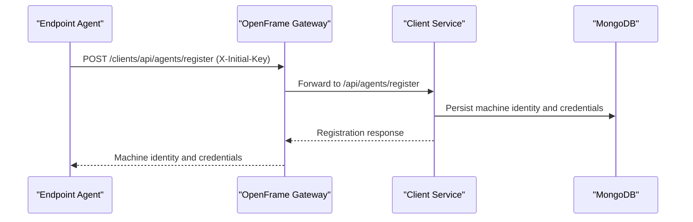
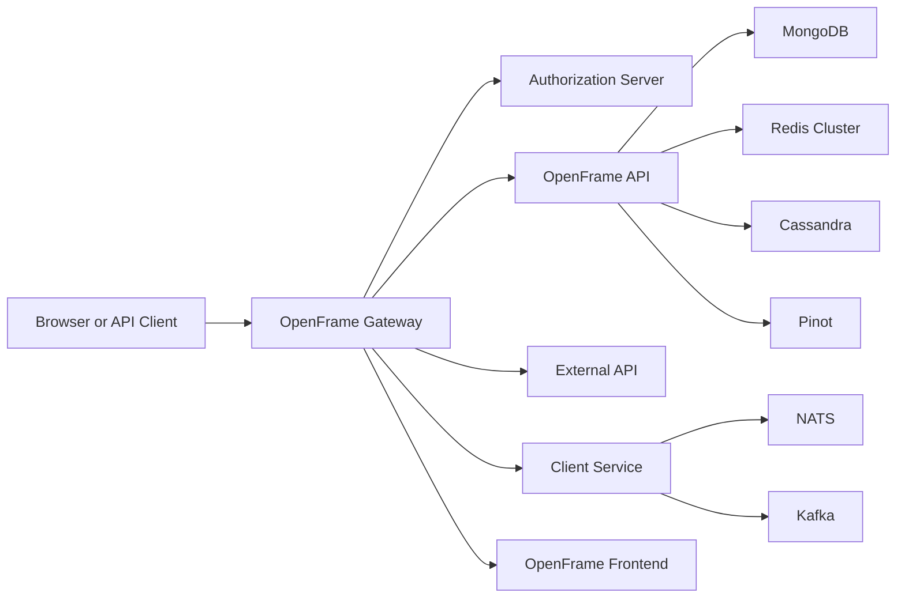

## Quick Start

> **Scope check:** OpenFrame OSS Tenant is a Kubernetes-deployed platform: nine Spring Boot services (Java 25, Spring Boot 4.1.1) plus a Rust endpoint agent, assembled from the [OpenFrame OSS Library](https://github.com/flamingo-stack/openframe-oss-lib) (pinned to `7.0.11`) and deployed through Helm charts and Argo CD. There is no single `docker-compose up` or local npm/yarn entry point in this repository — the fastest path to a running system is the [OpenFrame CLI](https://github.com/flamingo-stack/openframe-cli), an external tool maintained in its own repository.

This page gets you to a running OpenFrame tenant and a first API call in roughly five minutes, then points you at what to read next.

### Who this is for

You want to see OpenFrame running (gateway, API, authorization server, client service, and backing data stores) without first learning the full Kubernetes manifest layout. If you want the full picture of how the pieces fit together first, read [Introduction](./introduction.md) before continuing.

---

## TL;DR: 5-Minute Setup

OpenFrame OSS Tenant publishes Maven artifacts and container images; it is not run by cloning and building this repository directly for a quick trial. The supported quick-start path is the **OpenFrame CLI**, an external tool that provisions a local Kubernetes-based OpenFrame environment for you.

1. **Install the OpenFrame CLI.**
   Follow the installation instructions in the CLI's own repository — do not assume it lives inside this repository:
   [flamingo-stack/openframe-cli#installation](https://github.com/flamingo-stack/openframe-cli#installation)

2. **Bootstrap a tenant environment with the CLI.**
   The CLI handles cluster creation and deploys the platform's Argo CD application-of-apps (the same `manifests/app-of-apps` chart that this repository's release workflow publishes to `oci://ghcr.io/flamingo-stack/openframe-oss-tenant/app-of-apps`). Follow the CLI's documented bootstrap command in its docs:
   [flamingo-stack/openframe-cli/tree/main/docs](https://github.com/flamingo-stack/openframe-cli/tree/main/docs)

3. **Wait for the Argo CD sync waves to settle.**
   Behind the scenes, Argo CD applies the application tree defined in `manifests/apps/values.yaml` in order: the `platform` wave first (namespace, ingress-nginx, `openframe-config`, dev-tools), then the `datasources` wave (Cassandra, Kafka, MongoDB, MongoDB for MeshCentral, MySQL for Fleet MDM, NATS, Pinot, Redis Cluster, ZooKeeper), and finally the tenant application itself (`manifests/tenant`), which deploys the OpenFrame services, Fleet MDM, MeshCentral, and the frontend.

4. **Confirm the gateway is reachable.**
   The OpenFrame Gateway is the single entry point for browser, API, and agent traffic. Its routes (defined in `configs/base/openframe-gateway.yml`) fan out to the backing services:

   | Path prefix | Routed to |
   |---|---|
   | `/sas/**` | Authorization Server |
   | `/api/**` | OpenFrame API |
   | `/api-docs/**` | External API (Swagger/API docs) |
   | `/clients/**` | Client Service (agent registration and delivery) |
   | everything else | OpenFrame frontend |

   Once the gateway responds, your tenant is up.

5. **Explore with the CLI or kubectl.**
   Use whatever cluster-inspection commands the OpenFrame CLI documents (or plain `kubectl get pods -A`) to confirm the platform and tenant namespaces are healthy before moving on to the Hello World call below.

> **Why no `docker-compose.yml` here?** This repository has no Docker Compose files and no bundled CLI scripts of its own — `setup.dockerComposeFiles` and `setup.cliFiles` are both empty for this repository. Each service instead ships its own multi-stage `Dockerfile` (for example `openframe/services/openframe-api/Dockerfile`), built with Maven and run on `eclipse-temurin:25-jre-alpine-3.23`, and the deployment topology lives in the `manifests/` Helm charts consumed by Argo CD. The CLI is the supported shortcut around assembling all of that by hand.

For the full prerequisite list (CLI version, cluster requirements, access to the OpenMSP community for support), see [Prerequisites](./prerequisites.md).

---

## Hello World: Your First API Call

Once your tenant is running behind the gateway, the simplest "hello world" is an authenticated call to the OpenFrame API through `/api/**`. The API service (`com.openframe:openframe-api`) exposes REST and GraphQL endpoints backed by MongoDB, Redis, Cassandra, and Pinot, as described in `docs/reference/architecture/README.md`.

Because this is a multi-tenant platform behind OAuth2/OIDC (the Authorization Server under `/sas/**`), there is no bundled default login. Obtain the access details for your freshly bootstrapped environment from whatever output the OpenFrame CLI prints during setup, or from your environment configuration — never assume a hardcoded username or password here.

A minimal health check that does not require authentication is the gateway's routed actuator surface. Every service shares the common monitoring block defined in `configs/base/application.yml`:

```yaml
management:
  base-path: /management
  endpoints:
    web:
      base-path: /management/${RELEASE_VERSION:v1}
      exposure:
        include: health,info,metrics,prometheus
```

So, once you know the externally reachable gateway host for your environment, a first call looks like this:

```bash
# Replace <gateway-host> with the address your CLI bootstrap reported
curl -s https://<gateway-host>/api/management/v1/health
```

### Expected Output

A healthy OpenFrame API instance returns a Spring Boot Actuator health payload, for example:

```json
{
  "status": "UP"
}
```

If you instead see a connection refused or timeout, the gateway, the `openframe-api` pod, or the Argo CD sync may still be converging — re-check the sync wave status (step 3 above) before investigating further.

### A Slightly Richer Hello World: Register a Device

The platform's actual "hello world" workload is registering a managed endpoint. The Client Service (`com.openframe:openframe-client`, routed at `/clients/**`) exposes `POST /api/agents/register`, documented in [Registration and Authentication](../reference/architecture/openframe-client-core-java/registration_and_authentication.md). It requires an `X-Initial-Key` header and a validated JSON payload, and responds with a generated machine identity and credentials. This is the same endpoint the Rust-based [OpenFrame Client Core](../reference/architecture/openframe-client-core/openframe-client-core.md) endpoint agent calls on first install — it is not something you typically call by hand outside of agent installer flows, but it is the clearest proof that the full registration-to-delivery path (gateway → client service → MongoDB → NATS) works end to end.



If this call succeeds, every layer of the stack — gateway routing, the client service, and its MongoDB-backed state — is working.

---

## What Just Happened



The OpenFrame CLI drove Argo CD, which deployed:

- **Platform services**: ingress-nginx, the `openframe-config` Spring Cloud Config Server (which every other service pulls its configuration from via `spring.config.import`), and development tools.
- **Datasources**: MongoDB, Redis Cluster, Cassandra, Kafka, NATS, Pinot, MySQL (for Fleet MDM), and ZooKeeper — all declared under `manifests/datasources`.
- **The tenant application** (`manifests/tenant`): the nine OpenFrame Maven-module services, plus the Fleet MDM and MeshCentral integrated tools and the OpenFrame frontend, each pulled as a container image (for example `ghcr.io/flamingo-stack/openframe-oss-tenant/openframe-api:latest`).

This repository (`com.openframe:openframe-parent`, see `pom.xml`) does not implement the business logic for these services itself. Its Maven modules under `openframe/services/*` are thin Spring Boot entry points — see for example `openframe/services/openframe-api/src/main/java/com/openframe/api/ApiApplication.java` — that assemble functionality from the OpenFrame OSS Library (`com.openframe.oss:*`, pinned at `7.0.11`). The Rust `openframe-client` binary under `clients/openframe-client/src/main.rs` is equally thin, delegating to the `openframe-agent-lib` crate pinned at tag `v0.0.5` in `clients/openframe-client/Cargo.toml`.

---

## Next Steps

- Read [Introduction](./introduction.md) for the conceptual overview of OpenFrame and Flamingo before diving deeper.
- Work through [Prerequisites](./prerequisites.md) for the exact tooling and access you need before bootstrapping a tenant.
- Follow [First Steps](./first-steps.md) for a guided walkthrough beyond this quick start.
- For local service development instead of a full CLI-provisioned tenant, see [Local Development](../development/setup/local-development.md) and [Environment Setup](../development/setup/environment.md).
- To understand how the nine services, the Helm charts, and the Argo CD app-of-apps fit together, read the architecture overview at [Architecture](../development/architecture/README.md) and the generated [Ecosystem](../reference/architecture/ecosystem.md) reference, which lists every upstream OpenFrame OSS Library artifact this repository pins and the full delivery chain from CI images to Argo CD applications.
- Deep dives into individual runtime modules — all implemented in the OpenFrame OSS Library and assembled here — are indexed from [Reference Architecture](../reference/architecture/README.md), including [Registration and Authentication](../reference/architecture/openframe-client-core-java/registration_and_authentication.md), [Telemetry and Delivery](../reference/architecture/openframe-client-core-java/telemetry_and_delivery.md), and [Openframe Client Core](../reference/architecture/openframe-client-core/openframe-client-core.md) for the Rust endpoint agent.
- Before contributing changes, review [Security](../development/security/README.md), [Testing](../development/testing/README.md), and [Contributing Guidelines](../development/contributing/guidelines.md).

For questions, troubleshooting, or to connect with other OpenFrame users, join the [OpenMSP Slack community](https://www.openmsp.ai/).

[](https://www.youtube.com/watch?v=-_56_qYvMWk)
