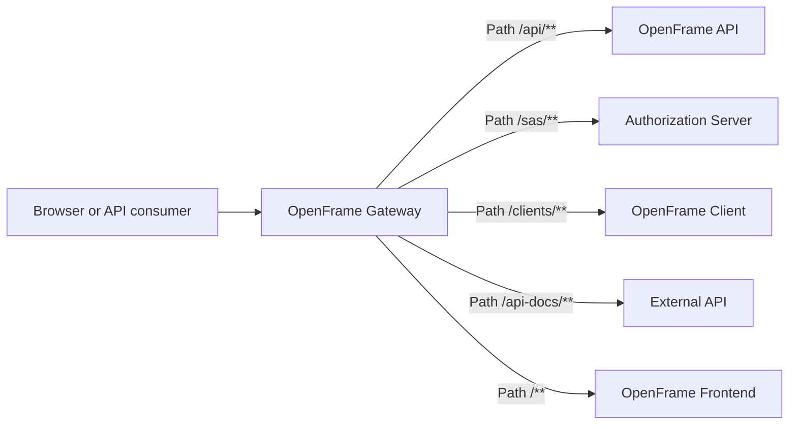

#  Quick Start

> OpenFrame OSS Tenant is the tenant-facing service and deployment repository for OpenFrame, Flamingo's unified AI-driven MSP platform. It assembles independently deployable Spring Boot services (Java 25), a Rust client agent, centralized configuration, and Kubernetes/Helm manifests into an operable tenant environment.

This guide gets you from a clean checkout to a running OpenFrame API service (and a quick look at the rest of the stack) in about 5 minutes, using the tools already present in this repository: Maven, Docker, and Helm/Argo CD manifests.

For background on the platform and its services, see [Introduction](./introduction.md). For a full breakdown of prerequisites and tooling, see [Prerequisites](./prerequisites.md). For a guided first contribution, see [First Steps](./first-steps.md).

## What you are installing

OpenFrame OSS Tenant publishes nine Maven service artifacts and one Rust client crate:

| Artifact | Purpose |
|---|---|
| `com.openframe:openframe-config` | Centralized configuration server (`openframe-config`), deployed first as a platform dependency. |
| `com.openframe:openframe-gateway` | Reactive edge gateway: routes `/sas/**`, `/api/**`, `/clients/**`, `/api-docs/**`, and `/**`. |
| `com.openframe:openframe-api` | Core OpenFrame API service. |
| `com.openframe:openframe-authorization-server` | OAuth2 / OpenID Connect authorization server (context path `/sas`). |
| `com.openframe:openframe-client` | Backend client service, communicates with the Rust agent. |
| `com.openframe:openframe-external-api` | Servlet-based API-key access boundary, routed at `/api-docs/**`. |
| `com.openframe:openframe-management` | Management-plane service. |
| `com.openframe:openframe-stream` | Kafka log-event consumer. |
| `com.openframe:openframe-test` | Shared test utilities. |
| `openframe_client` (cargo crate) | Thin Rust binary wrapping `openframe-agent-lib` from the OpenFrame OSS Library repository. |

Every Java service depends on the **OpenFrame OSS Library** (`com.openframe.oss:*`, pinned at `7.0.11`) for its actual API, data, security, authorization, and messaging implementations. This repository's Java modules are deliberately thin Spring Boot bootstrap classes — business logic lives in that upstream library.


No other managed repository currently consumes OpenFrame OSS Tenant's artifacts directly — it sits at the edge of the dependency graph, consuming the OSS Library and being deployed as container images and Helm charts.

## TL;DR: 5-minute setup

> Confirm detailed tool versions (Java, Maven, Docker, kubectl/Helm) in [Prerequisites](./prerequisites.md) before you start. The steps below assume a JDK capable of running Java 25 and Maven are already on your `$PATH`.

### 1. Clone the repository

```bash
git clone https://github.com/flamingo-stack/openframe-oss-tenant.git
cd openframe-oss-tenant
```

### 2. Build the Maven modules

The root [`pom.xml`](https://github.com/flamingo-stack/openframe-oss-tenant/blob/main/pom.xml) is a multi-module Maven project (`com.openframe:openframe-parent`) targeting Java 25 and Spring Boot `4.1.1`. It declares nine service modules under `openframe/services`:

```bash
mvn clean package -DskipTests
```

This resolves the pinned OpenFrame OSS Library artifacts (version `7.0.11`) and builds every service module, including `openframe-config`, `openframe-api`, `openframe-authorization-server`, `openframe-client`, `openframe-stream`, `openframe-management`, `openframe-gateway`, `openframe-external-api`, and `openframe-test`.

> Building against the private OpenFrame OSS Library artifacts requires authenticated Maven access (the Docker build stages inject a `GITHUB_TOKEN` via `.mvn/settings.xml` — see any service `Dockerfile`, for example [`openframe/services/openframe-api/Dockerfile`](https://github.com/flamingo-stack/openframe-oss-tenant/blob/main/openframe/services/openframe-api/Dockerfile)). Configure equivalent credentials locally before building if Maven cannot resolve `com.openframe.oss` dependencies.

### 3. Run one service locally

Each service is an ordinary Spring Boot application with its own `main` class. For example, to start just the API service module:

```bash
mvn -pl openframe/services/openframe-api -am spring-boot:run
```

By default, every service's `application.yml` points at a configuration server address such as `http://openframe-config.microservices.svc.cluster.local:8888` (see [`openframe/services/openframe-api/src/main/resources/application.yml`](https://github.com/flamingo-stack/openframe-oss-tenant/blob/main/openframe/services/openframe-api/src/main/resources/application.yml)). Outside Kubernetes, override `SPRING_CONFIG_URL` to point at a reachable config server, or run `openframe-config` first:

```bash
mvn -pl openframe/services/openframe-config -am spring-boot:run
```

### 4. Or build and run a container image

Every service ships a two-stage Dockerfile (Eclipse Temurin Java 25 JDK builder, Eclipse Temurin Java 25 JRE runtime). For example, to build the API service image locally:

```bash
docker build -f openframe/services/openframe-api/Dockerfile -t openframe-api:local .
```

The build stage runs:

```bash
mvn clean package -U -pl openframe/services/openframe-api -am -Dcompress --batch-mode --no-transfer-progress -Dmaven.javadoc.skip=true -Dmaven.test.skip=true
```

and the runtime stage launches the packaged jar as a non-root `appuser`:

```bash
java -jar app.jar
```

The same pattern applies to `openframe-authorization-server`, `openframe-client`, `openframe-config`, `openframe-external-api`, and `openframe-gateway` — each has its own `Dockerfile` under `openframe/services/<service>/`.

### 5. Deploy the full tenant stack (Kubernetes)

In a real deployment, services are not started individually by hand — they are deployed together through the Argo CD app-of-apps structure defined under `manifests/`:

- `manifests/apps` — the app-of-apps root, deploying `platform` (wave -1/0) then `datasources` (wave 0) then the `tenant` application.
- `manifests/platform/openframe-config` — the config server platform chart.
- `manifests/datasources/*` — MongoDB, Redis Cluster, Cassandra, Kafka, NATS, Pinot, MySQL (Fleet MDM), Zookeeper, Debezium Connect.
- `manifests/tenant` — the tenant chart that wires together `openframe-api`, `openframe-authorization-server`, `openframe-client`, `openframe-external-api`, `openframe-gateway`, `openframe-management`, `openframe-stream`, FleetMDM, MeshCentral, and the OpenFrame frontend image.

The release workflow ([`.github/workflows/release.yml`](https://github.com/flamingo-stack/openframe-oss-tenant/blob/main/.github/workflows/release.yml)) publishes container images to `ghcr.io/flamingo-stack/openframe-oss-tenant/<service>` and packages the app-of-apps chart as `oci://ghcr.io/flamingo-stack/openframe-oss-tenant/app-of-apps`. Applying that chart through Argo CD is the fastest path to a working multi-service environment; see [Local Development](../development/setup/local-development.md) and [Environment Setup](../development/setup/environment.md) for the full walkthrough.

### 6. Build the Rust client agent (optional)

The `clients/openframe-client` crate is a thin binary over `openframe-agent-lib`, pulled directly from the OpenFrame OSS Library repository at tag `v0.0.5` (see [`clients/openframe-client/Cargo.toml`](https://github.com/flamingo-stack/openframe-oss-tenant/blob/main/clients/openframe-client/Cargo.toml)). It is built with the Makefile in the same directory:

```bash
cd clients/openframe-client
OPENFRAME_VERSION=0.0.0-dev make build
```

`OPENFRAME_VERSION` is required at build time — it is consumed by the library's build script and the Makefile panics without it. The `make test` and `make lint` targets (`fmt-check` + `clippy -D warnings`) are also available; see [`clients/openframe-client/Makefile`](https://github.com/flamingo-stack/openframe-oss-tenant/blob/main/clients/openframe-client/Makefile).

> This Rust crate is this repository's thin wrapper; the actual agent implementation is delivered as a separate dependency. For the CLI used to manage OpenFrame deployments, see the external [openframe-cli](https://github.com/flamingo-stack/openframe-cli) repository and its [installation instructions](https://github.com/flamingo-stack/openframe-cli#installation) — it is not part of this repository and should not be built from a local subdirectory here.

## "Hello World": starting the API service and reaching it through the gateway

Rather than a toy example, the smallest meaningful "Hello World" in this platform is starting the **OpenFrame API service** and observing its one guaranteed side effect: a startup log line, followed by the gateway routing a request to it.

### What runs

[`ApiApplication.java`](https://github.com/flamingo-stack/openframe-oss-tenant/blob/main/openframe/services/openframe-api/src/main/java/com/openframe/api/ApiApplication.java) is the composition root for the API service:

```java
@SpringBootApplication
@ComponentScan(basePackages = {
        "com.openframe.api",
        "com.openframe.data",
        "com.openframe.core",
        "com.openframe.notification",
        "com.openframe.kafka"
})
@Slf4j
public class ApiApplication {

    public static void main(String[] args) {
        log.info("Starting OpenFrame API");
        SpringApplication.run(ApiApplication.class, args);
    }
}
```

It explicitly scans five package roots — its own `com.openframe.api` plus four shared OpenFrame packages — assembling API, data, core, notification, and Kafka capabilities supplied by the pinned OpenFrame OSS Library artifacts into one Spring application context. More detail on this bootstrap pattern is in [API Service Core](../reference/architecture/api-service-core/api-service-core.md).

### Run it

```bash
mvn -pl openframe/services/openframe-api -am spring-boot:run
```

### Expected output

On a successful start you will see, among the normal Spring Boot banner and autoconfiguration log lines:

```text
Starting OpenFrame API
...
Started ApiApplication in N.NNN seconds
```

That first line is emitted by the `log.info("Starting OpenFrame API")` call in `ApiApplication`, before `SpringApplication.run` even begins creating the context — it is the earliest observable signal that the module is executing.

Once running standalone, the service exposes common management endpoints (health, info, metrics, Prometheus) under a base path of `/management/${RELEASE_VERSION:v1}` as configured in [`configs/base/application.yml`](https://github.com/flamingo-stack/openframe-oss-tenant/blob/main/configs/base/application.yml). With `RELEASE_VERSION` unset, this defaults to `/management/v1`, so a local health check (once the embedded server is listening) looks like:

```bash
curl http://localhost:<port>/management/v1/health
```

> The exact HTTP port is service-specific runtime configuration (not hardcoded in `ApiApplication`); check your running service's logs or `configs/base/openframe-api.yml` for the bound port in your environment.

### Routed through the gateway

In a deployed tenant environment, the gateway is the single entry point. Per [`configs/base/openframe-gateway.yml`](https://github.com/flamingo-stack/openframe-oss-tenant/blob/main/configs/base/openframe-gateway.yml), the gateway maps:

| Path | Routed to |
|---|---|
| `/sas/**` | `openframe-authorization-server.tenant.svc.cluster.local` |
| `/api/**` | `openframe-api.tenant.svc.cluster.local` |
| `/clients/**` | `openframe-client.tenant.svc.cluster.local` |
| `/api-docs/**` | `openframe-external-api.tenant.svc.cluster.local` |
| `/**` | `openframe-frontend.tenant.svc.cluster.local` |



Once the gateway and API service are both up (locally via `spring-boot:run`, or in-cluster via the tenant Helm chart), a request to the gateway's `/api/**` path is forwarded unmodified to the API service and the response flows back through the gateway to the caller.

### Expected result

- The API service log shows `Starting OpenFrame API` followed by a normal Spring Boot `Started ApiApplication` line.
- The service's management health endpoint reports `UP` once MongoDB, Redis, and other configured datastores are reachable (shared settings in `configs/base/application.yml`).
- A request through the gateway at a path under `/api/**` reaches the API service and returns its response.

If the service instead fails to start, check first for missing shared infrastructure (MongoDB, Redis Cluster, Kafka, NATS — see the data sources declared in `configs/base/application.yml`) or an unreachable configuration server (`SPRING_CONFIG_URL`), since the API service's `application.yml` imports configuration optionally from a config server before anything else initializes.

## Next steps

- Read [Introduction](./introduction.md) for the broader Flamingo/OpenFrame platform context.
- Walk through [Prerequisites](./prerequisites.md) to confirm your toolchain (JDK, Maven, Docker, Kubernetes tooling) matches what this repository expects.
- Follow [First Steps](./first-steps.md) for a guided first change.
- Set up a full local environment with [Environment Setup](../development/setup/environment.md) and [Local Development](../development/setup/local-development.md), which cover running the datasources and the full tenant chart together.
- Review the [Architecture overview](../development/architecture/README.md) and the generated [Ecosystem reference](../reference/architecture/ecosystem.md) for how all nine services, the config server, and the datastore layer fit together.
- Dig into individual service internals: [API Service Core](../reference/architecture/api-service-core/api-service-core.md), [Authorization Server Core](../reference/architecture/authorization-server-core/authorization-server-core.md), [Client Service Core](../reference/architecture/client-service-core/client-service-core.md), [Config Server Core](../reference/architecture/config-server-core/config-server-core.md), [External API Service](../reference/architecture/external-api-service/external-api-service.md), [Gateway Service Core](../reference/architecture/gateway-service-core/gateway-service-core.md), [Management Service Core](../reference/architecture/management-service-core/management-service-core.md), and [Stream Service Core](../reference/architecture/stream-service-core/stream-service-core.md).
- Before contributing code, check [Security](../development/security/README.md), [Testing](../development/testing/README.md), and the [Contributing Guidelines](../development/contributing/guidelines.md).

> This project does not use GitHub Issues or GitHub Discussions. Questions, feedback, and coordination happen in the [OpenMSP Slack community](https://www.openmsp.ai/) (invite: https://join.slack.com/t/openmsp/shared_invite/zt-36bl7mx0h-3~U2nFH6nqHqoTPXMaHEHA).

[](https://www.youtube.com/watch?v=-_56_qYvMWk)
