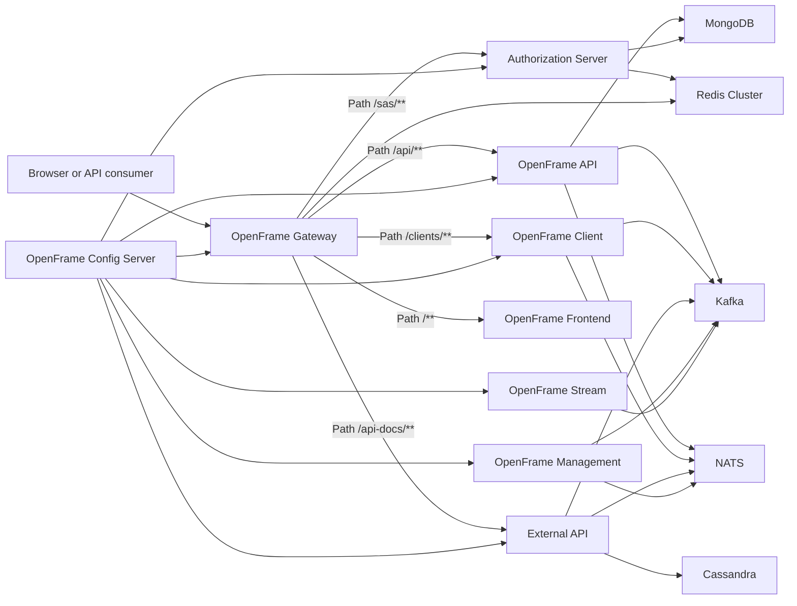
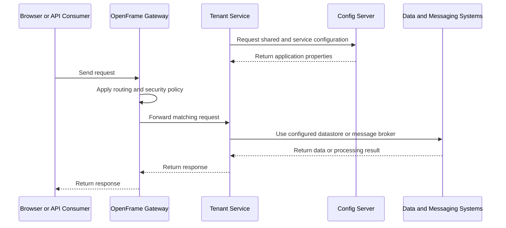

# OpenFrame OSS Tenant

OpenFrame OSS Tenant is the tenant-facing service and deployment repository for OpenFrame, Flamingo's unified AI-driven MSP platform. It assembles independently deployable Spring Boot services, centralized configuration, event processing, and Kubernetes/Helm manifests into an operable tenant environment.

The repository publishes Maven service artifacts, a Rust client crate, container images, and an app-of-apps Helm chart. Shared application capabilities—such as API, authorization, data, security, gateway, and messaging implementations—are supplied by the pinned OpenFrame OSS Library dependencies at version `7.0.11`.

## Repository Purpose

This repository provides:

- Spring Boot entry points for the OpenFrame backend services.
- Tenant-specific configuration under `configs/base`.
- Gateway routing for browser, API, authorization, client, and API-documentation traffic.
- Kafka and NATS integrations for asynchronous workloads.
- Helm charts and Argo CD app-of-apps configuration for platform, datasource, and tenant deployment.
- Container build definitions and release automation for the backend services.

## End-to-End Architecture

### Request and Configuration Flow

## Deployment Topology

The repository uses an Argo CD app-of-apps structure to deploy platform services, data sources, and tenant workloads.

```mermaid
flowchart TD
    Release["Release workflow"] --> Images["Service container images"]
    Release --> AppChart["App-of-apps Helm chart"]

    AppChart --> Platform["Platform applications"]
    AppChart --> Datasources["Datasource applications"]
    AppChart --> Tenant["Tenant application"]

    Platform --> ConfigServer["OpenFrame Config"]
    Platform --> Ingress["Ingress NGINX"]
    Platform --> DevTools["Development tools"]

    Datasources --> Mongo["MongoDB"]
    Datasources --> Redis["Redis Cluster"]
    Datasources --> Kafka["Kafka"]
    Datasources --> Nats["NATS"]
    Datasources --> Cassandra["Cassandra"]
    Datasources --> Pinot["Pinot"]
    Datasources --> Mysql["MySQL for Fleet"]
    Datasources --> Debezium["Debezium Connect"]

    Tenant --> Gateway["OpenFrame Gateway"]
    Tenant --> Api["OpenFrame API"]
    Tenant --> Authz["Authorization Server"]
    Tenant --> Client["OpenFrame Client"]
    Tenant --> ExternalApi["External API"]
    Tenant --> Management["OpenFrame Management"]
    Tenant --> Stream["OpenFrame Stream"]
    Tenant --> Frontend["OpenFrame Frontend"]
```

## Repository Structure

| Area | Purpose |
| --- | --- |
| [`openframe/services`](https://github.com/flamingo-stack/openframe-oss-tenant/tree/main/openframe/services) | Spring Boot service modules and container definitions. |
| [`configs/base`](https://github.com/flamingo-stack/openframe-oss-tenant/tree/main/configs/base) | Shared and service-specific runtime configuration. |
| [`manifests/apps`](https://github.com/flamingo-stack/openframe-oss-tenant/tree/main/manifests/apps) | Argo CD app-of-apps configuration. |
| [`manifests/platform`](https://github.com/flamingo-stack/openframe-oss-tenant/tree/main/manifests/platform) | Platform Helm charts, including configuration and ingress components. |
| [`manifests/datasources`](https://github.com/flamingo-stack/openframe-oss-tenant/tree/main/manifests/datasources) | Helm charts for tenant data and messaging dependencies. |
| [`manifests/tenant`](https://github.com/flamingo-stack/openframe-oss-tenant/tree/main/manifests/tenant) | Tenant application chart and service image configuration. |
| [`.github/workflows/release.yml`](https://github.com/flamingo-stack/openframe-oss-tenant/blob/main/.github/workflows/release.yml) | Release workflow that publishes service images and the app-of-apps chart. |

## Core Modules

### API Service Core

The API service is the Spring Boot composition root for API, data, core, notification, and Kafka components. The gateway routes `/api/**` traffic to this service.

- Source: [`ApiApplication.java`](https://github.com/flamingo-stack/openframe-oss-tenant/blob/main/openframe/services/openframe-api/src/main/java/com/openframe/api/ApiApplication.java)
- Module: [`openframe/services/openframe-api`](https://github.com/flamingo-stack/openframe-oss-tenant/tree/main/openframe/services/openframe-api)
- Configuration: [`openframe-api.yml`](https://github.com/flamingo-stack/openframe-oss-tenant/blob/main/configs/base/openframe-api.yml)

### Authorization Server Core

The authorization server provides the OAuth2 and OpenID Connect application boundary. It runs with the `/sas` context path and is routed through the gateway at `/sas/**`.

- Source: [`OpenFrameAuthorizationServerApplication.java`](https://github.com/flamingo-stack/openframe-oss-tenant/blob/main/openframe/services/openframe-authorization-server/src/main/java/com/openframe/authz/OpenFrameAuthorizationServerApplication.java)
- Module: [`openframe/services/openframe-authorization-server`](https://github.com/flamingo-stack/openframe-oss-tenant/tree/main/openframe/services/openframe-authorization-server)
- Configuration: [`openframe-authorization-server.yml`](https://github.com/flamingo-stack/openframe-oss-tenant/blob/main/configs/base/openframe-authorization-server.yml)

### Client Service Core

The client service bootstraps client, shared data, core, security, and Kafka producer components. Gateway traffic for this service uses the `/clients/**` route.

- Source: [`ClientApplication.java`](https://github.com/flamingo-stack/openframe-oss-tenant/blob/main/openframe/services/openframe-client/src/main/java/com/openframe/client/ClientApplication.java)
- Module: [`openframe/services/openframe-client`](https://github.com/flamingo-stack/openframe-oss-tenant/tree/main/openframe/services/openframe-client)
- Configuration: [`openframe-client.yml`](https://github.com/flamingo-stack/openframe-oss-tenant/blob/main/configs/base/openframe-client.yml)

### Config Server Core

The config server supplies centrally managed configuration to tenant services. It is deployed as an internal platform dependency before tenant workloads.

- Source: [`ConfigServerApplication.java`](https://github.com/flamingo-stack/openframe-oss-tenant/blob/main/openframe/services/openframe-config/src/main/java/com/openframe/config/ConfigServerApplication.java)
- Module: [`openframe/services/openframe-config`](https://github.com/flamingo-stack/openframe-oss-tenant/tree/main/openframe/services/openframe-config)
- Platform chart: [`manifests/platform/openframe-config`](https://github.com/flamingo-stack/openframe-oss-tenant/tree/main/manifests/platform/openframe-config)

### External API Service

The external API service supplies the servlet-based boundary for programmatic access using API keys. The gateway explicitly routes API documentation requests at `/api-docs/**` to this service.

- Source: [`ExternalApiApplication.java`](https://github.com/flamingo-stack/openframe-oss-tenant/blob/main/openframe/services/openframe-external-api/src/main/java/com/openframe/external/ExternalApiApplication.java)
- Module: [`openframe/services/openframe-external-api`](https://github.com/flamingo-stack/openframe-oss-tenant/tree/main/openframe/services/openframe-external-api)
- Configuration: [`openframe-external-api.yml`](https://github.com/flamingo-stack/openframe-oss-tenant/blob/main/configs/base/openframe-external-api.yml)

### Gateway Service Core

The gateway is the reactive edge service for tenant traffic. It applies routing, OAuth integration, JWT validation, CORS, rate-limit configuration, and backend HTTP client policy.

- Source: [`GatewayApplication.java`](https://github.com/flamingo-stack/openframe-oss-tenant/blob/main/openframe/services/openframe-gateway/src/main/java/com/openframe/gateway/GatewayApplication.java)
- Module: [`openframe/services/openframe-gateway`](https://github.com/flamingo-stack/openframe-oss-tenant/tree/main/openframe/services/openframe-gateway)
- Route configuration: [`openframe-gateway.yml`](https://github.com/flamingo-stack/openframe-oss-tenant/blob/main/configs/base/openframe-gateway.yml)

### Management Service Core

The management service assembles management, data, and core components. It also provides the distribution-specific policy that adds no optional NATS JetStream stream definitions.

- Sources: [`ManagementApplication.java`](https://github.com/flamingo-stack/openframe-oss-tenant/blob/main/openframe/services/openframe-management/src/main/java/com/openframe/management/ManagementApplication.java) and [`NoAdditionalStreamConfigurationProvider.java`](https://github.com/flamingo-stack/openframe-oss-tenant/blob/main/openframe/services/openframe-management/src/main/java/com/openframe/management/initializer/NoAdditionalStreamConfigurationProvider.java)
- Module: [`openframe/services/openframe-management`](https://github.com/flamingo-stack/openframe-oss-tenant/tree/main/openframe/services/openframe-management)
- Configuration: [`openframe-management.yml`](https://github.com/flamingo-stack/openframe-oss-tenant/blob/main/configs/base/openframe-management.yml)

### Stream Service Core

The stream service consumes inbound log events from Kafka. It delegates typed Debezium messages to a generic JSON message processor and logs processing failures at the consumer boundary.

- Sources: [`StreamApplication.java`](https://github.com/flamingo-stack/openframe-oss-tenant/blob/main/openframe/services/openframe-stream/src/main/java/com/openframe/stream/StreamApplication.java) and [`LogsEventListener.java`](https://github.com/flamingo-stack/openframe-oss-tenant/blob/main/openframe/services/openframe-stream/src/main/java/com/openframe/stream/listener/LogsEventListener.java)
- Module: [`openframe/services/openframe-stream`](https://github.com/flamingo-stack/openframe-oss-tenant/tree/main/openframe/services/openframe-stream)
- Configuration: [`openframe-stream.yml`](https://github.com/flamingo-stack/openframe-oss-tenant/blob/main/configs/base/openframe-stream.yml)

## Shared Configuration and Dependencies

Shared tenant configuration is defined in [`configs/base/application.yml`](https://github.com/flamingo-stack/openframe-oss-tenant/blob/main/configs/base/application.yml). It includes common MongoDB, Redis, Cassandra, Pinot, management, logging, encryption, and tenant-isolation settings.

The platform deploys these principal backing systems:

- MongoDB for document persistence.
- Redis Cluster for cached and distributed state.
- Cassandra for configured event and data workloads.
- Kafka for event streams and service messaging.
- NATS for messaging and stream-related integration.
- Pinot for analytics-oriented data access.
- MySQL for Fleet MDM dependencies.

## Published Deliverables

The release workflow publishes container images for:

- `openframe-api`
- `openframe-authorization-server`
- `openframe-client`
- `openframe-config`
- `openframe-external-api`
- `openframe-gateway`
- `openframe-management`
- `openframe-stream`

Images are published under `ghcr.io/flamingo-stack/openframe-oss-tenant/`, and the app-of-apps Helm chart is published as `oci://ghcr.io/flamingo-stack/openframe-oss-tenant/app-of-apps`.

## Community and Support

Questions, feedback, and coordination are handled through the OpenMSP Slack community rather than GitHub Issues or Discussions.

[OpenMSP Community](https://www.openmsp.ai/)