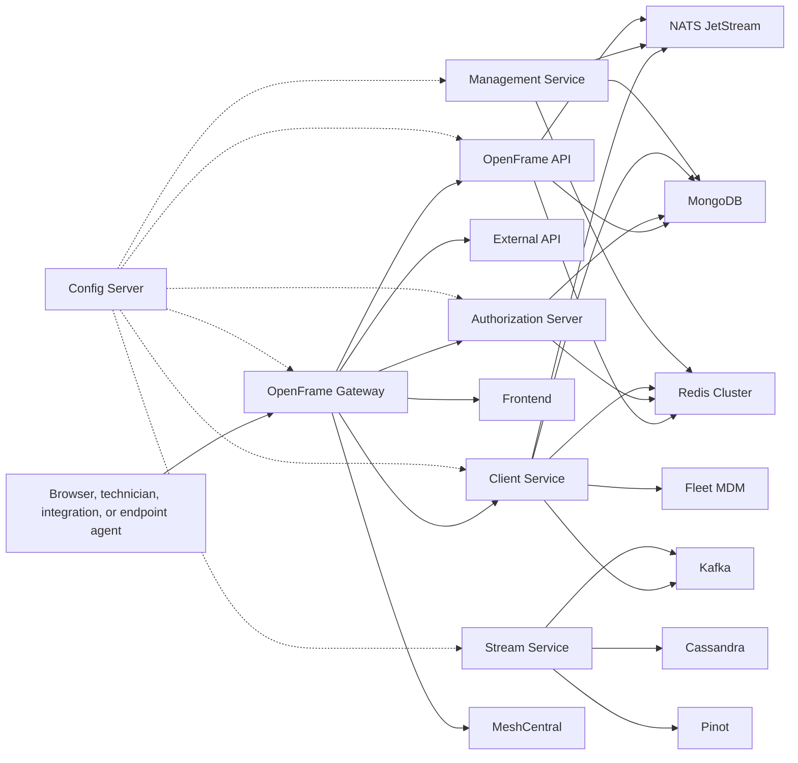
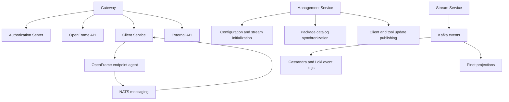
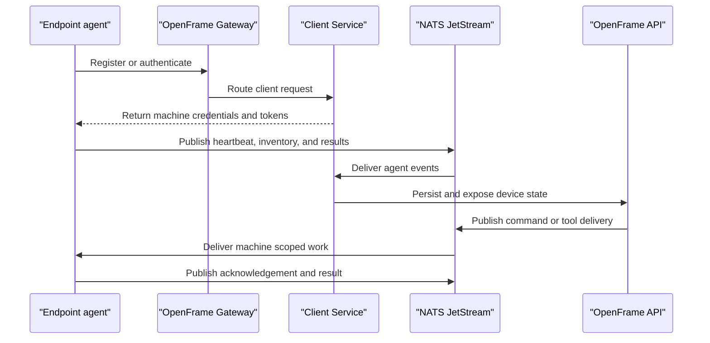
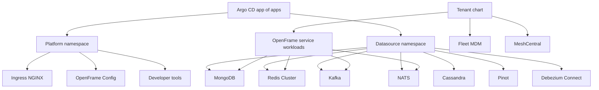

# OpenFrame OSS Tenant

[OpenFrame OSS Tenant](https://github.com/flamingo-stack/openframe-oss-tenant) is the deployable, tenant-oriented OpenFrame platform distribution. It assembles Spring Boot services, a Rust endpoint agent, shared configuration, Helm charts, and Argo CD application definitions into a complete MSP operations platform.

The repository packages OpenFrame capabilities for identity, APIs, endpoint management, automation, remote tooling, event processing, and operational data services. Most domain implementation is provided by the pinned OpenFrame OSS Library dependencies; this repository owns the runnable applications, container delivery, configuration, and Kubernetes deployment topology.

## Repository structure

| Area | Purpose |
|---|---|
| [`openframe/services`](https://github.com/flamingo-stack/openframe-oss-tenant/tree/main/openframe/services) | Runnable Spring Boot applications for the platform. |
| [`configs/base`](https://github.com/flamingo-stack/openframe-oss-tenant/tree/main/configs/base) | Shared service configuration, datasource settings, and gateway routes. |
| [`manifests`](https://github.com/flamingo-stack/openframe-oss-tenant/tree/main/manifests) | Helm charts and Argo CD application definitions for platform, datasource, and tenant workloads. |
| [`manifests/tenant`](https://github.com/flamingo-stack/openframe-oss-tenant/tree/main/manifests/tenant) | Tenant chart that deploys the OpenFrame services and integrated Fleet MDM and MeshCentral tooling. |
| [`.github/workflows/release.yml`](https://github.com/flamingo-stack/openframe-oss-tenant/blob/main/.github/workflows/release.yml) | Builds and publishes service images and the app-of-apps Helm chart. |

## End-to-end architecture

The gateway routes the platform's public service prefixes:

| Prefix | Destination service |
|---|---|
| `/sas/**` | `openframe-authorization-server` |
| `/api/**` | `openframe-api` |
| `/api-docs/**` | `openframe-external-api` |
| `/clients/**` | `openframe-client` |
| `/**` | Frontend workload |

These gateway routes are defined in [`configs/base/openframe-gateway.yml`](https://github.com/flamingo-stack/openframe-oss-tenant/blob/main/configs/base/openframe-gateway.yml).

## Service responsibilities

- **Gateway** is the reactive edge, JWT validation, API-key boundary, service router, and integrated-tool proxy.
- **Authorization Server** provides tenant-aware OAuth 2.1 and OpenID Connect, password login, invitations, SSO, password reset, and token issuance.
- **OpenFrame API** provides the primary GraphQL and REST-backed application API for devices, organizations, tickets, knowledge base, automation, and remote-management workflows.
- **External API** provides integration-oriented REST endpoints for customers, devices, tickets, tools, logs, and knowledge-base content.
- **Client Service** handles endpoint-agent registration, authentication, device events, command delivery, RMM results, schedules, and package-update state.
- **Management Service** initializes client and tool-agent configuration, NATS streams, integrated tools, package catalogs, and background reconciliation tasks.
- **Stream Service** processes Kafka and CDC events into operational logs, RMM history, software inventory, and analytics projections.
- **Config Server** centrally serves runtime configuration and shared logging configuration.

## Endpoint management flow

The Rust-based endpoint-agent runtime is published as the `openframe_client` Cargo artifact. It registers devices, maintains credentials, consumes command and execution messages, manages integrated tools, ships logs, and persists enough local state to recover results and updates safely.

## Deployment model

The Argo CD app-of-apps configuration deploys platform and datasource prerequisites before tenant workloads.

The application definitions are declared in [`manifests/apps/values.yaml`](https://github.com/flamingo-stack/openframe-oss-tenant/blob/main/manifests/apps/values.yaml). Shared datasource endpoints are configured in [`configs/base/application.yml`](https://github.com/flamingo-stack/openframe-oss-tenant/blob/main/configs/base/application.yml).

## Core module documentation

The repository composes the following core module areas from OpenFrame OSS Library version `7.0.11`:

| Module area | Documentation focus |
|---|---|
| **Main Applications** | Service entry points, component-scan boundaries, and executable service composition. |
| **Gateway Core** | Gateway security, JWT processing, API keys, client version policy, HTTP proxying, and WebSocket tool proxying. |
| **Authorization Service Core** | Tenant-aware OAuth, OpenID Connect, SSO, invitations, password recovery, custom grants, sessions, and signing keys. |
| **API Service Backend** | Log retrieval, RMM command dispatch, software inventory, vulnerability queries, and ticket workflows. |
| **API Service Fetchers and Dataloaders** | GraphQL resolver orchestration, Relay IDs, cursor connections, and batched relationship loading. |
| **Client Core Server Controllers** | Endpoint registration, NATS listeners, delivery tracking, RMM results, package updates, and scheduled operations. |
| **Openframe Client Core** | Rust endpoint-agent lifecycle, local state, authentication, command execution, tool management, logging, and recovery. |
| **Management Core** | Initializers, NATS stream reconciliation, package-catalog synchronization, tool configuration, and maintenance schedulers. |
| **Stream Service Core** | Kafka ingestion, CDC normalization, event enrichment, log destinations, RMM results, and Fleet software reconciliation. |
| **Data Mongo Sync Repositories** | Tenant-aware synchronous Mongo configuration, repositories, aggregations, projections, and persistence retry behavior. |
| **Data Redis** | Tenant-aware Redis keys, Spring caching, Redis templates, and cluster-aware key locality. |
| **External API Service Core** | API-key-authenticated REST resources, OpenAPI configuration, tickets, knowledge base, tools, logs, and devices. |
| **Config Core** | Spring Cloud Config Server support, Git cache repair, and shared Logback configuration delivery. |
| **Security OAuth** | Gateway backend-for-frontend OAuth cookies, authorization callbacks, token refresh, logout, and mobile handoff flows. |

The runnable applications that assemble these modules are located under [`openframe/services`](https://github.com/flamingo-stack/openframe-oss-tenant/tree/main/openframe/services):

- [`openframe-api`](https://github.com/flamingo-stack/openframe-oss-tenant/tree/main/openframe/services/openframe-api)
- [`openframe-authorization-server`](https://github.com/flamingo-stack/openframe-oss-tenant/tree/main/openframe/services/openframe-authorization-server)
- [`openframe-client`](https://github.com/flamingo-stack/openframe-oss-tenant/tree/main/openframe/services/openframe-client)
- [`openframe-config`](https://github.com/flamingo-stack/openframe-oss-tenant/tree/main/openframe/services/openframe-config)
- [`openframe-external-api`](https://github.com/flamingo-stack/openframe-oss-tenant/tree/main/openframe/services/openframe-external-api)
- [`openframe-gateway`](https://github.com/flamingo-stack/openframe-oss-tenant/tree/main/openframe/services/openframe-gateway)
- [`openframe-management`](https://github.com/flamingo-stack/openframe-oss-tenant/tree/main/openframe/services/openframe-management)
- [`openframe-stream`](https://github.com/flamingo-stack/openframe-oss-tenant/tree/main/openframe/services/openframe-stream)

## Published deliverables

The release workflow publishes container images for:

- `openframe-api`
- `openframe-authorization-server`
- `openframe-client`
- `openframe-config`
- `openframe-external-api`
- `openframe-gateway`
- `openframe-management`
- `openframe-stream`

It also publishes the `app-of-apps` OCI Helm chart. The tenant Helm chart references these images alongside Fleet MDM, MeshCentral, and the OpenFrame frontend.

## Further resources

- Repository: [flamingo-stack/openframe-oss-tenant](https://github.com/flamingo-stack/openframe-oss-tenant)
- Releases: [OpenFrame OSS Tenant releases](https://github.com/flamingo-stack/openframe-oss-tenant/releases)
- Community support: [OpenMSP Slack community](https://www.openmsp.ai/)