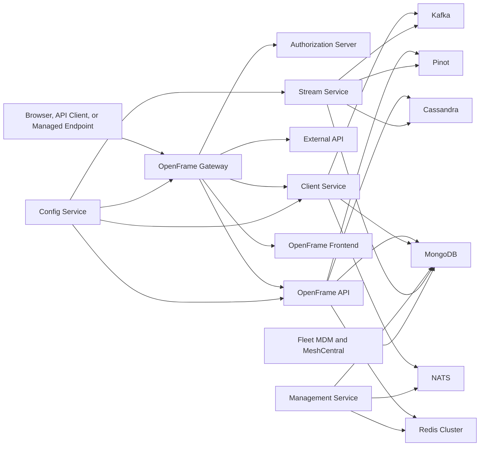
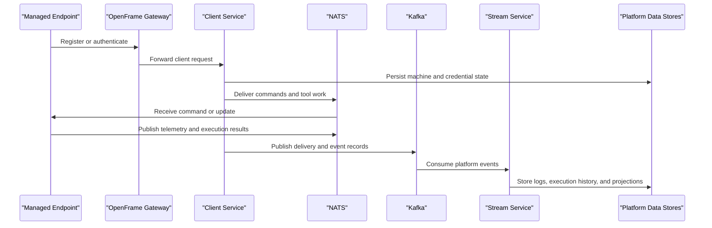
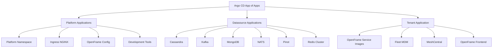

# OpenFrame OSS Tenant

[OpenFrame OSS Tenant](https://github.com/flamingo-stack/openframe-oss-tenant) is the deployable, self-hosted tenant distribution for OpenFrame. It assembles Spring Boot services, shared configuration, Kubernetes manifests, and endpoint-agent integrations into an AI-driven MSP platform stack.

Most domain implementation is consumed from OpenFrame OSS Library dependencies pinned to version `7.0.11`. This repository owns the tenant-specific service entry points, runtime configuration, Helm charts, Argo CD application definitions, and release delivery pipeline.

## Purpose

The repository provides the operational platform required to run an OpenFrame tenant:

- A gateway that routes browser, agent, API, and integration traffic.
- An OAuth 2.0 and OpenID Connect authorization server.
- Main API, External API, client-management, management, configuration, and stream-processing services.
- Shared deployment configuration for MongoDB, Redis, Cassandra, Kafka, NATS, Pinot, Fleet MDM, and MeshCentral.
- Kubernetes deployment manifests, including an app-of-apps chart for Argo CD.
- Published service images and Maven artifacts for tenant services.

## Repository Structure

```text
openframe-oss-tenant/
├── openframe/
│   └── services/
│       ├── openframe-api/
│       ├── openframe-authorization-server/
│       ├── openframe-client/
│       ├── openframe-config/
│       ├── openframe-external-api/
│       ├── openframe-gateway/
│       ├── openframe-management/
│       └── openframe-stream/
├── configs/
│   └── base/
├── manifests/
│   ├── app-of-apps/
│   ├── apps/
│   ├── datasources/
│   ├── platform/
│   └── tenant/
└── .github/
    └── workflows/
```

| Area | Responsibility |
| --- | --- |
| `openframe/services` | Thin Spring Boot entry points that compose OpenFrame OSS Library modules into deployable services. |
| `configs/base` | Shared Spring configuration, datasource addresses, Kafka and NATS settings, and gateway routes. |
| `manifests/tenant` | Tenant Helm chart that deploys OpenFrame services, Fleet MDM, MeshCentral, and the frontend. |
| `manifests/datasources` | Helm configuration for Cassandra, Kafka, MongoDB, MySQL, NATS, Pinot, Redis, and ZooKeeper. |
| `manifests/platform` | Platform-level services such as ingress, configuration server, and development tools. |
| `manifests/apps` | Argo CD application-of-applications configuration and synchronization waves. |

## End-to-End Architecture



The gateway is the external entry point. It routes:

- `/sas/**` to the authorization server.
- `/api/**` to the main OpenFrame API.
- `/api-docs/**` to the External API documentation surface.
- `/clients/**` to the managed endpoint client service.
- Remaining browser traffic to the OpenFrame frontend.

## Control Plane and Endpoint Flow



## Deployment Architecture



The Argo CD applications are organized into platform and datasource layers. Namespace applications are synchronized first, followed by the services that depend on them.

## Published Services

The repository publishes these Maven artifacts at version `1.0.0-SNAPSHOT`:

| Artifact | Runtime role |
| --- | --- |
| `com.openframe:openframe-api` | Main OpenFrame API and GraphQL service. |
| `com.openframe:openframe-authorization-server` | OAuth 2.0, OpenID Connect, user authentication, and SSO service. |
| `com.openframe:openframe-client` | Managed endpoint registration, delivery, telemetry, and RMM coordination service. |
| `com.openframe:openframe-config` | Spring Cloud Config Server for shared platform configuration. |
| `com.openframe:openframe-external-api` | API-key-protected REST API for third-party integrations. |
| `com.openframe:openframe-gateway` | Reactive edge router, JWT boundary, API-key enforcement, and tool proxy. |
| `com.openframe:openframe-management` | Platform initialization, reconciliation, catalog synchronization, and scheduled operations. |
| `com.openframe:openframe-stream` | Kafka event processing, enrichment, log storage, and software projection service. |
| `com.openframe:openframe-test` | Shared tenant integration and end-to-end test service artifact. |

The release workflow also publishes container images under `ghcr.io/flamingo-stack/openframe-oss-tenant`.

## Core Module Documentation

The tenant services assemble the following major OpenFrame OSS Library modules:

| Module documentation | Role in this repository |
| --- | --- |
| **Openframe Services** | Describes tenant-owned Spring Boot entry points and their deployment responsibilities. |
| **Openframe API Service Core** | REST and GraphQL adapters for operational platform APIs, RMM, tickets, devices, and knowledge base workflows. |
| **Openframe API Contracts** | Shared API DTOs, ticket services, software dispatch contracts, and log-query behavior. |
| **Openframe Authorization Service Core** | Tenant-aware OAuth 2.0, OpenID Connect, password authentication, SSO, onboarding, and token handling. |
| **Openframe Gateway Service Core** | Gateway routing, JWT validation, API-key enforcement, CORS, WebSocket proxying, and integrated-tool routing. |
| **Openframe Security OAuth** | Browser and mobile OAuth backend-for-frontend flows, cookies, redirects, and one-time handoff tickets. |
| **Openframe Client Core Java** | Server-side managed-client registration, telemetry processing, delivery handling, scheduling, and RMM orchestration. |
| **Openframe Client Core** | Rust endpoint-agent runtime for enrollment, NATS messaging, script execution, tool lifecycle, updates, logging, and durable result delivery. |
| **Openframe Config Core** | Spring Cloud Config Server activation, remote logging configuration, and Git cache recovery. |
| **Openframe Management Service Core** | Startup reconciliation, NATS stream provisioning, Fleet setup, package catalog synchronization, and maintenance jobs. |
| **Openframe Stream Service Core** | Kafka event normalization, enrichment, log routing, execution history updates, and Fleet software projection. |
| **Openframe External API Service Core** | Versioned integration REST API for customers, devices, tickets, logs, knowledge base content, and integrated tools. |
| **Openframe Data Mongo Common** | Shared MongoDB document types, domain state enums, package catalog support, and tenant defaults. |
| **Openframe Data Mongo Sync** | Synchronous tenant-aware Mongo repositories, projections, aggregations, and RMM persistence operations. |
| **Openframe Data Mongo Reactive** | Reactive Mongo repositories for tenant, user, onboarding, and OAuth client access. |
| **Openframe Data Redis** | Redis templates, tenant-aware cache keys, cache management, and Valkey-compatible Lettuce configuration. |
| **Openframe Data Device Aspect** | Device and tag change interception that publishes searchable device projection events. |
| **Openframe Security Core** | Shared RSA JWT encoding, decoding, and PEM public-key parsing infrastructure. |
| **Openframe Notification Mail** | SMTP and HubSpot API implementations for account-lifecycle email delivery. |
| **Openframe IdP Configuration** | Gateway OAuth client bootstrap and registered-client secret reconciliation. |
| **Openframe Tool Agent NATS Installation** | Runtime substitution of integrated-tool registration secrets in endpoint command arguments. |
| **Openframe Test Service Core** | Integration, UI, API, External API, AI-assistant, and tenant workflow test infrastructure. |

## Tenant-Owned Entry Points

The service applications in this repository are intentionally lightweight composition layers:

- [API application](https://github.com/flamingo-stack/openframe-oss-tenant/blob/main/openframe/services/openframe-api/src/main/java/com/openframe/api/ApiApplication.java)
- [Authorization Server application](https://github.com/flamingo-stack/openframe-oss-tenant/blob/main/openframe/services/openframe-authorization-server/src/main/java/com/openframe/authz/OpenFrameAuthorizationServerApplication.java)
- [Client application](https://github.com/flamingo-stack/openframe-oss-tenant/blob/main/openframe/services/openframe-client/src/main/java/com/openframe/client/ClientApplication.java)
- [Config Server application](https://github.com/flamingo-stack/openframe-oss-tenant/blob/main/openframe/services/openframe-config/src/main/java/com/openframe/config/ConfigServerApplication.java)
- [External API application](https://github.com/flamingo-stack/openframe-oss-tenant/blob/main/openframe/services/openframe-external-api/src/main/java/com/openframe/external/ExternalApiApplication.java)
- [Gateway application](https://github.com/flamingo-stack/openframe-oss-tenant/blob/main/openframe/services/openframe-gateway/src/main/java/com/openframe/gateway/GatewayApplication.java)
- [Management application](https://github.com/flamingo-stack/openframe-oss-tenant/blob/main/openframe/services/openframe-management/src/main/java/com/openframe/management/ManagementApplication.java)
- [Stream application](https://github.com/flamingo-stack/openframe-oss-tenant/blob/main/openframe/services/openframe-stream/src/main/java/com/openframe/stream/StreamApplication.java)

## Configuration and Delivery References

- Shared runtime configuration: [`configs/base`](https://github.com/flamingo-stack/openframe-oss-tenant/blob/main/configs/base)
- Gateway route configuration: [`configs/base/openframe-gateway.yml`](https://github.com/flamingo-stack/openframe-oss-tenant/blob/main/configs/base/openframe-gateway.yml)
- Tenant Helm chart: [`manifests/tenant`](https://github.com/flamingo-stack/openframe-oss-tenant/blob/main/manifests/tenant)
- Argo CD application definitions: [`manifests/apps/values.yaml`](https://github.com/flamingo-stack/openframe-oss-tenant/blob/main/manifests/apps/values.yaml)
- Release workflow: [`.github/workflows/release.yml`](https://github.com/flamingo-stack/openframe-oss-tenant/blob/main/.github/workflows/release.yml)

For collaboration and support, use the [OpenMSP Slack community](https://www.openmsp.ai/).