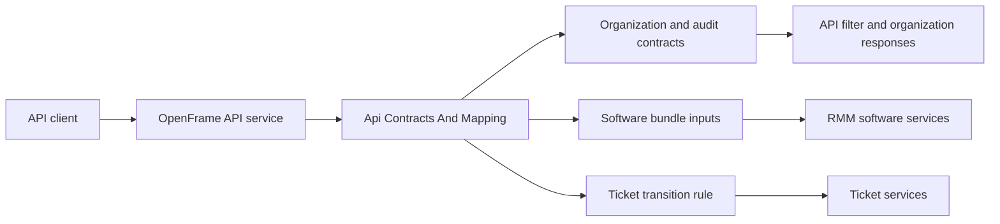
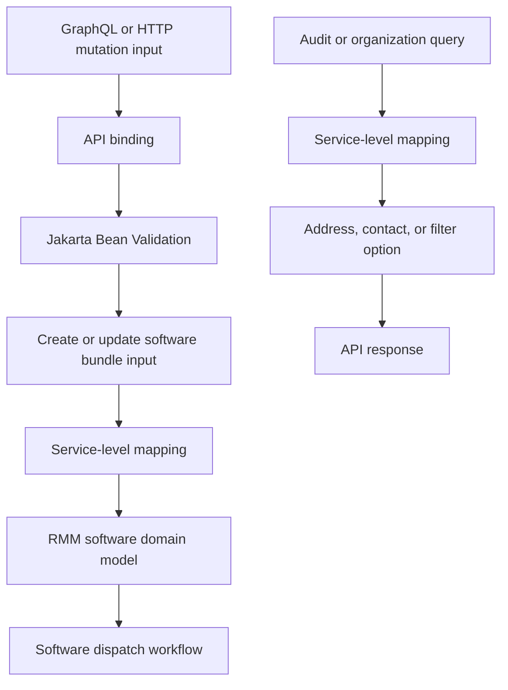

# Api Contracts And Mapping

Api Contracts And Mapping defines small, shared Java data-transfer contracts in the `openframe-api-lib` library. These types carry organization, audit-filter, remote-management software-bundle, and ticket-status data across the API boundary without implementing persistence, routing, or business workflows themselves.

The tenant service consumes `com.openframe.oss:openframe-api-lib` version `7.0.11`. The source for these contracts is maintained in the OpenFrame OSS Library; this repository assembles that library into the OpenFrame API service.

## Purpose

The module provides:

- **Organization presentation contracts** for addresses, contact people, and organization choices in audit-log filters.
- **Software-bundle mutation inputs** for creating and updating RMM software work across a non-empty set of target machines.
- **Ticket workflow contract data** that states the permitted destination statuses for a given source status.
- **Boundary validation** on software-bundle mutations before downstream dispatch logic receives a request.

## Architecture Overview

The contracts deliberately sit at the boundary between callers and backend services. The API service is responsible for binding and validating input; service modules use the resulting values to execute domain behavior. The contracts depend on domain types for software actions, software-bundle modes, and ticket status definitions, preserving a shared vocabulary rather than duplicating enum-like values.

## Contract Groups and Detailed Documentation

| Group | Responsibility | Detailed documentation |
|---|---|---|
| Organization Contracts | Models a postal address and contact person, plus a minimal `id` and `name` option for audit-log organization filters. | [Organization Contracts](api-contracts-and-mapping/organization_contracts/organization_contracts.md) |
| Software Bundle Inputs | Defines create and update payloads for targeted software-bundle actions, including Bean Validation constraints. | [Software Bundle Inputs](api-contracts-and-mapping/software_bundle_inputs/software_bundle_inputs.md) |
| Ticket Transition Contract | Represents a source ticket status and its allowable destination statuses. | [Ticket Transition Contract](api-contracts-and-mapping/ticket_transition_contract/ticket_transition_contract.md) |

## Contract Mapping Boundaries

The supplied types are contract and mapping inputs or outputs, not database documents. In particular, `AddressDto` and `ContactPersonDto` are immutable Java records, while the mutable Lombok-backed classes support framework data binding and builders where required.

## Cross-Module Placement

- **Api Service Backend** uses the software and ticket domains that receive these contracts after API-layer mapping and validation.
- **Api Service Config Controllers** exposes API endpoints and GraphQL configuration that bind or return shared API contracts.
- **Api Service Fetchers** resolves query-side data and maps it into API-facing shapes.
- **Data Mongo Common** supplies the domain values referenced by `SoftwareAction`, `SoftwareBundleMode`, and `TicketStatusDefinition`.

These modules are listed in the repository module tree but are documented separately; this document focuses exclusively on the shared contract surface.

## Compatibility and Maintenance Notes

- Treat field names and record component names as API schema: changing them can affect serialized payloads and generated GraphQL bindings.
- Preserve validation rules on bundle mutations. The target machine identifier expression intentionally permits only letters, digits, underscores, and hyphens, which keeps identifiers safe for message-subject use.
- Creation accepts an action, whereas update identifies the existing bundle and changes its mode, targets, package list, or scheduled start time.
- `TicketStatusTransitionRule` carries a one-to-many rule only; enforcement of transition semantics belongs to ticket workflow services.
- Add new contracts in the source library alongside the relevant domain package, then update service-level mapping and schema exposure together.

## Source Files

The implementations are in the OpenFrame OSS Library:

- [OrganizationFilterOption.java](https://github.com/flamingo-stack/openframe-oss-lib/blob/7a766f00e4f58b5d89db007b878ac8d6e0c344f4/openframe-api-lib/src/main/java/com/openframe/api/dto/audit/OrganizationFilterOption.java)
- [AddressDto.java](https://github.com/flamingo-stack/openframe-oss-lib/blob/7a766f00e4f58b5d89db007b878ac8d6e0c344f4/openframe-api-lib/src/main/java/com/openframe/api/dto/organization/AddressDto.java)
- [ContactPersonDto.java](https://github.com/flamingo-stack/openframe-oss-lib/blob/7a766f00e4f58b5d89db007b878ac8d6e0c344f4/openframe-api-lib/src/main/java/com/openframe/api/dto/organization/ContactPersonDto.java)
- [CreateSoftwareBundleInput.java](https://github.com/flamingo-stack/openframe-oss-lib/blob/7a766f00e4f58b5d89db007b878ac8d6e0c344f4/openframe-api-lib/src/main/java/com/openframe/api/dto/rmm/software/CreateSoftwareBundleInput.java)
- [UpdateSoftwareBundleInput.java](https://github.com/flamingo-stack/openframe-oss-lib/blob/7a766f00e4f58b5d89db007b878ac8d6e0c344f4/openframe-api-lib/src/main/java/com/openframe/api/dto/rmm/software/UpdateSoftwareBundleInput.java)
- [TicketStatusTransitionRule.java](https://github.com/flamingo-stack/openframe-oss-lib/blob/7a766f00e4f58b5d89db007b878ac8d6e0c344f4/openframe-api-lib/src/main/java/com/openframe/api/dto/ticket/TicketStatusTransitionRule.java)
