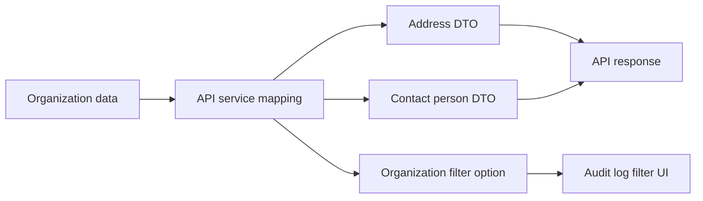

# Organization Contracts

Organization Contracts contains the API-facing types that present organization identity and contact details. The types originate in the `openframe-api-lib` library and keep API payloads independent of Mongo document implementations.

## Components

| Component | Role | Fields |
|---|---|---|
| `OrganizationFilterOption` | Minimal audit-log filter choice for an organization selector. | `id`, `name` |
| `AddressDto` | Immutable postal-address value. | `street1`, `street2`, `city`, `state`, `postalCode`, `country` |
| `ContactPersonDto` | Immutable organization contact value. | `contactName`, `title`, `phone`, `email` |

`OrganizationFilterOption` is a Lombok data class with a builder and both no-argument and all-argument constructors. This supports conventional object binding while retaining a concise `id` and display `name` representation. `AddressDto` and `ContactPersonDto` are Java records with Lombok builders, which makes their values immutable after construction.

## Data Flow

## Design Considerations

- Use the filter option only when an organization identifier and human-readable label are sufficient; it is not an organization aggregate.
- Preserve the record component names when evolving address or contact output because serialization uses those names.
- Validation is not defined on these DTOs. Validation and normalization policy belongs to the caller or the service mapping these values.

## Source

- [OrganizationFilterOption.java](https://github.com/flamingo-stack/openframe-oss-lib/blob/7a766f00e4f58b5d89db007b878ac8d6e0c344f4/openframe-api-lib/src/main/java/com/openframe/api/dto/audit/OrganizationFilterOption.java)
- [AddressDto.java](https://github.com/flamingo-stack/openframe-oss-lib/blob/7a766f00e4f58b5d89db007b878ac8d6e0c344f4/openframe-api-lib/src/main/java/com/openframe/api/dto/organization/AddressDto.java)
- [ContactPersonDto.java](https://github.com/flamingo-stack/openframe-oss-lib/blob/7a766f00e4f58b5d89db007b878ac8d6e0c344f4/openframe-api-lib/src/main/java/com/openframe/api/dto/organization/ContactPersonDto.java)
