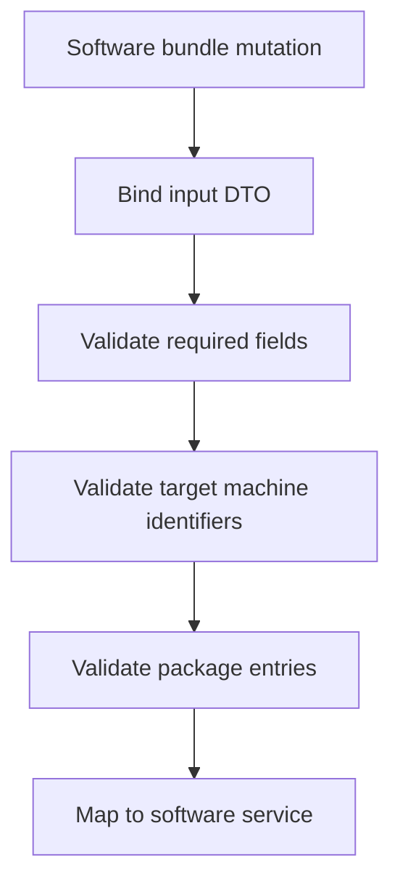

# Software Bundle Inputs

Software Bundle Inputs defines mutable request contracts for RMM software-bundle creation and update. The API binds these DTOs, validates their annotations, and maps valid input to the downstream software-bundle workflow.

## Components

| Component | Required fields | Optional fields | Purpose |
|---|---|---|---|
| `CreateSoftwareBundleInput` | `action`, `mode`, non-empty `machineIds` | `packages`, `startAt` | Requests a new software-bundle action for target machines. |
| `UpdateSoftwareBundleInput` | non-blank `id`, `mode`, non-empty `machineIds` | `packages`, `startAt` | Changes an identified software bundle. |

Both inputs reference shared domain types:

- `SoftwareAction` identifies the requested bundle action on create.
- `SoftwareBundleMode` defines the applicable bundle mode.
- `SoftwarePackageInput` supplies package-level configuration and is validated recursively when entries are present.
- `Instant` expresses an optional scheduled start time.

## Validation Contract

The `machineIds` list must not be empty. Every member must match `^[A-Za-z0-9_-]+$`, permitting only a single token made of letters, digits, underscores, and hyphens. This restriction prevents whitespace and delimiter characters from entering downstream subject-oriented targeting.

`packages` is optional, but `@Valid` causes each supplied package input to be validated according to its own constraints. The contract does not define an ordering or deduplication policy for package entries; that behavior is owned by the receiving service.

## Create and Update Semantics

Creation requires `action` because it establishes what the new bundle should do. Updating instead requires `id` to select an existing bundle and does not expose `action` in this input. Both operations require a mode and targets, and can change or provide package configuration and a scheduled start instant.

## Source

- [CreateSoftwareBundleInput.java](https://github.com/flamingo-stack/openframe-oss-lib/blob/7a766f00e4f58b5d89db007b878ac8d6e0c344f4/openframe-api-lib/src/main/java/com/openframe/api/dto/rmm/software/CreateSoftwareBundleInput.java)
- [UpdateSoftwareBundleInput.java](https://github.com/flamingo-stack/openframe-oss-lib/blob/7a766f00e4f58b5d89db007b878ac8d6e0c344f4/openframe-api-lib/src/main/java/com/openframe/api/dto/rmm/software/UpdateSoftwareBundleInput.java)
