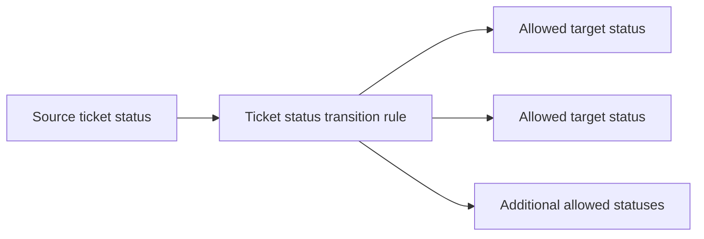

# Ticket Transition Contract

Ticket Transition Contract exposes a compact description of an allowed ticket-status transition. It is a shared API DTO from `openframe-api-lib`; the ticket workflow uses it to communicate rules rather than to perform the transition itself.

## Component

`TicketStatusTransitionRule` contains:

| Field | Type | Meaning |
|---|---|---|
| `from` | `TicketStatusDefinition` | The source status to which this rule applies. |
| `to` | `List<TicketStatusDefinition>` | The permitted destination statuses from that source. |

The type is a Lombok data class with a builder plus no-argument and all-argument constructors. This makes it suitable for API serialization and conventional object binding.

## Rule Representation

The DTO represents a one-to-many relationship. It neither guarantees that `from` or `to` is populated nor validates business invariants itself; callers and ticket services are responsible for creating valid rule sets and enforcing a selected transition.

## Source

- [TicketStatusTransitionRule.java](https://github.com/flamingo-stack/openframe-oss-lib/blob/7a766f00e4f58b5d89db007b878ac8d6e0c344f4/openframe-api-lib/src/main/java/com/openframe/api/dto/ticket/TicketStatusTransitionRule.java)
