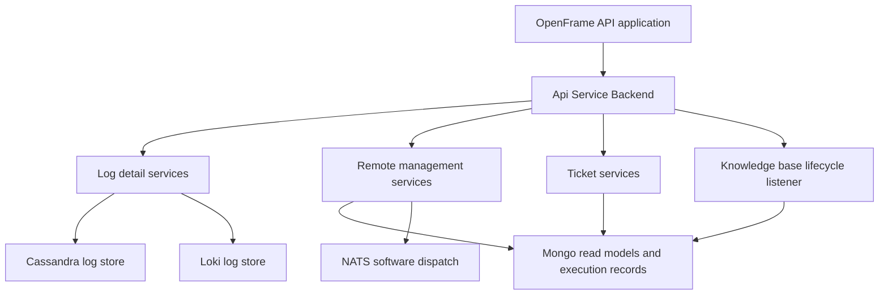
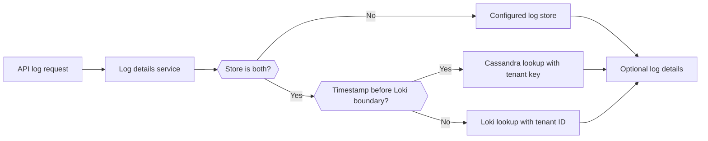
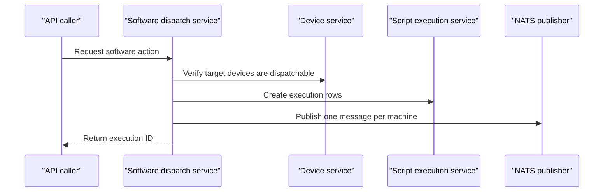

# Api Service Backend

Api Service Backend supplies reusable application services for the OpenFrame API. It is implemented by the `com.openframe.oss:openframe-api-lib` dependency at version `7.0.11`, while this repository assembles it into the `openframe-api` service. The module concentrates domain operations that sit behind API transport code: tenant-scoped log retrieval, device-log argument preparation, remote-management execution and software read models, knowledge-base publication metadata, and ticket workflows.

The implementation is supplied by [OpenFrame OSS Library](https://github.com/flamingo-stack/openframe-oss-lib) rather than being defined in this repository. The application entry point that assembles these Spring components is `ApiApplication` in this repository's `openframe-api` service.

## Responsibilities

- Select and query the configured audit-log store without losing tenant isolation.
- Validate and normalize device-log query arguments before a backend query is admitted.
- Create durable execution rows before remote commands or software actions are dispatched.
- Build software and vulnerability responses from tenant read models and package-catalog data.
- Apply ticket conventions for filtering, numbering, activity, staleness, statistics, resolution attribution, and transition history.
- Preserve the first publication timestamp of a knowledge-base article.

## Architecture

The API application's routing and GraphQL data fetchers live in separate service-core modules. This module provides the domain-facing services that those layers can call; it does not define HTTP or GraphQL endpoints itself.

## Detailed Component Documentation

- [Log Retrieval](api_service_backend/log_retrieval/log_retrieval.md) documents Cassandra, Loki, and dual-store log-detail selection.
- [Remote Management](api_service_backend/remote_management/remote_management.md) documents command execution, software inventory, catalog status, dispatch, and vulnerability queries.
- [Ticket Workflows](api_service_backend/ticket_workflows/ticket_workflows.md) documents ticket filtering, lifecycle support, statistics, and history.

## Runtime Boundaries

All persistence-facing services obtain tenant context through the platform tenant provider or use tenant-aware repositories. In particular, log lookup includes the active tenant in Cassandra keys and Loki queries, software and vulnerability queries accept a tenant identifier, and command execution rows are created with the active tenant identifier.

Feature-gated components activate only when their configuration allows them:

- Cassandra and Loki log detail services are conditional on the selected tool-event store; the combined implementation is primary when the store is `both`.
- Software catalog, auto-update, and dispatch services require remote-management software support. Dispatch additionally requires Spring Cloud Stream support.
- Device status processing provides a default extension point only when no custom processor is registered.

## Component Areas

### Log Retrieval and Device Log Arguments

The log-detail services share the `LogDetailsService` role. `BothStoresLogDetailsService` selects Cassandra before the configured Loki migration boundary and Loki from that boundary onward. The backing services construct tenant-aware lookups and map stored events into API log details.

`DeviceLogArgumentContract` is a pure admission and preparation layer for device-log queries. It enforces ID, text-term, time-window, epoch-nanosecond, and cursor rules; applies context-dependent default lookback windows; and creates a `PreparedQuery` containing normalized IDs and nanosecond bounds.

### Remote Management

Remote-management services handle commands, scripts, software inventory, package status, dispatch, and vulnerabilities. `CommandExecutionService` persists one `RUNNING` execution row per requested machine before results arrive. Script validators constrain elevated-user execution to Windows-only scripts and reject invalid or excessive timeouts.

The software read-model queries compose device, software, vulnerability, and machine repositories into API responses. Catalog status enriches installed software with match, latest-version, version-state, and auto-update information. Software dispatch first verifies that targets are dispatchable, persists the batch through the script-execution service, then publishes one NATS message per machine.

### Ticket Workflows

Ticket services keep operational state consistent around list filtering, numbers, activity, staleness, statistics, resolver attribution, and status history. They deliberately make certain auxiliary writes non-fatal: activity and status-history persistence failures are logged without breaking the primary ticket operation.

### Knowledge Base and Device Status Extensions

The knowledge-base Mongo lifecycle listener records `publishedAt` only when an item first becomes published, preserving that original publication moment across later state changes. The default device-status processor logs status changes and remains replaceable through the `DeviceStatusProcessor` extension point.

## Key Flows

### Log Detail Lookup

### Software Action Dispatch

## Source Components

The following source files implement the core behaviors documented here:

- [Log store selection](https://github.com/flamingo-stack/openframe-oss-lib/blob/7a766f00e4f58b5d89db007b878ac8d6e0c344f4/openframe-api-lib/src/main/java/com/openframe/api/service/BothStoresLogDetailsService.java), [Cassandra lookup](https://github.com/flamingo-stack/openframe-oss-lib/blob/7a766f00e4f58b5d89db007b878ac8d6e0c344f4/openframe-api-lib/src/main/java/com/openframe/api/service/CassandraLogDetailsService.java), and [Loki lookup](https://github.com/flamingo-stack/openframe-oss-lib/blob/7a766f00e4f58b5d89db007b878ac8d6e0c344f4/openframe-api-lib/src/main/java/com/openframe/api/service/LokiLogDetailsService.java).
- [Device log query contract](https://github.com/flamingo-stack/openframe-oss-lib/blob/7a766f00e4f58b5d89db007b878ac8d6e0c344f4/openframe-api-lib/src/main/java/com/openframe/api/service/device/DeviceLogArgumentContract.java) and [arguments](https://github.com/flamingo-stack/openframe-oss-lib/blob/7a766f00e4f58b5d89db007b878ac8d6e0c344f4/openframe-api-lib/src/main/java/com/openframe/api/service/device/DeviceLogQueryArguments.java).
- [Command execution service](https://github.com/flamingo-stack/openframe-oss-lib/blob/7a766f00e4f58b5d89db007b878ac8d6e0c344f4/openframe-api-lib/src/main/java/com/openframe/api/service/rmm/command/CommandExecutionService.java), [software dispatch service](https://github.com/flamingo-stack/openframe-oss-lib/blob/7a766f00e4f58b5d89db007b878ac8d6e0c344f4/openframe-api-lib/src/main/java/com/openframe/api/service/rmm/software/SoftwareDispatchService.java), and [software catalog status](https://github.com/flamingo-stack/openframe-oss-lib/blob/7a766f00e4f58b5d89db007b878ac8d6e0c344f4/openframe-api-lib/src/main/java/com/openframe/api/service/rmm/software/SoftwareCatalogStatus.java).
- [Ticket query service](https://github.com/flamingo-stack/openframe-oss-lib/blob/7a766f00e4f58b5d89db007b878ac8d6e0c344f4/openframe-api-lib/src/main/java/com/openframe/api/service/TicketQueryService.java), [ticket activity service](https://github.com/flamingo-stack/openframe-oss-lib/blob/7a766f00e4f58b5d89db007b878ac8d6e0c344f4/openframe-api-lib/src/main/java/com/openframe/api/service/ticket/TicketActivityService.java), and [ticket status history service](https://github.com/flamingo-stack/openframe-oss-lib/blob/7a766f00e4f58b5d89db007b878ac8d6e0c344f4/openframe-api-lib/src/main/java/com/openframe/api/service/ticket/TicketStatusHistoryService.java).
