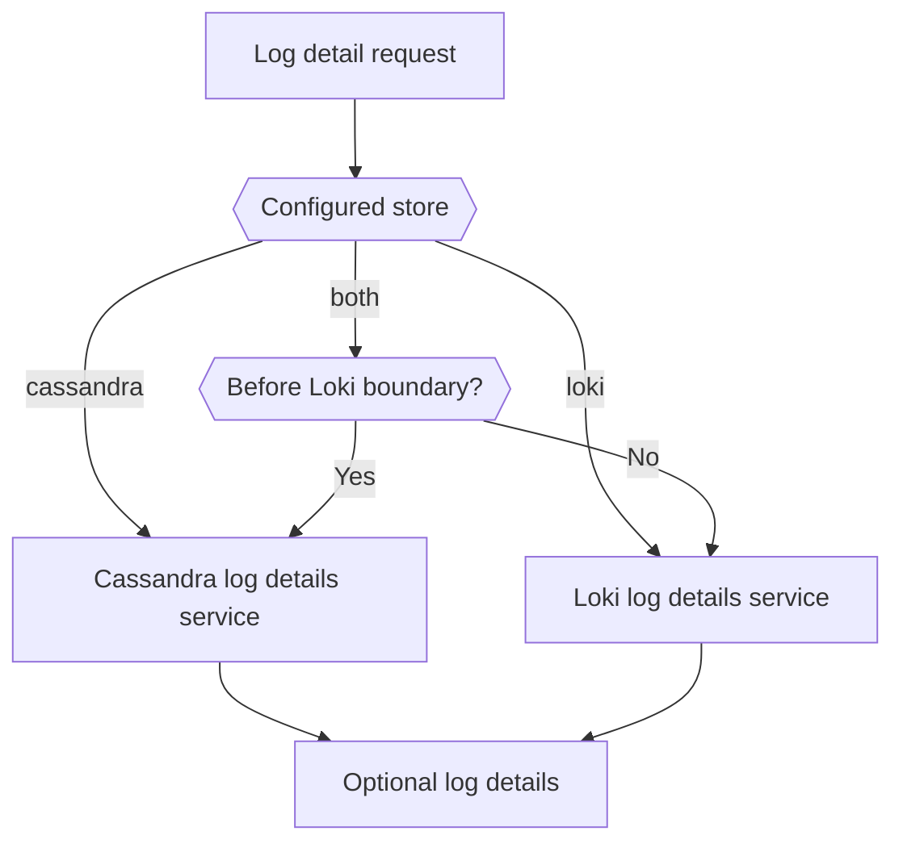

# Log Retrieval

## Purpose

Log Retrieval resolves a single tool-event detail record from the configured audit storage backend while preserving tenant isolation. The implementation is supplied by `com.openframe.oss:openframe-api-lib`.

## Components

- `CassandraLogDetailsService` creates a Cassandra composite key from ingest day, tool type, tenant ID, event type, timestamp, and tool-event ID. It maps a found event through `LogDetailsMapper` and otherwise returns an empty result.
- `LokiLogDetailsService` looks up an event using tenant ID, tool type, timestamp, and tool-event ID, then maps a match to API log details.
- `BothStoresLogDetailsService` is the primary implementation when `openframe.tool-events.store` is `both`. It chooses Cassandra for timestamps before `openframe.tool-events.loki-since` and Loki for later timestamps.

## Store Selection

## Operational Notes

The migration boundary is timestamp-based, not a fallback mechanism: in dual-store mode a request is directed to exactly one store. A missing Loki event is logged as a warning; a missing Cassandra event is logged at debug level. Both lookups return an optional value, allowing transport-layer code to express absence without inventing a record.

## Source

- [BothStoresLogDetailsService](https://github.com/flamingo-stack/openframe-oss-lib/blob/7a766f00e4f58b5d89db007b878ac8d6e0c344f4/openframe-api-lib/src/main/java/com/openframe/api/service/BothStoresLogDetailsService.java)
- [CassandraLogDetailsService](https://github.com/flamingo-stack/openframe-oss-lib/blob/7a766f00e4f58b5d89db007b878ac8d6e0c344f4/openframe-api-lib/src/main/java/com/openframe/api/service/CassandraLogDetailsService.java)
- [LokiLogDetailsService](https://github.com/flamingo-stack/openframe-oss-lib/blob/7a766f00e4f58b5d89db007b878ac8d6e0c344f4/openframe-api-lib/src/main/java/com/openframe/api/service/LokiLogDetailsService.java)
