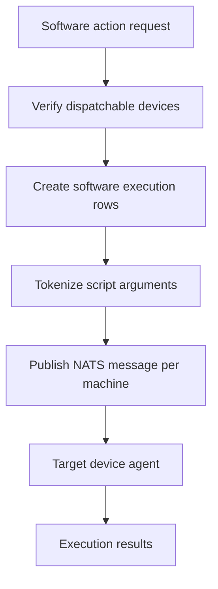

# Remote Management

## Purpose

Remote Management provides validation, execution persistence, software inventory enrichment, software dispatch, and vulnerability read-model queries for the API layer. The services are activated conditionally where software remote-management support is enabled.

## Execution and Validation

`CommandExecutionService` creates one tenant-scoped `RUNNING` command-execution record for every target machine under a shared execution ID. Results can subsequently be read by execution ID and machine ID. `ScriptPrivilegeValidator` permits `ELEVATED_USER` only when the supported platform list is exactly Windows. `ScriptTimeoutValidator` accepts absent values, rejects non-positive values, and enforces the configured maximum.

## Software Read Models and Dispatch

`DeviceSoftwareReadModelQuery` projects installed, connected device software into API rows. `TenantSoftwareReadModelQuery` lists tenant titles, per-title vulnerabilities, and affected devices with pagination and supported sort mappings. `SoftwareCatalogStatus` enriches rows using package matching and catalog data, deriving latest version, version state, manageable source, and a default auto-update state when policy state is absent.

`SoftwareAutoUpdateService` derives a row's auto-update state from relevant policies and withdraws work after a policy is turned off. `PackageUpdateSettingsMapper` only permits package update settings for update actions and supplies defaults for omitted update settings.

`SoftwareDispatchService` verifies target devices, persists script execution rows, tokenizes script arguments, and emits one software message per machine through NATS.

## Vulnerability Queries

`DeviceVulnerabilityReadModelQuery` derives a device's CVEs from its device-software rows, then loads tenant vulnerability aggregates. It also correlates affected software to connected installed titles and retains OS-level CVEs that have no software title. `TenantCveReadModelQuery` pages tenant CVEs, resolves a single CVE with affected software, and pages machines associated with a CVE through the aggregation repository.

## Source

- [CommandExecutionService](https://github.com/flamingo-stack/openframe-oss-lib/blob/7a766f00e4f58b5d89db007b878ac8d6e0c344f4/openframe-api-lib/src/main/java/com/openframe/api/service/rmm/command/CommandExecutionService.java)
- [SoftwareDispatchService](https://github.com/flamingo-stack/openframe-oss-lib/blob/7a766f00e4f58b5d89db007b878ac8d6e0c344f4/openframe-api-lib/src/main/java/com/openframe/api/service/rmm/software/SoftwareDispatchService.java)
- [TenantSoftwareReadModelQuery](https://github.com/flamingo-stack/openframe-oss-lib/blob/7a766f00e4f58b5d89db007b878ac8d6e0c344f4/openframe-api-lib/src/main/java/com/openframe/api/service/rmm/software/TenantSoftwareReadModelQuery.java)
- [DeviceVulnerabilityReadModelQuery](https://github.com/flamingo-stack/openframe-oss-lib/blob/7a766f00e4f58b5d89db007b878ac8d6e0c344f4/openframe-api-lib/src/main/java/com/openframe/api/service/rmm/vulnerability/DeviceVulnerabilityReadModelQuery.java)
