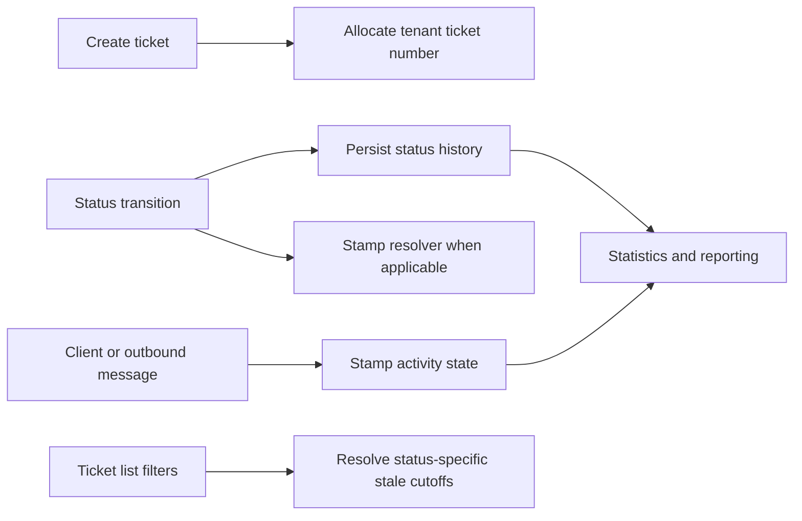

# Ticket Workflows

## Purpose

Ticket Workflows contains application services that support ticket discovery, filtering, numbering, activity tracking, staleness calculation, reporting, resolver attribution, and transition history. Most reads and writes are delegated to tenant-aware Mongo repositories.

## Querying and Filtering

`TicketQueryService` builds a repository query from a ticket filter and search text, then uses a stable cursor order of creation time descending and ID descending. `TicketFilterService` requires administrator access and concurrently loads status, organization, assignee, and tag options. `TicketIdsForFilter` resolves tag and unread restrictions; it preserves the distinction between no restriction and an empty matching set.

## Lifecycle State

`TicketNumberService` obtains sequential numbers from the `ticket_number` sequence. `TicketActivityService` records general activity and whether a ticket awaits client response. It logs and suppresses persistence failures to avoid breaking the primary caller.

`TicketStalenessResolver` produces cutoffs for active or stale filtering from each status definition, falling back to `openframe.tickets.staleness.default-minutes`, which defaults to 30 minutes. `TicketStatisticsService` requires administrator access and reports per-status totals, a legacy status aggregation, formatted average resolution time, and an optional rating-provider average.

`TicketResolverStamp` attributes an AI-agent resolution to the end user and attributes all other resolutions to a technician. `TicketStatusHistoryMapper` snapshots status names and kinds with actor information, while `TicketStatusHistoryService` records the transition but never allows a history-write failure to abort the transition. `TicketUserNames` centralizes display and profile-name fallbacks.

## Source

- [TicketQueryService](https://github.com/flamingo-stack/openframe-oss-lib/blob/7a766f00e4f58b5d89db007b878ac8d6e0c344f4/openframe-api-lib/src/main/java/com/openframe/api/service/TicketQueryService.java)
- [TicketFilterService](https://github.com/flamingo-stack/openframe-oss-lib/blob/7a766f00e4f58b5d89db007b878ac8d6e0c344f4/openframe-api-lib/src/main/java/com/openframe/api/service/ticket/TicketFilterService.java)
- [TicketStalenessResolver](https://github.com/flamingo-stack/openframe-oss-lib/blob/7a766f00e4f58b5d89db007b878ac8d6e0c344f4/openframe-api-lib/src/main/java/com/openframe/api/service/ticket/TicketStalenessResolver.java)
- [TicketStatusHistoryService](https://github.com/flamingo-stack/openframe-oss-lib/blob/7a766f00e4f58b5d89db007b878ac8d6e0c344f4/openframe-api-lib/src/main/java/com/openframe/api/service/ticket/TicketStatusHistoryService.java)
