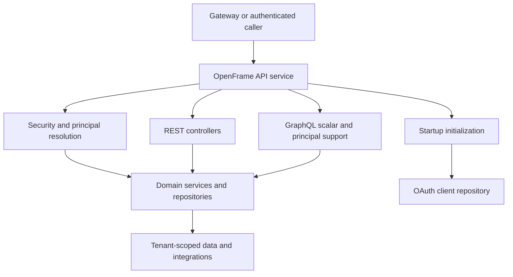

# Api Service Config Controllers

Api Service Config Controllers is the REST, GraphQL-support, and application-wiring layer supplied by the `com.openframe.oss:openframe-api-service-core` library and assembled by the tenant repository’s OpenFrame API service. It configures authentication and serialization, initializes the default OAuth client at startup, and exposes operational, tenant-management, agent-management, and knowledge-base image endpoints.

The tenant application starts Spring Boot and component-scans the `com.openframe.api`, data, core, notification, and Kafka packages. The module implementation comes from the [OpenFrame OSS Library](https://github.com/flamingo-stack/openframe-oss-lib/blob/7a766f00e4f58b5d89db007b878ac8d6e0c344f4/openframe-api-service-core/src/main/java/com/openframe/api/config/ApiApplicationConfig.java); the application that runs it is in this repository.

## Architecture Overview

## Responsibilities

- **Application wiring:** provides a BCrypt password encoder, a `RestTemplate`, gateway-auth security imports, MVC authentication-principal resolution, and bootstrap logic for the configured default OAuth client.
- **GraphQL interoperability:** registers Date, Instant, JSON, and Long scalars and resolves `AuthPrincipal` parameters for DGS data fetchers. JSON values are accepted through variables rather than inline GraphQL literals.
- **REST management surface:** supplies controllers for API keys, organizations, users, invitations, SSO configuration, agent registration/logging configuration, device status, release metadata, current-user inspection, and a health probe.
- **Agent and content operations:** provides forced agent and integrated-tool actions, client-configuration retrieval, and conditional direct-to-storage knowledge-base image upload and download redirects.

## Runtime Boundaries

The API service is reached through the gateway route for `/api/**`. Authentication behavior is imported from `GatewayAuthSecurityConfig`; REST handlers receive an `AuthPrincipal` through the MVC resolver, while DGS fetchers use a separate resolver because they do not execute through the MVC argument-resolution path. Domain authorization and business rules remain in the injected services rather than in controllers.

At startup, `DataInitializer` reads `oauth.client.default.id` and `oauth.client.default.secret`. It updates an existing OAuth client secret when it differs, or creates the client with `password` and `refresh_token` grant types and `read` and `write` scopes. The initializer logs the client identifier and secret length, not the secret value.

## Endpoint Families

| Family | Base path | Behavior |
|---|---|---|
| Health | `/health` | Returns `OK` for a simple service probe. |
| Current identity | `/me` | Returns authenticated identity attributes and super-user status; returns 401 when no principal is available. |
| API keys | `/api-keys` | Lists, creates, reads, updates, deletes, and regenerates keys in the authenticated user context. |
| Organizations | `/organizations` | Creates and updates organizations, checks whether an organization can be archived, and changes status. Unknown organization identifiers are translated to a not-found response before commands run. |
| Users and invitations | `/users`, `/invitations` | Supports user administration, ownership transfer, invitation creation, pagination, revocation, and renewal. Ownership transfer requires the `OWNER` authority. |
| SSO | `/sso` | Lists enabled and available providers, manages a provider configuration, and toggles or deletes configurations. |
| Agent configuration | `/agent/log-key`, `/agent/registration-secret`, `/openframe-client/configuration`, `/release-version` | Retrieves agent logging, registration, client configuration, and release-version data. |
| Device and forced actions | `/devices`, `/force` | Updates device status and requests client or tool installation, update, reinstall, uninstall, or feature-flag actions. |
| Knowledge-base images | `/knowledge-base/images` | When storage is enabled, creates direct upload instructions and redirects permanent image URLs to short-lived download URLs. |

## Design Notes for Maintainers

- Controllers validate request bodies where their request types declare validation constraints, then delegate to services. Preserve this separation when adding routes.
- API-key methods always pass the authenticated user identifier to the service, constraining key operations to the caller’s ownership context.
- The image controller is conditional on `storage.s3.disabled=false`. Its permanent application URL is distinct from the signed storage URL returned for upload or used for redirect.
- The custom Long scalar accepts Java numeric values and numeric strings, including values larger than GraphQL’s built-in integer range. Date inputs require `yyyy-MM-dd`; Instant inputs require an ISO-8601 instant parseable by `Instant.parse`.

## Detailed Components

- [Api Service Configuration](api_service_config_controllers/configuration/configuration.md) documents Spring beans, startup OAuth-client reconciliation, GraphQL scalars, and REST/DGS authentication-principal resolution.
- [Api Service REST Controllers](api_service_config_controllers/controllers/controllers.md) documents the HTTP endpoint families, delegation boundaries, response semantics, and knowledge-base image flow.
