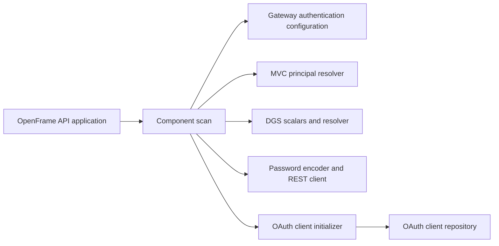
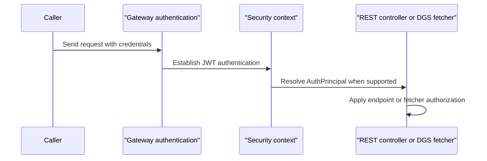

# Api Service Configuration

Api Service Configuration contains the Spring and DGS integration points that make the OpenFrame API service executable. These classes are implemented by the OpenFrame OSS Library artifact `com.openframe.oss:openframe-api-service-core` and discovered by the API application’s component scan.

## Configuration Assembly

## Spring Beans and Startup Processing

| Component | Responsibility |
|---|---|
| `ApiApplicationConfig` | Registers a BCrypt `PasswordEncoder` for services that require password hashing or comparison. |
| `RestTemplateConfig` | Registers a default `RestTemplate` bean for synchronous HTTP calls. It adds no custom transport, timeout, or interceptor behavior. |
| `SecurityConfig` | Imports `GatewayAuthSecurityConfig`, delegating the API service’s gateway-aware security policy to the security integration. |
| `AuthenticationConfig` | Adds `AuthPrincipalArgumentResolver` to Spring MVC so controller parameters annotated with `@AuthenticationPrincipal` can receive an OpenFrame `AuthPrincipal`. |
| `DataInitializer` | Registers a command-line runner that reconciles the configured default OAuth client in the OAuth client repository. |

`DataInitializer` reads `oauth.client.default.id` and `oauth.client.default.secret` from the Spring environment. On each start, it finds the client by identifier. If present with a different secret, it updates the stored secret. If absent, it creates a client with the `password` and `refresh_token` grants plus `read` and `write` scopes. Deployment configuration must therefore supply both properties consistently; changing the secret intentionally causes the stored value to be reconciled at the next start.

## GraphQL Integration

| Component | GraphQL name | Accepted input | Serialized output |
|---|---|---|---|
| `DateScalarConfig` | `Date` | A string matching `yyyy-MM-dd` | A `LocalDate` formatted as `yyyy-MM-dd` |
| `InstantScalarConfig` | `Instant` | A string accepted by `Instant.parse` | The `Instant` textual form |
| `JsonScalarConfig` | `JSON` | A runtime value, typically supplied as a variable | The unmodified runtime value |
| `LongScalarConfig` | `Long` | Numeric values or numeric strings | A 64-bit integer |

The Date and Instant scalars reject non-string literals and malformed values with coercion errors. The JSON scalar deliberately rejects inline GraphQL literals, so consumers must pass JSON arguments through variables. The Long scalar supports integer or string literals and prevents the built-in GraphQL integer range from limiting values such as byte counts.

`DgsAuthPrincipalArgumentResolver` is the equivalent of MVC principal resolution for DGS data fetchers. It supports parameters that both carry `@AuthenticationPrincipal` and are assignable to `AuthPrincipal`. When the Spring security context holds a JWT authentication token, it converts that JWT to an `AuthPrincipal`; otherwise it resolves `null`. Fetchers using this capability must handle unauthenticated access explicitly where their route may permit it.

## Request Authentication Flow

## Implementation Sources

- [ApiApplicationConfig](https://github.com/flamingo-stack/openframe-oss-lib/blob/7a766f00e4f58b5d89db007b878ac8d6e0c344f4/openframe-api-service-core/src/main/java/com/openframe/api/config/ApiApplicationConfig.java)
- [DataInitializer](https://github.com/flamingo-stack/openframe-oss-lib/blob/7a766f00e4f58b5d89db007b878ac8d6e0c344f4/openframe-api-service-core/src/main/java/com/openframe/api/config/DataInitializer.java)
- [DgsAuthPrincipalArgumentResolver](https://github.com/flamingo-stack/openframe-oss-lib/blob/7a766f00e4f58b5d89db007b878ac8d6e0c344f4/openframe-api-service-core/src/main/java/com/openframe/api/config/DgsAuthPrincipalArgumentResolver.java)
