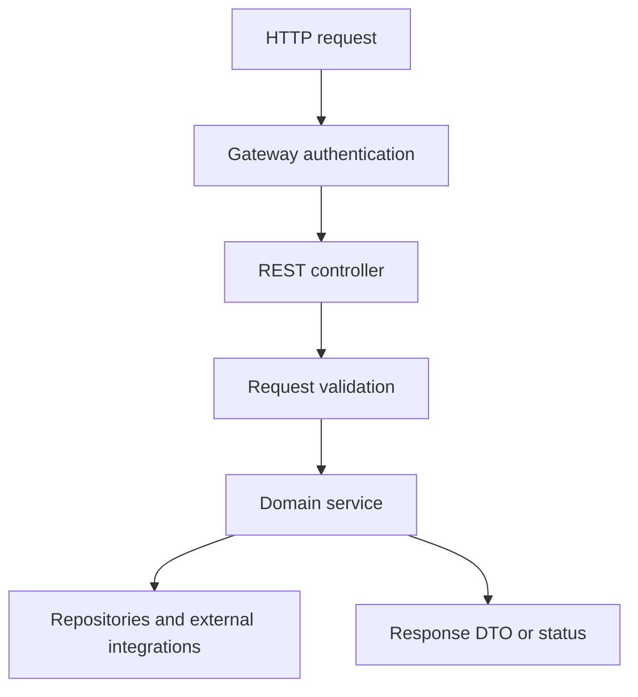

# Api Service REST Controllers

Api Service REST Controllers exposes the HTTP management endpoints implemented by the OpenFrame OSS Library’s `openframe-api-service-core` artifact. The controllers are intentionally thin: they bind and validate HTTP input, obtain the authenticated principal where required, select HTTP status codes, and delegate business decisions to domain services.

## Controller Map

## Identity, Access, and Service Health

| Controller | Routes | Responsibilities |
|---|---|---|
| `HealthController` | `GET /health` | Emits an `OK` response for a lightweight application health probe. |
| `MeController` | `GET /me` | Returns the authenticated user’s id, email, display name, roles, tenant id, and super-user evaluation. A missing principal receives a 401 response. |
| `ApiKeyController` | `/api-keys` | Lists and creates caller-owned keys; reads, updates, deletes, and regenerates a key by identifier. Each operation passes the authenticated principal id to `ApiKeyService`. |
| `SSOConfigController` | `/sso` | Lists enabled providers and available provider strategies, reads or writes a provider configuration, toggles its enabled state, and deletes it. |

The MVC configuration supplies `AuthPrincipal` to handlers annotated with `@AuthenticationPrincipal`. This creates a consistent identity object for routes such as `/me`, API-key operations, deletion of a user, and ownership transfer.

## Tenant and User Administration

| Controller | Routes | Responsibilities |
|---|---|---|
| `OrganizationController` | `/organizations` | Creates and updates organizations, evaluates archive eligibility, and changes the organization status. It verifies the organization exists before operations that target an identifier, returning a not-found error when it does not. Archive rejection due to active devices is delegated to domain logic. |
| `UserController` | `/users` | Lists users with page and size parameters, gets or updates a user, soft-deletes a user while recording the acting principal, and transfers ownership. The transfer route requires `OWNER` authority. |
| `InvitationController` | `/invitations` | Creates invitations, lists paginated invitations, revokes an invitation, and renews an invitation for resend. |

## Agent, Device, and Release Operations

| Controller | Routes | Responsibilities |
|---|---|---|
| `AgentLogKeyController` | `GET /agent/log-key` | Returns the agent log key obtained from `AgentLogKeyService`. |
| `AgentRegistrationSecretController` | `/agent/registration-secret` | Retrieves the active or complete registration-secret set and creates a new registration secret. Secret creation returns 201. |
| `OpenFrameClientConfigurationController` | `GET /openframe-client/configuration` | Returns the current client configuration from the query service. |
| `ReleaseVersionController` | `GET /release-version` | Returns the current release version when available or 404 when no release version is configured. |
| `DeviceController` | `PATCH /devices/{machineId}` | Validates and delegates an internal device-status update, returning 204. |
| `ForceAgentController` | `/force` | Delegates targeted and all-device client or tool installation, update, reinstall, uninstall, and feature-flag commands to specialized services. |

Forced operations include targeted client updates, tool-agent installation and updates, client uninstallation, client feature flags, and all-device variants where provided. Tool reinstall routes transform the reinstall request into an installation request before invoking the installation service. The controller does not execute agent work itself; downstream services are responsible for dispatch and result behavior.

## Knowledge-Base Images

`KnowledgeBaseImageController` is active only when `storage.s3.disabled` is `false`.

1. `POST /knowledge-base/images` validates image metadata and asks `KnowledgeBaseImageService` to create an upload.
2. The response returns a stable application image URL, a signed upload URL, and the storage content-length-range header required by the upload contract.
3. `GET /knowledge-base/images/{id}` obtains a new signed download URL and returns a 302 redirect.
4. The redirect is privately cacheable for one minute less than the signed URL lifetime, with a minimum of zero minutes.

This separates stable markdown image references from expiring storage URLs and keeps image bytes out of the API service’s request path.

## Status-Code Conventions

- Creation handlers use 201, including invitation creation, agent-secret generation, and image upload instruction creation.
- Deletion and state-change routes that have no response payload use 204.
- Query routes return 200 when a resource exists; the release-version route explicitly returns 404 when no value is available.
- Input DTOs annotated for validation are checked before their service methods run.

## Implementation Sources

- [ApiKeyController](https://github.com/flamingo-stack/openframe-oss-lib/blob/7a766f00e4f58b5d89db007b878ac8d6e0c344f4/openframe-api-service-core/src/main/java/com/openframe/api/controller/ApiKeyController.java)
- [ForceAgentController](https://github.com/flamingo-stack/openframe-oss-lib/blob/7a766f00e4f58b5d89db007b878ac8d6e0c344f4/openframe-api-service-core/src/main/java/com/openframe/api/controller/ForceAgentController.java)
- [KnowledgeBaseImageController](https://github.com/flamingo-stack/openframe-oss-lib/blob/7a766f00e4f58b5d89db007b878ac8d6e0c344f4/openframe-api-service-core/src/main/java/com/openframe/api/controller/KnowledgeBaseImageController.java)
- [OrganizationController](https://github.com/flamingo-stack/openframe-oss-lib/blob/7a766f00e4f58b5d89db007b878ac8d6e0c344f4/openframe-api-service-core/src/main/java/com/openframe/api/controller/OrganizationController.java)
