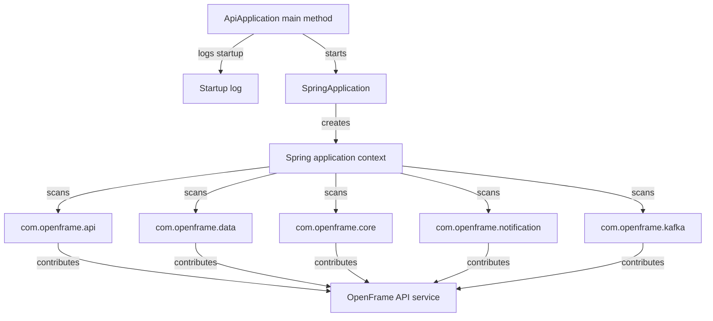
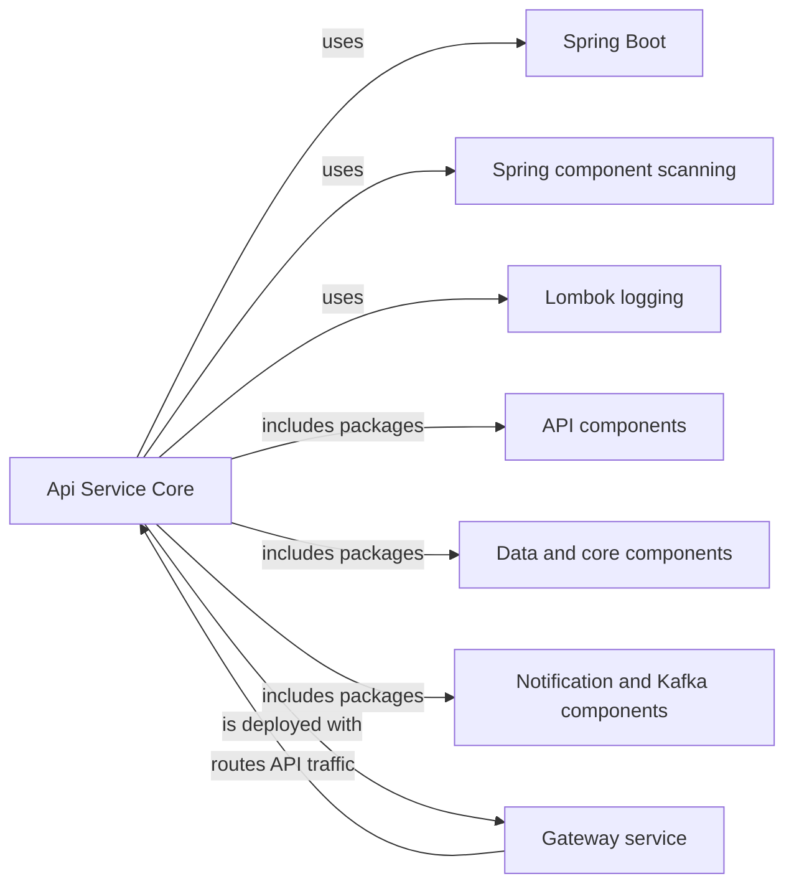
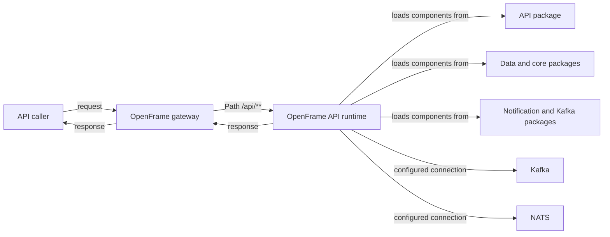
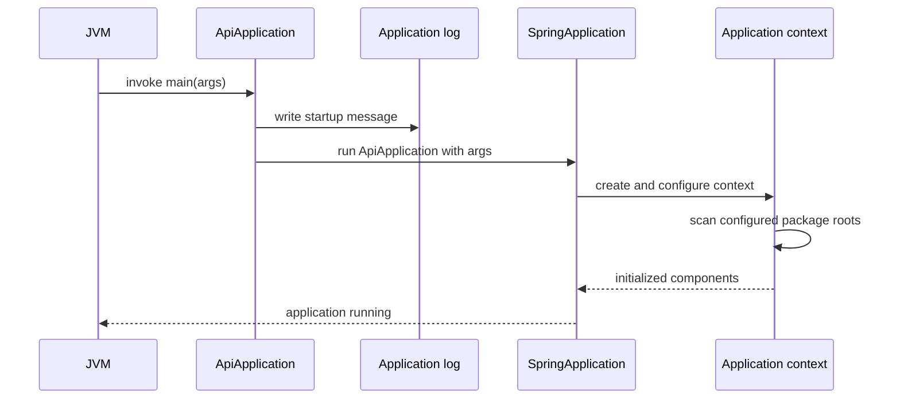

# Api Service Core

Api Service Core is the Spring Boot entry point for the OpenFrame API service. Its `ApiApplication` class starts the service, emits an early startup log message, and defines the component-scan boundary that assembles API, data, core, notification, and Kafka capabilities into one application context. The module deliberately contains bootstrap wiring rather than request handlers or domain logic.

The implementation is available in [ApiApplication.java](https://github.com/flamingo-stack/openframe-oss-tenant/blob/main/openframe/services/openframe-api/src/main/java/com/openframe/api/ApiApplication.java).

## Responsibilities

- Start the OpenFrame API process through Spring Boot.
- Log `Starting OpenFrame API` before Spring begins application-context creation.
- Discover Spring components in five package roots: `com.openframe.api`, `com.openframe.data`, `com.openframe.core`, `com.openframe.notification`, and `com.openframe.kafka`.
- Establish the composition boundary through which the API service incorporates tenant-specific and library-provided capabilities.

Api Service Core does not define HTTP mappings, persistence repositories, message consumers, or notification implementations itself. Those are supplied by components discovered under the configured package roots and by the service dependencies.

## Bootstrap Architecture

`@SpringBootApplication` enables Spring Boot configuration and component discovery. The explicit `@ComponentScan` supplements the application package with shared OpenFrame packages, so relocations or package-name changes in any of those roots can change which beans are available at startup.

## Component Dependencies

At the platform level, the gateway is configured to forward the `/api/**` route to the OpenFrame API service. The authorization server, client service, config server, external API service, management service, and stream service are separately bootstrapped applications in the same tenant deployment; Api Service Core does not start them in-process.

The repository consumes OpenFrame OSS Library Maven artifacts at version `7.0.11`, including API, core, data, Kafka-related service capabilities, notification support, and security integrations. Api Service Core integrates those capabilities only through its Spring application context; their internal implementation belongs to the upstream library.

## Runtime Data and Integration Boundary

The tenant configuration provides the API service with Kafka bootstrap servers through `spring.oss-tenant.kafka.bootstrap-servers` and a NATS server through `nats.spring.server`. Shared configuration also defines MongoDB, Redis, Cassandra, and Pinot settings for the deployment. The bootstrap class does not directly read, validate, publish to, or consume from these systems; the actual behavior depends on the discovered components and their configuration.

## Startup Process

The startup path is intentionally small:

1. The JVM invokes `ApiApplication.main(String[] args)`.
2. Lombok supplies the `log` field used to record the startup message.
3. `SpringApplication.run(ApiApplication.class, args)` passes command-line arguments to Spring Boot.
4. Spring Boot creates the application context and applies auto-configuration.
5. The configured package roots are scanned, and eligible components are registered.
6. The process remains active as the OpenFrame API runtime once initialization succeeds.

A failure in classpath resolution, configuration binding, auto-configuration, or bean creation prevents the service from becoming ready. The bootstrap class neither catches nor transforms those failures, allowing Spring Boot to report them through its standard startup diagnostics.

## Operational Considerations

### Component Scan as a Contract

The explicit scan list is a runtime contract. New API-facing components should be placed under an existing scan root or the scan configuration must be updated deliberately. Conversely, removing a root may silently exclude controllers, services, configuration, or integrations that previously became beans.

### Configuration and Deployment

Api Service Core accepts the standard Spring Boot argument flow by forwarding `args` unchanged. Runtime configuration therefore belongs in the deployment configuration and Spring property sources rather than in `ApiApplication`.

The release pipeline publishes an `openframe-api` container image, and the tenant chart deploys that image alongside the gateway and the other OpenFrame services. Gateway routing is the normal ingress path for the API service in the documented tenant topology.

### Observability

The only logging performed directly by this module is the informational startup message. More detailed request, data-access, messaging, and notification telemetry is produced only if the discovered components and their logging configuration provide it.

## Maintenance Guide

When changing Api Service Core:

1. Preserve `@SpringBootApplication` unless replacing Spring Boot startup behavior intentionally.
2. Treat changes to the component-scan list as compatibility-sensitive changes to the application context.
3. Keep the startup log message meaningful because it is emitted before Spring context initialization.
4. Validate the service with its tenant configuration, especially when changes affect Kafka, NATS, or shared data components.
5. Confirm gateway routing remains aligned with the `/api/**` service path when deployment configuration changes.

The class is the narrow composition root for the OpenFrame API service. Keep business workflows and transport-specific logic in scanned components so this entry point remains predictable, minimal, and easy to operate.
