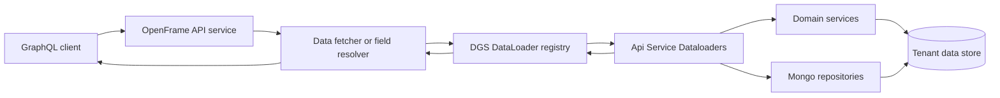
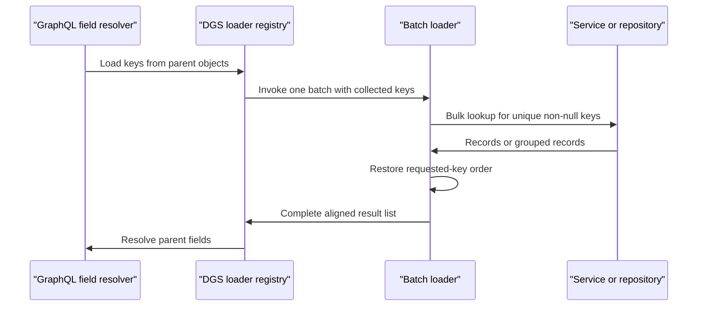
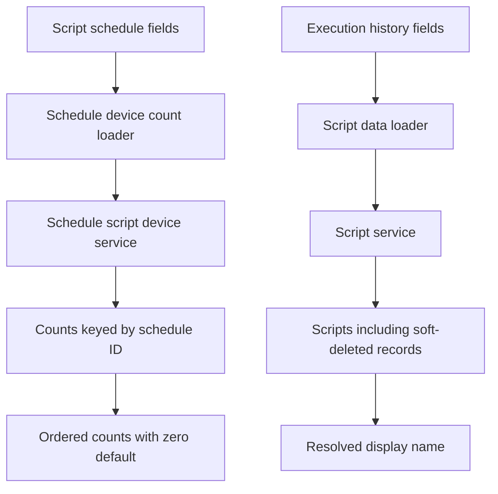

# Api Service Dataloaders

Api Service Dataloaders is the OpenFrame API's GraphQL batching layer. It is supplied at runtime by the `com.openframe.oss:openframe-api-service-core` library (version `7.0.11`) and is assembled by this repository's `openframe-api` service. The module defines twelve Netflix DGS `BatchLoader` implementations that coalesce field-resolution requests, delegate bulk reads to domain services or repositories, and return results in the exact order of the requested keys.

Its primary purpose is to avoid the GraphQL N+1 query pattern. Rather than independently loading a relationship for every parent object, DGS collects keys within a request and invokes a corresponding loader once for the batch.

## Scope and System Position

The loaders sit between GraphQL data fetchers and the API/domain data layer. They do not expose HTTP routes, persist data, or define GraphQL types. Data fetchers and field resolvers request values by named loader, while the loaders either call a domain service or execute a repository bulk lookup.

The module is implemented in the OpenFrame OSS Library, not in this repository. The API service consumes that library together with the API data fetcher, backend service, relay, and Mongo data modules. For deployment configuration and service routing, see platform documentation.

## Batch Loading Contract

Every loader is registered using `@DgsDataLoader` and implements `BatchLoader<Key, Value>`. The returned list has one entry per input key at the same position:

- Duplicate keys remain duplicated in the result even when the underlying lookup de-duplicates keys for efficiency.
- A null input key produces a null output for single-value loaders.
- A missing single-value record resolves to null rather than changing list length.
- Collection loaders return a list of collections whose position must correspond to the input-key sequence; their delegated service owns that grouping and ordering contract.
- Most loaders run their lookup through `CompletableFuture.supplyAsync`. The schedule-device-count loader computes its batch synchronously and wraps the ordered result with `CompletableFuture.completedFuture`.

## Loader Inventory

| Area | DGS loader name | Key | Result | Delegation |
|---|---|---|---|---|
| Device relationships | `installedAgentDataLoader` | Machine ID | Installed-agent list | `InstalledAgentService` |
| Device relationships | `tagDataLoader` | Machine ID | Tag list | `TagService` |
| Device relationships | `toolConnectionDataLoader` | Machine ID | Tool-connection list | `ToolConnectionService` |
| Polymorphic assignment | `machineDataLoader` | Machine ID | Machine | `MachineRepository` |
| Polymorphic assignment | `ticketDataLoader` | Ticket ID | Ticket | `TicketRepository` |
| Polymorphic assignment | `knowledgeBaseItemDataLoader` | Item ID | Knowledge-base item | `KnowledgeBaseItemRepository` |
| Knowledge base | `knowledgeBaseAttachmentDataLoader` | Item ID | Attachment list | `KnowledgeBaseAttachmentService` |
| Knowledge base | `knowledgeBaseTagDataLoader` | Item ID | Tag list | `KnowledgeBaseTagService` |
| Knowledge base | `userDataLoader` | User ID | User response | `UserService` |
| Scripts and schedules | `scriptDataLoader` | Script ID | Script response | `ScriptService` |
| Scripts and schedules | `scriptTagDataLoader` | Script ID | Tag list | `ScriptTagService` |
| Scripts and schedules | `scriptScheduleDeviceCountDataLoader` | Schedule ID | Device count | `ScheduleScriptDeviceService` |

## Device and Assignment Resolution

### Machine, Ticket, and Knowledge Base Item

`MachineDataLoader`, `TicketDataLoader`, and `KnowledgeBaseItemDataLoader` provide single-object resolution for assignable targets. They support device, ticket, and knowledge-article target types respectively. Each loader filters null keys, reduces remaining keys to a set for a single bulk query, indexes returned entities by identifier, then reconstructs the response list from the original input sequence.

This reconstruction is essential: repository result order is not treated as a GraphQL contract. A missing ID is returned as null in the same slot, so one absent entity cannot associate later results with the wrong parent.

`KnowledgeBaseItemDataLoader` queries `findByIdIn`, `MachineDataLoader` queries `findByMachineIdIn`, and `TicketDataLoader` queries `findAllById`. These direct repository paths make the loaders appropriate for entity resolution; tenant isolation and repository behavior are supplied by the configured data layer.

Source files: [Machine Data Loader](https://github.com/flamingo-stack/openframe-oss-lib/blob/7a766f00e4f58b5d89db007b878ac8d6e0c344f4/openframe-api-service-core/src/main/java/com/openframe/api/dataloader/MachineDataLoader.java), [Ticket Data Loader](https://github.com/flamingo-stack/openframe-oss-lib/blob/7a766f00e4f58b5d89db007b878ac8d6e0c344f4/openframe-api-service-core/src/main/java/com/openframe/api/dataloader/TicketDataLoader.java), and [Knowledge Base Item Data Loader](https://github.com/flamingo-stack/openframe-oss-lib/blob/7a766f00e4f58b5d89db007b878ac8d6e0c344f4/openframe-api-service-core/src/main/java/com/openframe/api/dataloader/KnowledgeBaseItemDataLoader.java).

### Machine-Owned Collections

`InstalledAgentDataLoader`, `TagDataLoader`, and `ToolConnectionDataLoader` batch collections associated with machines. Their services receive the complete machine-ID list and return one collection per requested machine. This allows a device list to resolve installed agents, tags, or tool connections with a bulk service operation rather than one call per device.

Source files: [Installed Agent Data Loader](https://github.com/flamingo-stack/openframe-oss-lib/blob/7a766f00e4f58b5d89db007b878ac8d6e0c344f4/openframe-api-service-core/src/main/java/com/openframe/api/dataloader/InstalledAgentDataLoader.java), [Tag Data Loader](https://github.com/flamingo-stack/openframe-oss-lib/blob/7a766f00e4f58b5d89db007b878ac8d6e0c344f4/openframe-api-service-core/src/main/java/com/openframe/api/dataloader/TagDataLoader.java), and [Tool Connection Data Loader](https://github.com/flamingo-stack/openframe-oss-lib/blob/7a766f00e4f58b5d89db007b878ac8d6e0c344f4/openframe-api-service-core/src/main/java/com/openframe/api/dataloader/ToolConnectionDataLoader.java).

## Knowledge Base Enrichment

Knowledge-base fields are resolved through three complementary loaders:

- `KnowledgeBaseAttachmentDataLoader` retrieves attachment lists grouped by article or item ID and emits a debug log containing the batch size.
- `KnowledgeBaseTagDataLoader` retrieves tags assigned to each knowledge-base item.
- `UserDataLoader` resolves the author as a `UserResponse` through `UserService`, rather than accessing a user repository directly. This preserves service-level user processing, including configured enrichment such as image data.

Like the other single-object loaders, `UserDataLoader` uses a unique non-null ID set for the service request and maps its responses back to the original sequence. The knowledge-base attachment and tag services are responsible for producing groups aligned with the supplied item IDs.

Source files: [Knowledge Base Attachment Data Loader](https://github.com/flamingo-stack/openframe-oss-lib/blob/7a766f00e4f58b5d89db007b878ac8d6e0c344f4/openframe-api-service-core/src/main/java/com/openframe/api/dataloader/KnowledgeBaseAttachmentDataLoader.java), [Knowledge Base Tag Data Loader](https://github.com/flamingo-stack/openframe-oss-lib/blob/7a766f00e4f58b5d89db007b878ac8d6e0c344f4/openframe-api-service-core/src/main/java/com/openframe/api/dataloader/KnowledgeBaseTagDataLoader.java), and [User Data Loader](https://github.com/flamingo-stack/openframe-oss-lib/blob/7a766f00e4f58b5d89db007b878ac8d6e0c344f4/openframe-api-service-core/src/main/java/com/openframe/api/dataloader/UserDataLoader.java).

## Script and Schedule Enrichment

`ScriptDataLoader` resolves `ScriptResponse` objects by script ID for execution history. In particular, a field resolver can obtain a script display name at read time rather than storing a name snapshot in every history row. It calls `ScriptService.getScriptsByIds`, which deliberately includes soft-deleted scripts so historical records can still resolve their script name. Unknown and null IDs resolve to null without breaking positional alignment.

`ScriptTagDataLoader` mirrors the knowledge-base tag pattern for `Script.tags`: a batch of script IDs produces a batch of tag lists through `ScriptTagService`.

`ScriptScheduleDeviceCountDataLoader` receives schedule IDs, fetches a map of counts in one call, and maps each requested ID to its count. An ID not present in the map becomes `0`, yielding a concrete count for every requested schedule.

Source files: [Script Data Loader](https://github.com/flamingo-stack/openframe-oss-lib/blob/7a766f00e4f58b5d89db007b878ac8d6e0c344f4/openframe-api-service-core/src/main/java/com/openframe/api/dataloader/ScriptDataLoader.java), [Script Tag Data Loader](https://github.com/flamingo-stack/openframe-oss-lib/blob/7a766f00e4f58b5d89db007b878ac8d6e0c344f4/openframe-api-service-core/src/main/java/com/openframe/api/dataloader/ScriptTagDataLoader.java), and [Script Schedule Device Count Data Loader](https://github.com/flamingo-stack/openframe-oss-lib/blob/7a766f00e4f58b5d89db007b878ac8d6e0c344f4/openframe-api-service-core/src/main/java/com/openframe/api/dataloader/ScriptScheduleDeviceCountDataLoader.java).

## Maintenance Considerations

- **Preserve positional output.** Any new bulk lookup must rebuild results using the original key list, not database return order.
- **Keep tenant-aware service paths where present.** The script and user loaders intentionally use domain services because those services apply behavior beyond raw entity lookup.
- **Treat soft deletion deliberately.** Script history requires deleted scripts to remain resolvable; replacing the service lookup with a default repository query could regress history rendering.
- **Maintain collection-group alignment.** When modifying a delegated service for installed agents, tags, tool connections, or knowledge-base attachments, verify it returns one group per input key in matching order.
- **Choose asynchronous execution intentionally.** The current loaders generally use the default `CompletableFuture` asynchronous executor. A change to execution strategy should consider request concurrency and data-store capacity.
- **Test absent, null, duplicate, and out-of-order keys.** These cases protect the data-loader contract and catch accidental map-order coupling.

## Source Ownership

All code documented here is provided by the OpenFrame OSS Library artifact `com.openframe.oss:openframe-api-service-core` at version `7.0.11`. This repository packages and runs it as part of the OpenFrame API service; source changes belong in the library repository.
