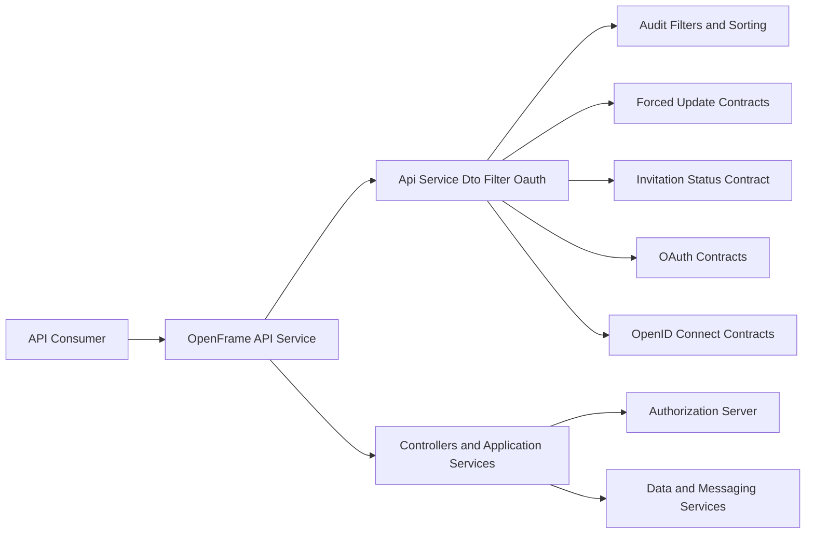
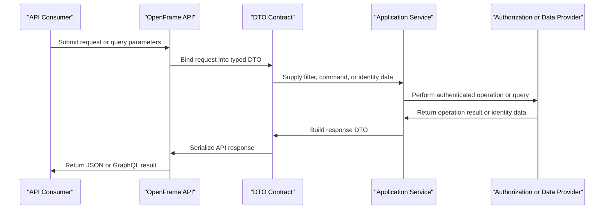

# Api Service Dto Filter Oauth

Api Service Dto Filter Oauth defines small, transport-facing Java data transfer objects for the OpenFrame API. The types shape GraphQL filtering and sorting, REST-style update commands, OAuth exchange payloads, and OpenID Connect discovery and user-info payloads. They contain data and serialization metadata rather than business logic.

The module is supplied by the `com.openframe.oss:openframe-api-service-core` library at version `7.0.11`. In this repository, that library runs with the OpenFrame API service. The source files belong to [OpenFrame OSS Library](https://github.com/flamingo-stack/openframe-oss-lib/tree/7a766f00e4f58b5d89db007b878ac8d6e0c344f4/openframe-api-service-core/src/main/java/com/openframe/api/dto).

## Purpose and Boundaries

The module establishes typed API contracts for five concerns:

- audit-log filtering and timestamp sorting;
- bulk client and tool update requests and their aggregate response;
- invitation status changes;
- OAuth authorization-code and token-exchange representations; and
- OpenID Connect discovery and user-profile representations.

Validation, authorization, persistence, token minting, invitation processing, and update dispatch are deliberately outside this module. API controllers, processors, and authorization services consume these payloads and enforce those behaviors.

## Architecture Overview

The DTO layer sits at the API boundary. It converts structured wire data into typed Java values and, for selected classes, maps Java-style properties to standards-compliant JSON names with Jackson annotations. Lombok generates the ordinary accessors, builders, and constructors used by callers.

## Contract Families

| Family | Role | Key types |
| --- | --- | --- |
| Audit | Narrows audit-log queries and expresses a typed sort order. | `LogFilterInput`, `LogSortInput`, `LogSortField` |
| Forced updates | Identifies target machines and, for tools, the tool agent to update. | `ForceClientUpdateRequest`, `ForceToolUpdateRequest`, `ForceToolAgentUpdateResponse` |
| Invitations | Requires an invitation status during a status update. | `UpdateInvitationStatusRequest` |
| OAuth | Represents authorization-code flow inputs and token or authorization results. | `AuthorizationResponse`, `GoogleTokenRequest`, `SocialAuthRequest`, `TokenResponse` |
| OpenID Connect | Publishes provider metadata and represents user-info input and output. | `OpenIDConfiguration`, `UserInfoRequest`, `UserInfo` |
| Organization sorting | Exposes the currently supported organization ordering field. | `OrganizationSortField` |

## Data Flow

## Detailed Contract Documentation

- [Audit Filters](api_service_dto_filter_oauth/audit_filters/audit_filters.md) documents audit-log range, categorical, scope, and typed sorting inputs.
- [Forced Updates](api_service_dto_filter_oauth/forced_updates/forced_updates.md) documents bulk client and tool update command envelopes.
- [OAuth Contracts](api_service_dto_filter_oauth/oauth_contracts/oauth_contracts.md) documents authorization-code, PKCE, redirect, and token-response representations.
- [Openid Connect](api_service_dto_filter_oauth/openid_connect/openid_connect.md) documents discovery metadata and user-info input and output contracts.
- [Invitation And Organization](api_service_dto_filter_oauth/invitation_and_organization/invitation_and_organization.md) documents invitation status mutation input and organization sorting.

## Integration Context

- The API configuration and controller layer supplies request binding, GraphQL scalars, authentication configuration, and endpoints.
- The API backend supplies audit-log querying and application services that act on filters and commands.
- The authorization server and security OAuth library implement authentication, authorization, redirect handling, and token issuance; these DTOs only express interoperable inputs and outputs.
- Mongo repositories may persist OAuth tokens and invitation-related state, but this module does not access a repository directly.

## Compatibility Notes

- OAuth JSON uses protocol-standard snake-case properties such as `access_token`, `refresh_token`, `code_verifier`, and `redirect_uri`.
- OpenID Connect metadata uses discovery-field names such as `authorization_endpoint`, `jwks_uri`, and `scopes_supported`.
- `UserInfo` omits properties whose values are `null`, allowing either identity claims or an error payload without serializing unused fields.
- `LogSortField` currently permits only `TIMESTAMP`, while `OrganizationSortField` currently permits only `LAST_ACTIVITY`. Adding fields changes the public GraphQL contract and should be coordinated with the corresponding query implementation.
