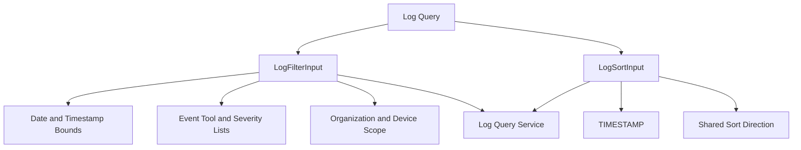

# Audit Filters

Audit Filters provides the GraphQL input contracts used to constrain and order log queries. The types are part of the OpenFrame OSS Library artifact `com.openframe.oss:openframe-api-service-core`, consumed by this repository's OpenFrame API service.

## Components

| Component | Responsibility |
| --- | --- |
| [`LogFilterInput`](https://github.com/flamingo-stack/openframe-oss-lib/blob/7a766f00e4f58b5d89db007b878ac8d6e0c344f4/openframe-api-service-core/src/main/java/com/openframe/api/dto/audit/LogFilterInput.java) | Carries optional date, instant, event-type, tool-type, severity, organization, and device constraints. |
| [`LogSortInput`](https://github.com/flamingo-stack/openframe-oss-lib/blob/7a766f00e4f58b5d89db007b878ac8d6e0c344f4/openframe-api-service-core/src/main/java/com/openframe/api/dto/audit/LogSortInput.java) | Couples a typed field with shared `SortDirection`. |
| [`LogSortField`](https://github.com/flamingo-stack/openframe-oss-lib/blob/7a766f00e4f58b5d89db007b878ac8d6e0c344f4/openframe-api-service-core/src/main/java/com/openframe/api/dto/audit/LogSortField.java) | Limits log sorting to `TIMESTAMP`. |

## Filter Semantics

`LogFilterInput` allows a caller to supply both calendar-date bounds (`startDate`, `endDate`) and precise instant bounds (`timestampFrom`, `timestampTo`). It also accepts list-valued categorical filters and identifiers. All fields are optional at this DTO boundary; the query service determines validation, defaulting, and combination semantics.

## Maintenance Considerations

These types are API schema. Keep field names and enum values stable when possible. Add a sort field only after the audit query layer can implement it consistently, and document how date and instant ranges interact before changing their behavior.
