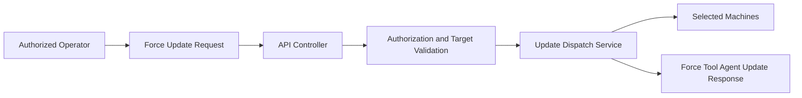

# Forced Updates

Forced Updates defines request and response envelopes for commanding client or integrated-tool updates on selected machines. The contracts are passive data carriers; controller and update-dispatch code performs authorization, target validation, delivery, and status collection.

## Components

| Component | Responsibility |
| --- | --- |
| [`ForceClientUpdateRequest`](https://github.com/flamingo-stack/openframe-oss-lib/blob/7a766f00e4f58b5d89db007b878ac8d6e0c344f4/openframe-api-service-core/src/main/java/com/openframe/api/dto/force/request/ForceClientUpdateRequest.java) | Contains the `machineIds` selected for an OpenFrame client update. |
| [`ForceToolUpdateRequest`](https://github.com/flamingo-stack/openframe-oss-lib/blob/7a766f00e4f58b5d89db007b878ac8d6e0c344f4/openframe-api-service-core/src/main/java/com/openframe/api/dto/force/request/ForceToolUpdateRequest.java) | Contains target `machineIds` plus the `toolAgentId` identifying the tool to update. |
| [`ForceToolAgentUpdateResponse`](https://github.com/flamingo-stack/openframe-oss-lib/blob/7a766f00e4f58b5d89db007b878ac8d6e0c344f4/openframe-api-service-core/src/main/java/com/openframe/api/dto/force/response/ForceToolAgentUpdateResponse.java) | Returns an `items` collection of per-target update result items. |

## Command Flow

## Contract Boundary

The request classes do not use validation annotations, so callers of this module must not assume that a nonempty machine list or tool identifier is guaranteed merely by deserialization. The operation layer should establish required-field and tenancy rules. The response exposes the aggregate `items` list while the item type provides the per-machine detail outside the components documented here.
