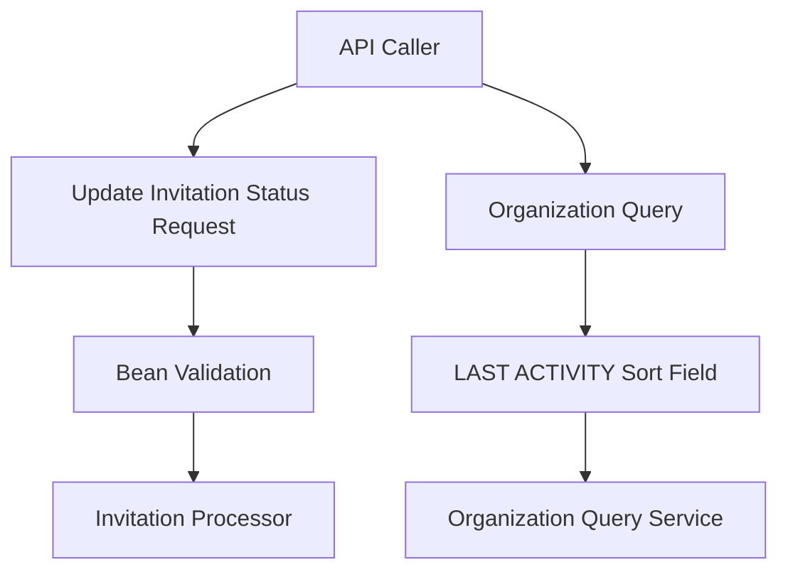

# Invitation And Organization

Invitation And Organization contains two compact, typed API contracts: a required invitation status mutation input and the allowed sort-field enumeration for organization queries.

## Components

| Component | Responsibility |
| --- | --- |
| [`UpdateInvitationStatusRequest`](https://github.com/flamingo-stack/openframe-oss-lib/blob/7a766f00e4f58b5d89db007b878ac8d6e0c344f4/openframe-api-service-core/src/main/java/com/openframe/api/dto/invitation/UpdateInvitationStatusRequest.java) | Carries an `InvitationStatus` and marks it `@NotNull` for Jakarta Bean Validation. |
| [`OrganizationSortField`](https://github.com/flamingo-stack/openframe-oss-lib/blob/7a766f00e4f58b5d89db007b878ac8d6e0c344f4/openframe-api-service-core/src/main/java/com/openframe/api/dto/organization/OrganizationSortField.java) | Restricts organization ordering to `LAST_ACTIVITY`. |

## Processing Boundaries

The non-null status annotation ensures the field is present when validation is invoked; it does not express which status transitions are allowed. Transition rules belong to invitation processing. `OrganizationSortField` intentionally contains only `LAST_ACTIVITY`, preserving a typed surface while leaving room for supported ordering options to expand alongside query capabilities.
